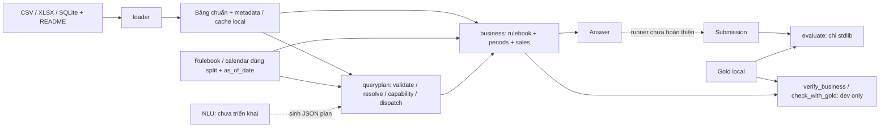

# DataMate - Gemini review packet, round 002

Source revision: `d99cac2620927702704e8efa93cfffdf3ca14cf0`. Source working tree at revision capture: clean.

Snapshot generated 2026-10-29, Asia/Saigon. This packet is for review; no response has been received.

All source blocks below are complete UTF-8 Git blobs at the pinned revision. Historical references in docs are evidence history, not current implementation instructions. No competition question/answer rows, private catalogs, caches, credentials or environment are included. The loader is unchanged and not included: decline to certify loader correctness from this packet.

## Review request

# Vòng 002 — Hiện trạng có đủ tin cậy để đi tiếp chưa?

Ngày 2026-10-29 (Asia/Saigon). Bên gửi: Codex, theo yêu cầu người dùng mời Gemini phản biện. Đây là review trạng thái sau QueryPlan executor, inventory/verifier độc lập và audit annotation; không phải tiếp tục áp patch ở vòng 001. Chưa có phản hồi Gemini vòng 002.

## Revision và mục tiêu

Source review: commit `d99cac2` trên nhánh `VuongNguyen`, repo `nguyenthanhnguyen10062021-dotcom/zalo-datamate-2026`. Commit nền executor `4fd268e`. File `GEMINI_HANDOFF.md` kèm bản chụp từ Git object của revision review, SHA256 từng file và synthetic tests; không cần truy cập đường dẫn local hoặc GitHub để đọc source.

Người dùng muốn biết trạng thái hiện tại đã đủ tốt để phát triển tiếp hay đang có khoảng trống/lỗi khiến kết quả kiểm chứng thiếu tin cậy. Đề nghị review độc lập, không chỉ xác nhận lại tài liệu. Phân biệt rõ: lỗi implementation có thể tái hiện; giới hạn capability được chọn có chủ ý; điểm thiếu bằng chứng; ưu tiên sản phẩm.

## Dữ kiện và giới hạn

- Runtime hiện có loader → bảng chuẩn → business; QueryExecutor validate/resolve/capability/dispatch gọi 10 API. Không model hoặc pipeline NLU hoàn chỉnh. Inference tương lai phải offline, eligible open weights <=15B; chưa chọn model/runtime.
- Verifier mới dev-only tách khỏi legacy. Inventory chỉ dùng câu hỏi để tạo manifest toàn corpus, freeze trước scoring. Verifier kiểm fingerprints rồi execute predictions trước đọc gold; dùng evaluator local cho type/format/value, không tự viết comparator list. Không chứng nhận evaluator local tương đương BTC.
- Train: 3000 câu, manifest v2 chọn **126**, ngoài selection **2874**. Selected chạm 7 API; top_products/top_customers/revenue_share có tests synthetic nhưng chưa chọn câu train. **125 compared =125 matched+0 mismatch;1 abstained;0 execution_errors;selected vẫn126**. Lệnh trả exit1 do abstain. Đây không phải PA toàn train/model, cũng không chứng minh plan được hiểu đúng nếu đáp án tình cờ trùng.
- Baseline legacy riêng: chọn417/3000, legacy skip8, compared/matched_gold/matched_legacy409/409, errors0. Không đo giao với126 nên không cộng số câu. Đây là evidence đã chạy ở lượt trước, không chấm lại trong lượt chuẩn bị packet.
- Audit không mở answers/report gold từng câu hoặc chạy scorer trong chính lượt audit. Lấy 10 câu mỗi reason bucket (40) và unit case (1), freeze sample rồi AI annotate. Mẫu40 có22 supported_plan,14 thiếu capability,4 domain chưa hỗ trợ; cộng unit case có23 plan đề xuất/41. Không ngoại suy tỷ lệ mẫu. Annotation chưa human/independent adjudication; agent đã thấy aggregate scores và train đã được dùng phát triển, không phải blind holdout.
- Ca abstain đã audit: **intent tiền/doanh thu nhầm thành quantity(unit tiền)**; theo rulebook tiền bán là revenue. Chưa sửa grammar, chưa thêm alias hoặc đổi unanswerable. Full câu hỏi/data doanh nghiệp không nằm trong gói này; chỉ cung cấp kết luận tổng hợp và ví dụ synthetic.
- Hai lỗi trước đó (mất dấu unit, gộp filter hai vế so sánh) được review synthetic và sửa RED→GREEN. Manifest/report v1 giữ nguyên; v2 có fingerprint selector mới. Không mở grammar theo kết quả sai/đúng của train trong lượt đó.
- Kiểm tra vừa chạy trên source sắp commit d99cac2: harness full **487 passed,2 local_data deselected**, bare pytest **488 passed,1 skip helper evaluator cũ tìm sai answers path**; fast passed. Hosted CI/Linux chưa xác nhận. Data regression nêu trên thuộc lượt trước; chưa chấm thêm gold ở audit hoặc lúc chuẩn bị review.

## Năm câu hỏi cần phản biện

1. **Implementation có thực thi đúng contract và đủ chặt để làm nền không?** Rà selector, manifest, runner, annotation utility, executor và đường IO. Tìm phản chứng tổng hợp về mất scope/qualifier, thời gian neo sai, nhãn/đơn vị, selection theo gold/legacy, input snapshot/fingerprint, mẫu số lỗi/abstain, comparator type/list/alias. Với lỗi Important/Critical hãy chỉ source line, input tối thiểu, expected/actual và regression test. Chỉ ra phần không thể kết luận nếu thiếu dữ liệu.
2. **Mức tin cậy của đánh giá hiện tại là gì?** 125/125 compared và 409/409 legacy chứng minh được gì? Có selection bias, accidental-answer agreement, stale/mixed input, thiếu coverage API/period/filter hoặc denominator chưa được test nào cần chặn trước bước kế? Phân biệt integrity do hash với correctness của plan và khả năng tổng quát hóa.
3. **Audit annotation có đủ dùng làm dev specification không?** Với AI annotations đã tiếp xúc aggregate/train, mẫu nhỏ theo reason/business và không có human adjudication: đề xuất validation/adjudication tối thiểu để tránh tự xác nhận hoặc lexical overfit. Không yêu cầu BTC rows/gold upload; hãy dùng synthetic contrast tests hoặc quy trình local có provenance. Có nên giữ nhóm plan-valid nhưng không execute trong một loại trạng thái khác?
4. **Nên ưu tiên điều gì trong hai bước tiếp theo?** Codex đang nghiêng về sửa intent tiền bằng regression tổng hợp, rồi mở các họ grammar có annotation; nhưng phương án khác là dừng đầu tư grammar ở baseline dev và tích hợp model offline sớm. Hãy phản biện lựa chọn này, nêu tradeoff, điều kiện dừng và acceptance checks đo được. Đừng đề xuất một roadmap dài không có cổng kiểm chứng.
5. **Ranh giới tối thiểu trước NLU/runner là gì?** Có cần thêm scalar/top1, growth đa metric hoặc hai filter scope ngay, hay tiếp tục reject rõ? Phân biệt bug cần sửa với capability mới. Đưa ra gate rõ cho baseline đầu-cuối đầu tiên; tránh refactor business hoặc chuyển SQL chỉ vì thích kiến trúc khác khi chưa có phản chứng/benchmark.

## Một số ca tổng hợp để thử phản chứng

Các câu dưới đây được viết làm minh họa synthetic, không phải bản sao rows train; không có nhãn gold BTC:

- `Tháng 9/2024 ca sáng bán được bao nhiêu tiền?` — cần phân biệt revenue với quantity.
- `Bán được bao nhiêu phần trong tháng 9/2024?` — giữ dấu đơn vị; không gán mọi “bao nhiêu X” là tiền.
- `Doanh thu tháng 1/2024 tăng bao nhiêu phần trăm so với tháng liền trước?` — kỳ trước là tháng12/2023, không phải trước as_of.
- `Doanh thu kênh "A" tuần này thay đổi bao nhiêu % so với tuần trước thanh toán "B"?` — hai filter scope không tự gộp vào một Filters.
- `Trong tháng 9/2024, khách nào mua nhiều đơn nhất?` — thiếu contract scalar; không tự coi list một phần tử là string.
- Đổi raw label thành list/dict; thiếu cache; duplicate/missing gold; thay corpus/plan rồi replay manifest; đổi thứ tự list/alias; thử output symlink/trùng input, file bị thay trong lúc replay. Đề nghị phân loại theo contract và mức ưu tiên, không mặc định mọi hạn chế là bug.

## Định dạng kết quả

Trả lời bằng tiếng Việt. Mở đầu với verdict riêng cho **nền tính toán/executor**, **đánh giá/phương pháp**, **sẵn sàng baseline đầu-cuối**: đạt / đạt có điều kiện / chưa đạt / chưa đủ bằng chứng, kèm gate cụ thể. Sau đó findings theo mức ảnh hưởng, căn cứ file:line, synthetic reproduction/test, độ chắc chắn; cuối cùng chọn đúng hai việc tiếp theo và các claims dự án cần rút lại nếu có. Nếu không tìm thấy lỗi hãy ghi đúng phạm vi đã kiểm, không chứng nhận toàn hệ thống hoặc tự tuyên bố đã chạy test.

Hãy tạo và đính kèm toàn bộ phản hồi dưới dạng file Markdown UTF-8 tải xuống được, tên **`GEMINI_RESPONSE_01.md`** cho **vòng002**, lượt01. Ghi ngày, revision, file đã thực sự đọc; chỉ ghi model nếu biết chắc. Không tạo placeholder hoặc bịa kết quả chạy. Nếu không đính kèm file được, xuất toàn bộ nội dung trong **một khối code bốn backtick nhãn markdown**, các code block bên trong dùng ba backtick. Không tuyên bố đã tạo file tải xuống nếu chỉ có text.


## Source manifest (SHA256 of Git blob bytes)

| Path | Bytes | SHA256 |
|---|---:|---|

| `docs/PROGRESS.md` | 15198 | `454d4acd5e66e7b59cba0d0940eac0ac4dffc938fd5b50cd5f9168c8a9f17763` |

| `docs/architecture.md` | 4045 | `0e23a17d73649b11378e75809225ea09718b3d219b00e953eddc9db6cc632129` |

| `docs/business.md` | 8837 | `1a9efa800c9e0205ebb25e84eea90ec1227f05e0caf388bc88c0d351306bf92d` |

| `docs/queryplan.md` | 8835 | `812212470cfdd97192b03632f376d37d53b45b122c09e5c7e3041604310a9272` |

| `docs/capability-verification.md` | 7670 | `a44fba802860af2f18a2abebdae52ef7fade7827aae529270e472ae35b1c20a3` |

| `docs/plan-annotation-audit.md` | 6875 | `3cae3f549ac7232636bfff76f0943df745918bb9e9f86abbb634facdfe8a2829` |

| `docs/validation.md` | 14717 | `f5df6dbb449d61e09e7558cb96080d86176123797b88fc5837816074eca82d36` |

| `docs/superpowers/specs/2026-10-29-capability-verifier.md` | 5072 | `eea4d48485be0602ebd3aefcfcd93f97abf4c2243582223b8684282d9fe67ed6` |

| `verification/__init__.py` | 82 | `7104a0c80ef3075214c448e2b055f442695dadb3e0717a757a5344fdd312ab9f` |

| `verification/AGENTS.md` | 945 | `60400770303ca8a4aa944d2614bf5f93c65f1ae3fd6ef15b766e3d91ed256fc4` |

| `verification/selection.py` | 7558 | `7aaec0b49a390cfbcdc1130b05e7447d2aec9dc6266c913196b162ce7c187a4e` |

| `verification/manifest.py` | 6765 | `744cca84c91524c0fdf0d77d89f8bf876d9003f92d36bd61973f685162de1925` |

| `verification/runner.py` | 6635 | `919f07c5188b80b5f12f6c6bd0e51ea09af8d13bc0b877d38f76212b4035ef1a` |

| `verification/audit.py` | 4435 | `5161863707b3a74c2fc428769dc5a76a171be26441391f6a3253aa687df7b4c4` |

| `inventory_capabilities.py` | 1003 | `0b87736fe3809d0f2976b2529a91a1cf0fc7d073132eff9c365f6f97bb7ac16c` |

| `verify_queryplans.py` | 2067 | `8cad65683b12363fe7351a06da605b6f0c25a215faa427f0f7443dc07338b070` |

| `queryplan/__init__.py` | 280 | `782a2e25eded126c564e20a01b70f329d6869b8a52cd2aa560c85c5b4d71d63f` |

| `queryplan/contract.py` | 8017 | `c0cc32e00c42aa25f8188e3986cc5cb5ab8270d2f62b3f508787f0171271d75c` |

| `queryplan/resolution.py` | 8296 | `e04b4710c841bda1681f7dc7c2fe798e47e141dd57d794f9eecf9c91f538fa85` |

| `queryplan/executor.py` | 5060 | `5f1748e4dd449513d6a9b0074bd0c4039c7b9387118a63eb0ed026b2b30b9310` |

| `business/__init__.py` | 336 | `6fba13fd1a176b4c1733aeb0bf6207bfc6f6907f49c837b4d5f751248b27d80c` |

| `business/rules.py` | 4123 | `9d448e1beb1bfc5e488c02cb2a9b872aed0a228efa83bff636c21dfc0d1d3422` |

| `business/periods.py` | 4798 | `317f0698d3d6a0130c6410e1994a23805ca99cfdab60681b91635bfb9359b87f` |

| `business/sales.py` | 18615 | `636c59bd394795075be7a0b3b9c9fa3f227a6105de96c73b27fca87b27cbe638` |

| `evaluate/evaluate.py` | 15455 | `4fe36ec255e57bb89a5601210d1ea82c8421b857d0c6316452a9a31558d9e2b0` |

| `tests/conftest.py` | 3207 | `3dee1c3b48aa2b5775600e75c792a54f4ea2757ae0632308f229aa90a18b5cac` |

| `tests/test_business_sales.py` | 17288 | `bb6abad7d3537c4cf1e30c9a3334e5aea40c84f0f95716e4555fed5d44b39b3c` |

| `tests/queryplan_fixtures.py` | 1100 | `7105fae60f1b7a7968f7aa908d3429d2b614df7916207226126c0ab95f907529` |

| `tests/test_queryplan_contract.py` | 4833 | `c5b3cee67bb35588cec5532fcfef814b51e6dee6dc6b576462bcb4b497eef610` |

| `tests/test_queryplan_executor.py` | 15597 | `c7076678a5c19de90cf77a68fbe18273923cf735cc0fcb357536302c41030d13` |

| `tests/test_capability_inventory.py` | 6035 | `fd639c9671fe9fe8ae3ef4f5e1474c76a589b369522331f5ec22bcb7d326dbb2` |

| `tests/test_queryplan_verification.py` | 7704 | `284b79a90cdec5e5026fdff8985c7746d4fc54527aa498714bdd99295a007958` |

| `tests/test_plan_annotation_audit.py` | 2886 | `db9dc26cae05a4223faf701c68136c2daf70f2e18cee11051455efe99771e9a2` |

| `scripts/harness.py` | 18540 | `2fd0b6a995e4678892fa6d448a1ae4e99401e4c404152884e7b56cf9c4aab5e2` |

| `tests/test_harness.py` | 9719 | `64ea4ac2a70e87429512b0b0af4f624b9e908f2b9de36b3a4b6c091adfbde480` |

| `requirements.txt` | 211 | `3a3409f16e5fcf08e6f0277b04e922b6228f181f8ed1e3a51b4ec319c81f34c4` |

| `pytest.ini` | 135 | `ce9e748b1ab204e998773522a81283ded59961ab3f8edc364d8d57faa0f9c336` |


## Full source snapshot


### File: docs/PROGRESS.md


````markdown

# Tiến độ và bàn giao cuối phiên — 2026-10-29

Ngày theo Asia/Saigon. Nhánh làm việc: `VuongNguyen`.

Người dùng yêu cầu commit/push inventory-verifier và audit annotation, đồng thời mở vòng phản biện Gemini mới. Xác định revision bàn giao bằng git log; các ghi chú “chưa commit/push” bên dưới thuộc thời điểm kiểm chứng trước bàn giao.

## Audit annotation trước khi mở grammar — cập nhật mới nhất 2026-10-29

Đã audit **41 ca local** không mở gold hoặc scorer trong lượt này: ca quantity chưa resolve và mẫu cố định **40 câu chưa parse**, 10 mỗi reason bucket. [Kết luận và provenance](plan-annotation-audit.md), [task/evidence](tasks/2026-10-29-plan-annotation-audit.md).

- Ca chưa resolve là **intent tiền/doanh thu bị nhầm thành quantity**, rulebook §1 quy định rõ; không phải catalog thiếu alias đơn vị. Annotation đề xuất revenue giữ tháng/ca. Chưa sửa grammar nên abstain v2 vẫn còn nguyên.
- Mẫu 40 câu: **22 supported_plan, 14 unsupported_capability, 4 unsupported_domain**. Cộng ca tiền có 23 plan đề xuất trong 41 annotations; không ngoại suy sang 2874 câu hoặc gọi schema-valid plan là chắc đúng đáp án.
- Frozen packet/annotations/digests/câu hỏi/catalog evidence chỉ ở `reports/capability_inventory/audit_v1/`. AI annotation có prior aggregate score exposure, chưa human adjudication hoặc blind holdout; chưa chạy annotation qua executor/scorer. Giữ grammar/manifest/runtime nguyên trạng.
- Utility sampling/validation: 9 synthetic tests; targeted **54 passed**, full **487 passed, 2 deselected**, bare **488 passed, 1 skip helper cũ**. Integrity kiểm đủ 41 annotations và source/catalog hashes. Không chạy data/scorer vì không đổi phép tính; không có kết quả gold mới.
- Bước kế tiếp: sửa intent tiền bằng synthetic contrast tests, rồi mở các họ grammar có annotation/dev provenance (time/paraphrase, comparison neo kỳ, ranking/list và nhóm hàng). Hai filter scope, scalar và nghiệp vụ mới cần contract riêng; không ép vào API hiện hành. Chưa commit/push.

## Capability inventory / verifier độc lập — mốc triển khai 2026-10-29

Đã thêm `inventory_capabilities.py`, `verify_queryplans.py` và package dev-only `verification/`; không thay runtime, nghiệp vụ hoặc thêm model. [Contract/lệnh](capability-verification.md), [plan/evidence](superpowers/plans/2026-10-29-capability-verifier.md).

- Frozen manifest v2 phủ **3000** câu; grammar bảo thủ chọn **126**, chưa chọn **2874**, chạm **7/10 operation**. Dạng chuẩn cả 10 API được kiểm thử tổng hợp; chưa chọn train cho top_products/top_customers/share. Không gọi 126 là toàn bộ capability hoặc coverage sales.
- Verifier mới độc lập legacy: **125/125 compared khớp**, **0 mismatch, 1 abstain quantity/unresolved_entity, 0 execution_errors**; selected vẫn **126**, exit **1** có chủ ý. Giữ v1/v2 và lý do revision; không bỏ câu lỗi hoặc tuning grammar theo gold. Không cộng với bộ 409 cũ khi chưa đo giao.
- Review synthetic độc lập tìm 2 lỗi unit mất dấu/scope filter so sánh, đã sửa với regression RED→GREEN. Targeted **100 passed**; full **478 passed, 2 deselected**; bare **479 passed, 1 skip helper cũ**. Data profile baseline riêng đạt **409/409**, chọn **417/3000**, legacy bỏ **8**, 0 lỗi.
- Bước tiếp theo: audit plan và các bucket chưa parse, ghi nguồn annotation độc lập gold để mở coverage; sau đó baseline model offline. Chưa có gold plan chuẩn, group-disjoint hoặc PA model/NLU. Chưa commit/push trong tác vụ này.

## QueryPlan executor v1 — mốc triển khai 2026-10-29

Người dùng duyệt triển khai executor trên 10 API sẵn có. Đã thêm package `queryplan/`: validator Python không dependency mới, resolver thời gian/tên/đơn vị, capability check và dispatcher; `ExecutionResult` giữ Answer/status/stage. Không đổi loader/business/evaluator; chưa thêm model hoặc runner submission.

- [Contract, ví dụ và giới hạn](queryplan.md); [spec](superpowers/specs/2026-10-29-queryplan-v1.md), [plan và execution record](superpowers/plans/2026-10-29-queryplan-v1.md).
- Có **121 ca queryplan tổng hợp**, cả 10 operation kiểm tra expected literals và public API. Thêm 8 ca guard cho package mới. Full sau review mới nhất: **430 passed, 2 local_data deselected**.
- Review ban đầu tìm 2 lỗi period/calendar; lượt xác nhận tiếp tìm thêm nhãn list/dict gây TypeError trước kiểm tra kiểu. Đã sửa tại resolver với 6 regression RED → GREEN, giữ lỗi dữ liệu thành data_error/abstain theo dependency. Toàn bộ pytest sau sửa mới nhất: **431 passed, 1 skip helper cũ**.
- Data profile chạy lại hoàn tất exit 0: local_data **1 passed, 1 skip cũ**; verifier mới **409/409** khớp gold và legacy, **0 lỗi**, chọn **417/3000**, legacy bỏ **8**. Full trong lượt data là 424/2 deselected trước sáu ca nhãn cuối; full 430 và bare 431 đã chạy sau sửa. Verifier không gọi queryplan, source business/cache không đổi; không suy PA/coverage của executor/NLU từ kết quả này. Xem [validation](validation.md).
- Bước kế tiếp: inventory capability và verifier mở rộng không phụ thuộc legacy gate; sau đó model offline và runner tối thiểu để đo đầu-cuối.

## Cập nhật Harness Engineering — 2026-10-29

Theo yêu cầu người dùng, đã thêm harness phát triển tham khảo OpenAI/Anthropic và Trail-Code trên nền `d3ae67b`. Hồ sơ kiểm chứng được ghi trước khi commit harness; người dùng đã yêu cầu commit và đẩy lên nhánh `VuongNguyen`. Source nghiệp vụ, loader và evaluator không thay đổi; hai test cần dữ liệu được gắn marker local_data.

- Điểm vào agent: [AGENTS](../AGENTS.md), [bản đồ tài liệu](README.md), [kiến trúc](architecture.md) và hướng dẫn theo module.
- `python scripts/harness.py map` và `context <file.py>` lấy API/import impact từ working tree hiện tại, kèm quyết định qua [context-index](context-index.json). Có tính dependency của package initializer; graph tĩnh vẫn có giới hạn với dynamic/data dependencies.
- `doctor`, `check --profile fast|full|data` và [CI Windows/Ubuntu](../.github/workflows/ci.yml). [Hướng dẫn và nghiên cứu](harness-engineering.md) ghi nguồn Trail theo revision, cơ chế đã áp dụng và giới hạn.
- Kiểm chứng mới: harness **44 passed**; full **301 passed, 2 local_data deselected**; toàn bộ `python -m pytest -q -rs` **302 passed, 1 skip cũ**. Checkout tạm không có train/public_test/cache/venv cũng full 301 passed; data profile từ chối rõ khi thiếu input.
- Review độc lập đã tái hiện và sửa guard bỏ sót báo cáo bị force-track; đã có regression test. CI hosted chưa được xác nhận trong hồ sơ kiểm chứng local này; xem GitHub Actions của commit sau khi push. Không cài Trail/package/hook toàn máy.
- Đối chiếu gold mới qua data profile: **409/409 khớp gold và legacy, 0 lỗi**, chọn 417/3000, legacy skip 8. Local-data tests: 1 passed, 1 skip helper cũ. Báo cáo local: `reports/harness/business_verification.json` và `.md`; không rebuild loader/cache vì code loader không đổi.

Hồ sơ harness: [plan và execution record](superpowers/plans/2026-10-29-harness-engineering.md). Đây là bằng chứng của lượt trước khi thêm executor; trạng thái mới nhất ở đầu tài liệu.

## Đang ở bước nào

Đã có loader, thư viện nghiệp vụ bán hàng và QueryPlan executor v1. Bản sửa sau bốn lượt phản biện Gemini và executor đã hoàn tất; người dùng yêu cầu cập nhật nhánh `VuongNguyen`. Xem git log để xác định commit bàn giao. Chưa có pipeline hoàn chỉnh từ câu hỏi tiếng Việt đến đáp án vì chưa tích hợp NLU.

| Thành phần | Trạng thái khi kết thúc phiên |
|---|---|
| Bộ chấm local | Đã có code/test; chưa được chứng nhận tương đương evaluator BTC |
| Loader và schema chuẩn | Bản đầu đã chạy 44 doanh nghiệp train/public; chưa chứng minh mọi mapping đúng |
| Nghiệp vụ bán hàng | 10 API; có rulebook, period/calendar, filter và Answer |
| Patch sau review Gemini | Đã áp dụng vào code chính, thêm 39 ca kiểm thử trong repo |
| Contract QueryPlan v1 | Đã có validator Python nghiêm ngặt; JSON Schema/helper trong hồ sơ cũ vẫn là đề xuất, chưa cung cấp schema constrained decoding |
| Validator, resolver, dispatcher | Đã tích hợp thành QueryExecutor trên 10 API, kiểm thử tổng hợp; chưa đo gold executor/NLU |
| Model câu hỏi → QueryPlan | Chưa chọn model, weights hoặc runtime inference |
| PA/coverage toàn hệ thống, Docker và runner nộp bài | Chưa hoàn thiện |

## Đã hoàn thành trong phiên

1. Đọc và kiểm chứng phản hồi Gemini đến `GEMINI_RESPONSE_04.md`, giữ nguyên các bản phản hồi để đối chiếu. Sửa lỗi tiếng Việt ở TRAIN_METADATA và kiểm tra UTF-8 của các gói gửi.
2. Kiểm tra schema bằng jsonschema trong môi trường review riêng; phân biệt structural validation và semantic validation. Không thêm jsonschema vào requirements production.
3. Tái hiện lỗi của patch Gemini: thiếu import UnsupportedRule và ba regression do loại đơn hủy/trả quá muộn.
4. Sửa và áp dụng vào `business/sales.py`: validation theo dependency, order filters cho cancellation_rate/top_customers, kiểm tra cấu trúc cache và luật revenue_share đúng scope.
5. Lưu 39 ca kiểm thử mới về catalog lỗi, ORPHAN, trạng thái/kênh chưa rõ, thứ tự lọc, tỷ lệ hủy, API filters và mẫu số share.
6. Cập nhật API/validation và đẩy code cùng hồ sơ trao đổi lên GitHub.

## Các mốc đã đẩy lên GitHub

| Commit | Nội dung |
|---|---|
| [`c567b29`](https://github.com/nguyenthanhnguyen10062021-dotcom/zalo-datamate-2026/commit/c567b29) | Bản sửa nghiệp vụ, 39 ca kiểm thử và tài liệu API/kiểm chứng |
| [`211e492`](https://github.com/nguyenthanhnguyen10062021-dotcom/zalo-datamate-2026/commit/211e492) | Hồ sơ review Gemini đến lượt 04, metadata tổng hợp và trạng thái triển khai |

Dữ liệu BTC, cache, môi trường Python và báo cáo từng câu vẫn chỉ ở local theo `.gitignore`.

## Bằng chứng kiểm chứng cuối cùng trên code chính

- `python -m pytest -q -rs`: **258 passed, 1 skipped**. Skip cũ ở helper evaluator do tìm `answers.jsonl` sai vị trí; chưa sửa trong phạm vi patch.
- `python verify_business.py --out reports/business_verification_applied04`: **409/409 khớp gold và phép tính cũ, 0 lỗi**. Chọn 417 câu, legacy bỏ qua 8.
- Trước khi áp dụng patch, một tập 19 ca mới đã tái hiện lỗi trên baseline. Sau áp dụng, toàn bộ suite qua.
- Loader: số liệu từ lượt trước là 44 doanh nghiệp, 0 crash, 236 PASS, 116 bỏ qua, 0 FAIL; không chạy lại loader trong phiên sửa nghiệp vụ.

Bộ 409 chỉ đối chiếu revenue/cancelled_orders/quantity theo bộ chọn cũ, tương đương khoảng 13,6% train. Đây không phải PA toàn bộ 3000 câu, không chứng minh NLU hoạt động hoặc cả 10 API đã khớp gold.

Chi tiết: [validation](validation.md), [API](business.md), [hồ sơ triển khai](../ai_collaboration/rounds/001_business_to_nlu/CODEX_IMPLEMENTATION_04.md). Báo cáo chi tiết local: `reports/business_verification_applied04.json` và `.md`.

## Quyết định kỹ thuật giữ cho phiên sau

- V1 dùng QueryPlan có kiểm tra, resolver và public API nghiệp vụ; hoãn boolean/raw_decimal và parent-share.
- Cancellation_rate/top_customers chỉ nhận filter cấp đơn ở v1; product filter bị reject rõ ràng. Share mặc định có mẫu số cả shop, gồm doanh thu khách vãng lai.
- Không bỏ ORPHAN khi phép tính cần dòng hàng. Không biến DataError/UnsupportedRule hoặc lỗi resolve thành đáp án unanswerable tự động.
- Khi câu hỏi không nói khác, tháng này so tháng trước dùng cùng số ngày theo rulebook; kỳ giao một phần vẫn tính phần có dữ liệu.
- Schema phải có URI thuần. Resolver cần trả unit tường minh và xử lý nhập nhằng nhiều mã cùng tên; helper hiện tại chưa hoàn thiện hai phần này.
- Mọi split trên train hiện tại là đánh giá hồi cứu. Chia doanh nghiệp có giao nhóm khác với group-disjoint; artifact học từ dữ liệu phải rebuild theo phía dev.
- Người dùng đã giao Codex tự kiểm chứng, phản biện và chuẩn bị các lượt trao đổi, không chờ duyệt từng chi tiết kỹ thuật. Việc chuyển nội dung sang Gemini hiện vẫn qua file, chưa có cầu nối tự động.

## Thứ tự tiếp tục ở phiên sau

1. Đọc báo cáo này, PROJECT_CONTEXT, DECISIONS và source tại commit code mới; kiểm tra nhánh/worktree trước khi sửa.
2. Nếu có `GEMINI_RESPONSE_05.md`, tự kiểm chứng các phản chứng mới. Hiện **chưa có file phản hồi 05** trong repo. Gói prompt 05 đã chuẩn bị, cần kèm cập nhật code đã áp dụng khi gửi; không lấy snapshot `1c89252` làm source hiện hành.
3. Executor JSON v1 đã triển khai và kiểm thử; tiếp tục bằng [API hiện hành](queryplan.md), không áp dụng lại schema/helper lịch sử. Executor trả status/stage để caller ghi log local, chưa tự ghi file.
4. Đã có verifier độc lập và frozen manifest hồi cứu; tiếp tục audit plan/grammar chưa hỗ trợ theo [capability verification](capability-verification.md), không loại/chọn theo kết quả khớp gold.
5. Chọn và tích hợp model offline sau khi executor ổn định; đo riêng độ đúng plan và kết quả đầu-cuối.
6. Hoàn thiện runner, Docker và đo PA/coverage/precision/thời gian trên phạm vi đã công bố.

## Điểm bắt đầu nhanh

> Tiếp tục từ docs/PROGRESS.md và docs/plan-annotation-audit.md. Executor có tại 4fd268e; inventory/verifier và audit mới ở working tree. Đã đóng băng 41 annotations AI độc lập gold trong lượt audit, có provenance/giới hạn. Sửa intent tiền trước rồi mở grammar theo annotation dev, không ép hai filter/scalar vào contract v1 hoặc suy PA model từ hồi cứu.

Các mục baseline nghiệp vụ/harness phía trên là lịch sử đã ghi; lượt triển khai executor và kết quả chạy mới được ghi riêng ở đầu tài liệu và validation.


````


### File: docs/architecture.md


````markdown

# Kiến trúc và ranh giới DataMate

Nguồn hiện hành: code trong loader/business/evaluate; tiến độ ở [PROGRESS](PROGRESS.md), API chi tiết ở [business](business.md).



Mũi tên trong sơ đồ là luồng dữ liệu/cách gọi, không phải quyền import ngược. Root scripts ghép các tầng; gold không được chảy vào loader/business.

| Tầng | Trách nhiệm / entrypoint | Dependency cục bộ cho phép |
|---|---|---|
| loader | `load_business`, đọc thô -> parse/type -> mapping -> bảng chuẩn | Nội bộ loader; pandas/numpy/openpyxl và stdlib |
| business | `Rulebook`, `Periods`, `SalesMetrics`, `Answer`; tính tất định trên bảng chuẩn | Nội bộ business; pandas/numpy và stdlib |
| queryplan | `QueryExecutor`, `validate_plan`, `ExecutionResult`; JSON plan -> Answer và trạng thái | Nội bộ queryplan, public API business; pandas và stdlib |
| evaluate | Chấm type/format/value; local evaluator chưa được chứng nhận tương đương BTC | Stdlib |
| Root tools / verification | `load_all.py`, legacy regression, `inventory_capabilities.py`, `verify_queryplans.py`; package dev-only `verification/` | Ghép các API phục vụ phát triển/kiểm chứng; scorer chỉ dùng sau predictions |
| Harness | `scripts/harness.py`: ngữ cảnh, structural checks, test runner | Stdlib; gọi pytest/verifier qua subprocess |
| Tests | Fixture tổng hợp trong Python/tmp_path; một số ca local_data | Có thể gọi nhiều tầng để kiểm chứng contract |

`business/` không import `loader/` hoặc `queryplan/`: caller đưa bảng hoặc cache vào API. `queryplan/` không import loader/evaluator/verifier/network; caller cấp bảng chuẩn và rulebook/calendar đúng split. Loader không biết gold hoặc cách trả lời câu hỏi. Evaluator không phụ thuộc implementation tính toán. Xem [contract executor](queryplan.md); guard harness bảo vệ ranh giới package mới.

[Capability verification](capability-verification.md) là luồng dev riêng: questions → grammar inventory → frozen manifest → QueryExecutor predictions → local scorer + gold. Runtime không import package/CLI verification. Legacy regression giữ riêng; không dùng gold hoặc kết quả legacy để tạo/chọn plan.

Các bảng chuẩn chính: `cua_hang`, `don_hang`, `dong_hang`, `mat_hang`, `quy_doi_don_vi`, `khach_hang`. Xem phần schema tương ứng trong [DESIGN](../surveys/DESIGN.md); không tự tạo schema mới từ bản tóm tắt này.

Các contract cần giữ:

- Rulebook/calendar đúng split, as_of_date theo câu hỏi; bản ghi tương lai chưa xảy ra.
- Thiếu dữ liệu có ngữ nghĩa khác với mapping sai, luật chưa hỗ trợ, hoặc agent chưa đủ tự tin. Giữ `unanswerable`, `DataError`, `UnsupportedRule`, abstain tách biệt.
- Dữ liệu đầu vào chỉ đọc; báo cáo từng câu/cache/môi trường không vào Git hoặc CI.
- Không điều kiện hóa theo ID doanh nghiệp/câu hỏi, không fit public test.
- Lệnh context chỉ suy import tĩnh và signatures, không chứng minh mọi data dependency/dynamic dispatch. Đọc source và test các hành vi chịu ảnh hưởng.

Guard trong harness kiểm tra được một phần contract bằng AST và tên file. Các quy tắc nghiệp vụ, tổng quát hóa và chính sách cuộc thi vẫn cần test/review có bằng chứng.


````


### File: docs/business.md


````markdown

# Thư viện nghiệp vụ trên schema chuẩn

`business/` là tầng tính toán tất định. Tầng hiểu câu hỏi gọi API bằng tham số rõ ràng; thư viện không nhận câu hỏi tự nhiên và không đọc đáp án train.

[QueryPlan executor v1](queryplan.md) đã gọi các public API này từ JSON plan có kiểm tra/resolve; model hiểu câu hỏi vẫn chưa triển khai.

## Ví dụ

Chạy từ gốc repo sau khi đã chạy `load_all.py`:

```python
from business import Filters, Periods, Rulebook, SalesMetrics

rules = Rulebook.from_path('train/rulebook.md')
periods = Periods(rules, as_of_date='2026-03-04', calendar_path='train/calendar.csv')
sales = SalesMetrics.from_cache('cache/biz_101', 'train/rulebook.md', '2026-03-04')

answer = sales.revenue(periods.this_month())
print(answer.to_submission('example'))

sales.revenue(periods.this_month(), Filters(shift='sang'))
sales.order_count(periods.previous_week())
sales.cancelled_orders(periods.this_month())
sales.cancellation_rate(periods.this_month())
sales.cancellation_rate(periods.this_month(), Filters(channel='online'))
sales.average_order_value(periods.this_month())
sales.quantity(periods.this_month(), unit='chai')
sales.top_products(periods.this_month(), k=3, metric='quantity')
sales.top_customers(periods.this_month(), k=3, metric='revenue')
sales.top_customers(periods.this_month(), k=3, metric='revenue', filters=Filters(channel='online'))
sales.revenue_growth(periods.this_month(), periods.previous_month(same_elapsed=True))
sales.revenue_share(periods.this_month(), Filters(product_group='Đồ uống'))

tet = periods.tet(2026)
sales.revenue_growth(tet, periods.before(tet))
```

Thay đường dẫn cache bằng doanh nghiệp cần hỏi. Với public test, truyền `public_test/rulebook.md` và `public_test/calendar.csv`. Các ID chỉ dùng để chọn dữ liệu/ghi kết quả, không tham gia luật tính toán.

## Thời gian

- `DateRange(start, end)` nhận ngày ISO hoặc `datetime.date`, gồm cả hai đầu.
- `today()`, `yesterday()`, `last_days(n)`, `this_week()`, `previous_week()`, `this_month()`, `previous_month()`, `year_to_date()`.
- `month(month, year=None)`, `quarter(quarter, year=None)`: thiếu năm thì chọn năm nay nếu đầu kỳ không sau as_of_date, ngược lại chọn năm trước. Có năm thì trả cả kỳ.
- `previous_month(same_elapsed=True)` dùng để so với tháng này: cùng số ngày, chặn ở cuối tháng trước.
- `tet(year)` đọc hai mốc âm trong calendar được truyền vào, không dùng lịch từ Internet; `before(period)` lấy kỳ liền trước có cùng số ngày.
- Phép tính giao kỳ hỏi với khoảng dữ liệu và as_of_date. Kỳ giao một phần vẫn tính phần có dữ liệu; hoàn toàn ngoài khoảng thì unanswerable.

## Phép tính và bộ lọc

| API | Kết quả |
|---|---|
| `revenue(period, filters)` | number, tiền VND |
| `order_count(period, filters)` | number, số đơn hợp lệ |
| `cancelled_orders(period, filters)` | number, số đơn hủy |
| `cancellation_rate(period, filters=...)` | percent, mẫu số là mọi trạng thái trong cùng bộ lọc cấp đơn |
| `average_order_value(period, filters)` | number, làm tròn half-up về đồng |
| `quantity(period, filters, unit=None)` | number, tổng số lượng đơn vị cơ bản |
| `top_products(period, k=5, metric='quantity', filters=...)` | list tên hàng, metric quantity hoặc revenue |
| `top_customers(period, k=5, metric='revenue', filters=...)` | list tên khách, metric revenue hoặc orders |
| `revenue_growth(period, comparison, filters)` | percent, (kỳ hỏi − kỳ so)/kỳ so |
| `revenue_share(period, filters)` | percent, doanh thu bộ lọc/doanh thu cả shop |

`Filters` hỗ trợ `product_ids` (tuple mã hàng), `product_group`, `channel`, `payment`, `customer_group`, `shift` (`sang`/`chieu`). Truyền mã/nhãn đúng trong schema chuẩn; việc khớp tên, alias và cách nói thuộc tầng hiểu câu hỏi. Bộ lọc sản phẩm áp lên dòng hàng; bộ lọc kênh/thanh toán/khách/ca áp lên đơn. Với AOV có bộ lọc sản phẩm, tử số là doanh thu các dòng được lọc và mẫu số là số đơn có các dòng đó.

`cancellation_rate` và `top_customers` nhận bộ lọc cấp đơn (`channel`, `payment`, `customer_group`, `shift`); truyền `product_ids` hoặc `product_group` vào hai API này phát sinh `UnsupportedRule`. `top_customers` giữ nguyên thứ tự tham số cũ; `filters` được thêm ở cuối. Tỷ trọng vẫn chia cho doanh thu cả shop cùng kỳ; chỉ yêu cầu điều khoản nhóm khách khi bộ lọc đó được dùng.

Doanh thu gồm phí phục vụ/topping, không trừ voucher cấp đơn, không cộng ship/VAT. Xếp hạng và số lượng mặt hàng bỏ phí phục vụ, có topping. Hủy/trả loại cả đơn, đang giao vẫn tính. Khi không có bảng dòng hàng, chỉ doanh thu toàn đơn có thể dùng `tong_tien_hang`, không suy từ tiền đã thu hoặc tổng phải trả.

## Kết quả thiếu dữ liệu và giới hạn

- `Answer(type, answer, reason)` và `to_submission(question_id)` tạo JSON object; chưa phải runner xuất toàn bộ submission.
- Không có loại thông tin cần thiết, ngoài khoảng dữ liệu, hoặc mẫu số bằng 0: `Answer('unanswerable', reason=...)`.
- Dữ liệu chuẩn có khóa trùng, ngày/status sai, giá trị liên quan thiếu một phần: `DataError`. Tầng agent cần sửa mapping hoặc abstain; không tự đổi lỗi này thành đáp án 0.
- Đầu vào phải có đủ `don_hang`, `dong_hang`, `mat_hang` là DataFrame và `cua_hang` là dict; thiếu bảng hoặc sai kiểu là `DataError`. Bảng không có loại thông tin được biểu diễn bằng bảng rỗng đúng cấu trúc, không bằng cách xóa key.
- Kiểm tra khóa sản phẩm và liên kết dòng hàng chạy khi metric phụ thuộc chúng. Catalog lỗi hoặc dòng mồ côi không chặn đếm đơn thuần; vẫn chặn các thao tác cần tra cứu sản phẩm hoặc đọc dòng hàng. Không bỏ dòng mồ côi chỉ vì không nối được với đơn trong kỳ.
- Với metric loại hủy/trả, trạng thái hủy/trả đã xác định được loại trước khi kiểm tra bộ lọc cấp đơn. Trạng thái chưa biết chỉ được bỏ qua khi các trường hợp lệ khác chứng minh đơn ngoài phạm vi truy vấn. Tỷ lệ hủy giữ mọi trạng thái trong mẫu số và vẫn kiểm tra các trường cần lọc.
- `UnsupportedRule`: điều khoản được dùng thiếu hoặc khác các mẫu mà bản này hỗ trợ. Cần bổ sung implementation/kiểm thử, hoặc agent abstain. Đây không phải kết luận câu hỏi không có đáp án trong dữ liệu.
- Rulebook được đọc từ file người gọi truyền, có source và SHA256. Bản này kiểm tra các cụm điều khoản cần thiết cho thao tác; không phải bộ suy luận ngôn ngữ tự nhiên cho mọi cách viết hoặc mọi thay đổi của rulebook. Cần rà soát lại khi BTC cập nhật luật.
- Đếm đơn/AOV/tỷ lệ hủy cần mã đơn thật (`co_ma_don`); mã nhân tạo của loader chỉ phục vụ nối dòng hàng.
- `quantity(unit=None)` cộng số lượng cơ bản của mọi hàng; người gọi phải bảo đảm đó là phép cộng mà câu hỏi yêu cầu. Chỉ định `unit` để cộng riêng một đơn vị cơ bản.
- Chưa hỗ trợ kho, nhập, nợ, lãi, lô/hạn dùng và toàn bộ luật ngành. Thiếu tính năng không đồng nghĩa dữ liệu unanswerable. Các bảng đó cần được loader chuẩn hóa trước.
- Thư viện dựa trên cache đã làm sạch; không khôi phục số lượng hoặc quan hệ mà loader ánh xạ sai. Test/kiểm tra loader vẫn cần thiết.

## Kiểm chứng

```powershell
python -m pytest -q
python verify_business.py --train train --cache cache --out reports/business_verification
```

Verifier ghi `.json` và `.md`, dùng cùng bộ chọn câu bảo thủ của `check_with_gold.py`: báo tổng câu train, số được chọn, số bị bỏ qua, số lỗi, số khớp gold và phép tính cũ. Đây là kiểm chứng hồi quy trên tập con, không phải PA toàn bộ train. Chỉ công cụ kiểm chứng bên ngoài `business/` đọc gold.

Baseline trước thay đổi: `reports/gold_before_business.md`, 263/263 câu doanh thu/hủy và 146/146 câu số lượng/ca. Test của thư viện dùng dữ liệu tổng hợp; file cuộc thi không được thêm vào Git.


````


### File: docs/queryplan.md


````markdown

# QueryPlan executor v1

`queryplan/` nhận JSON plan đã được tầng trước trích xuất, kiểm tra và gọi public API `business/`. Bản này chưa hiểu câu hỏi tiếng Việt, chưa tích hợp model và chưa có runner submission. Không thêm dependency; validator Python thực hiện contract dưới đây, chưa có JSON Schema cho constrained decoding.

## Gọi executor

Caller đưa bảng chuẩn vào `tables`, cùng `Rulebook`, ngày câu hỏi và calendar đúng split. Loader/cache loading nằm ngoài executor. Dữ liệu chỉ đọc.

```python
from business import Rulebook
from queryplan import QueryExecutor

executor = QueryExecutor(
    tables, Rulebook.from_path('train/rulebook.md'),
    as_of_date='2026-03-04', calendar_path='train/calendar.csv',
)
plan = {
    'version': '1.0', 'status': 'supported', 'unsupported_reason': None,
    'operation': 'quantity', 'expected_type': 'number',
    'period': {
        'kind': 'this_month', 'n': None, 'month': None, 'quarter': None,
        'year': None, 'start_date': None, 'end_date': None,
    },
    'comparison_period': None,
    'filters': {
        'product_mentions': None, 'product_group_mention': None,
        'channel_mention': None, 'payment_mention': None,
        'customer_group_mention': None, 'shift': None, 'unit_mention': 'ly',
    },
    'ranking': None,
}
result = executor.execute(plan)  # dict từ json.loads cũng dùng được
print(result.status, result.stage, result.answer)
submission_row = result.answer.to_submission('example')
```

Chỉ ghi `submission_row` không giữ được phân loại lỗi nội bộ; caller nên ghi thêm `status`, `stage` và reason vào báo cáo local ignored. Executor không tự ghi log/file. Một instance có thể execute nhiều plan; không cache kết quả nên caller không được sửa bảng giữa các lần hỏi nếu cần cùng snapshot.

## Contract

Mọi object phải đủ key như ví dụ; không nhận key lạ. Trường không dùng phải `null` (`None` trong Python). `validate_plan(raw)` trả dict độc lập sau normalize → structural → semantic validation; lỗi phát sinh `PlanValidationError` có `stage`. `execute` chuyển lỗi này thành `invalid_plan`/abstain.

- Số nguyên: chấp nhận `1.0` hữu hạn và chuẩn hóa thành `int`; reject bool, chuỗi số, số lẻ, NaN/Infinity. `k,n > 0`; month 1..12; quarter 1..4; year 1..9999.
- Mention: chuỗi không rỗng sau strip; `product_mentions` là list chuỗi hoặc null. `[]` chuẩn hóa thành null, không thành bộ lọc rỗng trả 0.
- `expected_type`: number cho revenue/order_count/cancelled_orders/average_order_value/quantity; percent cho cancellation_rate/revenue_growth/revenue_share; list cho top_products/top_customers. Phần trăm tăng trưởng có thể âm hoặc lớn hơn 100.
- `ranking`: bắt buộc với top_products/top_customers, gồm `k` và `metric`; operation khác phải null. Top products nhận quantity/revenue, top customers nhận revenue/orders.
- `unit_mention` chỉ dùng với quantity. Cancellation rate/top customers chỉ nhận filter cấp đơn. Share phải có filter thực sau normalize và luôn có mẫu số cả shop. Xem [ngữ nghĩa API](business.md).

### Thời gian

Period luôn có kind,n,month,quarter,year,start_date,end_date. Các kind today/yesterday/this_week/previous_week/this_month/previous_month/previous_month_same_elapsed/year_to_date không cần tham số; last_days cần n; month cần month và year tùy chọn; quarter tương tự; tet cần year; date_range cần hai ngày ISO tồn tại và không đảo đầu/cuối. Các tham số không dùng phải null.

Comparison chỉ dùng cho revenue_growth, nhận yesterday/previous_week/previous_month/previous_month_same_elapsed/month/quarter/tet/date_range/before_period. `before_period` chỉ áp dụng khi kỳ chính là tet. Comparison same_elapsed chỉ áp dụng với this_month. Growth this_month có comparison null sẽ dùng cùng số ngày tháng trước theo rulebook; growth với kỳ chính khác phải có comparison. `previous_month` tường minh nghĩa cả tháng trước: tầng NLU tương lai phải chọn theo câu hỏi, không tự đổi mặc định.

Resolver gọi `Periods` hiện hành, không tự tính lại lịch, không tra Internet. Tháng/quý thiếu năm, kỳ giao một phần và giới hạn as_of_date theo [API thời gian](business.md). Lỗi/mất calendar báo period_error; rule chưa hỗ trợ báo unsupported_rule.

Adapter kiểm tra header/ô bắt buộc, lunar_leap và hai mốc Tết của CSV trước khi gọi API. Chỉ lỗi đọc/parse input ở boundary đó được đổi thành PeriodResolutionError; không bắt chung ValueError/KeyError từ các hàm Periods. Kỳ vượt phạm vi ngày biểu diễn được được kiểm tra tường minh và báo period_error.

### Resolve tên và đơn vị

Khóa so khớp dùng NFC, casefold và gộp khoảng trắng; giữ dấu tiếng Việt/dấu câu. Không fuzzy, không synonym tự đoán. Product mention là **tên hàng** trong catalog, chưa hỗ trợ cú pháp chọn mã. Nhiều mã cùng tên là ambiguous, kể cả cùng nhóm/đơn vị; không tự cộng nhiều mã. Mention lặp cùng mã chỉ lọc một lần.

Nhóm hàng, kênh, thanh toán, nhóm khách trả nhãn raw đúng schema cho business. Nếu nhiều nhãn raw khác nhau có cùng khóa chuẩn hóa, báo ambiguous vì chọn một nhãn sẽ làm mất dòng. Nhãn cấp đơn chỉ tra trong đơn đến as_of_date, nhưng không giới hạn vào kỳ hỏi: một nhãn đã biết có thể có doanh số 0 trong kỳ. Đơn vị trả tường minh, chuẩn hóa giống quantity của business.

Không có cột/toàn bộ thông tin cần resolve bị thiếu → unanswerable ở stage resolve. Có thông tin nhưng mention không khớp → unresolved_entity/abstain. Catalog thiếu/trùng mã, một phần tên hàng thiếu hoặc nhãn sai kiểu → data_error. Các lỗi dữ liệu tính toán khác do business kiểm tra theo dependency; resolver không kiểm tra catalog khi đếm đơn không có filter sản phẩm.

### Plan không hỗ trợ

`status='unsupported'` cần unsupported_reason thuộc unsupported_domain/unsupported_answer_type/unsupported_comparison_or_denominator/ambiguous_question/unparseable_time. Tất cả operation,expected_type,period,comparison_period,filters,ranking phải null. Executor trả unsupported_plan/abstain, không chạm dữ liệu.

## Kết quả và lỗi

`ExecutionResult(answer, status, stage)` giữ `Answer` tương thích API cũ.

| status | Answer.type | Ý nghĩa |
|---|---|---|
| answered | number/percent/list | Business trả thành công |
| unanswerable | unanswerable | Thiếu loại thông tin ở resolve hoặc business xác định không trả lời được; phân biệt bằng stage/reason |
| invalid_plan | abstain | Sai normalize/structure/semantic contract |
| unsupported_plan | abstain | Tầng trước khai báo câu ngoài phạm vi |
| unsupported_capability | abstain | Tổ hợp filter/metric/comparison ngoài v1 |
| unresolved_entity | abstain | Có dữ liệu nhãn nhưng không khớp |
| ambiguous_entity | abstain | Nhiều đối tượng/nhãn cùng khớp |
| data_error | abstain | DataError từ dữ liệu chuẩn |
| unsupported_rule | abstain | UnsupportedRule, không phải dữ liệu không có đáp án |
| period_error | abstain | Không resolve được kỳ/calendar |

Stage: normalize/structure/semantic/capability/period/data/resolve/dispatch. Lỗi implementation bất ngờ và API trả sai answer type phát sinh exception, không bị đổi thành abstain/unanswerable. Caller truyền ngày as_of_date không hợp lệ sẽ lỗi ngay khi khởi tạo.

## Kiểm chứng và phần tiếp theo

Tests dùng bảng/plan/calendar tổng hợp: cả 10 operation có expected value độc lập và đối chiếu public API; kiểm tra resolver, thời gian, lỗi, capability và input bất biến. Chạy `python -m pytest tests/test_queryplan_contract.py tests/test_queryplan_executor.py -q`, rồi harness full/data.

Verifier legacy vẫn chỉ gọi business trên tập chọn lọc. Đã có [inventory và verifier độc lập](capability-verification.md) chạy QueryExecutor trên frozen manifest bằng grammar dev bảo thủ; chưa có model NLU. Tiếp theo cần audit/mở rộng plan coverage độc lập gold rồi tích hợp model offline và đo riêng plan correctness/kết quả đầu-cuối. Chưa tuyên bố PA của model từ unit test, bộ manifest hồi cứu hoặc 409 câu legacy.


````


### File: docs/capability-verification.md


````markdown

# Capability inventory và verifier độc lập legacy

Đây là công cụ **phát triển và đánh giá hồi cứu** trên câu hỏi train. Inventory kiểm kê khả năng grammar tạo QueryPlan; verifier chạy plan qua [executor v1](queryplan.md) rồi chấm bằng evaluator local. Không thêm model, không mở rộng nghiệp vụ tồn kho/công nợ, không thay `verify_business.py` hoặc dùng legacy làm điều kiện chọn/chấm.

## Chạy từ repository root

```powershell
.\.venv\Scripts\python.exe inventory_capabilities.py --out reports/capability_inventory/manifest_v1.json
.\.venv\Scripts\python.exe verify_queryplans.py --manifest reports/capability_inventory/manifest_v1.json --out reports/capability_inventory/verification_v1.json
```

Hai CLI mặc định đọc train; verifier mặc định đọc cache đã tạo sẵn. Có `--train` và verifier có `--cache` để kiểm tra fixture/corpus local khác; không dùng public test để tuning. Output CLI bắt buộc nằm trong `reports/` ignored và không trùng input. File đã tồn tại không bị ghi đè; chọn tên output mới cho lượt mới. Verifier tạo JSON chi tiết và Markdown summary. Manifest không cần answers hoặc cache khi được tạo; lưu nguyên file đó trước khi chấm.

## Selector hỗ trợ đến đâu

`verification/selection.py::select_question(text)` chỉ nhận nội dung câu. Không nhận ID, gold/answer type, cache, kết quả tính hoặc nhãn doanh nghiệp. Dùng grammar bảo thủ tiêu thụ toàn bộ câu, chưa phải NLU production. Grammar được chốt qua câu tổng hợp trước khi chấm train; không thêm ngoại lệ cho ID hoặc bỏ câu vì mismatch.

Các dạng chuẩn minh họa (dữ liệu tổng hợp):

| API | Dạng câu |
|---|---|
| revenue | Doanh thu tháng 3/2026 bao nhiêu? |
| order_count | Có bao nhiêu đơn hôm nay? |
| cancelled_orders | Bao nhiêu đơn bị hủy tháng này? |
| cancellation_rate | Tỷ lệ đơn hủy tháng này là bao nhiêu phần trăm? |
| average_order_value | Giá trị trung bình một đơn tháng này là bao nhiêu? |
| quantity | Bán được bao nhiêu ly tháng này? |
| top_products | Top 2 mặt hàng theo doanh thu tháng này? |
| top_customers | Top 2 khách hàng theo số đơn tháng này? |
| revenue_growth | Doanh thu tháng 3/2026 tăng bao nhiêu phần trăm so với tháng 2/2026? |
| revenue_share | Tỷ trọng doanh thu nhóm hàng "Nhóm mẫu" tháng này là bao nhiêu? |

Tên/nhãn phải được nêu tường minh trong dấu nháy sau mặt hàng/sản phẩm/nhóm hàng/nhóm khách/kênh/thanh toán; giữ nguyên dấu để resolver tra catalog. Có ca sáng/chiều. Quantity có một từ đơn vị. Ranking có k và metric; grammar không bao phủ mọi cách nói top/list. Kỳ có ngày ISO/khoảng ngày, hôm nay/qua, tuần/tháng này/trước, tháng/quý có hoặc không có năm, N ngày gần nhất/qua, từ đầu năm đến nay và Tết năm Y. So tháng này với tháng trước dùng same_elapsed đúng mặc định rulebook; qualifier khác chưa được nhận sẽ bị giữ lại và không chọn.

Mỗi câu có selection/reason và plan hoặc null. Inventory thống kê operation, period, filter, ranking metric, lý do chưa chọn; operation không xuất hiện trong histogram có số câu chọn bằng 0, không có nghĩa API chưa triển khai. Một plan được chọn vẫn có thể bị executor từ chối capability, không resolve được, hoặc thiếu dữ liệu. Không gọi số câu được chọn là số câu chắc chắn trả lời đúng.

## Frozen manifest và integrity

Manifest có đúng một entry cho mỗi câu của corpus, gồm id/business_id/as_of_date, fingerprint toàn record câu hỏi, selection/reason/plan. Metadata có version, fingerprint bytes file questions/rulebook và source selector; payload có fingerprint riêng. ID chỉ để join và tìm cache, không quyết định operation.

Verifier kiểm tra version, digest, corpus đầy đủ, ID trùng/lạ, ngày, plan contract và source fingerprint. Thay câu hỏi, rulebook hoặc selector làm manifest stale; lệnh từ chối chấm, không tự chọn lại. Hash giúp phát hiện thay đổi và replay, không chứng nhận plan được diễn giải đúng hoặc chống được người cố ý sửa rồi tính hash lại. Lưu mọi revision cùng lý do thay đổi; không rebuild để loại câu sau khi đã nhìn gold.

## Execution, scoring và mẫu số

Đọc đầy đủ ba bảng don_hang/dong_hang/mat_hang và cua_hang.json của từng doanh nghiệp trong cache; giữ tối đa một doanh nghiệp trong RAM. Caller truyền rulebook/calendar/as_of_date cho QueryExecutor. File cache dùng, source tính toán/scorer, corpus, manifest và gold có fingerprint trong report; không rebuild hoặc sửa cache.

Hoàn tất predictions trước khi mở answers. Gold phải có đúng tập ID toàn corpus, không trùng/mất/thừa, type/format cơ bản hợp lệ. So đáp án bằng chính `evaluate/evaluate.py::score_one`, gồm type, number/percent, list order/alias và unanswerable. Evaluator local chưa được chứng nhận tương đương BTC.

Các đẳng thức phải giữ:

```text
total = selected + outside_selection
selected = compared + abstained + execution_errors
compared = matched + mismatch
```

Status/stage/reason của executor được giữ nguyên. DataError/UnsupportedRule/resolve/capability tạo abstain có phân loại; business unanswerable vẫn được chấm như đáp án. Lỗi đọc cache và exception implementation thành execution_errors tường minh, không đổi thành unanswerable hoặc loại khỏi selected. Câu chưa parse vẫn nằm trong manifest/outside_selection. Lỗi integrity/reference khiến lệnh từ chối chấm; không có báo cáo thành công với mẫu số không đầy đủ.

Exit 0 chỉ khi selected/compared đều khác 0 và không mismatch, abstain hoặc execution error. Exit 1 từ một report có lỗi là kết quả chẩn đoán cần giữ và điều tra; không sửa selector để làm báo cáo xanh theo gold. Báo cáo không thể tự phân biệt mọi lỗi grammar→plan với lỗi executor/business, cần audit riêng trước khi sửa semantics.

## Kiểm chứng và giới hạn

Tests tổng hợp: `python -m pytest tests/test_capability_inventory.py tests/test_queryplan_verification.py tests/test_harness.py -q`, rồi harness full, bare pytest và data profile cho baseline cũ. Xem số liệu thực đo tại [validation](validation.md) và [execution record](superpowers/plans/2026-10-29-capability-verifier.md).

Độ phủ grammar không bằng độ phủ domain/API. Kết quả verifier là grammar + resolver + executor trên manifest train hồi cứu, không phải PA model/NLU, không phải chứng cứ holdout mới. Bộ legacy 417 chọn / 8 bỏ / 409 đối chiếu là baseline riêng, không cộng vào mẫu số mới khi chưa tính giao/khác. Group-disjoint/fold artifacts, gold plan được audit thủ công, model và runner submission chưa có trong tác vụ này.

Đã có [audit annotation AI trước mở grammar](plan-annotation-audit.md): 40 mẫu chưa parse và ca unit chưa resolve; artifact/digests local. Đây là annotation đề xuất có provenance, chưa gold plan chuẩn/human adjudication. Không sửa manifest v2 hoặc chạy scorer trong lượt audit.


````


### File: docs/plan-annotation-audit.md


````markdown

# Audit annotation từ câu hỏi, không dùng gold — 2026-10-29

Audit tiếp theo frozen manifest v2 của [capability verification](capability-verification.md). Không sửa grammar/manifest/resolver/business, không chạy scorer, không mở answers hoặc report chứa gold từng câu trong lượt audit. Annotation lưu local, không tự chuyển thành verifier selection mới.

## Kết luận ca chưa resolve đơn vị

Đã kiểm tra các quantity selected có unit, chỉ đọc câu hỏi, plan và catalog. Ca chưa resolve là **nhầm intent tiền bán thành số lượng**, không phải alias đơn vị bị thiếu. Rulebook train §1, dòng 11 quy định tiền bán/thu về là doanh thu; parser hiện gán money token làm `unit_mention`. Catalog không có đơn vị tiền là đúng.

Annotation đề xuất `revenue`, giữ nguyên tháng và ca trong câu hỏi, bỏ unit. **Chưa áp dụng sửa grammar**, nên abstain trong verifier v2 vẫn còn. Không thêm tiền vào alias/catalog, không coi đây là dữ liệu không có thông tin hoặc đáp án 0. Việc sửa sau audit phải có regression synthetic cho phân biệt tiền/đơn vị hàng, đóng băng manifest revision mới trước chấm và giữ nguyên kết quả v1/v2.

## Mẫu audit đã đóng băng

Lấy tối đa 10 câu mỗi reason bucket chưa parse: sắp theo fingerprint toàn record câu hỏi, luân phiên doanh nghiệp theo thứ tự fingerprint để tăng đa dạng. Không dùng answer type/result để lấy mẫu, không đổi mẫu sau khi đọc câu. Có 4 bucket nên mẫu là 40, thêm ca intent tiền thành 41 annotations. Mẫu có chủ đích nhỏ; không ngoại suy tỷ lệ sang 2.874 câu chưa parse hoặc cả 3.000 câu.

| Bucket | Tổng chưa parse v2 | Mẫu | Plan theo contract hiện tại | Cần capability mới | Domain chưa hỗ trợ |
|---|---:|---:|---:|---:|---:|
| missing_or_multiple_periods | 638 | 10 | 7 | 2 | 1 |
| multiple_filter_scopes | 13 | 10 | 0 | 10 | 0 |
| unrecognized_comparison | 33 | 10 | 9 | 1 | 0 |
| unrecognized_operation_or_scope | 2190 | 10 | 6 | 1 | 3 |
| **Tổng mẫu chưa parse** | **2874** | **40** | **22** | **14** | **4** |

Trong 22 plan đề xuất từ mẫu: revenue 7, order_count 2, top_products 1, revenue_growth 9, quantity 1, revenue_share 2. Thêm ca intent tiền có tổng 23 supported_plan/41 annotations. “Supported” chỉ nói plan được biểu diễn và schema hợp lệ theo nhận định annotator, chưa chứng minh executor/catalog thực thi được mọi ca hoặc đáp án khớp gold.

## Phân biệt lỗi grammar với thiếu capability

- Các biến thể thời gian, Telex/viết tắt, lời dẫn và tên hàng/nhóm không trong dấu nháy tạo khoảng trống grammar; vẫn cần giữ size, mã số trong tên và scope bộ lọc. Catalog dùng để xác nhận tên/đơn vị, không đoán theo gold hoặc tính giá trị đáp án.
- So tháng liền trước phải neo vào **kỳ được hỏi**, không mặc định tháng trước `as_of_date`. Cần test tháng 1 qua tháng 12 năm trước; so cùng kỳ năm ngoái dùng tháng đã nêu, còn tháng này so tháng trước dùng same_elapsed.
- So ca chiều với ca sáng cần hai filter scope trong cùng kỳ; mốc theo rulebook là ca sáng. QueryPlan v1 có một Filters cho cả hai kỳ growth, vì vậy nới grammar rồi gọi revenue_growth hiện tại sẽ đổi nghĩa. Mười ca của bucket multiple_filter_scopes và một ca comparison khác thuộc nhóm này trong mẫu.
- Câu hỏi một khách đứng đầu cần scalar/string; top_customers hiện trả list. Không tự đổi expected_type hoặc trả list một phần tử thay scalar khi chưa có contract.
- Giá bán theo ngày, hiệu ứng tăng giá trên lượng bán cần API/metric mới. Công nợ, nhập hàng/giá nhập bình quân và lãi gộp thuộc domain chưa triển khai; không thay bằng revenue/AOV hoặc top_products hiện có.

## Artifact và provenance

Tất cả artifact nằm dưới `reports/capability_inventory/audit_v1/` ignored:

- `packet.json`: frozen sample, câu hỏi, plan selector cũ, population counts, manifest/source fingerprints và evidence catalog của ca đơn vị.
- `annotations.json`: 41 AI annotations, decision, plan hoặc null, semantic intent, rationale, evidence, grammar gap, confidence, fingerprint packet/question/catalog và provenance.
- `annotate.py`: bản ghi quá trình tác giả gán plan thủ công bằng chỉ số trong frozen sample; không phải rule theo ID hoặc code inference. File chứa nội dung BTC nên phải giữ local.
- `summary.json`, `audit.md`: tổng hợp và bản đọc chi tiết local.
- `validation_receipt.json`: fingerprint artifact, validator hiện tại và kết quả completeness/schema; ghi rõ validator được thêm kiểm digest annotation sau khi freeze, không sửa annotation/mẫu.

Packet payload SHA256: `31440ba8da0bdf325245bb5b6d584c04fcdc2af9f07e9a85ac00756fa1a6bee4`.
Annotation payload SHA256: `34eef5cc796453f2bc1d5012274d2d4b80907182dcf584f727475abc79290861`.

Annotator là **Codex AI**, chưa có human hoặc independent reviewer adjudication. Agent đã thấy số tổng hợp chấm train của lượt trước; corpus cũng đã dùng trong phát triển trước đây. Vì vậy “độc lập gold” ở đây nghĩa là không mở gold/report gold từng câu, không tính/scorer đáp án để quyết định annotation trong lượt này; không có nghĩa blind holdout, annotation chuẩn tuyệt đối hoặc chưa từng tiếp xúc train.

`verification/audit.py` chỉ hỗ trợ sampling và kiểm integrity/completeness/schema/provenance. Validator không chứng nhận diễn giải đúng hoặc chứng minh lời khai provenance của annotator; digest không chống tác giả cố ý sửa rồi tính lại. Tests chỉ dùng fixture tổng hợp.

## Bước tiếp theo

1. Sửa intent tiền/doanh thu bằng luật tổng quát và synthetic contrast tests trước, giữ nguyên resolver/catalog. Đây là sửa lỗi đã có evidence rulebook, không dùng đáp án gold.
2. Mở grammar theo các họ ngôn ngữ được annotate: thời gian/viết tắt, comparison neo kỳ, ranking/list và nhóm hàng rõ scope. Giữ annotation sample này là dev-exposed; không gọi đánh giá trên nó là held-out, không hứa quota câu mới.
3. Đóng băng manifest revision mới trước scoring. Báo số selected/compared/abstain/error và mọi mismatch; không bỏ câu để làm report xanh. Các câu cần hai scope/scalar/metric/domain mới phải giữ unsupported cho đến khi có contract riêng.


````


### File: docs/validation.md


````markdown

# Kiểm chứng bản sửa nghiệp vụ ngày 2026-10-29

## Audit plan annotation — 2026-10-29

- Nền 4fd268e cộng working tree inventory/verifier đã có; thêm utility `verification/audit.py` và synthetic tests. Không sửa selector/manifest/resolver/business/evaluator. [Phương pháp và kết luận](plan-annotation-audit.md), [task record](tasks/2026-10-29-plan-annotation-audit.md).
- Audit không mở answers hoặc report gold từng câu, không chạy scorer/answer computation. Re-resolve unit qua catalog xác định intent tiền bị phân loại quantity; 40 unparsed samples deterministic, 10/bucket, đóng băng trước annotation. Cả 41 đều có rationale, evidence, fingerprint và decision; 23 plan schema-valid gồm ca intent tiền + 22 trong mẫu. 14 cần capability mới, 4 domain chưa hỗ trợ.
- Annotation/packet digests và corpus/catalog fingerprints kiểm tra qua; file frozen v2 còn hợp lệ với selector cũ. Artifact reports/capability_inventory/audit_v1/ ignored. Source utility thêm check annotation digest sau freeze được ghi bằng receipt riêng, không ghi đè annotations.
- 9 tests utility (RED thiếu module, rồi RED chỉnh rationale sau digest không bị phát hiện → GREEN); targeted audit+inventory+verifier **54 passed**. Full **487 passed, 2 local_data deselected**; bare pytest **488 passed, 1 skip helper evaluator cũ**. Fast cuối kiểm doc links/whitespace/source boundary.
- Không chạy data profile/gold verifier lần này vì không đổi tính toán. Kết quả 125 matched/1 abstain và baseline 409/409 phía dưới thuộc lượt trước, không phải đo mới hoặc annotation accuracy. Chưa sửa ca intent tiền.
- Review semantic bởi chính AI annotator, không có human/independent adjudication. Prior aggregate score exposure và train đã dùng trước đây được ghi rõ; không gọi đây là blind/held-out, không ngoại suy 22/40 cho toàn bucket. Không LLM inference integration, dependency mới, commit/push.

## Capability inventory / verifier độc lập — 2026-10-29

Nền `4fd268e` cộng working tree; không sửa loader/business/queryplan/evaluator hoặc requirements. Grammar dev bảo thủ, kiểm chứng hồi cứu, không tuning public test. [Contract và lệnh](capability-verification.md); [plan/evidence](superpowers/plans/2026-10-29-capability-verifier.md).

- Targeted inventory/verifier/guard: **100 passed**; gồm mẫu chuẩn cả 10 API, frozen manifest integrity, evaluator list alias/order, giữ lỗi/mismatch trong mẫu số, cache lỗi và exception implementation. Smoke hai CLI trên corpus tổng hợp giữ 1 mismatch và 1 abstain, exit 1 đúng contract.
- Full sau sửa review: **478 passed, 2 local_data deselected**, fast/full exit 0. Bare pytest: **479 passed, 1 skip helper evaluator cũ**.
- Inventory v2 chạy trên **3000** câu train: **126 selected, 2874 outside_selection**, 7 operation. Phân bố selected: revenue 62, cancellation_rate 22, cancelled_orders 14, quantity 3, order_count 7, average_order_value 14, revenue_growth 4. Top products/customers và share chưa được grammar chọn câu train nào; chỉ có synthetic coverage.
- Verifier v2: **125 compared, 125 matched, 0 mismatch, 1 abstained (unresolved_entity ở quantity), 0 execution_errors**. Selected vẫn là 126; exit **1** theo contract vì còn abstain, không loại câu đó để trình bày 126/126. Report không chứng minh độ phủ sales/API hoặc PA model/NLU.
- Trước khi sửa review đã đóng băng/chấm v1: cùng selected 126, compared/matched 125, abstained 1, mismatch/execution_errors 0. Review độc lập chỉ dùng synthetic tìm 2 Important: unit mất dấu và filter scope bị gộp giữa các vế; 3 regression RED→GREEN. Giữ nguyên v1, tạo v2 với selector fingerprint mới; đã xác nhận v1 bị từ chối replay âm thầm sau thay source. Không mở rộng grammar hoặc loại câu theo gold.
- Reports local ignored: `reports/capability_inventory/manifest_v1.json`, `verification_v1.json`, `manifest_v2.json`, `verification_v2.json` và Markdown summaries. Các fingerprints question/rulebook/selector/scorer/runtime/cache/gold được giữ trong manifest/report; không sao chép rows vào tài liệu hoặc CI.
- Data profile baseline riêng: **exit 0**, full 474/2 deselected trước 4 ca cuối, local_data **1 passed, 1 skip cũ**; legacy chọn **417/3000**, bỏ **8**, **409/409** khớp gold và legacy, **0 lỗi**. Source business/cache không đổi; lượt này không gọi verifier mới. Full 478/bare 479 ở trên chạy sau sửa. Chưa đo giao giữa hai tập, không cộng mẫu số.
- Chưa chạy hosted CI/Linux. Chưa có audit gold plans, group-disjoint hoặc đánh giá dữ liệu chưa từng tiếp xúc. Next action: audit plan/unsupported buckets theo manifest, ghi annotation provenance độc lập gold rồi mở coverage; sau đó baseline model offline.

## QueryPlan executor v1 — lượt triển khai mới nhất 2026-10-29

Nền `6dc41d7` cộng thay đổi working tree chưa commit. Thêm `queryplan/`, không đổi source loader/business/evaluator hoặc requirements; fixture chỉ dùng dữ liệu/plan/calendar tổng hợp.

### Lượt xác nhận tiếp cùng tác vụ

Working tree đã có spec/plan/source khi tiếp tục; không tạo lại executor hoặc ghi đè phần việc đang có. Chạy lại doctor: interpreter/dependencies đạt, local data sẵn. Review độc lập mới tìm một lỗi Important: `_labels` gọi unique trước kiểm tra kiểu nên list/dict gây TypeError. Sáu regression trên kênh/tên hàng/đơn vị đã thất bại trước sửa, qua sau khi chuyển kiểm tra kiểu lên trước unique; order_count không phụ thuộc nhãn đó vẫn chạy. Không bắt chung TypeError hoặc đổi ngữ nghĩa business.

- Targeted queryplan: **121 passed**.
- Harness full sau sửa: **430 passed, 2 local_data deselected**, exit 0.
- Bare pytest sau sửa: **431 passed, 1 skipped**; cùng skip helper cũ dưới đây.
- Smoke JSON tổng hợp qua json.dumps/json.loads với tên hàng tiếng Việt và Answer.to_submission: trả đúng revenue 90, JSON number hợp lệ.
- Data profile chạy lại **exit 0**: full 424/2 deselected và local_data **1 passed, 1 skipped** trước sáu ca nhãn cuối; verifier mới chọn **417/3000**, legacy bỏ **8**, đối chiếu **409/409** khớp gold và legacy, **0 lỗi**. Report local ignored `reports/harness/business_verification.json` và `.md`, cùng rulebook SHA256 ghi bên dưới. Full 430/bare 431 đã chạy sau sửa resolver; business/cache không đổi, không rebuild cache. Verifier này không gọi executor và không đo PA/coverage NLU.

### Bằng chứng lượt triển khai trước khi xác nhận tiếp

- Queryplan tests: **115 passed**; cả 10 operation có expected values độc lập và đối chiếu public API, thêm normalize/semantic/resolution/capability/error/period/input immutability.
- Harness full sau sửa review: **424 passed, 2 local_data deselected**, fast/full exit 0.
- Toàn bộ `.\.venv\Scripts\python.exe -m pytest -q -rs`: **425 passed, 1 skipped**; skip cũ `evaluate/test_evaluate.py::test_self_score_real_file` do helper tìm answers.jsonl sai vị trí. Không sửa helper trong tác vụ này.
- Review độc lập chạy lại 100 tests trước sửa, tìm 2 Important: catch lỗi period quá rộng và calendar thiếu ô làm crash. Main tái hiện bằng 3 ca thất bại, sửa ở boundary input hẹp, thêm tổng 15 ca period/calendar. Unexpected KeyError/ValueError/RuntimeError từ Periods nay được propagate.
- `.\.venv\Scripts\python.exe scripts/harness.py check --profile data`: exit 0; local_data **1 passed, 1 skipped**, skip helper cũ nêu trên; verifier mới chọn **417/3000**, legacy bỏ **8**, đối chiếu **409/409** khớp gold và legacy, **0 lỗi**. Report local ignored: `reports/harness/business_verification.json` và `.md`. Rulebook SHA256 `740267bccba29df70f745bc39968bbec5b3e62dada2c858c45314f3ec723d113`.
- Data profile bắt đầu trước các sửa period/calendar và 15 ca cuối (full của riêng lượt data là 409 passed/2 deselected). Full 424 và bare pytest 425 ở trên chạy sau sửa; source business/cache không đổi trong toàn lượt verifier. Không rebuild loader/cache hoặc chạy lại phép đối chiếu đắt tiền vì verifier không gọi queryplan. Không suy PA hoặc coverage của executor/NLU từ hồi quy business này.

Xem [contract executor](queryplan.md) và [plan/evidence](superpowers/plans/2026-10-29-queryplan-v1.md). Chưa chạy hosted CI/Linux; chưa đo model hoặc pipeline đầu-cuối.

## Kiểm chứng harness ngày 2026-10-29

Code nền `d3ae67b` cộng bản triển khai harness; bằng chứng bên dưới được chạy trước khi commit trên Windows/Python 3.14.10. Không đổi runtime loader/business/evaluator hoặc dependencies; chỉ thêm marker local_data cho hai ca vốn cần download BTC.

| Kiểm tra đã chạy mới | Kết quả / phạm vi |
|---|---|
| `python scripts/harness.py doctor` | Python/Git sẵn; cả 5 package khớp requirements pin |
| `python -m pytest tests/test_harness.py -q` | 44 passed; có RED -> GREEN cho guard, ngữ cảnh, force-track report và package initializer |
| `python scripts/harness.py check` | 301 passed, 2 local_data deselected; guard/link/budget/whitespace qua |
| `python -m pytest -q -rs` | 302 passed, 1 skip helper real-file evaluator cũ |
| Full trong checkout tạm không có train/public_test/cache/venv | 301 passed, 2 deselected, exit 0; dùng cùng interpreter đã cài dependencies |
| Data profile trong checkout không có dữ liệu | Exit 1, chỉ rõ rulebook/questions/answers/cache còn thiếu |
| `python scripts/harness.py check --profile data` tại workspace thật | Exit 0; local_data 1 passed, 1 skip cũ; verifier mới 409/409 khớp gold và legacy, errors=[]; chọn 417/3000, legacy bỏ 8 |

Một reviewer độc lập đã đọc spec/plan/code/docs, tái hiện lỗ hổng force-track report; các ca hồi quy đã được chạy thất bại trước khi sửa và qua sau sửa. Bổ sung import initializer để navigation phản ánh việc Python thực thi package. Full suite vẫn bắt buộc; graph không phải proof về mọi dependency.

Data profile được bắt đầu trước hai sửa guard/navigation cuối; full 301 và toàn bộ suite 302 bên trên là lượt sau hai sửa đó. Verifier hoàn tất trên cùng code nghiệp vụ/cache không đổi; không chạy lại phép đối chiếu đắt tiền vì các sửa cuối không chạm dữ liệu hoặc phép tính. Report mới nằm local tại `reports/harness/business_verification.json` và `.md`. Rulebook SHA256: `740267bccba29df70f745bc39968bbec5b3e62dada2c858c45314f3ec723d113`. Không rebuild cache trong tác vụ harness; 409 vẫn là tập chọn lọc chạm 3/10 API, không phải PA toàn train/NLU.

Workflow CI đã được tạo cho Ubuntu/Windows, Python 3.14, chỉ full/synthetic. Chưa chạy hosted CI hoặc kiểm chứng Linux trong tác vụ này. AST offline/gold guards là kiểm tra tĩnh hỗ trợ review, không phải sandbox hoặc chứng minh không leakage theo mọi cách. Không suy kết quả PA/NLU từ các test này. Xem [harness guide](harness-engineering.md).

## Baseline nghiệp vụ trước khi thêm harness

Đã áp dụng bản sửa sau review Gemini lượt 04 vào `business/sales.py`, chuyển các phản chứng thành 39 ca kiểm thử mới trong `tests/test_business_sales.py` và cập nhật tài liệu API.

Tiến độ khi kết thúc phiên và điểm tiếp tục: [PROGRESS.md](PROGRESS.md). Lượt tổng kết cuối phiên chỉ cập nhật tài liệu, không chạy lại test/verifier.

- `python -m pytest -q -rs`: **258 passed, 1 skipped**.
- `python verify_business.py --out reports/business_verification_applied04`: exit 0, **409/409 khớp gold và phép tính cũ, 0 lỗi**. Chọn 417 câu, legacy bỏ qua 8. Đây là lượt chạy mới trên code chính sau khi áp dụng patch.
- `git diff --check`: qua; code chính khớp đúng bản ứng viên đã kiểm chứng. Báo cáo từng câu chỉ lưu local trong `reports/`.
- Chi tiết thay đổi và phạm vi kiểm chứng: [CODEX_IMPLEMENTATION_04.md](../ai_collaboration/rounds/001_business_to_nlu/CODEX_IMPLEMENTATION_04.md).

Các kết quả trên được chạy trên code và test trước khi commit bản sửa; xem lịch sử nhánh để xác định commit áp dụng. Snapshot kiểm chứng trước khi thay đổi được giữ dưới đây.

## Trạng thái kiểm chứng ngày 2026-10-28

Đã chạy lại trên workspace Windows/Python 3.14.10 trước khi đưa bản thư viện nghiệp vụ và gói trao đổi Gemini lên nhánh `VuongNguyen`.

| Kiểm tra | Kết quả |
|---|---|
| `python -m pytest -q -rs` | 219 passed, 1 skipped |
| `python -m compileall -q business verify_business.py` | Exit 0 |
| `git diff --check` | Exit 0 |
| `python verify_business.py` | Exit 0, khớp gold 409/409 và phép tính cũ 409/409, 0 lỗi |

Verifier chọn 417 trong 3000 câu train; 8 câu bị bộ kiểm tra cũ bỏ qua, còn 409 câu đối chiếu được: 187 doanh thu tháng, 76 số đơn hủy, 130 số lượng, 8 ca sáng và 8 ca chiều. Đây là kiểm chứng hồi quy trên tập con, không phải PA toàn bộ train. Các API khác được kiểm thử bằng dữ liệu tổng hợp; không suy rộng kết quả 409/409 cho toàn bộ agent.

Test bỏ qua là `evaluate/test_evaluate.py::test_self_score_real_file`: helper hiện tìm gold dưới `evaluate/`, không tìm `train/answers.jsonl` ở gốc repo. Dữ liệu train thực tế đã có tại local. Chưa sửa evaluator trong phạm vi triển khai này.

Lượt loader đã chạy trước đó trên 44 doanh nghiệp: 0 crash, 236 PASS, 116 kiểm tra bỏ qua, 0 FAIL. Không chạy lại loader trong lượt chuẩn bị GitHub này vì không sửa loader hoặc dữ liệu.

Chi tiết đối chiếu từng câu và báo cáo loader ở `reports/business_verification.*`, `reports/gold_before_business.md`, `load_report.md` tại local, được Git ignore. File này chỉ ghi số liệu tổng hợp để người đọc GitHub thấy bằng chứng và giới hạn kiểm chứng.


````


### File: docs/superpowers/specs/2026-10-29-capability-verifier.md


````markdown

# Inventory capability và verifier QueryPlan độc lập legacy

## Phạm vi được giao

Người dùng yêu cầu thực hiện bước tiếp theo sau executor v1. Kiểm kê khả năng xử lý câu hỏi train và kiểm chứng qua QueryExecutor, không thêm nghiệp vụ, model hoặc thay đổi semantics business. Đây là công cụ phát triển/đánh giá hồi cứu; không phải NLU production hoặc holdout mới.

## Thiết kế đã chốt trước code

Codex chọn hai lệnh: `inventory_capabilities.py` tạo manifest JSON local; `verify_queryplans.py` thực thi manifest rồi chấm. Package dev-only `verification/` chứa selector và IO/runner. Cách chỉ mở rộng dispatcher legacy vẫn giữ gate cũ nên không dùng; cách gán plan từ gold không được phép. Giữ nguyên `verify_business.py` làm baseline riêng.

Selector chỉ nhận nội dung câu hỏi, không nhận ID, gold, kết quả tính hoặc cache. Grammar cố định và bảo thủ: chỉ nhận toàn bộ câu nằm trong mẫu đã định nghĩa, có thời gian tường minh và filter/metric rõ ràng. Hỗ trợ các dạng chuẩn của cả 10 operation; câu ngoài grammar được ghi unparsed, không suy domain bằng regex quota. Mention tường minh được giữ để executor resolve; không đoán alias/tên từ gold. Grammar chốt bằng fixture tổng hợp trước lần chấm train, không chỉnh theo câu đã khớp/sai.

Manifest deterministic có đúng một entry cho mỗi câu: ID để join, business_id để tìm cache, as_of_date, fingerprint câu hỏi, selection/reason và plan hoặc null. Metadata chứa version, fingerprint file questions, rulebook và source selector. Không đọc answers khi tạo inventory. Không dùng ID để quyết định capability. Manifest phải được lưu và đọc lại trước verification; reject thiếu/thừa/trùng entry, fingerprint stale, plan lỗi hoặc version không hỗ trợ. Không tự làm lại manifest khi chấm. Toàn bộ câu/manifest/report chỉ ở reports ignored.

Runner chỉ dùng QueryExecutor trên bảng chuẩn đọc từ cache, đúng rulebook/calendar/as_of của train; không import hoặc gọi legacy. Xử lý theo từng doanh nghiệp để không giữ mọi bảng trong RAM. Fingerprint các file cache dùng, rulebook, calendar nếu có và source để report có thể đối chiếu. Không sửa cache. Sau execution mới join gold theo ID và dùng nguyên `evaluate/evaluate.py::score_one` cho type/format/value, bao gồm list/alias/order và unanswerable.

Mọi câu được chọn vẫn ở mẫu số dù resolve/capability/data lỗi hoặc mismatch. Báo total, selected, outside_selection; selected được phân hoạch thành compared (matched+mismatch), abstained và execution_errors. Status/stage của executor giữ riêng. Lỗi load cache và lỗi implementation được ghi rõ và gây exit khác 0, không biến thành unanswerable/skip. Missing/duplicate gold hoặc corpus/manifest không nhất quán làm lệnh từ chối chấm; không tạo điểm thành công từ mẫu số thiếu. Không có selected/compared cũng exit khác 0. Mismatch hoặc lỗi đã phân loại là kết quả cần điều tra, không phải lý do bỏ câu hoặc sửa selector theo gold.

Inventory báo operation, period, filter, ranking metric và lý do chưa chọn; đây là độ phủ grammar/plans, không chứng minh correctness hay độ phủ mọi câu sales. Verifier báo riêng lỗi mapping câu→plan và lỗi business chưa thể phân biệt tự động; kết quả là độ đúng của pipeline grammar+executor trên manifest hồi cứu, không PA model/NLU. Regression và group-disjoint là hai mục tiêu khác nhau; chưa triển khai fold/tuning hoặc tuyên bố dữ liệu chưa từng thấy.

## Acceptance checks

- Inventory chạy không cần answers/cache, deterministic; đổi gold không đổi lựa chọn/plan, ID chỉ là khóa join. Có fixture tổng hợp cho cả 10 API và phản chứng câu chứa qualifier lạ.
- Manifest phủ toàn corpus, kiểm tra missing/duplicate/stale/modified plan; không âm thầm chọn lại khi replay.
- Verifier không import/call legacy; có ca ngoài bộ chọn legacy, mismatch và các lỗi executor vẫn giữ trong mẫu số.
- Chấm number/percent/list/unanswerable theo local evaluator; list đúng thứ tự/alias, giữ status/stage và reason. Duplicate/missing gold, cache thiếu và unexpected exception được kiểm tra.
- Test tổng hợp RED→GREEN, harness full và bare pytest; chạy inventory+verifier trên train local, báo số thực đo và mọi giới hạn/mismatch; chạy data profile baseline riêng. Không đặt mục tiêu 1000–1500 hoặc chọn câu theo đáp án.
- Không thay loader/business/queryplan/evaluator semantics, không dependency mới, không public-test tuning, không commit/push tự động.


````


### File: verification/__init__.py


````python

"""Development-only capability inventory and retrospective verification tools."""


````


### File: verification/AGENTS.md


````markdown

# Verification tools

Read [contract](../docs/superpowers/specs/2026-10-29-capability-verifier.md).

- Development only; never import this package into loader/business/queryplan.
- Selector consumes question text only. No gold, answer type, cache results or IDs to select/construct plans. Freeze manifest before scoring; no mismatch-driven exclusions or public-test tuning.
- Keep legacy regression separate. Use QueryExecutor and the real local evaluator; preserve status/stage, denominators and all errors. Unexpected failures are reported, never converted to unanswerable.
- Row-level inputs/manifests/reports stay in reports/ ignored; tracked tests contain synthetic data only. Do not overwrite source data, frozen manifests or cache with reports.
- Run harness context before Python edits, targeted tests, full harness and local verification. Results are retrospective grammar+executor diagnostics, not model PA or unseen-fold performance.


````


### File: verification/selection.py


````python

"""Conservative development grammar. Selection never receives gold, IDs or data."""
import re
import unicodedata

from queryplan import PlanValidationError, validate_plan
from queryplan.contract import FILTER_FIELDS, OPERATIONS, PERIOD_FIELDS


PERIOD_RE = re.compile('|'.join(f'(?P<{kind}>{pattern})' for kind, pattern in (
    ('date_range', r'tu ngay \d{4}-\d{2}-\d{2} den(?: het)? ngay \d{4}-\d{2}-\d{2}'),
    ('date', r'ngay \d{4}-\d{2}-\d{2}'),
    ('today', r'hom nay'), ('yesterday', r'hom qua'),
    ('this_week', r'tuan nay'), ('previous_week', r'tuan truoc'),
    ('this_month', r'thang nay'), ('previous_month', r'thang truoc'),
    ('year_to_date', r'tu dau nam den nay'),
    ('last_days', r'\d+ ngay (?:gan nhat|qua)'),
    ('month', r'thang \d{1,2}(?:\s*(?:/|nam)\s*\d{4})?'),
    ('quarter', r'quy [1-4](?:\s*(?:/|nam)\s*\d{4})?'),
    ('tet', r'tet(?: nam)? \d{4}'),
)))
FILTER_RE = re.compile(r'\b(?:theo )?(nhom hang|nhom khach|kenh(?: ban)?|'
                       r'(?:hinh thuc )?thanh toan|mat hang|san pham) (x\d+x)\b')


def _fold(text):
    text = unicodedata.normalize('NFD', text.casefold().replace('đ', 'd'))
    return ''.join(c for c in text if unicodedata.category(c) != 'Mn')


def _clean(text):
    # These connectors only join a recognized time/filter to the metric phrase.
    return ' '.join(re.sub(r'\b(?:ty trong|ti trong|trong|vao|cua)\b',
                          lambda m: m[0] if m[0] in ('ty trong', 'ti trong') else ' ', text).split())


def _period(text):
    matches = list(PERIOD_RE.finditer(text))
    if len(matches) != 1:
        return None, text
    match = matches[0]
    kind, value = match.lastgroup, match[0]
    spec = dict.fromkeys(PERIOD_FIELDS)
    spec['kind'] = kind
    numbers = list(map(int, re.findall(r'\d+', value)))
    if kind in ('month', 'quarter'):
        spec[kind] = numbers[0]
        spec['year'] = numbers[1] if len(numbers) > 1 else None
    elif kind == 'last_days':
        spec['n'] = numbers[0]
    elif kind == 'tet':
        spec['year'] = numbers[0]
    elif kind in ('date', 'date_range'):
        dates = re.findall(r'\d{4}-\d{2}-\d{2}', value)
        spec.update(kind='date_range', start_date=dates[0], end_date=dates[-1])
    return spec, _clean(text[:match.start()] + ' ' + text[match.end():])


def _intent(text):
    patterns = (
        ('revenue_growth', r'doanh thu (?:tang|giam|thay doi|tang truong)(?: bao nhieu)? (?:phan tram|%)'),
        ('revenue_share', r'(?:ty trong|ti trong|ty le) doanh thu(?: la bao nhieu| bao nhieu(?: phan tram)?)?'),
        ('revenue_share', r'doanh thu chiem bao nhieu phan tram'),
        ('cancellation_rate', r'(?:ty le|ti le|phan tram) don(?: hang)? (?:bi )?huy(?: la bao nhieu(?: phan tram)?| bao nhieu(?: phan tram)?)?'),
        ('average_order_value', r'gia tri trung binh (?:mot|moi) don(?: hang)?(?: la bao nhieu)?'),
        ('cancelled_orders', r'(?:co )?bao nhieu don(?: hang)? (?:bi )?huy'),
        ('cancelled_orders', r'(?:tong )?so don(?: hang)? (?:bi )?huy(?: la bao nhieu)?'),
        ('order_count', r'(?:co )?bao nhieu don(?: hang)?'),
        ('order_count', r'(?:tong )?so don(?: hang)?(?: la bao nhieu| bao nhieu)?'),
        ('revenue', r'(?:tong )?doanh thu(?: la)?(?: bao nhieu(?: tien)?| duoc bao nhieu)?'),
    )
    for operation, pattern in patterns:
        if re.fullmatch(pattern, text):
            return operation, None, None
    match = re.fullmatch(r'ban (?:duoc )?bao nhieu ([\w]+)', text)
    if match:
        return 'quantity', None, match[1]
    match = re.fullmatch(r'top (\d+) (mat hang|san pham|mon|khach hang) '
                         r'(ban chay(?: nhat)?|theo doanh thu(?: cao nhat)?|mua nhieu tien nhat|theo so don)', text)
    if match:
        product = match[2] != 'khach hang'
        criterion = match[3]
        if criterion.startswith('ban chay') and not product or criterion == 'theo so don' and product:
            return None, None, None
        metric = 'quantity' if criterion.startswith('ban chay') else 'orders' if criterion == 'theo so don' else 'revenue'
        return 'top_products' if product else 'top_customers', dict(k=int(match[1]), metric=metric), None
    return None, None, None


def select_question(text: str) -> dict:
    """Consume the entire supported grammar; leave unknown scope unselected."""
    def reject(reason):
        return dict(selection='unparsed', reason=reason, plan=None)
    if not isinstance(text, str) or not text.strip():
        return reject('empty_question')
    text = unicodedata.normalize('NFC', text)
    if re.search(r'\bx\d+x\b', text):
        return reject('reserved_mention_token')
    mentions = {}
    def quoted(match):
        token = f'x{len(mentions)}x'
        mentions[token] = next(v for v in match.groups() if v is not None).strip()
        return token
    text = re.sub(r'["“]([^"“”]+)["”]|[\'‘]([^\'‘’]+)[\'’]', quoted, text)
    raw_words = re.findall(r'\w+', text)
    text = ' '.join(re.sub(r'[?!.,;:]', ' ', _fold(text)).split())
    parts = re.split(r'\bso voi\b', text)
    if len(parts) > 2:
        return reject('multiple_comparisons')
    text = parts[0]  # v1 has one filter scope; never lift filters from the comparison.
    filters = dict.fromkeys(FILTER_FIELDS)
    repeated = False
    def filter_match(match):
        nonlocal repeated
        label, token = match.groups()
        if token not in mentions:
            repeated = True
            return match[0]
        field = ('product_group_mention' if label == 'nhom hang' else
                 'customer_group_mention' if label == 'nhom khach' else
                 'channel_mention' if label.startswith('kenh') else
                 'payment_mention' if 'thanh toan' in label else 'product_mentions')
        if filters[field] is not None:
            repeated = True
        filters[field] = [mentions[token]] if field == 'product_mentions' else mentions[token]
        return ' '
    text = FILTER_RE.sub(filter_match, text)
    shifts = re.findall(r'\bca (sang|chieu)\b', text)
    if len(shifts) > 1 or repeated:
        return reject('multiple_filter_scopes')
    if shifts:
        filters['shift'] = shifts[0]
        text = re.sub(r'\bca (?:sang|chieu)\b', ' ', text)
    parts[0] = text
    period, metric_text = _period(parts[0])
    if period is None:
        return reject('missing_or_multiple_periods')
    comparison = None
    if len(parts) == 2:
        comparison, rest = _period(parts[1])
        if comparison is None or rest:
            return reject('unrecognized_comparison')
        if period['kind'] == 'this_month' and comparison['kind'] == 'previous_month':
            comparison['kind'] = 'previous_month_same_elapsed'
    operation, ranking, unit = _intent(_clean(metric_text))
    if operation is None:
        return reject('unrecognized_operation_or_scope')
    if unit is not None:
        spellings = {word.casefold() for word in raw_words if _fold(word) == unit}
        if len(spellings) != 1:
            return reject('ambiguous_unit_spelling')
        unit = spellings.pop()
    filters['unit_mention'] = unit
    plan = dict(version='1.0', status='supported', unsupported_reason=None,
                operation=operation, expected_type=OPERATIONS[operation], period=period,
                comparison_period=comparison, filters=filters, ranking=ranking)
    try:
        plan = validate_plan(plan)
    except PlanValidationError:
        return reject('invalid_plan_parameters')
    return dict(selection='selected', reason='matched_full_grammar', plan=plan)


````


### File: verification/manifest.py


````python

"""Frozen inventory and source integrity. This module never opens gold or cache."""
from collections import Counter
from datetime import date
from hashlib import sha256
import json
from pathlib import Path

from queryplan import PlanValidationError, validate_plan
from . import selection


class ManifestError(ValueError):
    pass


def file_hash(path):
    digest = sha256()
    with Path(path).open('rb') as stream:
        for block in iter(lambda: stream.read(1024 * 1024), b''):
            digest.update(block)
    return digest.hexdigest()


def object_hash(value):
    return sha256(json.dumps(value, ensure_ascii=False, sort_keys=True,
                             separators=(',', ':'), allow_nan=False).encode('utf-8')).hexdigest()


def read_records(path):
    records, seen = [], set()
    for line_no, line in enumerate(Path(path).read_text(encoding='utf-8-sig').splitlines(), 1):
        if not line.strip():
            continue
        try:
            record = json.loads(line)
        except ValueError as exc:
            raise ManifestError(f'{Path(path).name}:{line_no}: invalid JSON') from exc
        if not isinstance(record, dict) or not isinstance(record.get('id'), str) or not record['id']:
            raise ManifestError(f'{Path(path).name}:{line_no}: missing/string id required')
        if record['id'] in seen:
            raise ManifestError(f'{Path(path).name}:{line_no}: duplicate id')
        seen.add(record['id'])
        records.append(record)
    if not records:
        raise ManifestError(f'{Path(path).name}: empty corpus')
    return records


def questions(path):
    rows = read_records(path)
    for row in rows:
        if any(not isinstance(row.get(k), str) or not row[k].strip()
               for k in ('question', 'business_id', 'as_of_date')):
            raise ManifestError('question/business_id/as_of_date must be nonempty strings')
        bid = row['business_id']
        if bid in ('.', '..') or any(c in bid for c in '/\\:'):
            raise ManifestError('business_id must be one local cache directory component')
        try:
            date.fromisoformat(row['as_of_date'])
        except ValueError as exc:
            raise ManifestError('invalid as_of_date') from exc
    return rows


def _sources(questions_path, rulebook_path):
    return dict(questions_sha256=file_hash(questions_path), rulebook_sha256=file_hash(rulebook_path),
                selector_sha256=file_hash(selection.__file__))


def build_manifest(questions_path, rulebook_path) -> dict:
    entries = []
    for row in questions(questions_path):
        entries.append(dict(id=row['id'], business_id=row['business_id'], as_of_date=row['as_of_date'],
                            question_sha256=object_hash(row), **selection.select_question(row['question'])))
    result = dict(version='1.0', evaluation='retrospective_grammar_executor',
                  sources=_sources(questions_path, rulebook_path), entries=entries)
    return result | dict(manifest_sha256=object_hash(result))


def validate_manifest(manifest, questions_path, rulebook_path):
    if (not isinstance(manifest, dict) or set(manifest) !=
            {'version', 'evaluation', 'sources', 'entries', 'manifest_sha256'} or manifest['version'] != '1.0'
            or manifest['evaluation'] != 'retrospective_grammar_executor'):
        raise ManifestError('unsupported manifest envelope/version')
    payload = {k: v for k, v in manifest.items() if k != 'manifest_sha256'}
    if object_hash(payload) != manifest['manifest_sha256']:
        raise ManifestError('manifest payload fingerprint changed')
    if manifest['sources'] != _sources(questions_path, rulebook_path):
        raise ManifestError('stale corpus/rulebook/selector fingerprint')
    rows = {q['id']: q for q in questions(questions_path)}
    entries = manifest['entries']
    if not isinstance(entries, list):
        raise ManifestError('manifest entries must be a list')
    seen = set()
    fields = {'id', 'business_id', 'as_of_date', 'question_sha256', 'selection', 'reason', 'plan'}
    for entry in entries:
        if not isinstance(entry, dict) or set(entry) != fields:
            raise ManifestError('invalid entry envelope')
        qid = entry['id']
        if not isinstance(qid, str) or qid not in rows or qid in seen:
            raise ManifestError('missing/unknown/duplicate manifest id')
        seen.add(qid)
        row = rows[qid]
        if any(entry[k] != row[k] for k in ('business_id', 'as_of_date')) or entry['question_sha256'] != object_hash(row):
            raise ManifestError('entry does not match corpus')
        if not isinstance(entry['reason'], str) or not entry['reason']:
            raise ManifestError('entry requires reason')
        if entry['selection'] == 'selected':
            try:
                if validate_plan(entry['plan']) != entry['plan'] or entry['plan']['status'] != 'supported':
                    raise ManifestError('manifest plan must be normalized and executable')
            except PlanValidationError as exc:
                raise ManifestError(f'invalid manifest plan: {exc}') from exc
        elif entry['selection'] != 'unparsed' or entry['plan'] is not None:
            raise ManifestError('invalid unselected entry')
    if seen != set(rows):
        raise ManifestError('manifest does not cover entire corpus')
    return entries


def inventory_summary(manifest):
    entries = manifest['entries']
    selected = [e for e in entries if e['selection'] == 'selected']
    return dict(total=len(entries), selected=len(selected), outside_selection=len(entries)-len(selected),
        by_operation=dict(Counter(e['plan']['operation'] for e in selected)),
        by_period=dict(Counter(e['plan']['period']['kind'] for e in selected)),
        by_filter=dict(Counter(k for e in selected for k, v in e['plan']['filters'].items() if v is not None)),
        by_ranking_metric=dict(Counter(e['plan']['ranking']['metric'] for e in selected if e['plan']['ranking'])),
        unselected_reasons=dict(Counter(e['reason'] for e in entries if e['selection'] != 'selected')))


def write_json(path, value):
    path = Path(path)
    path.parent.mkdir(parents=True, exist_ok=True)
    path.write_text(json.dumps(value, ensure_ascii=False, indent=2, allow_nan=False) + '\n', encoding='utf-8')


def local_output(path, protected=()):
    """Keep row-level artifacts under ignored reports/ and never overwrite inputs."""
    path = Path(path).resolve()
    reports = Path(__file__).resolve().parents[1] / 'reports'
    if not path.is_relative_to(reports.resolve()) or path in {Path(p).resolve() for p in protected}:
        raise ManifestError('output must be under repository reports/ and distinct from input files')
    return path


````


### File: verification/runner.py


````python

"""Replay frozen plans, then score with the local evaluator; no legacy dependency."""
from collections import Counter, defaultdict
import importlib.util
import json
from pathlib import Path

import pandas as pd

from business import Rulebook
from queryplan import QueryExecutor
from .manifest import ManifestError, file_hash, inventory_summary, read_records, validate_manifest


ROOT = Path(__file__).resolve().parents[1]


def _scorer():
    # pytest also imports evaluate.py as top-level 'evaluate'; avoid namespace collision.
    spec = importlib.util.spec_from_file_location('datamate_local_scorer', ROOT/'evaluate/evaluate.py')
    module = importlib.util.module_from_spec(spec)
    spec.loader.exec_module(module)
    return module


def _reference(path, ids, scorer):
    records = read_records(path)
    if {r['id'] for r in records} != ids:
        raise ManifestError('gold ids must match the complete question corpus exactly')
    for row in records:
        kind = row.get('type')
        if kind not in ('number', 'percent', 'list', 'date', 'string', 'boolean', 'table', 'unanswerable'):
            raise ManifestError('unknown reference type')
        if kind != 'unanswerable' and ('answer' not in row or not scorer.is_valid_format(kind, row['answer'])):
            raise ManifestError('invalid reference answer format')
    return {r['id']: r for r in records}


def _load_cache(directory):
    files = [directory/f'{key}.parquet' for key in ('don_hang', 'dong_hang', 'mat_hang')]
    files.append(directory/'cua_hang.json')
    fingerprints = {path.name: file_hash(path) for path in files}
    tables = {path.stem: pd.read_parquet(path) for path in files[:-1]}
    tables['cua_hang'] = json.loads(files[-1].read_text(encoding='utf-8-sig'))
    return tables, fingerprints


def verify_manifest(manifest_path, train_dir, cache_dir, progress=None) -> dict:
    manifest_path, train_dir, cache_dir = map(Path, (manifest_path, train_dir, cache_dir))
    manifest = json.loads(manifest_path.read_text(encoding='utf-8-sig'))
    entries = validate_manifest(manifest, train_dir/'questions.jsonl', train_dir/'rulebook.md')
    summary = inventory_summary(manifest)
    rules = Rulebook.from_path(train_dir/'rulebook.md')
    groups = defaultdict(list)
    for index, entry in enumerate(entries):
        if entry['selection'] == 'selected':
            groups[entry['business_id']].append((index, entry))
    rows, cache_hashes = [], {}
    calendar = train_dir/'calendar.csv'
    for group_index, (bid, selected) in enumerate(groups.items(), 1):
        try:
            tables, fingerprints = _load_cache(cache_dir/bid)
            cache_hashes[bid] = fingerprints
        except Exception as exc:
            # A broken/missing cache remains an explicit error for EVERY affected plan.
            for index, entry in selected:
                rows.append(dict(index=index, id=entry['id'], operation=entry['plan']['operation'],
                    execution_status='cache_error', stage='cache', prediction=None,
                    reason=f'{type(exc).__name__}: {exc}'))
        else:
            for index, entry in selected:
                row = dict(index=index, id=entry['id'], operation=entry['plan']['operation'])
                try:
                    result = QueryExecutor(tables, rules, entry['as_of_date'], calendar).execute(entry['plan'])
                    row.update(execution_status=result.status, stage=result.stage,
                               prediction=result.answer.to_submission(entry['id']), reason=result.answer.reason)
                except Exception as exc:
                    # Development diagnostics only: never disguise implementation bugs as business answers.
                    row.update(execution_status='execution_error', stage='execution', prediction=None,
                               reason=f'{type(exc).__name__}: {exc}')
                rows.append(row)
            del tables  # Retain at most one business's complete canonical tables.
        if progress:
            progress(group_index, len(groups), len(rows))
    rows.sort(key=lambda r: r.pop('index'))
    # Selection and predictions are complete BEFORE reference answers are read.
    scorer = _scorer()
    gold = _reference(train_dir/'answers.jsonl', {e['id'] for e in entries}, scorer)
    counts = Counter()
    by_operation = defaultdict(Counter)
    for row in rows:
        status = row['execution_status']
        if status in ('cache_error', 'execution_error'):
            outcome = 'execution_errors'
            row.update(score=None, score_reason='not scored: execution failed')
        else:
            score, reason = scorer.score_one(gold[row['id']], row['prediction'])
            row.update(score=score, score_reason=reason)
            outcome = {'correct': 'matched', 'wrong': 'mismatch', 'abstain': 'abstained'}[score]
        counts[outcome] += 1
        by_operation[row['operation']][outcome] += 1
    # Refuse a mixed snapshot if another process changed the corpus/rulebook during replay.
    validate_manifest(manifest, train_dir/'questions.jsonl', train_dir/'rulebook.md')
    result = {k: summary[k] for k in ('total', 'selected', 'outside_selection')}
    result.update({k: counts[k] for k in ('matched', 'mismatch', 'abstained', 'execution_errors')})
    result['compared'] = counts['matched'] + counts['mismatch']
    if result['selected'] != result['compared'] + result['abstained'] + result['execution_errors']:
        raise RuntimeError('verification denominator invariant violated')
    sources = ('verification/selection.py', 'verification/manifest.py', 'verification/runner.py',
               'queryplan/contract.py', 'queryplan/executor.py', 'queryplan/resolution.py',
               'business/sales.py', 'business/periods.py', 'business/rules.py', 'evaluate/evaluate.py')
    return result | dict(evaluation='retrospective_grammar_executor',
        by_operation={op: dict(values) for op, values in by_operation.items()},
        execution_statuses=dict(Counter(r['execution_status'] for r in rows)),
        unselected_reasons=summary['unselected_reasons'],
        manifest_sha256=file_hash(manifest_path), sources=manifest['sources'],
        gold_sha256=file_hash(train_dir/'answers.jsonl'),
        calendar_sha256=file_hash(calendar) if calendar.exists() else None,
        code_sha256={name: file_hash(ROOT/name) for name in sources}, cache_sha256=cache_hashes, rows=rows)


def verification_exit_code(result):
    return int(not result['selected'] or not result['compared'] or any(
        result[key] for key in ('mismatch', 'abstained', 'execution_errors')))


````


### File: verification/audit.py


````python

"""Question-only sampling and validation for local AI plan annotation audits."""
from collections import defaultdict

from queryplan import PlanValidationError, validate_plan
from .manifest import ManifestError, object_hash


def sample_unparsed(entries, per_reason=10):
    """Stable fingerprint order; round-robin businesses within each reason bucket."""
    if type(per_reason) is not int or per_reason <= 0:
        raise ValueError('per_reason must be a positive integer')
    buckets = defaultdict(lambda: defaultdict(list))
    for entry in entries:
        if entry['selection'] == 'unparsed':
            buckets[entry['reason']][entry['business_id']].append(entry)
    selected = []
    for reason, businesses in sorted(buckets.items()):
        queues = [sorted(rows, key=lambda e: (e['question_sha256'], e['id']))
                  for rows in businesses.values()]
        queues.sort(key=lambda rows: (rows[0]['question_sha256'], rows[0]['business_id']))
        count = 0
        while queues and count < per_reason:
            remaining = []
            for rows in queues:
                if count == per_reason:
                    break
                selected.append(dict(rows[0]))
                count += 1
                if len(rows) > 1:
                    remaining.append(rows[1:])
            queues = remaining
    return selected


def validate_annotations(packet, annotations):
    """Validate integrity and schema, not the truth of the annotator's reading."""
    def require(condition, message):
        if not condition:
            raise ManifestError(message)
    require(isinstance(packet, dict) and packet.get('version') == '1.0', 'invalid audit packet')
    digest = packet.get('packet_sha256')
    require(digest == object_hash({k: v for k, v in packet.items() if k != 'packet_sha256'}),
            'audit packet fingerprint changed')
    require(isinstance(annotations, dict) and annotations.get('packet_sha256') == digest,
            'annotations require the frozen packet fingerprint')
    if 'annotations_sha256' in annotations:
        require(annotations['annotations_sha256'] == object_hash(
            {k: v for k, v in annotations.items() if k != 'annotations_sha256'}),
            'annotation payload fingerprint changed')
    require(annotations.get('gold_access_this_audit') is False
            and type(annotations.get('prior_aggregate_score_exposure')) is bool
            and isinstance(annotations.get('annotator'), str) and bool(annotations['annotator'].strip()),
            'missing or incompatible annotation provenance')
    expected = {e['id']: e['question_sha256'] for e in packet['entries']}
    require(len(expected) == len(packet['entries']), 'duplicate packet id')
    rows = annotations.get('entries')
    require(isinstance(rows, list), 'annotation entries must be a list')
    seen = set()
    decisions = ('supported_plan', 'unsupported_capability', 'unsupported_domain', 'needs_clarification')
    for row in rows:
        require(isinstance(row, dict), 'annotation must be an object')
        qid = row.get('id')
        require(isinstance(qid, str) and qid in expected and qid not in seen, 'unknown/duplicate annotation id')
        seen.add(qid)
        require(row.get('question_sha256') == expected[qid], 'stale annotation question fingerprint')
        require(row.get('decision') in decisions, 'unknown annotation decision')
        for field in ('rationale', 'grammar_gap'):
            require(isinstance(row.get(field), str) and bool(row[field].strip()), f'missing {field}')
        require(row.get('confidence') in ('high', 'medium', 'low'), 'invalid confidence')
        require(isinstance(row.get('evidence'), list) and bool(row['evidence'])
                and all(isinstance(v, str) and v.strip() for v in row['evidence']), 'missing evidence')
        if row['decision'] == 'supported_plan':
            try:
                require(validate_plan(row.get('plan')) == row['plan'] and row['plan']['status'] == 'supported',
                        'annotation plan must be normalized and supported')
            except PlanValidationError as exc:
                raise ManifestError(f'invalid annotation plan: {exc}') from exc
        else:
            require(row.get('plan') is None, 'unsupported/uncertain annotation must keep plan null')
    require(seen == set(expected), 'annotations must cover the entire frozen sample')
    return rows


````


### File: inventory_capabilities.py


````python

"""Freeze development grammar selection without reading answers or legacy results."""
import argparse
import json
from pathlib import Path

from verification.manifest import build_manifest, inventory_summary, local_output, write_json


def main(argv=None):
    parser = argparse.ArgumentParser(description=__doc__)
    parser.add_argument('--train', type=Path, default=Path('train'))
    parser.add_argument('--out', type=Path, default=Path('reports/capability_inventory/manifest.json'))
    args = parser.parse_args(argv)
    out = local_output(args.out, (args.train/'questions.jsonl', args.train/'rulebook.md'))
    if out.exists():
        parser.error('manifest already exists; use a new output path to keep the frozen inventory')
    manifest = build_manifest(args.train/'questions.jsonl', args.train/'rulebook.md')
    write_json(out, manifest)
    print(json.dumps(inventory_summary(manifest), ensure_ascii=False, indent=2))
    return 0


if __name__ == '__main__':
    raise SystemExit(main())


````


### File: verify_queryplans.py


````python

"""Verify frozen retrospective QueryPlans independently of the legacy selector/calculator."""
import argparse
import json
from pathlib import Path

from verification.manifest import ManifestError, local_output, write_json
from verification.runner import verification_exit_code, verify_manifest


def main(argv=None):
    parser = argparse.ArgumentParser(description=__doc__)
    parser.add_argument('--manifest', type=Path, required=True)
    parser.add_argument('--train', type=Path, default=Path('train'))
    parser.add_argument('--cache', type=Path, default=Path('cache'))
    parser.add_argument('--out', type=Path, default=Path('reports/capability_inventory/verification.json'))
    args = parser.parse_args(argv)
    out = local_output(args.out, (args.manifest,))
    markdown = local_output(out.with_suffix('.md'), (args.manifest,))
    if out.suffix != '.json' or any(path.is_relative_to(folder.resolve()) for path in (out, markdown)
                                  for folder in (args.train, args.cache)):
        raise ManifestError('report must be .json outside the input corpus/cache directories')
    if out.exists() or markdown.exists():
        parser.error('report already exists; use a new output path to preserve prior evidence')
    def progress(done, total, count):
        print(f'Executed {done}/{total} cache groups, {count} selected plans.', flush=True)
    result = verify_manifest(args.manifest, args.train, args.cache, progress=progress)
    write_json(out, result)
    summary = {k: v for k, v in result.items() if k not in
               ('rows', 'cache_sha256', 'code_sha256')}
    markdown.write_text('# Retrospective grammar + QueryExecutor verification\n\n'
        'Not full-train PA, model accuracy, or an unseen holdout. All selected failures remain counted.\n\n'
        '```json\n' + json.dumps(summary, ensure_ascii=False, indent=2) + '\n```\n', encoding='utf-8')
    print(json.dumps(summary, ensure_ascii=False, indent=2))
    return verification_exit_code(result)


if __name__ == '__main__':
    raise SystemExit(main())


````


### File: queryplan/__init__.py


````python

"""Deterministic QueryPlan v1 validation and execution above the business API."""
from .contract import PlanValidationError, validate_plan
from .executor import ExecutionResult, QueryExecutor

__all__ = ['ExecutionResult', 'PlanValidationError', 'QueryExecutor', 'validate_plan']


````


### File: queryplan/contract.py


````python

"""Strict v1 JSON contract, independent of data, models and business execution."""
from copy import deepcopy
from datetime import date
import math
import re


OPERATIONS = {
    'revenue': 'number', 'order_count': 'number', 'cancelled_orders': 'number',
    'average_order_value': 'number', 'quantity': 'number',
    'cancellation_rate': 'percent', 'revenue_growth': 'percent', 'revenue_share': 'percent',
    'top_products': 'list', 'top_customers': 'list',
}
TOP_FIELDS = ('version', 'status', 'unsupported_reason', 'operation', 'expected_type',
              'period', 'comparison_period', 'filters', 'ranking')
PERIOD_FIELDS = ('kind', 'n', 'month', 'quarter', 'year', 'start_date', 'end_date')
FILTER_FIELDS = ('product_mentions', 'product_group_mention', 'channel_mention',
                 'payment_mention', 'customer_group_mention', 'shift', 'unit_mention')
PERIOD_KINDS = ('today', 'yesterday', 'last_days', 'this_week', 'previous_week',
                'this_month', 'previous_month', 'previous_month_same_elapsed',
                'month', 'quarter', 'year_to_date', 'tet', 'date_range')
COMPARISON_KINDS = ('yesterday', 'previous_week', 'previous_month',
                    'previous_month_same_elapsed', 'month', 'quarter', 'tet',
                    'date_range', 'before_period')
UNSUPPORTED_REASONS = ('unsupported_domain', 'unsupported_answer_type',
    'unsupported_comparison_or_denominator', 'ambiguous_question', 'unparseable_time')


class PlanValidationError(ValueError):
    def __init__(self, stage: str, message: str):
        self.stage = stage
        super().__init__(message)


def _require(condition, stage, message):
    if not condition:
        raise PlanValidationError(stage, message)


def _object(value, fields, path):
    _require(type(value) is dict, 'structure', f'{path}: expected object')
    _require(set(value) == set(fields), 'structure', f'{path}: missing or unknown fields')


def _integer(value, path):
    if value is None or type(value) is int:
        return value
    if type(value) is float and math.isfinite(value) and value.is_integer():
        return int(value)
    raise PlanValidationError('normalize', f'{path}: expected finite integer, not bool/string/fraction')


def _mention(value, path):
    _require(type(value) is str and bool(value.strip()), 'normalize', f'{path}: empty/non-string mention')
    return value.strip()


def _normalize(raw):
    _require(type(raw) is dict, 'structure', 'plan: expected object')
    plan = deepcopy(raw)
    for name in ('period', 'comparison_period', 'ranking'):
        spec = plan.get(name)
        if type(spec) is dict:
            for field in (('k',) if name == 'ranking' else ('n', 'month', 'quarter', 'year')):
                if field in spec:
                    spec[field] = _integer(spec[field], f'{name}.{field}')
    filters = plan.get('filters')
    if type(filters) is dict:
        mentions = filters.get('product_mentions')
        if type(mentions) is list:
            filters['product_mentions'] = [_mention(v, 'product_mentions') for v in mentions] or None
        for field in FILTER_FIELDS[1:-2] + ('unit_mention',):
            if filters.get(field) is not None:
                filters[field] = _mention(filters[field], field)
    return plan


def _period_structure(spec, comparison=False):
    _object(spec, PERIOD_FIELDS, 'comparison_period' if comparison else 'period')
    _require(spec['kind'] in (COMPARISON_KINDS if comparison else PERIOD_KINDS),
             'structure', 'period.kind: unknown kind')
    for field, low, high in (('n', 1, None), ('month', 1, 12), ('quarter', 1, 4), ('year', 1, 9999)):
        value = spec[field]
        _require(value is None or type(value) is int and value >= low and (high is None or value <= high),
                 'structure', f'period.{field}: invalid integer/range')
    for field in ('start_date', 'end_date'):
        value = spec[field]
        _require(value is None or type(value) is str and re.fullmatch(r'[0-9]{4}-[0-9]{2}-[0-9]{2}', value),
                 'structure', f'period.{field}: expected YYYY-MM-DD')


def _structure(plan):
    _object(plan, TOP_FIELDS, 'plan')
    _require(plan['version'] == '1.0', 'structure', 'version must be 1.0')
    for field, allowed in (('status', ('supported', 'unsupported')),
        ('unsupported_reason', (*UNSUPPORTED_REASONS, None)),
        ('operation', (*OPERATIONS, None)), ('expected_type', ('number', 'percent', 'list', None))):
        _require(plan[field] in allowed, 'structure', f'{field}: unknown value')
    for name in ('period', 'comparison_period'):
        if plan[name] is not None:
            _period_structure(plan[name], comparison=name == 'comparison_period')
    filters = plan['filters']
    if filters is not None:
        _object(filters, FILTER_FIELDS, 'filters')
        mentions = filters['product_mentions']
        _require(mentions is None or type(mentions) is list and bool(mentions)
                 and all(type(v) is str and bool(v.strip()) for v in mentions),
                 'structure', 'product_mentions: expected nonempty list or null')
        _require(filters['shift'] in ('sang', 'chieu', None), 'structure', 'shift: unknown value')
    ranking = plan['ranking']
    if ranking is not None:
        _object(ranking, ('k', 'metric'), 'ranking')
        _require(type(ranking['k']) is int and ranking['k'] > 0, 'structure', 'ranking.k must be positive')
        _require(ranking['metric'] in ('quantity', 'revenue', 'orders'), 'structure', 'ranking.metric: unknown')


def _period_semantics(spec):
    kind = spec['kind']
    allowed = {'last_days': ('n',), 'month': ('month', 'year'), 'quarter': ('quarter', 'year'),
               'tet': ('year',), 'date_range': ('start_date', 'end_date')}.get(kind, ())
    required = {'month': ('month',), 'quarter': ('quarter',)}.get(kind, allowed)
    _require(all(spec[field] is not None for field in required), 'semantic', f'{kind}: missing parameters')
    _require(all(spec[field] is None for field in PERIOD_FIELDS[1:] if field not in allowed),
             'semantic', f'{kind}: unused parameters must be null')
    if kind == 'date_range':
        try:
            start, end = date.fromisoformat(spec['start_date']), date.fromisoformat(spec['end_date'])
        except ValueError as exc:
            raise PlanValidationError('semantic', 'date_range: invalid calendar date') from exc
        _require(start <= end, 'semantic', 'date_range: reversed endpoints')


def _semantics(plan):
    if plan['status'] == 'unsupported':
        _require(plan['unsupported_reason'] is not None and all(plan[k] is None for k in TOP_FIELDS[3:]),
                 'semantic', 'unsupported plan requires reason and null executable fields')
        return
    _require(plan['unsupported_reason'] is None and all(plan[k] is not None for k in
             ('operation', 'expected_type', 'period', 'filters')), 'semantic', 'supported plan is incomplete')
    op = plan['operation']
    _require(plan['expected_type'] == OPERATIONS[op], 'semantic', 'expected_type conflicts with operation')
    _period_semantics(plan['period'])
    comparison = plan['comparison_period']
    if comparison is not None:
        _require(op == 'revenue_growth', 'semantic', 'comparison only supported for revenue_growth')
        _period_semantics(comparison)
    elif op == 'revenue_growth':
        _require(plan['period']['kind'] == 'this_month', 'semantic', 'growth requires explicit comparison')
    _require((plan['ranking'] is not None) == op.startswith('top_'), 'semantic', 'ranking conflicts with operation')
    if op == 'revenue_share':
        _require(any(plan['filters'][k] is not None for k in FILTER_FIELDS if k != 'unit_mention'),
                 'semantic', 'revenue_share requires a nonempty filter')


def validate_plan(raw: dict) -> dict:
    """Return a normalized, independent JSON plan; never infer data availability."""
    plan = _normalize(raw)
    _structure(plan)
    _semantics(plan)
    return plan


````


### File: queryplan/resolution.py


````python

"""Resolve validated periods and exact normalized mentions against canonical data."""
from dataclasses import dataclass
from datetime import date
import csv
import unicodedata

import pandas as pd

from business import DataError, DateRange, Filters, Periods


class ResolutionError(LookupError):
    """Information exists, but the requested label is unknown."""


class AmbiguousEntityError(ResolutionError):
    """Several distinct entities/labels match; do not choose one silently."""


class MissingInformation(LookupError):
    """The input lacks the type of information required for resolution."""


class PeriodResolutionError(ValueError):
    """Proven calendar/input range error, distinct from implementation exceptions."""


def _key(value: str) -> str:
    return ' '.join(unicodedata.normalize('NFC', value).casefold().split())


def _labels(frame, column):
    if column not in frame or not frame[column].notna().any():
        raise MissingInformation(f'Không ghi thông tin {column}')
    values = frame[column].dropna()
    if any(not isinstance(v, str) or not _key(v) for v in values):
        raise DataError(f'Nhãn {column} sai kiểu/rỗng')
    return values.unique().tolist()


def _label(frame, column, mention, *, unit=False):
    values = _labels(frame, column)
    matches = [v for v in values if _key(v) == _key(mention)]
    if not matches:
        raise ResolutionError(f'Không khớp {column}: {mention}')
    # quantity itself normalizes base units; other business filters compare raw strings.
    if len(matches) > 1 and not unit:
        raise AmbiguousEntityError(f'Nhiều nhãn {column} cùng cách viết chuẩn hóa: {mention}')
    return _key(matches[0]) if unit else matches[0]


def _catalog(products):
    if ('ma_hang' not in products or products['ma_hang'].isna().any()
            or products['ma_hang'].duplicated().any()):
        raise DataError('Khóa ma_hang thiếu/trùng trong bảng chuẩn')


@dataclass(frozen=True)
class ResolvedFilters:
    filters: Filters
    unit: str | None


def resolve_filters(spec: dict, tables: dict, as_of_date) -> ResolvedFilters:
    """No fuzzy aliases. Only inspect catalogs/columns needed by supplied mentions.

    Caller must validate the canonical table envelope/order dates with SalesMetrics first.
    """
    products, orders = tables['mat_hang'], tables['don_hang']
    product_ids = None
    if any(spec[k] is not None for k in ('product_mentions', 'product_group_mention', 'unit_mention')):
        _catalog(products)
    if spec['product_mentions'] is not None:
        _labels(products, 'ten_hang')
        if products['ten_hang'].isna().any():
            raise DataError('Một số mặt hàng thiếu tên để resolve')
        keys = products['ten_hang'].map(_key)
        ids = []
        for mention in spec['product_mentions']:
            matches = products.loc[keys.eq(_key(mention)), 'ma_hang'].tolist()
            if not matches:
                raise ResolutionError(f'Không khớp tên mặt hàng: {mention}')
            if len(matches) != 1:
                raise AmbiguousEntityError(f'Nhiều mã hàng cùng tên: {mention}')
            if matches[0] not in ids:
                ids.append(matches[0])
        product_ids = tuple(ids)
    # Future transactions have not happened at the question's as_of_date.
    known_orders = orders[pd.to_datetime(orders['ngay_dat']).dt.normalize() <= pd.Timestamp(as_of_date)]
    resolved = dict(product_ids=product_ids, shift=spec['shift'])
    for source, column, field, frame in (
        ('product_group_mention', 'nhom_hang', 'product_group', products),
        ('channel_mention', 'kenh_ban', 'channel', known_orders),
        ('payment_mention', 'hinh_thuc_tt', 'payment', known_orders),
        ('customer_group_mention', 'nhom_khach', 'customer_group', known_orders),
    ):
        resolved[field] = _label(frame, column, spec[source]) if spec[source] is not None else None
    unit = _label(products, 'don_vi_co_ban', spec['unit_mention'], unit=True) if spec['unit_mention'] is not None else None
    return ResolvedFilters(Filters(**resolved), unit)


def _validate_tet_calendar(periods, year):
    """Validate external CSV at its input boundary, before calling the business API."""
    if periods.calendar_path is None:
        raise PeriodResolutionError('calendar_path is required for Tet')
    endpoints = {(year - 1, 12, 23): [], (year, 1, 10): []}
    fields = ('date', 'lunar_year', 'lunar_month', 'lunar_day', 'lunar_leap')
    try:
        with periods.calendar_path.open(encoding='utf-8-sig', newline='') as stream:
            reader = csv.DictReader(stream, strict=True)
            if (reader.fieldnames is None or not set(fields).issubset(reader.fieldnames)
                    or len(reader.fieldnames) != len(set(reader.fieldnames))):
                raise PeriodResolutionError('calendar: missing/duplicate required headers')
            for row in reader:
                if any(not isinstance(row[f], str) or not row[f].strip() for f in fields):
                    raise PeriodResolutionError('calendar: missing required cell')
                leap = row['lunar_leap'].lower()
                if leap not in ('false', '0', 'true', '1'):
                    raise PeriodResolutionError('calendar: invalid lunar_leap')
                if leap in ('false', '0'):
                    key = tuple(int(row[f]) for f in fields[1:4])
                    if key in endpoints:
                        endpoints[key].append(date.fromisoformat(row['date']))
    except (OSError, UnicodeError, csv.Error, ValueError) as exc:
        # Only external reading/parsing lives inside this boundary; no Periods calls.
        raise PeriodResolutionError(f'calendar: {exc}') from exc
    if any(len(values) != 1 for values in endpoints.values()):
        raise PeriodResolutionError(f'calendar: missing/ambiguous Tet endpoints for {year}')
    if endpoints[(year - 1, 12, 23)][0] > endpoints[(year, 1, 10)][0]:
        raise PeriodResolutionError('calendar: reversed Tet endpoints')


def _period_bounds(spec, periods, primary):
    """Check representable date bounds explicitly rather than catching API bugs."""
    kind, today = spec['kind'], periods.as_of
    ordinal = today.toordinal()
    if (kind == 'last_days' and spec['n'] > ordinal
            or kind == 'yesterday' and ordinal == 1
            or kind == 'previous_week' and ordinal - today.weekday() - 7 < 1
            or kind in ('previous_month', 'previous_month_same_elapsed') and today.year == 1 and today.month == 1):
        raise PeriodResolutionError('period exceeds representable calendar bounds')
    if kind in ('month', 'quarter') and spec['year'] is None and today.year == 1:
        month = spec['month'] if kind == 'month' else 3 * (spec['quarter'] - 1) + 1
        if month > today.month:
            raise PeriodResolutionError('implicit year would precede year 1')
    if kind == 'before_period' and primary is not None:
        if primary.start.toordinal() <= (primary.end - primary.start).days + 1:
            raise PeriodResolutionError('comparison would precede year 1')


def resolve_period(spec: dict, periods: Periods, primary: DateRange | None = None) -> DateRange:
    """Map a validated period spec onto the public Periods API."""
    kind = spec['kind']
    _period_bounds(spec, periods, primary)
    if kind == 'date_range':
        return DateRange(spec['start_date'], spec['end_date'])
    if kind == 'last_days':
        return periods.last_days(spec['n'])
    if kind == 'month':
        return periods.month(spec['month'], spec['year'])
    if kind == 'quarter':
        return periods.quarter(spec['quarter'], spec['year'])
    if kind == 'tet':
        _validate_tet_calendar(periods, spec['year'])
        return periods.tet(spec['year'])
    if kind == 'before_period':
        if primary is None:
            raise ValueError('before_period requires primary period')
        return periods.before(primary)
    if kind == 'previous_month_same_elapsed':
        return periods.previous_month(same_elapsed=True)
    simple = {name: getattr(periods, name) for name in (
        'today', 'yesterday', 'this_week', 'previous_week', 'this_month',
        'previous_month', 'year_to_date')}
    return simple[kind]()


````


### File: queryplan/executor.py


````python

"""Offline plan execution. Unexpected implementation failures deliberately propagate."""
from dataclasses import dataclass

from business import Answer, DataError, Periods, SalesMetrics, UnsupportedRule
from business.periods import as_date

from .contract import PlanValidationError, validate_plan
from .resolution import (AmbiguousEntityError, MissingInformation, PeriodResolutionError, ResolutionError,
                         resolve_filters, resolve_period)


class UnsupportedCapability(ValueError):
    pass


def _capability(plan):
    op, filters = plan['operation'], plan['filters']
    if filters['unit_mention'] is not None and op != 'quantity':
        raise UnsupportedCapability('unit_mention chỉ hỗ trợ quantity')
    if op in ('cancellation_rate', 'top_customers') and any(filters[k] is not None
            for k in ('product_mentions', 'product_group_mention')):
        raise UnsupportedCapability(f'{op} chỉ hỗ trợ bộ lọc cấp đơn ở v1')
    if op.startswith('top_'):
        allowed = ('quantity', 'revenue') if op == 'top_products' else ('revenue', 'orders')
        if plan['ranking']['metric'] not in allowed:
            raise UnsupportedCapability(f'Metric không hỗ trợ cho {op}')
    comparison = plan['comparison_period']
    if comparison is not None:
        kind, main = comparison['kind'], plan['period']['kind']
        if kind == 'before_period' and main != 'tet':
            raise UnsupportedCapability('before_period chỉ hỗ trợ so trước Tết')
        if kind == 'previous_month_same_elapsed' and main != 'this_month':
            raise UnsupportedCapability('same_elapsed chỉ hỗ trợ so tháng này')


@dataclass(frozen=True)
class ExecutionResult:
    answer: Answer
    status: str
    stage: str


def _abstain(status, stage, reason):
    return ExecutionResult(Answer('abstain', reason=f'{status}: {reason}'), status, stage)


class QueryExecutor:
    """Caller supplies one business's tables and the correct split's rulebook/calendar.

    The executor neither loads files nor writes logs. Retain status/stage alongside
    Answer when logging locally; submission serialization remains Answer.to_submission.
    """

    def __init__(self, tables: dict, rules, as_of_date, calendar_path=None):
        self.tables, self.rules = tables, rules
        self.as_of = as_date(as_of_date)
        self.calendar_path = calendar_path

    def execute(self, raw_plan: dict) -> ExecutionResult:
        try:
            plan = validate_plan(raw_plan)
        except PlanValidationError as exc:
            return _abstain('invalid_plan', exc.stage, str(exc))
        if plan['status'] == 'unsupported':
            return _abstain('unsupported_plan', 'semantic', plan['unsupported_reason'])
        try:
            _capability(plan)
        except UnsupportedCapability as exc:
            return _abstain('unsupported_capability', 'capability', str(exc))

        stage = 'period'
        try:
            periods = Periods(self.rules, self.as_of, self.calendar_path)
            period = resolve_period(plan['period'], periods)
            comparison = plan['comparison_period']
            if comparison is not None:
                comparison = resolve_period(comparison, periods, period)
            elif plan['operation'] == 'revenue_growth':
                comparison = resolve_period({'kind': 'previous_month_same_elapsed'}, periods)
            stage = 'data'
            engine = SalesMetrics(self.tables, self.rules, self.as_of)
            stage = 'resolve'
            resolved = resolve_filters(plan['filters'], self.tables, self.as_of)
            stage = 'dispatch'
            kwargs = dict(filters=resolved.filters)
            if plan['operation'] == 'quantity':
                kwargs['unit'] = resolved.unit
            if plan['ranking'] is not None:
                kwargs.update(plan['ranking'])
            if plan['operation'] == 'revenue_growth':
                kwargs['comparison'] = comparison
            answer = getattr(engine, plan['operation'])(period, **kwargs)
        except AmbiguousEntityError as exc:
            return _abstain('ambiguous_entity', stage, str(exc))
        except ResolutionError as exc:
            return _abstain('unresolved_entity', stage, str(exc))
        except MissingInformation as exc:
            return ExecutionResult(Answer('unanswerable', reason=str(exc)), 'unanswerable', stage)
        except PeriodResolutionError as exc:
            return _abstain('period_error', stage, str(exc))
        except DataError as exc:
            return _abstain('data_error', stage, str(exc))
        except UnsupportedRule as exc:
            return _abstain('unsupported_rule', stage, str(exc))
        if not isinstance(answer, Answer) or answer.type not in (plan['expected_type'], 'unanswerable'):
            raise RuntimeError('Business API returned an unexpected answer type')
        status = 'unanswerable' if answer.type == 'unanswerable' else 'answered'
        return ExecutionResult(answer, status, 'dispatch')


````


### File: business/__init__.py


````python

"""Deterministic business operations on the loader's canonical schema."""
from .periods import DateRange, Periods
from .rules import Rulebook, UnsupportedRule
from .sales import Answer, DataError, Filters, SalesMetrics

__all__ = ['DateRange', 'Periods', 'Rulebook', 'UnsupportedRule', 'Answer', 'DataError', 'Filters', 'SalesMetrics']


````


### File: business/rules.py


````python

"""Read the supplied split's rules; reject unsupported semantics explicitly."""
from dataclasses import dataclass
from hashlib import sha256
from pathlib import Path
import re
import unicodedata


class UnsupportedRule(ValueError):
    """A requested operation cannot implement this rulebook safely."""


def folded(text: str) -> str:
    text = unicodedata.normalize('NFD', text.lower().replace('đ', 'd'))
    text = ''.join(c for c in text if unicodedata.category(c) != 'Mn')
    return re.sub(r'\s+', ' ', text.replace('**', '').replace('`', '')).strip()


@dataclass(frozen=True)
class Rulebook:
    text: str
    source: str
    fingerprint: str
    rows: dict[str, str | None]

    @classmethod
    def from_text(cls, text: str, source: str = '<text>'):
        rows, scoped = {}, {}
        section = ''
        for line in text.splitlines():
            if line.strip().startswith('#'):
                section = folded(line.strip())
            if line.strip().startswith('|'):
                parts = [x.strip() for x in line.strip().strip('|').split('|')]
                if len(parts) == 2 and parts[0] and not parts[0].startswith('-'):
                    key = folded(parts[0])
                    if (section,key) in scoped and scoped[section,key] != parts[1]:
                        raise UnsupportedRule(f'Conflicting rule: {parts[0]}')
                    scoped[section,key] = parts[1]
                    # An ambiguous cross-industry label is unusable without an
                    # industry-specific implementation, but must not block core sales.
                    rows[key] = parts[1] if key not in rows or rows[key] == parts[1] else None
        if not rows:
            raise UnsupportedRule('No supported rule table found')
        return cls(text, str(source), sha256(text.encode('utf-8')).hexdigest(), rows)

    @classmethod
    def from_path(cls, path: str | Path):
        path = Path(path)
        return cls.from_text(path.read_text(encoding='utf-8-sig'), str(path.resolve()))

    def require(self, label: str, *fragments: str) -> str:
        value = self.rows.get(folded(label), '')
        if not value or not all(folded(part) in folded(value) for part in fragments):
            raise UnsupportedRule(f'Unsupported/missing rule {label!r} in {self.source}')
        return value.replace('**', '').replace('`', '')

    def require_text(self, *fragments: str):
        if not all(folded(part) in folded(self.text) for part in fragments):
            raise UnsupportedRule(f'Unsupported/missing rulebook convention in {self.source}')

    def implicit_year(self):
        self.require('Tháng M, quý Q không ghi năm', 'nam nay neu khong sau hom nay')
        value = folded(self.rows[folded('Tháng M, quý Q không ghi năm')])
        if not re.search(r'(sau hom nay thi cua|con lai) nam truoc', value):
            raise UnsupportedRule('Unsupported implicit-year fallback')

    def rounding_places(self, kind: str) -> int:
        text = folded(self.text)
        if kind == 'money' and re.search(r'\btien(?: ra so le)? lam tron ve dong', text):
            return 0
        if kind == 'percent':
            values = re.findall(r'phan tram(?: va so trung binh khac)? lam tron (\d+) chu so', text)
            if values and set(values) == {'2'}:
                return 2
        raise UnsupportedRule(f'Unsupported {kind} rounding convention')

    def shift_minutes(self, shift: str) -> tuple[int, int]:
        if shift not in ('sang', 'chieu'):
            raise ValueError('shift must be sang or chieu')
        value = folded(self.require('Ca sáng, ca chiều', 'theo gio tao don'))
        match = re.search(rf'ca {shift}\s+(\d{{2}}):(\d{{2}})\s*[–—-]\s*(\d{{2}}):(\d{{2}})', value)
        if not match:
            raise UnsupportedRule('Unsupported shift boundaries')
        h0, m0, h1, m1 = map(int, match.groups())
        start, end = h0 * 60 + m0, h1 * 60 + m1 + 1
        if not (0 <= h0 <= 23 and 0 <= h1 <= 23 and 0 <= m0 <= 59 and 0 <= m1 <= 59 and start < end):
            raise UnsupportedRule('Invalid shift boundaries')
        return start, end


````


### File: business/periods.py


````python

"""Explicit date-period API. Natural-language question parsing belongs upstream."""
from calendar import monthrange
import csv
from dataclasses import dataclass
from datetime import date, datetime, timedelta
from pathlib import Path

from .rules import Rulebook


def as_date(value) -> date:
    if isinstance(value, datetime):
        return value.date()
    return value if isinstance(value, date) else date.fromisoformat(value)


@dataclass(frozen=True)
class DateRange:
    start: date
    end: date

    def __post_init__(self):
        object.__setattr__(self, 'start', as_date(self.start))
        object.__setattr__(self, 'end', as_date(self.end))
        if self.start > self.end:
            raise ValueError('start must not be after end')


class Periods:
    def __init__(self, rules: Rulebook, as_of_date, calendar_path: str | Path | None = None):
        self.rules, self.as_of = rules, as_date(as_of_date)
        self.calendar_path = Path(calendar_path) if calendar_path is not None else None

    def today(self):
        return DateRange(self.as_of, self.as_of)

    def yesterday(self):
        day = self.as_of - timedelta(days=1)
        return DateRange(day, day)

    def last_days(self, n: int):
        if type(n) is not int or n <= 0:
            raise ValueError('n must be a positive integer')
        self.rules.require('N ngày gần nhất', 'ke ca hom nay', 'ngay cuoi la hom nay')
        return DateRange(self.as_of - timedelta(days=n-1), self.as_of)

    def this_week(self):
        self.rules.require('Tuần', 'bat dau thu Hai', 'den het hom nay')
        return DateRange(self.as_of - timedelta(days=self.as_of.weekday()), self.as_of)

    def previous_week(self):
        self.rules.require('Tuần', 'bat dau thu Hai', 'thu Hai den Chu nhat')
        end = self.this_week().start - timedelta(days=1)
        return DateRange(end - timedelta(days=6), end)

    def this_month(self):
        self.rules.require('Tháng này', 'tu ngay 1 den het hom nay')
        return DateRange(self.as_of.replace(day=1), self.as_of)

    def previous_month(self, same_elapsed: bool = False):
        end = self.as_of.replace(day=1) - timedelta(days=1)
        if same_elapsed:
            self.rules.require('Tháng này', 'cung so ngay', 'thang truoc')
            end = end.replace(day=min(end.day, self.as_of.day))
        return DateRange(self.month(end.month, end.year).start, end)

    def month(self, month: int, year: int | None = None):
        if type(month) is not int or not 1 <= month <= 12:
            raise ValueError('month must be 1..12')
        if year is None:
            self.rules.implicit_year()
            year = self.as_of.year - (month > self.as_of.month)
        self.rules.require('Tháng M/Y', 'ca thang')
        return DateRange(date(year, month, 1), date(year, month, monthrange(year, month)[1]))

    def quarter(self, quarter: int, year: int | None = None):
        if type(quarter) is not int or not 1 <= quarter <= 4:
            raise ValueError('quarter must be 1..4')
        self.rules.require('Tháng M, quý Q không ghi năm', 'quy theo duong lich', '3 thang')
        month = 3 * (quarter - 1) + 1
        if year is None:
            self.rules.implicit_year()
            year = self.as_of.year - (month > self.as_of.month)
        return DateRange(date(year, month, 1), self.month(month + 2, year).end)

    def year_to_date(self):
        self.rules.require('Từ đầu năm, từ đầu năm tới nay', '01/01', 'den het hom nay')
        return DateRange(date(self.as_of.year, 1, 1), self.as_of)

    def tet(self, year: int):
        self.rules.require('Tết năm Y, dịp Tết, mùa Tết', '23 thang Chap', 'mung 10 thang Gieng', 'calendar.csv')
        if self.calendar_path is None:
            raise ValueError('calendar_path is required for Tet')
        matches = {(year-1, 12, 23): [], (year, 1, 10): []}
        with self.calendar_path.open(encoding='utf-8-sig', newline='') as f:
            for row in csv.DictReader(f):
                if row['lunar_leap'].lower() not in ('false', '0'):
                    continue
                key = tuple(int(row[c]) for c in ('lunar_year','lunar_month','lunar_day'))
                if key in matches:
                    matches[key].append(row['date'])
        if any(len(v) != 1 for v in matches.values()):
            raise ValueError(f'calendar has missing/ambiguous Tet endpoints for {year}')
        return DateRange(matches[(year-1,12,23)][0], matches[(year,1,10)][0])

    def before(self, period: DateRange):
        self.rules.require('Tết năm Y, dịp Tết, mùa Tết', 'cung so ngay ngay truoc')
        return DateRange(period.start - (period.end - period.start) - timedelta(days=1),
                         period.start - timedelta(days=1))


````


### File: business/sales.py


````python

"""Sales operations on canonical loader tables, without questions or gold data."""
from dataclasses import dataclass
from decimal import Decimal, ROUND_HALF_UP
from functools import wraps
import json
from pathlib import Path
import unicodedata

import numpy as np
import pandas as pd

from .periods import DateRange, as_date
from .rules import Rulebook, UnsupportedRule


class DataError(ValueError):
    """Incomplete/inconsistent normalized data: an agent should abstain or repair."""


class _Unavailable(Exception):
    pass


@dataclass(frozen=True)
class Answer:
    type: str
    answer: object = None
    reason: str | None = None

    def to_submission(self, question_id: str) -> dict:
        result = {'id': question_id, 'type': self.type}
        if self.type not in ('unanswerable', 'abstain'):
            result['answer'] = self.answer
        if self.reason is not None:
            result['reason'] = self.reason
        return result


@dataclass(frozen=True)
class Filters:
    product_ids: tuple[str, ...] | None = None
    product_group: str | None = None
    channel: str | None = None
    payment: str | None = None
    customer_group: str | None = None
    shift: str | None = None


def _answer(method):
    @wraps(method)
    def call(*args, **kwargs):
        try:
            return method(*args, **kwargs)
        except _Unavailable as e:
            return Answer('unanswerable', reason=str(e))
    return call


def _number(value: Decimal, places=0):
    value = value.quantize(Decimal(1).scaleb(-places), rounding=ROUND_HALF_UP)
    return int(value) if value == value.to_integral_value() else float(value)


def _values(frame: pd.DataFrame, column: str) -> pd.Series:
    if column not in frame:
        raise _Unavailable(f'Không có cột {column}')
    raw = frame[column]
    numeric = pd.to_numeric(raw, errors='coerce')
    if numeric.isna().any() or not np.isfinite(numeric.to_numpy(dtype=float)).all() or raw.map(lambda x: isinstance(x, (bool,np.bool_))).any():
        raise DataError(f'Thiếu/sai giá trị ở cột {column}')
    return numeric


def _sum(frame: pd.DataFrame, column: str) -> Decimal:
    return sum((Decimal(str(v)) for v in _values(frame, column)), Decimal(0))


class SalesMetrics:
    """Use real order IDs for counts; retain synthetic IDs only for linking sales."""

    def __init__(self, tables: dict, rules: Rulebook, as_of_date):
        if not isinstance(tables, dict) or not {'don_hang', 'dong_hang', 'mat_hang', 'cua_hang'}.issubset(tables):
            raise DataError('Thiếu bảng chuẩn trong dữ liệu đầu vào')
        if not all(isinstance(tables[name], pd.DataFrame) for name in ('don_hang','dong_hang','mat_hang')) or not isinstance(tables['cua_hang'], dict):
            raise DataError('Sai kiểu bảng chuẩn trong dữ liệu đầu vào')
        self.rules, self.as_of = rules, as_date(as_of_date)
        self.orders = tables['don_hang']
        self.lines = tables['dong_hang']
        self.products = tables['mat_hang']
        self.meta = tables['cua_hang']
        if 'ma_don' not in self.orders or self.orders['ma_don'].isna().any() or self.orders['ma_don'].duplicated().any():
            raise DataError('Khóa ma_don thiếu/trùng trong bảng chuẩn')
        if 'ngay_dat' not in self.orders:
            raise DataError('Ngày đặt thiếu/sai')
        self._dates = pd.to_datetime(self.orders['ngay_dat'], errors='coerce').dt.normalize()
        if self._dates.isna().any():
            raise DataError('Ngày đặt thiếu/sai')

    def _validate_products(self):
        if 'ma_hang' not in self.products or self.products['ma_hang'].isna().any() or self.products['ma_hang'].duplicated().any():
            raise DataError('Khóa ma_hang thiếu/trùng trong bảng chuẩn')

    def _validate_lines(self):
        if len(self.lines) and ('ma_don' not in self.lines or not self.lines['ma_don'].isin(self.orders['ma_don']).all()):
            raise DataError('Dòng hàng không nối được với đơn hàng')

    @classmethod
    def from_cache(cls, cache_dir: str | Path, rulebook_path: str | Path, as_of_date):
        cache = Path(cache_dir)
        tables = {name: pd.read_parquet(cache/f'{name}.parquet') for name in ('don_hang','dong_hang','mat_hang')}
        tables['cua_hang'] = json.loads((cache/'cua_hang.json').read_text(encoding='utf-8'))
        return cls(tables, Rulebook.from_path(rulebook_path), as_of_date)

    def _range(self, period: DateRange):
        first = self.meta.get('ngay_bat_dau_du_lieu')
        last = self.meta.get('ngay_ket_thuc_du_lieu') or self.meta.get('ngay_cuoi_trong_du_lieu')
        if not first or not last:
            raise _Unavailable('Không biết khoảng ngày có dữ liệu')
        start, end = max(period.start,as_date(first)), min(period.end,as_date(last),self.as_of)
        if start > end:
            raise _Unavailable('Kỳ hỏi nằm hoàn toàn ngoài khoảng dữ liệu đã xảy ra')
        return pd.Timestamp(start), pd.Timestamp(end)

    def _column(self, frame, column):
        if column not in frame or not frame[column].notna().any():
            raise _Unavailable(f'Không ghi thông tin {column}')
        return frame[column]

    def _orders(self, period, filters: Filters, valid: bool):
        self.rules.require('Đơn thuộc kỳ nào', 'theo ngay dat')
        start, end = self._range(period)
        selected = self.orders.loc[self._dates.between(start,end)]
        status = self._column(self.orders,'trang_thai')
        if valid:
            self.rules.require('Đơn tính vào doanh thu', 'khong huy', 'khong tra hang', 'dang giao van tinh')
            selected = selected[~status.loc[selected.index].isin(('huy','tra_hang'))]
        for column, value in (('kenh_ban',filters.channel), ('hinh_thuc_tt',filters.payment), ('nhom_khach',filters.customer_group)):
            if value is None:
                continue
            if column == 'hinh_thuc_tt':
                self.rules.require('Doanh thu theo hình thức thanh toán','ghi tren don')
            if column == 'nhom_khach':
                self.rules.require('Doanh thu theo nhóm khách','cot nhom khach','khong thuoc nhom nao')
            self._column(self.orders,column)
            if selected[column].isna().any() and column != 'nhom_khach':
                raise DataError(f'Một số đơn thiếu {column}')
            mask = selected[column].eq(value).fillna(False)
            if column == 'nhom_khach':
                walkins = self._walkins(selected)
                if (selected[column].isna() & ~walkins).any():
                    raise DataError('Một số khách đã định danh thiếu nhóm khách')
                mask &= ~walkins
            selected = selected[mask]
        if filters.shift is not None:
            start_min,end_min = self.rules.shift_minutes(filters.shift)
            self._column(self.orders,'thoi_diem_dat')
            ts = pd.to_datetime(selected['thoi_diem_dat'],errors='coerce')
            if ts.isna().any():
                raise DataError('Một số đơn thiếu giờ đặt')
            minute = ts.dt.hour*60+ts.dt.minute
            selected = selected[minute.between(start_min,end_min-1)]
        if not selected['trang_thai'].isin(('hoan_thanh','dang_giao','huy','tra_hang')).all():
            raise DataError('Trạng thái đơn thiếu/chưa nhận diện')
        return selected

    def _line_sales(self, orders, filters: Filters, products_only=False):
        if not len(self.lines):
            raise _Unavailable('Không ghi dòng hàng')
        self._validate_lines()
        self._column(self.lines,'loai_dong')
        lines = self.lines[self.lines['ma_don'].isin(orders['ma_don'])]
        if not orders['ma_don'].isin(lines['ma_don']).all():
            raise DataError('Một số đơn trong kỳ không có dòng hàng')
        kinds = ('hang','topping') if products_only else ('hang','phi_phuc_vu','topping')
        if not lines['loai_dong'].isin(('hang','topping','phi_phuc_vu','voucher','dung_diem','phi_ship')).all():
            raise DataError('Không biết loại dòng hàng')
        lines = lines[lines['loai_dong'].isin(kinds)]
        if filters.product_ids is not None:
            if isinstance(filters.product_ids, str):
                raise ValueError('product_ids must be a sequence of IDs, not a string')
            self._validate_products()
            unknown = set(filters.product_ids)-set(self.products['ma_hang'])
            if unknown:
                raise _Unavailable('Không tìm thấy mã sản phẩm trong danh mục')
            lines = lines[lines['ma_hang'].isin(filters.product_ids)]
        if filters.product_group is not None:
            self.rules.require('Nhóm hàng','theo cot nhom hang','khong gop nhom khac ten')
            self._validate_products()
            self._column(self.products,'nhom_hang')
            groups = self.products.set_index('ma_hang')['nhom_hang']
            mapped = lines['ma_hang'].map(groups)
            merchandise = lines['loai_dong'].isin(('hang','topping'))
            if (mapped.isna() & merchandise).any():
                raise DataError('Một số mặt hàng thiếu nhóm hàng')
            lines = lines[mapped.eq(filters.product_group).fillna(False)]
        return lines

    def _revenue_rule(self):
        self.rules.require('Doanh thu một đơn','thanh tien cac dong hang','khong tru giam gia tren ca don',
                           'khong cong thue VAT','khong gom phi giao hang')
        self.rules.require('Mặt hàng','phi phuc vu','van tinh vao doanh thu')

    def _revenue(self, period, filters):
        self._revenue_rule()
        orders = self._orders(period,filters,True)
        if len(self.lines):
            self._validate_lines()
            self._column(self.lines,'thanh_tien')
            return _sum(self._line_sales(orders,filters),'thanh_tien')
        if filters.product_ids is not None or filters.product_group is not None:
            raise _Unavailable('Không có dòng hàng để lọc sản phẩm')
        self._column(self.orders,'tong_tien_hang')
        return _sum(orders,'tong_tien_hang')

    def _count(self, period, filters, cancelled=False):
        if not self.meta.get('co_ma_don'):
            raise _Unavailable('Sổ không ghi mã đơn, không xác định được số đơn')
        self.rules.require('Số đơn','khong huy','khong tra')
        orders = self._orders(period,filters,not cancelled)
        if cancelled:
            self.rules.require('Đơn bị huỷ','trang thai huy','khong phai don huy')
            orders = orders[orders['trang_thai']=='huy']
        if filters.product_ids is not None or filters.product_group is not None:
            lines = self._line_sales(orders,filters,True)
            orders = orders[orders['ma_don'].isin(lines['ma_don'])]
        return len(orders)

    @_answer
    def revenue(self, period: DateRange, filters: Filters = Filters()):
        return Answer('number',_number(self._revenue(period,filters),self.rules.rounding_places('money')))

    @_answer
    def order_count(self, period: DateRange, filters: Filters = Filters()):
        return Answer('number',self._count(period,filters))

    @_answer
    def cancelled_orders(self, period: DateRange, filters: Filters = Filters()):
        return Answer('number',self._count(period,filters,True))

    @_answer
    def cancellation_rate(self, period: DateRange, filters: Filters = Filters()):
        if filters.product_ids is not None or filters.product_group is not None:
            raise UnsupportedRule('Chưa hỗ trợ lọc sản phẩm cho tỷ lệ đơn hủy')
        if not self.meta.get('co_ma_don'):
            raise _Unavailable('Không xác định được số đơn')
        self.rules.require('Tỉ lệ đơn huỷ trong kỳ','moi don dat trong ky','moi trang thai','2 chu so')
        orders = self._orders(period,filters,False)
        if not len(orders):
            raise _Unavailable('Không có đơn để tính tỷ lệ')
        return Answer('percent',_number(Decimal(int(orders['trang_thai'].eq('huy').sum()))/len(orders)*100,self.rules.rounding_places('percent')))

    @_answer
    def average_order_value(self, period: DateRange, filters: Filters = Filters()):
        self.rules.require('Giá trị trung bình một đơn','nua dong lam tron len')
        count = self._count(period,filters)
        if not count:
            raise _Unavailable('Không có đơn hợp lệ để tính trung bình')
        return Answer('number',_number(self._revenue(period,filters)/count,self.rules.rounding_places('money')))

    @_answer
    def quantity(self, period: DateRange, filters: Filters = Filters(), unit: str | None = None):
        self.rules.require('Bán được bao nhiêu <đơn vị>','so luong quy ve don vi co ban','co don vi co ban la')
        orders = self._orders(period,filters,True)
        self._column(self.lines,'so_luong_co_ban')
        lines = self._line_sales(orders,filters,True)
        if unit is not None:
            self._validate_products()
            self._column(self.products,'don_vi_co_ban')
            base = self.products.set_index('ma_hang')['don_vi_co_ban']
            def unit_key(value):
                return ' '.join(unicodedata.normalize('NFC',value).casefold().split())
            base = base.map(lambda v:unit_key(v) if isinstance(v,str) else None)
            unit = unit_key(unit)
            if unit not in set(base.dropna()):
                raise _Unavailable('Không có đơn vị cơ bản được yêu cầu')
            mapped = lines['ma_hang'].map(base)
            if mapped.isna().any():
                raise DataError('Một số sản phẩm chưa xác định đơn vị cơ bản')
            lines = lines[mapped.eq(unit)]
        return Answer('number',_number(_sum(lines,'so_luong_co_ban'),6))

    def _ranking_rules(self):
        self.rules.require_text('theo ma tang dan')

    def _rank(self, grouped, labels, k):
        if type(k) is not int or k <= 0:
            raise ValueError('k must be a positive integer')
        ranked = sorted(grouped.items(), key=lambda item: (-item[1],str(item[0])))[:k]
        if not ranked:
            raise _Unavailable('Không có đối tượng để xếp hạng')
        names = [labels.get(key) for key,_ in ranked]
        if any(pd.isna(name) for name in names):
            raise DataError('Thiếu tên đối tượng xếp hạng')
        return Answer('list',names)

    @_answer
    def top_products(self, period: DateRange, k: int = 5, metric: str = 'quantity', filters: Filters = Filters()):
        self._ranking_rules()
        if metric not in ('quantity','revenue'):
            raise ValueError('metric must be quantity or revenue')
        self.rules.require('Mặt hàng','phi phuc vu','khong xep hang')
        self._validate_products()
        if metric == 'quantity':
            self.rules.require('Bán chạy','so luong quy ve don vi co ban')
        else:
            self._revenue_rule()
        orders = self._orders(period,filters,True)
        lines = self._line_sales(orders,filters,True)
        column = 'so_luong_co_ban' if metric == 'quantity' else 'thanh_tien'
        _values(lines,column)
        if lines['ma_hang'].isna().any():
            raise DataError('Dòng hàng thiếu mã hàng')
        grouped = {key:_sum(group,column) for key,group in lines.groupby('ma_hang')}
        return self._rank(grouped,self.products.set_index('ma_hang')['ten_hang'].to_dict(),k)

    def _walkins(self, orders):
        if self.meta.get('co_ma_khach'):
            return orders['ma_khach'].isna()
        return orders['la_khach_le'].fillna(True).astype(bool)

    @_answer
    def top_customers(self, period: DateRange, k: int = 5, metric: str = 'revenue', filters: Filters = Filters()):
        if metric not in ('revenue','orders'):
            raise ValueError('metric must be revenue or orders')
        if filters.product_ids is not None or filters.product_group is not None:
            raise UnsupportedRule('Chưa hỗ trợ lọc sản phẩm cho xếp hạng khách hàng')
        self._ranking_rules()
        self.rules.require('Xác định khách','ma khach','khach le','khong xep hang','ten ghi tren don')
        orders = self._orders(period,filters,True)
        self._column(self.orders,'ten_khach')
        orders = orders[~self._walkins(orders)]
        key = 'ma_khach' if self.meta.get('co_ma_khach') else 'khach_key'
        self._column(self.orders,key)
        if orders[key].isna().any():
            raise DataError('Khách hàng thiếu định danh')
        labels = orders.groupby(key)['ten_khach'].first().to_dict()
        if metric == 'orders':
            if not self.meta.get('co_ma_don'):
                raise _Unavailable('Không xác định được số đơn')
            grouped = orders.groupby(key).size().to_dict()
        else:
            self._revenue_rule()
            if len(self.lines):
                lines = self._line_sales(orders,Filters())
                _values(lines,'thanh_tien')
                frame = lines.merge(orders[['ma_don',key]],on='ma_don',validate='many_to_one')
                grouped = {who:_sum(group,'thanh_tien') for who,group in frame.groupby(key)}
            else:
                grouped = {who:_sum(group,'tong_tien_hang') for who,group in orders.groupby(key)}
        return self._rank(grouped,labels,k)

    @_answer
    def revenue_growth(self, period: DateRange, comparison: DateRange, filters: Filters = Filters()):
        self.rules.require('Phần trăm thay đổi, tăng trưởng','ky truoc','so am')
        current, baseline = self._revenue(period,filters), self._revenue(comparison,filters)
        if baseline == 0:
            raise _Unavailable('Kỳ so sánh bằng 0, không tính được tăng trưởng')
        return Answer('percent',_number((current-baseline)/baseline*100,self.rules.rounding_places('percent')))

    @_answer
    def revenue_share(self, period: DateRange, filters: Filters):
        if filters.customer_group is not None:
            self.rules.require('Doanh thu theo nhóm khách','doanh thu ca shop')
        numerator,denominator = self._revenue(period,filters),self._revenue(period,Filters())
        if denominator == 0:
            raise _Unavailable('Tổng doanh thu bằng 0, không tính được tỷ trọng')
        return Answer('percent',_number(numerator/denominator*100,self.rules.rounding_places('percent')))


````


### File: evaluate/evaluate.py


````python

#!/usr/bin/env python3
"""Chấm điểm submission DataMate (Zalo AI Challenge 2026) theo luật chấm của BTC.

Cách chạy:
    python evaluate.py --pred submission.jsonl --gold train/answers.jsonl \
        [--questions train/questions.jsonl] [--errors errors.jsonl]

Mỗi câu: đúng +1, sai -1, bỏ trống 0. ĐIỂM = (đúng - sai) / tổng số câu.
Chỉ dùng thư viện chuẩn (Python 3.10+).
"""

from __future__ import annotations

import argparse
import json
import math
import re
import sys
import unicodedata
from collections import Counter, defaultdict

# Kết quả chấm một câu
CORRECT = "correct"
WRONG = "wrong"
ABSTAIN = "abstain"

# Nhóm lý do sai (ghi vào errors.jsonl)
WRONG_TYPE = "sai type"
WRONG_FORMAT = "sai format"
WRONG_VALUE = "sai giá trị"

FLOAT_TOL = 1e-6  # chỉ bỏ qua sai số dấu phẩy động

# re.ASCII để \d chỉ khớp 0-9 (không khớp chữ số Unicode khác)
DATE_RE = re.compile(r"\d{4}-\d{2}-\d{2}|\d{4}-\d{2}", re.ASCII)

_MISSING = object()  # đánh dấu dòng dự đoán không có khóa "answer"


# ---------------------------------------------------------------------------
# Đọc file
# ---------------------------------------------------------------------------

def load_jsonl(path: str) -> tuple[list[dict], int]:
    """Đọc file JSONL, trả về (danh sách object, số dòng không parse được).

    Dòng trống bị bỏ qua. Dòng không phải JSON hợp lệ, hoặc không phải object
    có khóa "id", bị đếm là lỗi (với submission: coi như bỏ trống câu đó).
    Dùng utf-8-sig để chịu được BOM ở đầu file.
    """
    records: list[dict] = []
    n_bad = 0
    with open(path, encoding="utf-8-sig") as f:
        for line in f:
            if not line.strip():
                continue
            try:
                obj = json.loads(line)
            except json.JSONDecodeError:
                n_bad += 1
                continue
            if not isinstance(obj, dict) or "id" not in obj:
                n_bad += 1
                continue
            records.append(obj)
    return records, n_bad


# ---------------------------------------------------------------------------
# Kiểm tra format
# ---------------------------------------------------------------------------

def is_number(x) -> bool:
    """JSON number hữu hạn: int/float nhưng KHÔNG phải bool (bool là lớp con của int)."""
    if isinstance(x, bool) or not isinstance(x, (int, float)):
        return False
    return isinstance(x, int) or math.isfinite(x)


def is_valid_format(qtype: str, answer) -> bool:
    """Kiểm tra answer có đúng format của type hay không (chưa so giá trị)."""
    if qtype in ("number", "percent"):
        return is_number(answer)
    if qtype == "date":
        return isinstance(answer, str) and DATE_RE.fullmatch(answer) is not None
    if qtype == "boolean":
        return isinstance(answer, bool)
    if qtype == "string":
        return isinstance(answer, str)
    if qtype == "list":
        return isinstance(answer, list)
    if qtype == "table":
        return (
            isinstance(answer, dict)
            and isinstance(answer.get("columns"), list)
            and isinstance(answer.get("rows"), list)
            and all(isinstance(r, list) for r in answer["rows"])
        )
    if qtype == "unanswerable":
        return True
    return False


# ---------------------------------------------------------------------------
# So giá trị
# ---------------------------------------------------------------------------

def normalize_str(s: str) -> str:
    """Chuẩn hóa chuỗi để so: NFC, lowercase, bỏ khoảng trắng và dấu câu.

    Chỉ giữ ký tự chữ (L*), số (N*) và dấu kết hợp (M*) nên dấu tiếng Việt
    được giữ nguyên: "Sting dầu" != "Sting dâu".
    """
    s = unicodedata.normalize("NFC", s).lower()
    s = unicodedata.normalize("NFC", s)
    return "".join(ch for ch in s if unicodedata.category(ch)[0] in "LNM")


def match_number(gold, pred) -> bool:
    return is_number(pred) and abs(gold - pred) <= FLOAT_TOL


def match_string(gold: str, pred, aliases=()) -> bool:
    """Đúng nếu pred khớp gold hoặc bất kỳ alias nào (sau chuẩn hóa)."""
    if not isinstance(pred, str):
        return False
    p = normalize_str(pred)
    return any(p == normalize_str(c) for c in (gold, *aliases) if isinstance(c, str))


def match_scalar(gold, pred, aliases=()) -> bool:
    """So một giá trị đơn (phần tử list / ô bảng) theo kiểu của gold."""
    if isinstance(gold, bool):
        return isinstance(pred, bool) and gold == pred
    if is_number(gold):
        return match_number(gold, pred)
    if isinstance(gold, str):
        return match_string(gold, pred, aliases)
    return gold == pred


def scalar_type_ok(gold, pred) -> bool:
    """Phần tử/ô có đúng kiểu so với gold không (số phải là JSON number, chuỗi phải là str)."""
    if isinstance(gold, bool):
        return isinstance(pred, bool)
    if is_number(gold):
        return is_number(pred)
    if isinstance(gold, str):
        return isinstance(pred, str)
    return True


def _alias_at(alias, i: int) -> list:
    """alias[i] nếu có (dùng cho list và table), ngược lại list rỗng."""
    if isinstance(alias, list) and i < len(alias) and isinstance(alias[i], list):
        return alias[i]
    return []


def match_list(gold: list, alias, pred: list) -> tuple[bool, str]:
    """List: cùng độ dài, so từng vị trí theo thứ tự; phần tử chuỗi nhận alias[i]."""
    if len(pred) != len(gold):
        return False, f"{WRONG_VALUE}: độ dài {len(pred)} != {len(gold)}"
    for i, (g, p) in enumerate(zip(gold, pred)):
        if not scalar_type_ok(g, p):
            return False, f"{WRONG_FORMAT}: phần tử [{i}] sai kiểu ({p!r})"
        if not match_scalar(g, p, _alias_at(alias, i)):
            return False, f"{WRONG_VALUE}: phần tử [{i}] {p!r} != {g!r}"
    return True, ""


def map_columns(gold_cols: list, pred_cols: list) -> list[int]:
    """Với mỗi cột đáp án, tìm chỉ số cột dự đoán tương ứng.

    So theo tên cột (đã chuẩn hóa); tên không khớp thì lấy cột cùng VỊ TRÍ.
    """
    pred_names = [normalize_str(c) if isinstance(c, str) else None for c in pred_cols]
    mapping = []
    for j, gc in enumerate(gold_cols):
        name = normalize_str(gc) if isinstance(gc, str) else None
        if name is not None and pred_names.count(name) == 1:
            mapping.append(pred_names.index(name))
        else:
            mapping.append(j)
    return mapping


def match_table(gold: dict, alias, pred: dict) -> tuple[bool, str]:
    """Table: cùng số dòng/cột; ghép dòng theo ô đầu tiên (có alias), thứ tự dòng tùy ý."""
    g_cols, g_rows = gold["columns"], gold["rows"]
    p_cols, p_rows = pred["columns"], pred["rows"]
    if len(p_rows) != len(g_rows):
        return False, f"{WRONG_VALUE}: số dòng {len(p_rows)} != {len(g_rows)}"
    if len(p_cols) != len(g_cols):
        return False, f"{WRONG_VALUE}: số cột {len(p_cols)} != {len(g_cols)}"

    col_map = map_columns(g_cols, p_cols)

    # Chiếu mỗi dòng dự đoán về thứ tự cột của đáp án
    projected = []
    for r, row in enumerate(p_rows):
        if any(k >= len(row) for k in col_map):
            return False, f"{WRONG_FORMAT}: dòng [{r}] thiếu ô"
        projected.append([row[k] for k in col_map])

    # Kiểm kiểu từng ô theo kiểu ô tương ứng của đáp án (ô số phải là JSON number)
    for j in range(len(g_cols)):
        g_cells = [row[j] for row in g_rows if j < len(row)]
        if not g_cells:
            continue
        for r, prow in enumerate(projected):
            if not scalar_type_ok(g_cells[0], prow[j]):
                return False, f"{WRONG_FORMAT}: ô dòng [{r}] cột {g_cols[j]!r} sai kiểu ({prow[j]!r})"

    # Ghép dòng: mỗi dòng đáp án tìm một dòng dự đoán chưa dùng khớp toàn bộ
    used = [False] * len(projected)
    for i, g_row in enumerate(g_rows):
        aliases = _alias_at(alias, i)
        found = False
        for r, prow in enumerate(projected):
            if used[r]:
                continue
            if not match_scalar(g_row[0], prow[0], aliases):
                continue
            if all(match_scalar(g, p) for g, p in zip(g_row[1:], prow[1:])):
                used[r] = found = True
                break
        if not found:
            return False, f"{WRONG_VALUE}: không có dòng khớp {g_row!r}"
    return True, ""


def match_value(qtype: str, gold, alias, pred) -> tuple[bool, str]:
    """So giá trị dự đoán với đáp án (pred đã đúng format). Trả về (đúng?, lý do nếu sai)."""
    if qtype in ("number", "percent"):
        ok = match_number(gold, pred)
    elif qtype in ("date", "boolean"):
        ok = gold == pred
    elif qtype == "string":
        ok = match_string(gold, pred, alias if isinstance(alias, list) else [])
    elif qtype == "list":
        return match_list(gold, alias, pred)
    elif qtype == "table":
        return match_table(gold, alias, pred)
    elif qtype == "unanswerable":
        ok = True
    else:
        ok = False
    return ok, "" if ok else f"{WRONG_VALUE}: {pred!r} != {gold!r}"


# ---------------------------------------------------------------------------
# Chấm một câu
# ---------------------------------------------------------------------------

def score_one(gold: dict, pred: dict | None) -> tuple[str, str]:
    """Chấm một câu. Trả về (CORRECT | WRONG | ABSTAIN, lý do)."""
    if pred is None:
        return ABSTAIN, "không có dòng"
    ptype = pred.get("type")
    if ptype == "abstain":
        return ABSTAIN, "abstain"
    # Dòng có "reason" không phải chuỗi thì không đọc được -> bỏ trống
    if "reason" in pred and not isinstance(pred["reason"], str):
        return ABSTAIN, "reason không phải chuỗi"

    gtype = gold["type"]
    if ptype != gtype:
        return WRONG, f"{WRONG_TYPE}: dự đoán {ptype!r}, đáp án {gtype!r}"
    if gtype == "unanswerable":
        return CORRECT, ""

    answer = pred.get("answer", _MISSING)
    if answer is _MISSING:
        return WRONG, f"{WRONG_FORMAT}: thiếu khóa answer"
    if not is_valid_format(gtype, answer):
        return WRONG, f"{WRONG_FORMAT}: {answer!r} không phải format {gtype}"

    ok, reason = match_value(gtype, gold["answer"], gold.get("alias", []), answer)
    return (CORRECT, "") if ok else (WRONG, reason)


# ---------------------------------------------------------------------------
# Thống kê và in kết quả
# ---------------------------------------------------------------------------

def print_table(title: str, headers: list[str], rows: list[list]) -> None:
    """In bảng căn cột đơn giản."""
    cells = [headers] + [[str(c) for c in r] for r in rows]
    widths = [max(len(r[j]) for r in cells) for j in range(len(headers))]
    print(f"\n{title}")
    line = "  ".join(h.ljust(w) for h, w in zip(headers, widths))
    print(line)
    print("-" * len(line))
    for r in cells[1:]:
        print("  ".join([r[0].ljust(widths[0])] + [c.rjust(w) for c, w in zip(r[1:], widths[1:])]))


def group_rows(results: list[dict], key: str) -> list[list]:
    """Gom kết quả theo khóa (type / business_id): số câu, đúng, sai, bỏ trống, điểm."""
    groups: dict[str, Counter] = defaultdict(Counter)
    for r in results:
        groups[r[key]][r["status"]] += 1
    rows = []
    for name in sorted(groups):
        c = groups[name]
        n = sum(c.values())
        rows.append([name, n, c[CORRECT], c[WRONG], c[ABSTAIN], f"{(c[CORRECT] - c[WRONG]) / n:.4f}"])
    return rows


def main(argv: list[str] | None = None) -> dict:
    parser = argparse.ArgumentParser(description="Chấm điểm submission DataMate")
    parser.add_argument("--pred", required=True, help="file submission.jsonl")
    parser.add_argument("--gold", required=True, help="file answers.jsonl")
    parser.add_argument("--questions", help="file questions.jsonl (để thống kê theo business_id)")
    parser.add_argument("--errors", default="errors.jsonl", help="file ghi các câu sai")
    args = parser.parse_args(argv)

    golds, _ = load_jsonl(args.gold)
    preds, n_bad = load_jsonl(args.pred)

    # Gom dự đoán theo id; trùng id thì dòng sau cùng được dùng
    pred_by_id: dict = {}
    n_dup = 0
    for p in preds:
        if p["id"] in pred_by_id:
            n_dup += 1
        pred_by_id[p["id"]] = p
    gold_ids = {g["id"] for g in golds}
    n_unknown = sum(1 for pid in pred_by_id if pid not in gold_ids)
    if n_bad:
        print(f"[cảnh báo] {n_bad} dòng submission không đọc được -> coi như bỏ trống", file=sys.stderr)
    if n_dup:
        print(f"[cảnh báo] {n_dup} dòng trùng id trong submission -> dùng dòng sau cùng", file=sys.stderr)
    if n_unknown:
        print(f"[cảnh báo] {n_unknown} id trong submission không có trong đáp án -> bỏ qua", file=sys.stderr)

    questions = {}
    if args.questions:
        qs, _ = load_jsonl(args.questions)
        questions = {q["id"]: q for q in qs}

    # Chấm từng câu
    results = []
    errors = []
    for g in golds:
        pred = pred_by_id.get(g["id"])
        status, reason = score_one(g, pred)
        q = questions.get(g["id"], {})
        results.append({
            "id": g["id"],
            "type": g["type"],
            "business_id": q.get("business_id", "(không rõ)"),
            "status": status,
        })
        if status == WRONG:
            err = {"id": g["id"]}
            if "question" in q:
                err["question"] = q["question"]
            err["gold"] = {"type": g["type"], "answer": g.get("answer"), "alias": g.get("alias", [])}
            err["pred"] = pred
            err["reason"] = reason
            errors.append(err)

    # Tổng kết
    total = len(results)
    c = Counter(r["status"] for r in results)
    n_ok, n_wrong, n_abs = c[CORRECT], c[WRONG], c[ABSTAIN]
    score = (n_ok - n_wrong) / total if total else 0.0
    answered = n_ok + n_wrong
    acc = n_ok / answered if answered else 0.0

    print("=== TỔNG KẾT ===")
    print(f"Số câu        : {total}")
    print(f"Đúng / Sai / Bỏ trống: {n_ok} / {n_wrong} / {n_abs}")
    print(f"ĐIỂM          : {score:.4f}  (= (đúng - sai) / tổng)")
    print(f"Độ chính xác trên câu đã trả lời: {acc:.4f}  ({n_ok}/{answered})")

    headers = ["", "số câu", "đúng", "sai", "bỏ trống", "điểm"]
    print_table("=== THEO TYPE (đáp án) ===", ["type"] + headers[1:], group_rows(results, "type"))
    if args.questions:
        print_table("=== THEO BUSINESS_ID ===", ["business_id"] + headers[1:], group_rows(results, "business_id"))

    with open(args.errors, "w", encoding="utf-8") as f:
        for e in errors:
            f.write(json.dumps(e, ensure_ascii=False) + "\n")
    print(f"\nĐã ghi {len(errors)} câu sai vào {args.errors}")

    return {"total": total, "correct": n_ok, "wrong": n_wrong, "abstain": n_abs,
            "score": score, "accuracy": acc}


if __name__ == "__main__":
    main()


````


### File: tests/conftest.py


````python

"""Synthetic rulebook: core tests do not require competition data downloads."""
import sys
from pathlib import Path

import pytest

sys.path.insert(0, str(Path(__file__).resolve().parents[1]))
from business import Rulebook


RULES = '''
Hôm nay là as_of_date. Bản ghi ngày sau hôm nay coi như chưa xảy ra.
| Luật | Mặc định |
|---|---|
| Đơn tính vào doanh thu | đơn không huỷ và không trả hàng. Đang giao vẫn tính |
| Đơn thuộc kỳ nào | theo ngày đặt, không theo ngày giao hay ngày thu tiền |
| Số đơn | chỉ tính đơn không huỷ, không trả |
| Đơn bị huỷ | đơn có trạng thái huỷ. Đơn trả hàng không phải đơn huỷ |
| Doanh thu một đơn | tổng thành tiền các dòng hàng. Không trừ giảm giá trên cả đơn; không cộng thuế VAT, không gồm phí giao hàng |
| Tỉ lệ đơn huỷ trong kỳ | phần trăm đơn huỷ trong mọi đơn đặt trong kỳ, mọi trạng thái. Làm tròn 2 chữ số thập phân |
| Mặt hàng | Phí phục vụ không phải mặt hàng: không xếp hạng. Vẫn tính vào doanh thu |
| Bán chạy | theo số lượng quy về đơn vị cơ bản, bỏ đơn huỷ, trả |
| Bán được bao nhiêu <đơn vị> | cộng số lượng quy về đơn vị cơ bản của các mặt hàng có đơn vị cơ bản là <đơn vị> |
| Nhóm hàng | theo cột nhóm hàng, đúng tên nhóm câu hỏi nêu; không gộp nhóm khác tên |
| Xác định khách | Shop có mã khách: mỗi mã khách là một khách; khách lẻ không đếm và không xếp hạng. Shop không có mã khách: xác định khách theo tên ghi trên đơn |
| Doanh thu theo nhóm khách | theo cột nhóm khách. Đơn không ghi khách không thuộc nhóm nào. Tỉ trọng chia cho doanh thu cả shop |
| Doanh thu theo hình thức thanh toán | theo hình thức ghi trên đơn, không theo lần trả nợ |
| Giá trị trung bình một đơn | làm tròn về đồng, nửa đồng làm tròn lên |
| Phần trăm thay đổi, tăng trưởng | so với kỳ trước; giảm thì ra số âm |
| N ngày gần nhất | N ngày kể cả hôm nay, ngày cuối là hôm nay |
| Tuần | bắt đầu **thứ Hai**. Tuần này đến hết hôm nay. Tuần trước thứ Hai đến Chủ nhật |
| Tháng M/Y | cả tháng |
| Tháng này | từ ngày 1 đến hết hôm nay. So tháng trước cùng số ngày |
| Tháng M, quý Q không ghi năm | năm nay nếu không sau hôm nay, còn lại năm trước. Quý theo dương lịch, 3 tháng |
| Từ đầu năm, từ đầu năm tới nay | từ 01/01 đến hết hôm nay |
| Tết năm Y, dịp Tết, mùa Tết | từ 23 tháng Chạp đến mùng 10 tháng Giêng, tra calendar.csv. So trước Tết = cùng số ngày ngay trước |
| Ca sáng, ca chiều | theo giờ tạo đơn: ca sáng 06:00–13:59, ca chiều 14:00–21:59 |
Bằng nhau: xếp theo mã tăng dần (không có mã thì theo tên).
Làm tròn: tiền làm tròn về đồng; phần trăm làm tròn 2 chữ số thập phân.
'''


@pytest.fixture
def rules():
    return Rulebook.from_text(RULES)


````


### File: tests/test_business_sales.py


````python

from copy import deepcopy

import pandas as pd
import pytest

from business import DateRange, Rulebook, UnsupportedRule
from business.sales import Answer, DataError, Filters, SalesMetrics


@pytest.fixture
def tables():
    # Synthetic orders: two valid, one returned, one cancelled, one future.
    orders = pd.DataFrame([
        ['O1','2026-03-01','2026-03-01 13:59:59','hoan_thanh','K2','Lan',False,'K2','VIP','tai_quan','tien_mat',101],
        ['O2','2026-03-02','2026-03-02 14:00:00','dang_giao','K1','Lan',False,'K1','VIP','online','cod',100],
        ['O3','2026-03-02','2026-03-02 15:00:00','tra_hang','K1','Lan',False,'K1','VIP','online','cod',900],
        ['O4','2026-03-03','2026-03-03 10:00:00','huy',None,None,True,None,None,'online','tien_mat',900],
        ['O5','2026-03-20','2026-03-20 10:00:00','hoan_thanh','K1','Lan',False,'K1','VIP','online','cod',800],
    ], columns=['ma_don','ngay_dat','thoi_diem_dat','trang_thai','ma_khach','ten_khach','la_khach_le','khach_key',
                'nhom_khach','kenh_ban','hinh_thuc_tt','tong_tien_hang'])
    lines = pd.DataFrame([
        ['O1','P2','hang',1,80], ['O1','S','phi_phuc_vu',1,21],
        ['O2','P1','hang',1,90], ['O2','T','topping',1,10],
        ['O3','P1','hang',9,900], ['O4','P1','hang',9,900], ['O5','P1','hang',8,800],
    ], columns=['ma_don','ma_hang','loai_dong','so_luong_co_ban','thanh_tien'])
    products = pd.DataFrame([
        ['P1','Cà phê','Đồ uống','ly'], ['P2','Trà','Đồ uống','ly'],
        ['T','Trân châu','Topping','phần'], ['S','Phí phục vụ',None,None],
    ], columns=['ma_hang','ten_hang','nhom_hang','don_vi_co_ban'])
    return {'don_hang':orders,'dong_hang':lines,'mat_hang':products,
            'cua_hang':{'ngay_bat_dau_du_lieu':'2026-01-01','ngay_ket_thuc_du_lieu':'2026-03-31',
                        'co_ma_don':True,'co_ma_khach':True}}


@pytest.fixture
def period():
    return DateRange('2026-03-01','2026-03-31')


def test_revenue_excludes_entire_return_order_and_future(tables, rules, period):
    engine = SalesMetrics(tables, rules, '2026-03-04')
    assert engine.revenue(period).answer == 201
    assert engine.order_count(period).answer == 2
    assert engine.cancelled_orders(period).answer == 1
    assert engine.cancellation_rate(period).answer == 25
    assert engine.average_order_value(period).answer == 101  # 100.5 half-up


def test_filters_and_shifts_follow_order_time(tables, rules, period):
    engine = SalesMetrics(tables, rules, '2026-03-04')
    assert engine.revenue(period, Filters(shift='sang')).answer == 101
    assert engine.revenue(period, Filters(shift='chieu')).answer == 100
    assert engine.revenue(period, Filters(payment='cod')).answer == 100
    assert engine.revenue(period, Filters(channel='online')).answer == 100
    assert engine.revenue(period, Filters(product_group='Đồ uống')).answer == 170
    assert engine.revenue(period, Filters(product_ids=('P1',))).answer == 90
    assert engine.revenue_share(period, Filters(product_group='Đồ uống')).answer == 84.58


def test_quantity_uses_base_unit_and_top_products_excludes_service(tables, rules, period):
    engine = SalesMetrics(tables, rules, '2026-03-04')
    assert engine.quantity(period, unit='ly').answer == 2
    assert engine.quantity(period, unit='phần').answer == 1
    assert engine.top_products(period, k=9).answer == ['Cà phê','Trà','Trân châu']
    assert engine.top_products(period, k=2, metric='revenue').answer == ['Cà phê','Trà']


def test_customer_ids_keep_same_names_distinct_and_walkins_excluded(tables, rules, period):
    engine = SalesMetrics(tables, rules, '2026-03-04')
    ranked = engine.top_customers(period, k=5)
    assert ranked.answer == ['Lan','Lan']
    tables['don_hang'].loc[0, ['ma_khach','khach_key']] = None
    tables['don_hang'].loc[0, 'la_khach_le'] = True
    assert SalesMetrics(tables,rules,'2026-03-04').top_customers(period).answer == ['Lan']


def test_outside_data_is_unanswerable_but_empty_supported_period_is_zero(tables, rules):
    engine = SalesMetrics(tables,rules,'2026-03-04')
    assert engine.revenue(DateRange('2025-01-01','2025-01-31')).type == 'unanswerable'
    assert engine.revenue(DateRange('2026-02-01','2026-02-28')).answer == 0
    assert engine.revenue(DateRange('2026-03-10','2026-03-15')).type == 'unanswerable'
    assert engine.average_order_value(DateRange('2026-02-01','2026-02-28')).type == 'unanswerable'


def test_order_level_revenue_fallback_without_lines(tables, rules, period):
    tables['dong_hang'] = tables['dong_hang'].iloc[:0]
    engine = SalesMetrics(tables,rules,'2026-03-04')
    assert engine.revenue(period).answer == 201
    assert engine.quantity(period).type == 'unanswerable'
    assert engine.revenue(period, Filters(product_ids=('P1',))).type == 'unanswerable'


def test_missing_or_partial_values_do_not_silently_sum_to_zero(tables, rules, period):
    tables['dong_hang'].loc[0,'thanh_tien'] = None
    with pytest.raises(DataError):
        SalesMetrics(tables,rules,'2026-03-04').revenue(period)
    tables['don_hang']['hinh_thuc_tt'] = None
    assert SalesMetrics(tables,rules,'2026-03-04').revenue(period, Filters(payment='cod')).type == 'unanswerable'


def test_unknown_status_and_duplicate_order_keys_rejected(tables, rules, period):
    tables['don_hang'].loc[0,'trang_thai'] = None
    with pytest.raises(DataError):
        SalesMetrics(tables,rules,'2026-03-04').revenue(period)
    tables['don_hang'].loc[0,'trang_thai'] = 'hoan_thanh'
    tables['don_hang'].loc[1,'ma_don'] = 'O1'
    with pytest.raises(DataError):
        SalesMetrics(tables,rules,'2026-03-04')


def test_no_real_order_ids_and_unmapped_quantities_rejected(tables, rules, period):
    tables['cua_hang']['co_ma_don'] = False
    engine = SalesMetrics(tables,rules,'2026-03-04')
    assert engine.order_count(period).type == 'unanswerable'
    assert engine.average_order_value(period).type == 'unanswerable'
    tables['dong_hang'].loc[0,'so_luong_co_ban'] = None
    with pytest.raises(DataError):
        engine.quantity(period)


def test_growth_zero_denominator_and_answer_serialization(tables, rules, period):
    engine = SalesMetrics(tables,rules,'2026-03-04')
    assert engine.revenue_growth(DateRange('2026-03-02','2026-03-02'), DateRange('2026-03-01','2026-03-01')).answer == -0.99
    assert engine.revenue_growth(period, DateRange('2026-02-01','2026-02-28')).type == 'unanswerable'
    assert engine.revenue(period).to_submission('q') == {'id':'q','type':'number','answer':201}
    assert 'answer' not in Answer('unanswerable',reason='missing').to_submission('q')


def test_changed_revenue_rule_rejected_and_changed_shift_parsed(tables, rules, period):
    changed = Rulebook.from_text(rules.text.replace('không gồm phí giao hàng','gồm phí giao hàng'))
    with pytest.raises(UnsupportedRule):
        SalesMetrics(tables,changed,'2026-03-04').revenue(period)
    shifted = Rulebook.from_text(rules.text.replace('06:00–13:59','06:00–12:59'))
    assert SalesMetrics(tables,shifted,'2026-03-04').revenue(period, Filters(shift='sang')).answer == 0


def test_inputs_not_mutated_and_partial_period_allowed(tables, rules):
    original = deepcopy(tables)
    result = SalesMetrics(tables,rules,'2026-03-04').revenue(DateRange('2025-12-01','2026-03-02'))
    assert result.answer == 201
    for name in ('don_hang','dong_hang','mat_hang'):
        pd.testing.assert_frame_equal(tables[name],original[name])


@pytest.mark.parametrize('missing', ['product_group','customer_group'])
def test_unknown_group_does_not_disappear_from_filtered_revenue(tables, rules, period, missing):
    if missing == 'product_group':
        tables['mat_hang'].loc[0,'nhom_hang'] = None
        filters = Filters(product_group='Đồ uống')
    else:
        tables['don_hang'].loc[1,'nhom_khach'] = None
        filters = Filters(customer_group='VIP')
    with pytest.raises(DataError):
        SalesMetrics(tables,rules,'2026-03-04').revenue(period,filters)


@pytest.mark.parametrize('method', ['revenue','top_customers'])
def test_partially_missing_line_coverage_is_detected(tables,rules,period,method):
    tables['dong_hang'] = tables['dong_hang'][tables['dong_hang']['ma_don']!='O2']
    with pytest.raises(DataError):
        getattr(SalesMetrics(tables,rules,'2026-03-04'),method)(period)


def test_unknown_line_kind_is_not_dropped(tables,rules,period):
    tables['dong_hang'].loc[0,'loai_dong']='unknown'
    with pytest.raises(DataError):
        SalesMetrics(tables,rules,'2026-03-04').revenue(period)


def test_changed_share_denominator_rejected(tables,rules,period):
    changed = Rulebook.from_text(rules.text.replace('doanh thu cả shop','doanh thu các đơn có khách'))
    with pytest.raises(UnsupportedRule):
        SalesMetrics(tables,changed,'2026-03-04').revenue_share(period,Filters(customer_group='VIP'))


def test_changed_percentage_precision_rejected(tables,rules):
    changed=Rulebook.from_text(rules.text.replace('phần trăm làm tròn 2 chữ số','phần trăm làm tròn 1 chữ số'))
    with pytest.raises(UnsupportedRule):
        SalesMetrics(tables,changed,'2026-03-04').revenue_growth(DateRange('2026-03-02','2026-03-02'),DateRange('2026-03-01','2026-03-01'))


def test_selected_missing_amount_is_data_error_not_unanswerable(tables,rules):
    tables['dong_hang'].loc[2:3,'thanh_tien']=None
    with pytest.raises(DataError):
        SalesMetrics(tables,rules,'2026-03-04').revenue(DateRange('2026-03-02','2026-03-02'))


def test_base_unit_matching_ignores_case(tables,rules,period):
    tables['mat_hang'].loc[:1,'don_vi_co_ban']='Ly'
    assert SalesMetrics(tables,rules,'2026-03-04').quantity(period,unit='ly').answer==2


@pytest.mark.parametrize('name', ['don_hang', 'dong_hang', 'mat_hang', 'cua_hang'])
@pytest.mark.parametrize('problem', ['missing', 'wrong_type'])
def test_malformed_table_structure_is_data_error(tables, rules, name, problem):
    if problem == 'missing':
        del tables[name]
    else:
        tables[name] = None
    with pytest.raises(DataError):
        SalesMetrics(tables, rules, '2026-03-04')


@pytest.mark.parametrize('tables', [None, []])
def test_non_dictionary_input_is_data_error(tables, rules):
    with pytest.raises(DataError):
        SalesMetrics(tables, rules, '2026-03-04')


def test_missing_order_date_column_is_data_error(tables, rules):
    del tables['don_hang']['ngay_dat']
    with pytest.raises(DataError, match='Ngày đặt'):
        SalesMetrics(tables, rules, '2026-03-04')


@pytest.mark.parametrize('problem', ['duplicate', 'missing_key', 'missing_column'])
def test_catalog_errors_do_not_block_pure_order_metrics(tables, rules, period, problem):
    if problem == 'duplicate':
        tables['mat_hang'].loc[1, 'ma_hang'] = 'P1'
    elif problem == 'missing_key':
        tables['mat_hang'].loc[1, 'ma_hang'] = None
    else:
        del tables['mat_hang']['ma_hang']
    engine = SalesMetrics(tables, rules, '2026-03-04')
    assert engine.order_count(period).answer == 2
    assert engine.cancelled_orders(period).answer == 1
    assert engine.cancellation_rate(period).answer == 25
    assert engine.top_customers(period, metric='orders').answer == ['Lan', 'Lan']


@pytest.mark.parametrize('operation', ['top_products', 'quantity', 'product_ids', 'product_group'])
def test_catalog_errors_still_block_product_dependencies(tables, rules, period, operation):
    tables['mat_hang'].loc[1, 'ma_hang'] = 'P1'
    engine = SalesMetrics(tables, rules, '2026-03-04')
    with pytest.raises(DataError, match='ma_hang'):
        if operation == 'top_products':
            engine.top_products(period)
        elif operation == 'quantity':
            engine.quantity(period, unit='ly')
        elif operation == 'product_ids':
            engine.order_count(period, Filters(product_ids=('P1',)))
        else:
            engine.revenue(period, Filters(product_group='Đồ uống'))


def test_orphan_lines_only_block_line_dependent_metrics(tables, rules, period):
    tables['dong_hang'] = pd.concat([
        tables['dong_hang'],
        pd.DataFrame([['ORPHAN', 'P1', 'hang', 1, 50]], columns=tables['dong_hang'].columns),
    ], ignore_index=True)
    engine = SalesMetrics(tables, rules, '2026-03-04')
    assert engine.order_count(period).answer == 2
    assert engine.cancelled_orders(period).answer == 1
    assert engine.cancellation_rate(period).answer == 25
    assert engine.top_customers(period, metric='orders').answer == ['Lan', 'Lan']
    for call in (
        lambda: engine.revenue(period),
        lambda: engine.average_order_value(period),
        lambda: engine.quantity(period),
        lambda: engine.top_products(period),
        lambda: engine.top_customers(period, metric='revenue'),
        lambda: engine.order_count(period, Filters(product_ids=('P1',))),
    ):
        with pytest.raises(DataError, match='Dòng hàng không nối được'):
            call()


def test_unknown_status_on_excluded_channel_does_not_block_query(tables, rules, period):
    tables['don_hang'].loc[0, 'trang_thai'] = 'bad_status'
    engine = SalesMetrics(tables, rules, '2026-03-04')
    online = Filters(channel='online')
    assert engine.revenue(period, online).answer == 100
    assert engine.cancelled_orders(period, online).answer == 1
    assert engine.cancellation_rate(period, online).answer == 33.33
    assert engine.top_customers(period, filters=online).answer == ['Lan']
    # The share denominator includes the whole shop, including the bad order.
    with pytest.raises(DataError, match='Trạng thái đơn'):
        engine.revenue_share(period, online)


@pytest.mark.parametrize('channel', ['online', None])
def test_unknown_status_not_proven_outside_channel_still_blocks(tables, rules, period, channel):
    tables['don_hang'].loc[0, ['trang_thai', 'kenh_ban']] = ['bad_status', channel]
    engine = SalesMetrics(tables, rules, '2026-03-04')
    online = Filters(channel='online')
    for call in (
        lambda: engine.revenue(period, online),
        lambda: engine.cancelled_orders(period, online),
        lambda: engine.cancellation_rate(period, online),
        lambda: engine.top_customers(period, filters=online),
    ):
        with pytest.raises(DataError):
            call()


@pytest.mark.parametrize('row,column,filters,expected', [
    (2, 'kenh_ban', Filters(channel='online'), 100),
    (3, 'hinh_thuc_tt', Filters(payment='cod'), 100),
    (2, 'nhom_khach', Filters(customer_group='VIP'), 201),
    (2, 'thoi_diem_dat', Filters(shift='chieu'), 100),
])
def test_known_cancelled_or_returned_orders_are_excluded_before_filters(
    tables, rules, period, row, column, filters, expected,
):
    tables['don_hang'].loc[row, column] = None
    assert SalesMetrics(tables, rules, '2026-03-04').revenue(period, filters).answer == expected


@pytest.mark.parametrize('row', [2, 3])
def test_cancellation_rate_retains_returned_and_cancelled_order_dependencies(tables, rules, period, row):
    tables['don_hang'].loc[row, 'hinh_thuc_tt'] = None
    engine = SalesMetrics(tables, rules, '2026-03-04')
    with pytest.raises(DataError, match='hinh_thuc_tt'):
        engine.cancellation_rate(period, Filters(payment='cod'))


@pytest.mark.parametrize('metric', ['orders', 'revenue'])
@pytest.mark.parametrize('channel,expected', [('online', 'Khách online'), ('tai_quan', 'Khách tại quán')])
def test_customer_ranking_order_filters_preserve_positional_api(tables, rules, period, metric, channel, expected):
    names = {'K1': 'Khách online', 'K2': 'Khách tại quán'}
    tables['don_hang']['ten_khach'] = tables['don_hang']['ma_khach'].map(names)
    engine = SalesMetrics(tables, rules, '2026-03-04')
    assert engine.top_customers(period, 1, metric, Filters(channel=channel)).answer == [expected]


@pytest.mark.parametrize('operation', ['cancellation_rate', 'top_customers'])
@pytest.mark.parametrize('filters', [Filters(product_ids=('P1',)), Filters(product_group='Đồ uống')])
def test_unsupported_product_filters_are_explicitly_rejected(tables, rules, period, operation, filters):
    engine = SalesMetrics(tables, rules, '2026-03-04')
    with pytest.raises(UnsupportedRule):
        getattr(engine, operation)(period, filters=filters)


@pytest.mark.parametrize('filters,expected', [
    (Filters(product_group='Đồ uống'), 84.58),
    (Filters(channel='online'), 49.75),
])
def test_non_customer_share_does_not_require_customer_group_rule(tables, rules, period, filters, expected):
    no_customer_rule = Rulebook.from_text('\n'.join(
        line for line in rules.text.splitlines() if not line.startswith('| Doanh thu theo nhóm khách |')
    ))
    engine = SalesMetrics(tables, no_customer_rule, '2026-03-04')
    assert engine.revenue_share(period, filters).answer == expected
    with pytest.raises(UnsupportedRule):
        engine.revenue_share(period, Filters(customer_group='VIP'))


def test_customer_share_denominator_keeps_walkin_revenue(tables, rules, period):
    tables['don_hang'].loc[0, ['ma_khach', 'ten_khach', 'khach_key', 'nhom_khach']] = None
    tables['don_hang'].loc[0, 'la_khach_le'] = True
    assert SalesMetrics(tables, rules, '2026-03-04').revenue_share(
        period, Filters(customer_group='VIP'),
    ).answer == 49.75


````


### File: tests/queryplan_fixtures.py


````python

"""Only synthetic plans; no competition questions or gold."""


def period_spec(kind='this_month', **values):
    return dict(kind=kind, n=None, month=None, quarter=None, year=None,
                start_date=None, end_date=None) | values


def plan(operation='revenue', **values):
    expected = {'cancellation_rate': 'percent', 'revenue_growth': 'percent',
                'revenue_share': 'percent', 'top_products': 'list', 'top_customers': 'list'}
    result = dict(version='1.0', status='supported', unsupported_reason=None,
                  operation=operation, expected_type=expected.get(operation, 'number'),
                  period=period_spec(), comparison_period=None,
                  filters=dict(product_mentions=None, product_group_mention=None,
                               channel_mention=None, payment_mention=None,
                               customer_group_mention=None, shift=None, unit_mention=None),
                  ranking=None)
    if operation.startswith('top_'):
        result['ranking'] = dict(k=3, metric='revenue')
    result.update(values)
    return result


````


### File: tests/test_queryplan_contract.py


````python

"""Contract boundary tests: reject model mistakes before any calculation."""
from copy import deepcopy
import math

import pytest

from queryplan import PlanValidationError, validate_plan
from queryplan_fixtures import period_spec, plan


def test_normalize_integer_float_mentions_and_empty_products_without_mutation():
    raw = plan('top_products', period=period_spec('month', month=3.0, year=2026.0),
               ranking=dict(k=1.0, metric='quantity'))
    raw['filters'].update(product_mentions=[], channel_mention='  online  ')
    before = deepcopy(raw)
    actual = validate_plan(raw)
    assert type(actual['ranking']['k']) is int
    assert type(actual['period']['month']) is int
    assert actual['filters']['product_mentions'] is None
    assert actual['filters']['channel_mention'] == 'online'
    assert raw == before


@pytest.mark.parametrize('value', [True, False, '1', 1.5, math.inf, math.nan])
def test_reject_non_integer_ranking(value):
    with pytest.raises(PlanValidationError):
        validate_plan(plan('top_products', ranking=dict(k=value, metric='quantity')))


@pytest.mark.parametrize('section,key', [(None, 'operation'), ('period', 'n'),
                                       ('filters', 'unit_mention'), ('ranking', 'metric')])
def test_required_and_unknown_fields_at_every_level(section, key):
    raw = plan('top_products')
    target = raw if section is None else raw[section]
    del target[key]
    with pytest.raises(PlanValidationError):
        validate_plan(raw)
    raw = plan('top_products')
    target = raw if section is None else raw[section]
    target['typo'] = None
    with pytest.raises(PlanValidationError):
        validate_plan(raw)


@pytest.mark.parametrize('value', [None, [], 'json', 1, True])
def test_root_must_be_object(value):
    with pytest.raises(PlanValidationError):
        validate_plan(value)


@pytest.mark.parametrize('values', [dict(status=[]), dict(operation={}), dict(version=1),
                                  dict(expected_type=True), dict(filters=[]), dict(ranking=[]),
                                  dict(unsupported_reason=[]), dict(period=[])])
def test_malformed_structure_is_validation_error_not_python_error(values):
    raw = plan()
    raw.update(values)
    with pytest.raises(PlanValidationError):
        validate_plan(raw)


@pytest.mark.parametrize('spec', [period_spec('date_range', start_date='2026-02-31', end_date='2026-03-04'),
    period_spec('date_range', start_date='2026-03-05', end_date='2026-03-04'),
    period_spec('date_range', start_date='20260301', end_date='2026-03-04'),
    period_spec('today', n=3), period_spec('last_days'), period_spec('month', month=13),
    period_spec('quarter', quarter=0), period_spec('tet'), period_spec('month', month=3, year=True),
    period_spec('date_range', start_date='2026-03-01'), period_spec('month', month=3, year=10000)])
def test_invalid_calendar_dates_and_unused_or_missing_period_fields(spec):
    with pytest.raises(PlanValidationError):
        validate_plan(plan(period=spec))


@pytest.mark.parametrize('field,value', [('channel_mention', '  '), ('unit_mention', 3),
    ('product_mentions', ['']), ('product_mentions', 'Trà'), ('product_mentions', [None]),
    ('shift', 'morning')])
def test_bad_filter_mentions(field, value):
    raw = plan()
    raw['filters'][field] = value
    with pytest.raises(PlanValidationError):
        validate_plan(raw)


@pytest.mark.parametrize('values', [dict(expected_type='list'), dict(ranking=dict(k=1, metric='revenue')),
    dict(comparison_period=period_spec('previous_week')), dict(filters=None),
    dict(unsupported_reason='ambiguous_question')])
def test_inconsistent_supported_plan(values):
    with pytest.raises(PlanValidationError):
        validate_plan(plan(**values))


def test_unsupported_envelope_cannot_contain_executable_fields():
    raw = dict(version='1.0', status='unsupported', unsupported_reason='unsupported_domain',
               operation=None, expected_type=None, period=None, comparison_period=None,
               filters=None, ranking=None)
    assert validate_plan(raw) == raw
    raw['operation'] = 'revenue'
    with pytest.raises(PlanValidationError):
        validate_plan(raw)


def test_growth_default_and_explicit_comparison_contract():
    assert validate_plan(plan('revenue_growth'))['comparison_period'] is None
    with pytest.raises(PlanValidationError):
        validate_plan(plan('revenue_growth', period=period_spec('today')))
    assert validate_plan(plan('revenue_growth', period=period_spec('today'),
                             comparison_period=period_spec('yesterday')))


def test_empty_share_rejected_after_normalization():
    raw = plan('revenue_share')
    raw['filters']['product_mentions'] = []
    with pytest.raises(PlanValidationError):
        validate_plan(raw)


````


### File: tests/test_queryplan_executor.py


````python

"""Execute real public business APIs on synthetic data; no model or gold."""
from copy import deepcopy
import unicodedata

import pandas as pd
import pytest

from business import Answer, DateRange, Filters, Periods, Rulebook, SalesMetrics
from queryplan_fixtures import period_spec, plan
from test_business_sales import tables  # Shared synthetic fixture, no local data.


@pytest.fixture
def executor_class():
    import queryplan
    assert hasattr(queryplan, 'QueryExecutor'), 'QueryExecutor is not implemented'
    return queryplan.QueryExecutor


@pytest.mark.parametrize('operation,mentions,ranking,expected,direct_filters,unit', [
    ('revenue', {}, None, 201, Filters(), None),
    ('order_count', {}, None, 2, Filters(), None),
    ('cancelled_orders', {}, None, 1, Filters(), None),
    ('cancellation_rate', {'channel_mention': 'ONLINE'}, None, 33.33, Filters(channel='online'), None),
    ('average_order_value', {}, None, 101, Filters(), None),
    ('quantity', {'unit_mention': ' LY '}, None, 2, Filters(), 'ly'),
    ('top_products', {}, {'k': 2, 'metric': 'revenue'}, ['Cà phê', 'Trà'], Filters(), None),
    ('top_customers', {'customer_group_mention': 'vip'}, {'k': 2, 'metric': 'orders'},
     ['Lan', 'Lan'], Filters(customer_group='VIP'), None),
    ('revenue_share', {'product_group_mention': 'đồ uống'}, None, 84.58,
     Filters(product_group='Đồ uống'), None),
    ('revenue_growth', {}, None, -0.99, Filters(), None),
])
def test_ten_operations_match_literal_and_direct_api(executor_class, tables, rules,
        operation, mentions, ranking, expected, direct_filters, unit):
    raw = plan(operation)
    raw['filters'].update(mentions)
    raw['ranking'] = ranking
    selected = DateRange('2026-03-01', '2026-03-04')
    engine = SalesMetrics(tables, rules, '2026-03-04')
    kwargs = dict(filters=direct_filters)
    if operation == 'quantity':
        kwargs['unit'] = unit
    if ranking:
        kwargs.update(ranking)
    if operation == 'revenue_growth':
        raw['period'] = period_spec('date_range', start_date='2026-03-02', end_date='2026-03-02')
        raw['comparison_period'] = period_spec('date_range', start_date='2026-03-01', end_date='2026-03-01')
        selected = DateRange('2026-03-02', '2026-03-02')
        kwargs['comparison'] = DateRange('2026-03-01', '2026-03-01')
    result = executor_class(tables, rules, '2026-03-04').execute(raw)
    assert result.status == 'answered'
    assert result.stage == 'dispatch'
    assert result.answer.answer == expected
    assert result.answer == getattr(engine, operation)(selected, **kwargs)


def test_product_names_resolve_with_nfc_case_and_spaces(executor_class, tables, rules):
    raw = plan()
    raw['filters']['product_mentions'] = [unicodedata.normalize('NFD', '  CÀ   PHÊ ')]
    assert executor_class(tables, rules, '2026-03-04').execute(raw).answer.answer == 90


@pytest.mark.parametrize('field,value', [('product_mentions', ['Không biết']),
    ('channel_mention', 'mystery'), ('payment_mention', 'mystery'),
    ('customer_group_mention', 'mystery'), ('product_group_mention', 'mystery'),
    ('unit_mention', 'thùng')])
def test_unknown_mentions_abstain_instead_of_zero_or_unanswerable(executor_class, tables, rules, field, value):
    raw = plan('quantity' if field == 'unit_mention' else 'revenue')
    raw['filters'][field] = value
    result = executor_class(tables, rules, '2026-03-04').execute(raw)
    assert (result.status, result.stage, result.answer.type) == ('unresolved_entity', 'resolve', 'abstain')


def test_duplicate_product_name_is_ambiguous_not_union(executor_class, tables, rules):
    tables['mat_hang'].loc[4] = ['P3', 'Cà phê', 'Đồ uống', 'chai']
    raw = plan()
    raw['filters']['product_mentions'] = ['Cà phê']
    result = executor_class(tables, rules, '2026-03-04').execute(raw)
    assert result.status == 'ambiguous_entity'
    assert result.answer.type == 'abstain'


def test_normalized_label_collision_does_not_drop_rows(executor_class, tables, rules):
    tables['don_hang'].loc[2, 'kenh_ban'] = ' ONLINE '
    raw = plan('cancellation_rate')
    raw['filters']['channel_mention'] = 'online'
    assert executor_class(tables, rules, '2026-03-04').execute(raw).status == 'ambiguous_entity'


def test_future_only_label_is_not_used_to_resolve(executor_class, tables, rules):
    tables['don_hang'].loc[4, 'kenh_ban'] = 'future_channel'
    raw = plan()
    raw['filters']['channel_mention'] = 'future_channel'
    assert executor_class(tables, rules, '2026-03-04').execute(raw).status == 'unresolved_entity'


def test_known_label_outside_query_period_still_returns_zero(executor_class, tables, rules):
    raw = plan(period=period_spec('month', month=2))
    raw['filters']['channel_mention'] = 'online'
    result = executor_class(tables, rules, '2026-03-04').execute(raw)
    assert result.status == 'answered'
    assert result.answer.answer == 0


@pytest.mark.parametrize('column,field', [('kenh_ban', 'channel_mention'), ('hinh_thuc_tt', 'payment_mention')])
def test_no_label_information_is_unanswerable_with_resolve_stage(executor_class, tables, rules, column, field):
    tables['don_hang'][column] = None
    raw = plan()
    raw['filters'][field] = 'label'
    result = executor_class(tables, rules, '2026-03-04').execute(raw)
    assert (result.status, result.stage, result.answer.type) == ('unanswerable', 'resolve', 'unanswerable')


@pytest.mark.parametrize('operation,changes', [
    ('revenue', {'unit_mention': 'ly'}), ('cancellation_rate', {'product_mentions': ['Trà']}),
    ('top_customers', {'product_group_mention': 'Đồ uống'}),
])
def test_unsupported_filter_capability_has_distinct_status(executor_class, tables, rules, operation, changes):
    raw = plan(operation)
    raw['filters'].update(changes)
    result = executor_class(tables, rules, '2026-03-04').execute(raw)
    assert (result.status, result.stage, result.answer.type) == ('unsupported_capability', 'capability', 'abstain')


@pytest.mark.parametrize('operation,metric', [('top_products', 'orders'), ('top_customers', 'quantity')])
def test_ranking_metric_capability(executor_class, tables, rules, operation, metric):
    result = executor_class(tables, rules, '2026-03-04').execute(plan(operation, ranking=dict(k=2, metric=metric)))
    assert result.status == 'unsupported_capability'


def test_invalid_and_unsupported_plans_need_no_data(executor_class, rules):
    executor = executor_class({}, rules, '2026-03-04')
    assert executor.execute({}).status == 'invalid_plan'
    raw = dict(version='1.0', status='unsupported', unsupported_reason='unsupported_domain',
               operation=None, expected_type=None, period=None, comparison_period=None, filters=None, ranking=None)
    result = executor.execute(raw)
    assert result.status == 'unsupported_plan'
    assert result.answer.type == 'abstain'


def test_data_errors_keep_dependency_scope(executor_class, tables, rules):
    tables['dong_hang'].loc[7] = ['ORPHAN', 'P1', 'hang', 1, 900]
    executor = executor_class(tables, rules, '2026-03-04')
    assert executor.execute(plan('order_count')).answer.answer == 2
    result = executor.execute(plan())
    assert (result.status, result.answer.type) == ('data_error', 'abstain')


def test_bad_catalog_not_validated_by_order_count_but_rejected_when_resolving(executor_class, tables, rules):
    tables['mat_hang'].loc[1, 'ma_hang'] = 'P1'
    executor = executor_class(tables, rules, '2026-03-04')
    assert executor.execute(plan('order_count')).answer.answer == 2
    raw = plan()
    raw['filters']['product_mentions'] = ['Trà']
    assert executor.execute(raw).status == 'data_error'


@pytest.mark.parametrize('table,column,field,operation', [
    ('don_hang', 'kenh_ban', 'channel_mention', 'revenue'),
    ('mat_hang', 'ten_hang', 'product_mentions', 'revenue'),
    ('mat_hang', 'don_vi_co_ban', 'unit_mention', 'quantity'),
])
@pytest.mark.parametrize('bad_label', [['label'], {'name': 'label'}])
def test_non_string_labels_are_data_errors_when_resolved(
        executor_class, tables, rules, table, column, field, operation, bad_label):
    tables[table][column] = tables[table][column].astype(object)
    tables[table].at[0, column] = bad_label
    executor = executor_class(tables, rules, '2026-03-04')
    assert executor.execute(plan('order_count')).answer.answer == 2
    raw = plan(operation)
    raw['filters'][field] = ['label'] if field == 'product_mentions' else 'label'
    result = executor.execute(raw)
    assert (result.status, result.stage, result.answer.type) == ('data_error', 'resolve', 'abstain')
    assert column in result.answer.reason


def test_unsupported_rule_is_not_unanswerable(executor_class, tables, rules):
    changed = Rulebook.from_text(rules.text.replace('không gồm phí giao hàng', 'gồm phí giao hàng'))
    result = executor_class(tables, changed, '2026-03-04').execute(plan())
    assert (result.status, result.answer.type) == ('unsupported_rule', 'abstain')


def test_unanswerable_from_business_preserved(executor_class, tables, rules):
    raw = plan(period=period_spec('date_range', start_date='2025-01-01', end_date='2025-01-31'))
    result = executor_class(tables, rules, '2026-03-04').execute(raw)
    assert (result.status, result.stage, result.answer.type) == ('unanswerable', 'dispatch', 'unanswerable')


def test_growth_same_elapsed_default_and_explicit_full_month(executor_class, tables, rules):
    orders = tables['don_hang']
    lines = tables['dong_hang']
    for i, day, amount in [(5, '2026-02-02', 10), (6, '2026-02-20', 390)]:
        orders.loc[i] = orders.loc[0].copy()
        orders.loc[i, ['ma_don', 'ngay_dat', 'thoi_diem_dat', 'tong_tien_hang']] = [f'B{i}', day, day+' 12:00:00', amount]
        lines.loc[len(lines)] = [f'B{i}', 'P1', 'hang', 1, amount]
    executor = executor_class(tables, rules, '2026-03-04')
    assert executor.execute(plan('revenue_growth')).answer.answer == 1910
    raw = plan('revenue_growth', comparison_period=period_spec('previous_month'))
    assert executor.execute(raw).answer.answer == -49.75


@pytest.mark.parametrize('comparison', [period_spec('before_period'), period_spec('previous_month_same_elapsed')])
def test_comparison_scope_restrictions(executor_class, tables, rules, comparison):
    raw = plan('revenue_growth', period=period_spec('today'), comparison_period=comparison)
    assert executor_class(tables, rules, '2026-03-04').execute(raw).status == 'unsupported_capability'


def test_calendar_required_and_malformed_are_period_errors(executor_class, tables, rules, tmp_path):
    raw = plan(period=period_spec('tet', year=2026))
    result = executor_class(tables, rules, '2026-03-04').execute(raw)
    assert result.status == 'period_error'
    calendar = tmp_path / 'calendar.csv'
    calendar.write_text('wrong_header\nvalue\n', encoding='utf-8')
    assert executor_class(tables, rules, '2026-03-04', calendar).execute(raw).status == 'period_error'
    calendar.write_text('date,lunar_year,lunar_month,lunar_day,lunar_leap\n'
                        '2026-02-10,2025,12,23,false\n2026-02-26,2026,1,10,false\n', encoding='utf-8')
    raw = plan('revenue_growth', period=period_spec('tet', year=2026),
               comparison_period=period_spec('before_period'))
    # Both synthetic periods contain no orders; baseline=0 is business unanswerable.
    result = executor_class(tables, rules, '2026-03-04', calendar).execute(raw)
    assert (result.status, result.stage) == ('unanswerable', 'dispatch')


@pytest.mark.parametrize('spec,start,end', [
    (period_spec('today'), '2026-03-04', '2026-03-04'),
    (period_spec('yesterday'), '2026-03-03', '2026-03-03'),
    (period_spec('last_days', n=3), '2026-03-02', '2026-03-04'),
    (period_spec('this_week'), '2026-03-02', '2026-03-04'),
    (period_spec('previous_week'), '2026-02-23', '2026-03-01'),
    (period_spec('this_month'), '2026-03-01', '2026-03-04'),
    (period_spec('previous_month'), '2026-02-01', '2026-02-28'),
    (period_spec('previous_month_same_elapsed'), '2026-02-01', '2026-02-04'),
    (period_spec('month', month=12), '2025-12-01', '2025-12-31'),
    (period_spec('quarter', quarter=4), '2025-10-01', '2025-12-31'),
    (period_spec('year_to_date'), '2026-01-01', '2026-03-04'),
    (period_spec('date_range', start_date='2026-02-01', end_date='2026-03-01'), '2026-02-01', '2026-03-01'),
])
def test_period_dispatch_has_correct_endpoints(executor_class, rules, spec, start, end):
    from queryplan.resolution import resolve_period
    assert resolve_period(spec, Periods(rules, '2026-03-04')) == DateRange(start, end)


def test_partial_period_and_inputs_unchanged(executor_class, tables, rules):
    before = deepcopy(tables)
    raw = plan(period=period_spec('date_range', start_date='2025-12-01', end_date='2026-03-02'))
    raw_before = deepcopy(raw)
    executor = executor_class(tables, rules, '2026-03-04')
    assert executor.execute(raw).answer.answer == 201
    assert raw == raw_before
    for key in ('don_hang', 'dong_hang', 'mat_hang'):
        pd.testing.assert_frame_equal(tables[key], before[key])


def test_unexpected_failure_and_type_mismatch_are_not_hidden(executor_class, tables, rules, monkeypatch):
    executor = executor_class(tables, rules, '2026-03-04')
    def broken(*args, **kwargs):
        raise RuntimeError('implementation bug')
    monkeypatch.setattr(SalesMetrics, 'revenue', broken)
    with pytest.raises(RuntimeError, match='implementation bug'):
        executor.execute(plan())
    monkeypatch.setattr(SalesMetrics, 'revenue', lambda *a, **kw: Answer('list', []))
    with pytest.raises(RuntimeError, match='type'):
        executor.execute(plan())


@pytest.mark.parametrize('error', [KeyError, ValueError, RuntimeError])
def test_period_implementation_exceptions_propagate(executor_class, tables, rules, monkeypatch, error):
    def broken(*args):
        raise error('implementation_bug')
    monkeypatch.setattr(Periods, 'today', broken)
    with pytest.raises(error, match='implementation_bug'):
        executor_class(tables, rules, '2026-03-04').execute(plan(period=period_spec('today')))


@pytest.mark.parametrize('rows', [
    '2026-02-10,2025,12,23\n',  # Missing leap cell, not a programming exception.
    '2026-02-10,2025,12,23,maybe\n',
    '2026-02-10,not_a_year,12,23,false\n',
    '2026-02-31,2025,12,23,false\n2026-02-26,2026,1,10,false\n',
    '2026-02-10,2025,12,23,false\n',  # Missing endpoint.
    '2026-02-10,2025,12,23,false\n2026-02-10,2025,12,23,false\n2026-02-26,2026,1,10,false\n',
])
def test_calendar_input_errors_classified_at_adapter(executor_class, tables, rules, tmp_path, rows):
    calendar = tmp_path / 'calendar.csv'
    calendar.write_text('date,lunar_year,lunar_month,lunar_day,lunar_leap\n' + rows, encoding='utf-8')
    result = executor_class(tables, rules, '2026-03-04', calendar).execute(plan(period=period_spec('tet', year=2026)))
    assert (result.status, result.stage, result.answer.type) == ('period_error', 'period', 'abstain')


@pytest.mark.parametrize('spec,as_of', [
    (period_spec('last_days', n=10**30), '2026-03-04'),
    (period_spec('yesterday'), '0001-01-01'),
    (period_spec('previous_month'), '0001-01-01'),
    (period_spec('previous_week'), '0001-01-01'),
    (period_spec('month', month=12), '0001-01-01'),
    (period_spec('quarter', quarter=4), '0001-01-01'),
])
def test_unrepresentable_period_is_input_error(executor_class, tables, rules, spec, as_of):
    result = executor_class(tables, rules, as_of).execute(plan(period=spec))
    assert result.status == 'period_error'


````


### File: tests/test_capability_inventory.py


````python

"""Synthetic grammar and frozen-corpus checks; no competition rows or gold."""
import json

import pytest

from test_business_sales import tables
from verification.selection import select_question
from verification.manifest import ManifestError, build_manifest, validate_manifest


@pytest.mark.parametrize('text,operation', [
    ('Doanh thu tháng 3/2026 bao nhiêu?', 'revenue'),
    ('Có bao nhiêu đơn hàng hôm nay?', 'order_count'),
    ('Bao nhiêu đơn bị hủy tháng này?', 'cancelled_orders'),
    ('Tỷ lệ đơn hủy tháng này là bao nhiêu phần trăm?', 'cancellation_rate'),
    ('Giá trị trung bình một đơn tháng này là bao nhiêu?', 'average_order_value'),
    ('Bán được bao nhiêu ly tháng này?', 'quantity'),
    ('Top 2 mặt hàng theo doanh thu tháng này?', 'top_products'),
    ('Top 2 khách hàng theo số đơn tháng này?', 'top_customers'),
    ('Doanh thu tháng 3/2026 tăng bao nhiêu phần trăm so với tháng 2/2026?', 'revenue_growth'),
    ('Tỷ trọng doanh thu nhóm hàng "Đồ uống" tháng này là bao nhiêu?', 'revenue_share'),
])
def test_ten_operations_selected_from_question_only(text, operation):
    result = select_question(text)
    assert result['selection'] == 'selected'
    assert result['plan']['operation'] == operation


@pytest.mark.parametrize('text', [
    'Doanh thu tháng này trừ phí giao hàng bao nhiêu?',
    'Doanh thu tháng này và số đơn tháng này bao nhiêu?',
    'Doanh thu tháng này riêng khách mới bao nhiêu?',
    'Doanh thu bao nhiêu?',
    'Top 2 mặt hàng ít bán nhất tháng này?',
    'Doanh thu tháng 13/2026 bao nhiêu?',
    'Doanh thu tháng này hoặc tháng trước bao nhiêu?',
])
def test_unconsumed_or_ambiguous_scope_not_silently_dropped(text):
    result = select_question(text)
    assert result['selection'] == 'unparsed'
    assert result['reason']
    assert result['plan'] is None


def test_filter_mentions_keep_accents_and_unit_and_same_elapsed():
    result = select_question('Bán được bao nhiêu ly mặt hàng "CÀ PHÊ" tháng này?')
    assert result['plan']['filters']['product_mentions'] == ['CÀ PHÊ']
    assert result['plan']['filters']['unit_mention'] == 'ly'
    result = select_question('Doanh thu tháng này tăng bao nhiêu phần trăm so với tháng trước?')
    assert result['plan']['comparison_period']['kind'] == 'previous_month_same_elapsed'


def test_quantity_unit_preserves_accents_through_executor(tables, rules):
    from queryplan import QueryExecutor
    result = select_question('Bán được bao nhiêu phần tháng này?')
    assert result['plan']['filters']['unit_mention'] == 'phần'
    executed = QueryExecutor(tables, rules, '2026-03-04').execute(result['plan'])
    assert executed.status == 'answered'
    assert executed.answer.answer == 1


@pytest.mark.parametrize('comparison_scope', ['thanh toán "cod"', 'ca chiều'])
def test_filters_in_comparison_are_not_applied_to_both_periods(comparison_scope):
    text = ('Doanh thu kênh "online" tháng này tăng bao nhiêu phần trăm '
            f'so với tháng trước {comparison_scope}?')
    result = select_question(text)
    assert result['selection'] == 'unparsed'
    assert result['plan'] is None


@pytest.mark.parametrize('text,kind', [
    ('Doanh thu 7 ngày gần nhất bao nhiêu?', 'last_days'),
    ('Doanh thu quý 2/2026 bao nhiêu?', 'quarter'),
    ('Doanh thu từ ngày 2026-03-01 đến hết ngày 2026-03-04 bao nhiêu?', 'date_range'),
    ('Doanh thu Tết năm 2026 bao nhiêu?', 'tet'),
])
def test_period_shapes(text, kind):
    assert select_question(text)['plan']['period']['kind'] == kind


@pytest.fixture
def corpus(tmp_path, rules):
    questions = tmp_path / 'questions.jsonl'
    rows = [dict(id='q1', business_id='shop', as_of_date='2026-03-04',
                 question='Doanh thu tháng này bao nhiêu?'),
            dict(id='q2', business_id='shop', as_of_date='2026-03-04', question='Ngoài grammar')]
    questions.write_text('\n'.join(json.dumps(r, ensure_ascii=False) for r in rows), encoding='utf-8')
    rulebook = tmp_path / 'rulebook.md'
    rulebook.write_text(rules.text, encoding='utf-8')
    return questions, rulebook


def test_inventory_needs_neither_gold_nor_cache_and_is_deterministic(corpus):
    questions, rules = corpus
    manifest = build_manifest(questions, rules)
    assert manifest == build_manifest(questions, rules)
    assert len(manifest['entries']) == 2
    assert [e['selection'] for e in manifest['entries']] == ['selected', 'unparsed']
    assert validate_manifest(manifest, questions, rules) == manifest['entries']
    (questions.parent / 'answers.jsonl').write_text('broken gold never read', encoding='utf-8')
    assert manifest == build_manifest(questions, rules)


@pytest.mark.parametrize('change', ['missing', 'duplicate', 'plan', 'version', 'questions', 'rulebook'])
def test_manifest_refuses_changed_corpus_or_payload(corpus, change):
    questions, rules = corpus
    manifest = build_manifest(questions, rules)
    if change == 'missing':
        manifest['entries'].pop()
    elif change == 'duplicate':
        manifest['entries'].append(manifest['entries'][0])
    elif change == 'plan':
        manifest['entries'][0]['plan']['operation'] = 'order_count'
    elif change == 'version':
        manifest['version'] = 'future'
    elif change == 'questions':
        questions.write_text(questions.read_text(encoding='utf-8') + '\n', encoding='utf-8')
    else:
        rules.write_text(rules.read_text(encoding='utf-8') + '\n', encoding='utf-8')
    with pytest.raises(ManifestError):
        validate_manifest(manifest, questions, rules)


def test_duplicate_question_ids_rejected(corpus):
    questions, rules = corpus
    first = questions.read_text(encoding='utf-8').splitlines()[0]
    questions.write_text(first + '\n' + first, encoding='utf-8')
    with pytest.raises(ManifestError, match='duplicate'):
        build_manifest(questions, rules)


````


### File: tests/test_queryplan_verification.py


````python

"""Retrospective replay on synthetic questions, cache and reference answers."""
import json

import pandas as pd
import pytest

from test_business_sales import tables
from verification.manifest import ManifestError, build_manifest, write_json
from verification.runner import verification_exit_code, verify_manifest


def jsonl(path, rows):
    path.write_text('\n'.join(json.dumps(r, ensure_ascii=False) for r in rows), encoding='utf-8')


@pytest.fixture
def replay_corpus(tmp_path, tables, rules):
    train = tmp_path / 'train'
    train.mkdir()
    examples = [
        ('Doanh thu tháng này bao nhiêu?', 'number', 201),
        ('Có bao nhiêu đơn hôm nay?', 'number', 1),  # Wrong literal deliberately retained.
        ('Bao nhiêu đơn bị hủy tháng này?', 'number', 1),
        ('Tỷ lệ đơn hủy tháng này là bao nhiêu phần trăm?', 'percent', 25),
        ('Giá trị trung bình một đơn tháng này là bao nhiêu?', 'number', 101),
        ('Bán được bao nhiêu ly tháng này?', 'number', 2),
        ('Top 2 mặt hàng theo doanh thu tháng này?', 'list', ['Coffee', 'Tea']),
        ('Top 2 khách hàng theo số đơn tháng này?', 'list', ['Lan', 'Lan']),
        ('Doanh thu ngày 2026-03-02 tăng bao nhiêu phần trăm so với ngày 2026-03-01?', 'percent', -0.99),
        ('Tỷ trọng doanh thu nhóm hàng "Đồ uống" tháng này là bao nhiêu?', 'percent', 84.58),
        ('Doanh thu kênh "unknown" tháng này bao nhiêu?', 'number', 0),
        ('Câu ngoài grammar', 'string', 'x'),
    ]
    questions, gold = [], []
    for i, (text, kind, answer) in enumerate(examples):
        qid = f'q{i}'
        questions.append(dict(id=qid, business_id='shop', as_of_date='2026-03-04', question=text))
        gold.append(dict(id=qid, type=kind, answer=answer))
    gold[6]['alias'] = [['Cà phê'], ['Trà']]
    jsonl(train/'questions.jsonl', questions)
    jsonl(train/'answers.jsonl', gold)
    (train/'rulebook.md').write_text(rules.text, encoding='utf-8')
    cache = tmp_path / 'cache' / 'shop'
    cache.mkdir(parents=True)
    for key in ('don_hang', 'dong_hang', 'mat_hang'):
        tables[key].to_parquet(cache/f'{key}.parquet')
    write_json(cache/'cua_hang.json', tables['cua_hang'])
    manifest = tmp_path / 'manifest.json'
    write_json(manifest, build_manifest(train/'questions.jsonl', train/'rulebook.md'))
    return manifest, train, cache.parent, gold


def test_verifier_executes_all_ten_apis_without_legacy_gate_and_preserves_denominators(replay_corpus):
    manifest, train, cache, _ = replay_corpus
    result = verify_manifest(manifest, train, cache)
    assert (result['total'], result['selected'], result['outside_selection']) == (12, 11, 1)
    assert (result['compared'], result['matched'], result['mismatch'], result['abstained']) == (10, 9, 1, 1)
    assert result['execution_errors'] == 0
    assert result['selected'] == result['compared'] + result['abstained'] + result['execution_errors']
    assert len(result['by_operation']) == 10
    assert result['rows'][6]['score'] == 'correct'  # Evaluator aliases, not literal equality.
    assert result['rows'][10]['execution_status'] == 'unresolved_entity'
    assert result['rows'][10]['score'] == 'abstain'
    assert len(result['cache_sha256']['shop']) == 4
    assert verification_exit_code(result) == 1


def test_reference_values_do_not_change_selection_or_execution(replay_corpus):
    manifest, train, cache, gold = replay_corpus
    first = verify_manifest(manifest, train, cache)
    gold[0]['answer'] = -999
    jsonl(train/'answers.jsonl', gold)
    second = verify_manifest(manifest, train, cache)
    assert first['selected'] == second['selected']
    assert [r['prediction'] for r in first['rows']] == [r['prediction'] for r in second['rows']]
    assert second['mismatch'] == first['mismatch'] + 1


def test_list_order_uses_real_evaluator(replay_corpus):
    manifest, train, cache, gold = replay_corpus
    gold[6]['answer'] = ['Trà', 'Cà phê']
    gold[6].pop('alias')
    jsonl(train/'answers.jsonl', gold)
    assert verify_manifest(manifest, train, cache)['rows'][6]['score'] == 'wrong'


@pytest.mark.parametrize('bad_gold', ['duplicate', 'missing', 'unknown', 'format'])
def test_incomplete_or_invalid_reference_refuses_to_score(replay_corpus, bad_gold):
    manifest, train, cache, gold = replay_corpus
    if bad_gold == 'duplicate':
        gold.append(gold[0])
    elif bad_gold == 'missing':
        gold.pop()
    elif bad_gold == 'unknown':
        gold[0]['id'] = 'not-in-corpus'
    else:
        gold[0]['answer'] = 'not a number'
    jsonl(train/'answers.jsonl', gold)
    with pytest.raises(ManifestError):
        verify_manifest(manifest, train, cache)


def test_missing_cache_is_reported_for_every_selected_question(replay_corpus):
    manifest, train, cache, _ = replay_corpus
    (cache/'shop'/'dong_hang.parquet').unlink()
    result = verify_manifest(manifest, train, cache)
    assert result['execution_errors'] == result['selected'] == 11
    assert result['compared'] == 0
    assert {r['execution_status'] for r in result['rows']} == {'cache_error'}
    assert verification_exit_code(result) == 1


def test_unexpected_exception_is_error_not_unanswerable(replay_corpus, monkeypatch):
    from queryplan import QueryExecutor
    def broken(*args, **kwargs):
        raise RuntimeError('synthetic implementation bug')
    monkeypatch.setattr(QueryExecutor, 'execute', broken)
    manifest, train, cache, _ = replay_corpus
    result = verify_manifest(manifest, train, cache)
    assert result['execution_errors'] == 11
    assert result['compared'] == result['abstained'] == 0
    assert {r['execution_status'] for r in result['rows']} == {'execution_error'}


def test_business_unanswerable_is_scored(replay_corpus):
    manifest, train, cache, gold = replay_corpus
    rows = [dict(id='a', business_id='shop', as_of_date='2026-03-04',
                 question='Doanh thu tháng 3/2025 bao nhiêu?')]
    jsonl(train/'questions.jsonl', rows)
    jsonl(train/'answers.jsonl', [dict(id='a', type='unanswerable')])
    write_json(manifest, build_manifest(train/'questions.jsonl', train/'rulebook.md'))
    result = verify_manifest(manifest, train, cache)
    assert result['matched'] == result['compared'] == 1
    assert result['rows'][0]['execution_status'] == 'unanswerable'
    assert verification_exit_code(result) == 0


def test_classified_data_error_stays_in_selected_denominator(replay_corpus):
    manifest, train, cache, _ = replay_corpus
    path = cache/'shop'/'dong_hang.parquet'
    lines = pd.read_parquet(path)
    lines['thanh_tien'] = lines['thanh_tien'].astype(float)
    lines.at[0, 'thanh_tien'] = float('nan')
    lines.to_parquet(path)
    result = verify_manifest(manifest, train, cache)
    row = result['rows'][0]
    assert (row['execution_status'], row['prediction']['type'], row['score']) == ('data_error', 'abstain', 'abstain')
    assert result['selected'] == 11
    assert result['selected'] == result['compared'] + result['abstained'] + result['execution_errors']


def test_no_selection_fails_explicitly(replay_corpus):
    manifest, train, cache, gold = replay_corpus
    jsonl(train/'questions.jsonl', [dict(id='a', business_id='shop', as_of_date='2026-03-04', question='unknown')])
    jsonl(train/'answers.jsonl', [dict(id='a', type='string', answer='x')])
    write_json(manifest, build_manifest(train/'questions.jsonl', train/'rulebook.md'))
    result = verify_manifest(manifest, train, cache)
    assert result['total'] == result['outside_selection'] == 1
    assert result['selected'] == result['compared'] == 0
    assert verification_exit_code(result) == 1


````


### File: tests/test_plan_annotation_audit.py


````python

"""Synthetic annotation sampling and completeness checks, no reference answers."""
from copy import deepcopy

import pytest

from queryplan_fixtures import plan
from verification.audit import sample_unparsed, validate_annotations
from verification.manifest import ManifestError, object_hash


def entries():
    return [dict(id=f'q{i}', business_id=f'b{i%3}', question_sha256=object_hash(i),
                 selection='unparsed', reason='scope' if i < 9 else 'time') for i in range(12)]


def test_sample_is_deterministic_order_independent_diverse_and_bounded():
    rows = entries()
    before = deepcopy(rows)
    selected = sample_unparsed(rows, per_reason=4)
    assert selected == sample_unparsed(rows[::-1], per_reason=4)
    assert len(selected) == 7
    assert len({r['business_id'] for r in selected if r['reason'] == 'scope'}) == 3
    assert rows == before


def packet_and_annotations():
    packet = dict(version='1.0', entries=[dict(id='q', question_sha256='abc')])
    packet['packet_sha256'] = object_hash(packet)
    annotations = dict(packet_sha256=packet['packet_sha256'], annotator='Codex AI',
        gold_access_this_audit=False, prior_aggregate_score_exposure=True,
        entries=[dict(id='q', question_sha256='abc', decision='supported_plan',
                      plan=plan(), rationale='Explicit revenue and month',
                      evidence=['question: full text', 'rulebook: sales and time'],
                      grammar_gap='wording', confidence='high')])
    return packet, annotations


def test_complete_annotation_validated_without_reference_or_executor():
    packet, annotations = packet_and_annotations()
    assert validate_annotations(packet, annotations) == annotations['entries']


def test_annotation_digest_detects_edit_even_when_plan_schema_still_valid():
    packet, annotations = packet_and_annotations()
    annotations['annotations_sha256'] = object_hash(annotations)
    annotations['entries'][0]['rationale'] = 'Changed interpretation after freeze'
    with pytest.raises(ManifestError, match='annotation.*fingerprint'):
        validate_annotations(packet, annotations)


@pytest.mark.parametrize('change', ['missing', 'duplicate', 'plan', 'provenance', 'fingerprint', 'packet'])
def test_bad_annotation_or_stale_packet_rejected(change):
    packet, annotations = packet_and_annotations()
    if change == 'missing':
        annotations['entries'] = []
    elif change == 'duplicate':
        annotations['entries'] *= 2
    elif change == 'plan':
        annotations['entries'][0]['plan'] = None
    elif change == 'provenance':
        annotations['gold_access_this_audit'] = True
    elif change == 'fingerprint':
        annotations['entries'][0]['question_sha256'] = 'stale'
    else:
        packet['entries'][0]['id'] = 'changed'
    with pytest.raises(ManifestError):
        validate_annotations(packet, annotations)


````


### File: scripts/harness.py


````python

"""Local/CI feedback for coding agents. Stdlib only; never installs or uploads."""
from __future__ import annotations

import argparse
import ast
from fnmatch import fnmatchcase
from importlib import metadata
import json
import os
from pathlib import Path
import re
import subprocess
import sys
from urllib.parse import unquote


ROOT = Path(__file__).resolve().parents[1]
REQUIRED_DOCS = (
    "AGENTS.md", "docs/README.md", "docs/architecture.md",
    "docs/harness-engineering.md", "docs/PROGRESS.md", "docs/validation.md",
    "docs/tasks/TEMPLATE.md", "loader/AGENTS.md", "business/AGENTS.md",
    "evaluate/AGENTS.md", "ai_collaboration/AGENTS.md",
    "docs/context-index.json",
)
DEV_MODULES = {
    "evaluate", "tests", "surveys", "scripts", "load_all", "check_with_gold",
    "generalize_check", "verify_business", "verification", "inventory_capabilities", "verify_queryplans",
}
NETWORK_MODULES = {
    "socket", "http", "urllib", "requests", "httpx", "aiohttp", "openai",
    "anthropic", "grpc", "ftplib", "smtplib", "webbrowser",
}
PRIVATE_DIRS = {
    "train", "public_test", "data", "cache", "reports", ".venv", "venv",
    "__pycache__", ".pytest_cache", ".aws", ".codex-log",
}
PRIVATE_SUFFIXES = {".csv", ".xlsx", ".xls", ".sqlite", ".db", ".parquet", ".zip", ".pyc"}
PRIVATE_PATHS = {"surveys/survey_raw.md", "load_report.md", "gold_report.md", "generalize_report.md"}


def private_file(name: str) -> bool:
    path = Path(name)
    return bool(path.as_posix() in PRIVATE_PATHS or set(path.parts) & PRIVATE_DIRS or path.suffix.lower() in PRIVATE_SUFFIXES
                or (path.name.startswith(".env") and path.name != ".env.example")
                or path.suffix == ".jsonl" and path.name.startswith(("submission", "errors", "abstain")))


def git(root: Path, *args: str) -> str:
    result = subprocess.run(
        ["git", "-C", str(root), *args], capture_output=True,
        text=True, encoding="utf-8", errors="replace",
    )
    if result.returncode:
        raise RuntimeError(result.stderr.strip() or result.stdout.strip() or "Git command failed")
    return result.stdout


def repository_paths(root: Path) -> list[str]:
    """Include forced tracked files; do not walk ignored datasets/environments."""
    return sorted(set(filter(None, git(
        root, "ls-files", "-z", "--cached", "--others", "--exclude-standard",
    ).split("\0"))))


def check_source(path: str, source: str) -> list[str]:
    errors = []
    try:
        tree = ast.parse(source, filename=path)
    except SyntaxError as exc:
        return [f"{path}:{exc.lineno}: syntax: {exc.msg}; fix Python syntax."]
    layer = path.split("/")[0]
    if layer not in {"loader", "business", "queryplan", "evaluate"} or Path(path).name.startswith("test_"):
        return errors
    for node in ast.walk(tree):
        location = f"{path}:{getattr(node, 'lineno', 1)}:"
        if isinstance(node, (ast.Import, ast.ImportFrom)):
            if isinstance(node, ast.Import):
                modules = [alias.name.split(".")[0] for alias in node.names]
            else:
                modules = [(node.module or "").split(".")[0]]
                if not node.module:
                    modules = [alias.name.split(".")[0] for alias in node.names]
            for module in modules:
                if module in NETWORK_MODULES:
                    errors.append(f"{location} offline: {module}; keep network clients outside runtime layers.")
                if layer == "evaluate":
                    if module not in sys.stdlib_module_names:
                        errors.append(f"{location} evaluator must use stdlib only: {module}; move integration outside evaluate/.")
                elif (module in DEV_MODULES
                      or layer == "loader" and module in {"business", "queryplan"}
                      or layer == "business" and module in {"loader", "queryplan"}
                      or layer == "queryplan" and module == "loader"):
                    errors.append(f"{location} dependency: {layer} cannot import {module}; pass data through the public API.")
        if layer in {"loader", "business", "queryplan"} and isinstance(node, ast.Constant) and isinstance(node.value, str):
            if "answers.jsonl" in node.value.replace("\\", "/").lower():
                errors.append(f"{location} gold: answers.jsonl belongs in verification tools, never {layer}/.")
    return errors


def check_doc_links(root: Path, path: str, text: str) -> list[str]:
    # Only inline Markdown links in maintained docs. Skip code/examples/anchors.
    text = re.sub(r"```.*?```|`[^`\n]+`", "", text, flags=re.DOTALL)
    errors = []
    for match in re.finditer(r"\[[^\]\n]*\]\((<[^>\n]+>|[^)\s]+)(?:\s+[^)]*)?\)", text):
        target = match[1].strip("<>")
        if target.startswith(("#", "/")) or re.match(r"[a-zA-Z][a-zA-Z0-9+.-]*:", target):
            continue
        target = unquote(target.split("#", 1)[0].split("?", 1)[0])
        if target and not (root / path).parent.joinpath(target).exists():
            errors.append(f"{path}: broken link {target}; update the target or link.")
    return errors


def check_paths(root: Path, paths: list[str]) -> list[str]:
    errors = []
    for name in paths:
        path = root / name
        if not path.is_file():
            continue  # A deleted file is not part of the proposed working tree.
        if not path.resolve().is_relative_to(root.resolve()):
            errors.append(f"{name}: file escapes repository; replace the external symlink.")
            continue
        if private_file(name):
            errors.append(f"{name}: private/generated file in Git inventory; untrack it and keep it local via .gitignore.")
            continue
        is_agents = path.name == "AGENTS.md"
        is_doc = (name in {"README.md", "ai_collaboration/README.md"}
                  or name.startswith("docs/") and not name.startswith("docs/superpowers/"))
        if path.suffix.lower() not in {".py", ".md"}:
            continue
        try:
            text = path.read_text(encoding="utf-8-sig")
        except (OSError, UnicodeError) as exc:
            errors.append(f"{name}: cannot read UTF-8: {exc}; save source/docs as UTF-8.")
            continue
        if path.suffix == ".py":
            errors.extend(check_source(name, text))
        if is_agents:
            limit = 6000 if name == "AGENTS.md" else 3000
            if path.stat().st_size > limit:
                errors.append(f"{name}: exceeds {limit} byte context budget; move details into linked docs.")
        if path.suffix == ".md" and (is_doc or is_agents):
            errors.extend(check_doc_links(root, name, text))
    return errors


def build_code_map(root: Path, paths: list[str]) -> dict:
    """Fresh Python import graph and signatures, not a dynamic call graph."""
    trees, modules = {}, {}
    for name in sorted(paths):
        path = root / name
        if path.suffix != ".py" or private_file(name) or not path.is_file():
            continue
        if not path.resolve().is_relative_to(root.resolve()):
            continue
        trees[name] = ast.parse(path.read_text(encoding="utf-8-sig"), filename=name)
        module = name[:-3].replace("/", ".")
        modules[module.removesuffix(".__init__")] = name
    graph = {}
    for name, tree in trees.items():
        current = name[:-3].replace("/", ".")
        package = current.rsplit(".", 1)[0] if "." in current else ""
        imports, api = set(), []
        for node in ast.walk(tree):
            candidates = []
            if isinstance(node, ast.Import):
                candidates = [alias.name for alias in node.names]
            elif isinstance(node, ast.ImportFrom):
                if node.level:
                    prefix = package.split(".") if package else []
                    prefix = prefix[:len(prefix) - node.level + 1]
                    base = ".".join(prefix + ([node.module] if node.module else []))
                else:
                    base = node.module or ""
                candidates = [base] + [f"{base}.{alias.name}".strip(".") for alias in node.names]
            for candidate in candidates:
                # Longest local module prefix; unresolved/dynamic imports stay unknown.
                while candidate:
                    if candidate in modules:
                        if modules[candidate] != name:
                            imports.add(modules[candidate])
                        # Absolute submodule imports execute ancestor package initializers.
                        # The caller's own package has already been initialized.
                        pieces = candidate.split(".")
                        for size in range(1, len(pieces)):
                            ancestor = ".".join(pieces[:size])
                            initializer = modules.get(ancestor)
                            already_in_package = package == ancestor or package.startswith(ancestor + ".")
                            if initializer and initializer.endswith("/__init__.py") and not already_in_package:
                                imports.add(initializer)
                        break
                    candidate = candidate.rpartition(".")[0]

        def definitions(nodes, prefix=""):
            for node in nodes:
                if isinstance(node, (ast.FunctionDef, ast.AsyncFunctionDef, ast.ClassDef)):
                    symbol = prefix + node.name
                    signature = (f"class {node.name}" if isinstance(node, ast.ClassDef)
                                 else f"{node.name}({ast.unparse(node.args)})" +
                                 (f" -> {ast.unparse(node.returns)}" if node.returns else ""))
                    api.append({"name": symbol, "line": node.lineno, "end_line": node.end_lineno, "signature": signature})
                    if isinstance(node, ast.ClassDef):
                        definitions(node.body, symbol + ".")
        definitions(tree.body)
        graph[name] = {"imports": sorted(imports), "api": api}
    return graph


def file_context(graph: dict, name: str, limit: int) -> dict:
    if name not in graph:
        raise ValueError(f"{name} is not indexed; choose a repository Python file from map")
    seen, pending = {name}, [name]
    while pending:
        target = pending.pop()
        for caller, node in graph.items():
            if caller not in seen and target in node["imports"]:
                seen.add(caller)
                pending.append(caller)
    dependents = sorted(seen - {name})
    node = graph[name]
    return {"file": name, "imports": node["imports"], "api": node["api"][:limit],
            "api_total": len(node["api"]), "dependents": dependents[:limit],
            "dependents_total": len(dependents)}


def related_knowledge(root: Path, name: str) -> list[dict]:
    index = json.loads((root / "docs/context-index.json").read_text(encoding="utf-8"))
    if not isinstance(index, dict) or not isinstance(index.get("entries"), list):
        raise ValueError("docs/context-index.json must contain an entries list")
    selected, ids = [], set()
    for entry in index["entries"]:
        if (not isinstance(entry, dict) or not isinstance(entry.get("id"), str)
                or entry["id"] in ids or not isinstance(entry.get("summary"), str)):
            raise ValueError("context-index entry needs a unique id and summary")
        ids.add(entry["id"])
        for field in ("touches", "read"):
            values = entry.get(field)
            if not isinstance(values, list) or not values or not all(isinstance(v, str) and v for v in values):
                raise ValueError(f"context-index {entry['id']} needs nonempty {field} paths")
        for target in entry["read"]:
            path = root / target
            if not path.resolve().is_relative_to(root.resolve()) or not path.is_file():
                raise ValueError(f"context-index {entry['id']}: missing/local-only evidence {target}")
        if any(fnmatchcase(name, pattern) for pattern in entry["touches"]):
            selected.append(entry)
    return selected


def data_prerequisites(root: Path) -> list[str]:
    errors = []
    for name in ("train/rulebook.md", "train/questions.jsonl", "train/answers.jsonl"):
        if not (root / name).is_file():
            errors.append(f"Missing {name}; extract the official train download locally.")
    if not any((root / "cache").glob("*/don_hang.parquet")):
        errors.append("Missing cache/*/don_hang.parquet; run python load_all.py with local datasets first.")
    return errors


def validate_verification(result: dict) -> list[str]:
    compared, matched = result.get("compared"), result.get("matched_gold")
    if type(compared) is not int or compared <= 0:
        return ["Data verification compared zero questions or has an invalid report; inspect local input/cache and selection."]
    errors = []
    if type(matched) is not int or matched != compared:
        errors.append(f"Data verification matched_gold={matched}/{compared}; inspect reports/harness/business_verification.json.")
    if result.get("errors") != []:
        errors.append("Data verification has errors or lacks its error list; inspect the local report.")
    return errors


def report(errors: list[str]) -> bool:
    for error in errors:
        print(f"FAIL {error}", flush=True)
    return not errors


def run(root: Path, *args: str) -> bool:
    print("RUN " + " ".join(args), flush=True)
    env = dict(os.environ, PYTHONUTF8="1")
    return subprocess.run(list(args), cwd=root, env=env).returncode == 0


def doctor(root: Path) -> int:
    print(f"Repository: {root}\nPython: {sys.executable}\nVersion: {sys.version.split()[0]}")
    print("Git: " + git(root, "--version").strip())
    errors = []
    for package, wanted in re.findall(r"^([\w-]+)==([^\s#]+)", (root / "requirements.txt").read_text(encoding="utf-8"), re.MULTILINE):
        try:
            actual = metadata.version(package)
        except metadata.PackageNotFoundError:
            actual = "MISSING"
        print(f"Dependency: {package} {actual} (pinned {wanted})")
        if actual != wanted:
            errors.append(f"{package}: use this interpreter with -m pip install -r requirements.txt.")
    missing = data_prerequisites(root)
    print("Local data: " + ("not ready (optional for full/CI)" if missing else "ready for selected regression"))
    return 0 if report(errors) else 1


def check(root: Path, profile: str) -> int:
    if profile == "data" and not report(data_prerequisites(root)):
        return 1
    paths = repository_paths(root)
    errors = [f"{name}: required harness doc missing; restore it." for name in REQUIRED_DOCS if not (root / name).is_file()]
    errors.extend(check_paths(root, paths))
    if (root / "docs/context-index.json").is_file():
        try:
            related_knowledge(root, "")  # Validate every entry, including those not selected today.
        except ValueError as exc:
            errors.append(str(exc))
    if not report(errors):
        return 1
    if not run(root, "git", "diff", "--check") or not run(root, "git", "diff", "--cached", "--check"):
        return 1
    print(f"PASS fast: {len(paths)} repository files inspected; ignored local datasets not traversed.", flush=True)
    if profile == "fast":
        return 0
    if not run(root, sys.executable, "-m", "pytest", "tests/", "evaluate/", "-q", "-rs", "-m", "not local_data"):
        return 1
    if profile == "data":
        if not run(root, sys.executable, "-m", "pytest", "tests/", "evaluate/", "-q", "-rs", "-m", "local_data"):
            return 1
        output = root / "reports" / "harness" / "business_verification"
        if not run(root, sys.executable, "verify_business.py", "--out", str(output)):
            return 1
        result = json.loads(output.with_suffix(".json").read_text(encoding="utf-8"))
        if not report(validate_verification(result)):
            return 1
        print(f"PASS selected data regression: {result['matched_gold']}/{result['compared']}; not full-train PA.")
    print(f"PASS {profile}", flush=True)
    return 0


def main(argv=None) -> int:
    parser = argparse.ArgumentParser(description=__doc__)
    commands = parser.add_subparsers(dest="command", required=True)
    commands.add_parser("doctor", help="Inspect interpreter, pinned dependencies and optional local data")
    checks = commands.add_parser("check", help="Run the same checks used by agents and CI")
    checks.add_argument("--profile", choices=("fast", "full", "data"), default="full")
    for command in ("map", "context"):
        context = commands.add_parser(command, help="Fresh Python imports/API/related decisions (JSON; no model or cache)")
        if command == "context":
            context.add_argument("file", help="Repository-relative Python file")
        context.add_argument("--limit", type=int, default=30, help="Maximum entries per output section (1..200)")
    args = parser.parse_args(argv)
    if sys.version_info < (3, 10):
        print("FAIL Python >=3.10 is required; use the project virtual environment.")
        return 1
    try:
        if args.command in {"map", "context"}:
            if not 1 <= args.limit <= 200:
                raise ValueError("--limit must be between 1 and 200")
            graph = build_code_map(ROOT, repository_paths(ROOT))
            if args.command == "map":
                result = {"files_total": len(graph), "files": [
                    {"file": name, "definitions": len(node["api"]), "imports": node["imports"]}
                    for name, node in list(graph.items())[:args.limit]
                ]}
            else:
                name = args.file.replace("\\", "/")
                result = file_context(graph, name, args.limit)
                knowledge = related_knowledge(ROOT, name)
                result.update(knowledge=knowledge[:args.limit], knowledge_total=len(knowledge))
            result["scope"] = "Current working-tree Python imports/signatures; dynamic calls and data dependencies require source review."
            print(json.dumps(result, ensure_ascii=False, indent=2))
            return 0
        return doctor(ROOT) if args.command == "doctor" else check(ROOT, args.profile)
    except (OSError, RuntimeError, ValueError) as exc:
        print(f"FAIL harness: {exc}; run doctor and inspect the command/input above.", flush=True)
        return 1


if __name__ == "__main__":
    sys.stdout.reconfigure(encoding="utf-8")
    raise SystemExit(main())


````


### File: tests/test_harness.py


````python

"""Exercise the harness with synthetic files; no competition data or network."""
import importlib.util
import json
from pathlib import Path
import subprocess
import sys

import pytest


SCRIPT = Path(__file__).resolve().parents[1] / "scripts" / "harness.py"


@pytest.fixture
def harness():
    assert SCRIPT.is_file(), "Harness CLI has not been implemented"
    spec = importlib.util.spec_from_file_location("datamate_harness", SCRIPT)
    module = importlib.util.module_from_spec(spec)
    spec.loader.exec_module(module)
    return module


@pytest.mark.parametrize("path,source,clue", [
    ("business/sales.py", "from loader import load_business", "loader"),
    ("business/sales.py", "from ..loader import build", "loader"),
    ("loader/build.py", "import os, business", "business"),
    ("business/sales.py", "import verify_business", "verify_business"),
    ("evaluate/evaluate.py", "import pandas", "stdlib"),
    ("business/sales.py", "import requests", "offline"),
    ("loader/io.py", "from urllib.request import urlopen", "offline"),
    ("business/sales.py", "gold = 'train/answers.jsonl'", "gold"),
    ("loader/io.py", "gold = Path('answers.jsonl')", "gold"),
    ("queryplan/executor.py", "import requests", "offline"),
    ("queryplan/executor.py", "from loader import load_business", "loader"),
    ("queryplan/executor.py", "import evaluate", "evaluate"),
    ("queryplan/executor.py", "import verify_business", "verify_business"),
    ("queryplan/executor.py", "from verification.runner import verify_manifest", "verification"),
    ("business/sales.py", "import inventory_capabilities", "inventory_capabilities"),
    ("loader/build.py", "import verify_queryplans", "verify_queryplans"),
    ("queryplan/executor.py", "gold = 'train/answers.jsonl'", "gold"),
    ("business/sales.py", "import queryplan", "queryplan"),
    ("loader/build.py", "from queryplan import QueryExecutor", "queryplan"),
    ("business/sales.py", "def broken(:", "syntax"),
])
def test_source_violation_has_location_and_remediation(harness, path, source, clue):
    errors = harness.check_source(path, source)
    assert errors and any(clue in error for error in errors)
    assert all(path in error and ":1:" in error for error in errors)


@pytest.mark.parametrize("path,source", [
    ("business/sales.py", "import pandas as pd\nfrom .periods import DateRange"),
    ("loader/build.py", "from .mapping import Dictionaries\nimport numpy as np"),
    ("evaluate/evaluate.py", "from collections import Counter\nimport json"),
    ("tests/test_example.py", "import business\nx = 'answers.jsonl'"),
    ("queryplan/executor.py", "from business import SalesMetrics\nfrom .contract import validate_plan"),
])
def test_source_allowed_dependencies(harness, path, source):
    assert harness.check_source(path, source) == []


@pytest.mark.parametrize("name", [
    "train/data/shop/README.md", "public_test/questions.jsonl", "cache/tables.json",
    "reports/run.json", ".env", ".env.production", ".venv/pyvenv.cfg", "sample.csv",
    "surveys/survey_raw.md", "load_report.md", "gold_report.md", "generalize_report.md",
])
def test_forbidden_tracked_files_are_rejected(harness, tmp_path, name):
    path = tmp_path / name
    path.parent.mkdir(parents=True, exist_ok=True)
    path.write_text("synthetic", encoding="utf-8")
    errors = harness.check_paths(tmp_path, [name])
    assert any(name in error and "Git" in error for error in errors)


def test_current_doc_links_are_checked_without_loading_history(harness, tmp_path):
    (tmp_path / "docs").mkdir()
    (tmp_path / "docs" / "Thử file.md").write_text("# Hi", encoding="utf-8")
    (tmp_path / "README.md").write_text(
        "[ok](<docs/Thử file.md#hi>) [web](https://example.com) [self](#hi)\n"
        "[broken](docs/missing.md)", encoding="utf-8",
    )
    archive = tmp_path / "ai_collaboration" / "rounds"
    archive.mkdir(parents=True)
    (archive / "old.md").write_text("[old](missing.md)", encoding="utf-8")
    errors = harness.check_paths(tmp_path, ["README.md", "ai_collaboration/rounds/old.md"])
    assert len(errors) == 1 and "docs/missing.md" in errors[0]


def test_agents_budget_prevents_context_bloat(harness, tmp_path):
    (tmp_path / "AGENTS.md").write_text("x" * 6001, encoding="utf-8")
    assert any("6000" in error for error in harness.check_paths(tmp_path, ["AGENTS.md"]))


@pytest.mark.parametrize("result", [
    {}, {"compared": 0, "matched_gold": 0, "errors": []},
    {"compared": 3, "matched_gold": 2, "errors": []},
    {"compared": 3, "matched_gold": 3, "errors": [{"error": "bad"}]},
])
def test_empty_or_failed_data_verification_cannot_pass(harness, result):
    assert harness.validate_verification(result)


def test_nonempty_matching_data_verification_passes(harness):
    assert harness.validate_verification({"compared": 3, "matched_gold": 3, "errors": []}) == []


def git(root, *args):
    return subprocess.run(["git", "-C", str(root), *args], check=True, capture_output=True)


@pytest.mark.parametrize("forced", [
    "train/answers.jsonl", "surveys/survey_raw.md", "load_report.md",
    "gold_report.md", "generalize_report.md",
])
def test_inventory_includes_forced_tracked_data_but_skips_ignored_env(harness, tmp_path, forced):
    git(tmp_path, "init", "-q")
    (tmp_path / ".gitignore").write_text(forced + "\n.venv/\n", encoding="utf-8")
    artifact = tmp_path / forced
    artifact.parent.mkdir(parents=True, exist_ok=True)
    artifact.write_text("{}", encoding="utf-8")
    (tmp_path / ".venv").mkdir()
    (tmp_path / ".venv" / "private.txt").write_text("hidden", encoding="utf-8")
    git(tmp_path, "add", "-f", forced)
    paths = harness.repository_paths(tmp_path)
    assert forced in paths
    assert ".venv/private.txt" not in paths
    assert any(forced in error for error in harness.check_paths(tmp_path, paths))


def test_data_preflight_lists_missing_inputs(harness, tmp_path):
    errors = harness.data_prerequisites(tmp_path)
    assert any("train/answers.jsonl" in error for error in errors)
    assert any("cache" in error for error in errors)


def test_context_follows_relative_imports_and_transitive_dependents(harness, tmp_path):
    files = {
        "pkg/__init__.py": "from .engine import Engine\n",
        "pkg/engine.py": "from .rules import Rule\nclass Engine:\n    def total(self, n: int = 1) -> int:\n        return n\n",
        "pkg/rules.py": "class Rule:\n    pass\n",
        "run.py": "from pkg import Engine\n",
        "train/private.py": "def PRIVATE_COMPETITION_TEXT(): pass\n",
    }
    for name, source in files.items():
        path = tmp_path / name
        path.parent.mkdir(parents=True, exist_ok=True)
        path.write_text(source, encoding="utf-8")
    graph = harness.build_code_map(tmp_path, list(files))
    assert "train/private.py" not in graph
    context = harness.file_context(graph, "pkg/rules.py", limit=20)
    assert context["dependents"] == ["pkg/__init__.py", "pkg/engine.py", "run.py"]
    api = harness.file_context(graph, "pkg/engine.py", limit=20)
    assert api["imports"] == ["pkg/rules.py"]
    assert any(item["name"] == "Engine.total" and item["line"] == 3 for item in api["api"])


def test_context_reads_uncommitted_edits_and_bounds_output(harness, tmp_path):
    path = tmp_path / "api.py"
    path.write_text("def first(): pass\ndef second(): pass\n", encoding="utf-8")
    graph = harness.build_code_map(tmp_path, ["api.py"])
    limited = harness.file_context(graph, "api.py", limit=1)
    assert len(limited["api"]) == 1 and limited["api_total"] == 2
    path.write_text("def renamed(): pass\n", encoding="utf-8")
    fresh = harness.file_context(harness.build_code_map(tmp_path, ["api.py"]), "api.py", limit=20)
    assert fresh["api"][0]["name"] == "renamed"
    with pytest.raises(ValueError, match="not indexed"):
        harness.file_context(graph, "missing.py", limit=20)


def test_context_tracks_package_initializer_side_effects(harness, tmp_path):
    files = {
        "pkg/__init__.py": "from .config import VALUE\n",
        "pkg/config.py": "VALUE = 1\n",
        "pkg/engine.py": "def run(): pass\n",
        "main.py": "import pkg.engine\n",
    }
    for name, source in files.items():
        path = tmp_path / name
        path.parent.mkdir(parents=True, exist_ok=True)
        path.write_text(source, encoding="utf-8")
    graph = harness.build_code_map(tmp_path, list(files))
    assert harness.file_context(graph, "pkg/config.py", limit=20)["dependents"] == ["main.py", "pkg/__init__.py"]


def test_context_index_rejects_missing_evidence_and_matches_file_scope(harness, tmp_path):
    (tmp_path / "docs").mkdir()
    (tmp_path / "docs" / "rules.md").write_text("# Evidence", encoding="utf-8")
    path = tmp_path / "docs" / "context-index.json"
    entry = {"id": "errors", "touches": ["business/**"], "read": ["docs/rules.md"], "summary": "Do not hide data errors"}
    path.write_text(json.dumps({"entries": [entry]}), encoding="utf-8")
    assert harness.related_knowledge(tmp_path, "business/sales.py") == [entry]
    assert harness.related_knowledge(tmp_path, "loader/io.py") == []
    entry["read"] = ["docs/missing.md"]
    path.write_text(json.dumps({"entries": [entry]}), encoding="utf-8")
    with pytest.raises(ValueError, match="missing.md"):
        harness.related_knowledge(tmp_path, "business/sales.py")


def test_cli_uses_repository_root_from_another_cwd(tmp_path):
    result = subprocess.run(
        [sys.executable, str(SCRIPT), "doctor"], cwd=tmp_path,
        capture_output=True, text=True, encoding="utf-8",
    )
    assert result.returncode == 0, result.stdout + result.stderr
    assert str(SCRIPT.parents[1]) in result.stdout
    assert sys.executable in result.stdout


````


### File: requirements.txt


````text

# Version đã chạy thử (Python 3.14). evaluate/evaluate.py chỉ cần thư viện chuẩn.
pandas==3.1.0
numpy==2.5.4
openpyxl==3.1.5
pyarrow==26.0.0     # pandas đọc/ghi parquet (cache/)
pytest==9.2.0


````


### File: pytest.ini


````text

[pytest]
testpaths = tests evaluate
markers =
    local_data: requires local competition data; excluded by the full/CI harness profile


````
