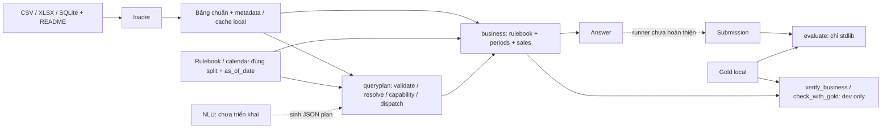

# SOURCE_PACKET — DataMate vòng003, revision01

Snapshot local lúc 2026-10-29 11:39:48 Asia/Saigon. Người đóng gói: Codex. Chưa gửi Gemini/Antigravity.

Commit nền: 00043facd58fa47d064c4a794cc0ba0008b13fb5; nhánh: VuongNguyen. Source dưới đây lấy từ working tree, không lấy từ GitHub. Dirty state tại thời điểm đóng gói (chưa gồm chính packet này):

```text
 M README.md
 M ai_collaboration/AGENTS.md
 M ai_collaboration/DECISIONS.md
 M ai_collaboration/README.md
 M ai_collaboration/templates/DISCUSSION_REQUEST.md
 M docs/PROGRESS.md
 M docs/README.md
 M docs/capability-verification.md
 M docs/context-index.json
 M docs/plan-annotation-audit.md
 M docs/validation.md
?? ai_collaboration/archive/
?? ai_collaboration/rounds/003_three_ai_restart/
?? docs/tasks/2026-10-29-v4-semantic-audit.md
```

## Phạm vi và cách xác minh

Đọc BRIEF.md cùng vòng để có đề bài và lập trường Codex. Gói chọn lọc source/tài liệu, không phải checkout đầy đủ: các import phụ thuộc không có trong bảng chưa được cung cấp. Các đường dẫn bên trong mỗi tài liệu được hiểu từ vị trí gốc trong repo. Scoped AGENTS đi kèm để giữ quy tắc khi đối chiếu source.

Chỉ gồm file allowlist dưới đây; không mở BTC rows/questions/answers, cache, reports từng câu, credentials hoặc môi trường. tests/conftest.py chứa rulebook TỔNG HỢP, không phải rulebook BTC đúng split. Các con số audit là báo cáo aggregate đã ghi, không đủ để tái chấm từ gói này.

Kiểm trước đóng gói: harness map hoàn tất; .\.venv\Scripts\python.exe scripts/harness.py check đạt 545 passed, 2 local_data deselected, PASS full. Không chạy lại data/gold để đóng gói.

SHA256 tính trên nội dung UTF-8 không BOM sau chuẩn hóa CRLF/CR thành LF, giữ nguyên trailing newline. Bytes là số byte của nội dung đã chuẩn hóa. Fence bao nguồn không thuộc hash. Khi repo đổi, so từng hash và ghi divergence; tạo packet revision mới thay vì ghi đè bản đã gửi.

## Fingerprints

| File | UTF-8/LF bytes | SHA256 |
|---|---:|---|
| AGENTS.md | 4737 | bc243aa4069023f87aef3165e16b0f280985ac70d8968c273504e1e0db4d0ab8 |
| ai_collaboration/AGENTS.md | 1577 | 68fbd5d4ccf5010527269762d1bc6b1ca196c46b2db38907b82ce80dcdf5afde |
| loader/AGENTS.md | 996 | 3bc84b5712822dbef7a03a55fb242e9c13a2c8a6e8c32dec2b4bdb42c1d0cb10 |
| business/AGENTS.md | 1117 | de166a9041935097b2ecc731d714ab3352b70586f986751c67454e869ed9451b |
| queryplan/AGENTS.md | 1633 | c8f6e6149b9c300c8cc09edd336e495b9c2371464cc4c9bb1074b43aba6c7b4c |
| docs/architecture.md | 4045 | 0e23a17d73649b11378e75809225ea09718b3d219b00e953eddc9db6cc632129 |
| docs/business.md | 8837 | 1a9efa800c9e0205ebb25e84eea90ec1227f05e0caf388bc88c0d351306bf92d |
| docs/queryplan.md | 10560 | 7a2cbaa0186fe5d89cb72a10ee490248c26ec0461bf6fc5198a2dc7081b5fe76 |
| docs/tasks/2026-10-29-v4-semantic-audit.md | 12686 | e4ccdf3996a761e21c5701cf6a3aaacbd4d0715861646da47ac00f180ff72c40 |
| load_all.py | 10382 | 74c6a78f94bd40a7741b6f3e78ce2933eabeeb15def959bb98c0196b9e6df88d |
| loader/build.py | 53292 | 8539b7659c7485caef355f3f57e27a4bd19a9d975c8631622e56361d1463354b |
| loader/parsers.py | 17252 | f3986b12718ed31602938938912629f1846532aec03d4807ee0534435d83c44c |
| business/sales.py | 18615 | 636c59bd394795075be7a0b3b9c9fa3f227a6105de96c73b27fca87b27cbe638 |
| queryplan/contract.py | 8073 | 1f39b9678f52fdd3c082b4b1ef6aff96299943363275f5e4684efd567ab5401e |
| queryplan/executor.py | 5572 | 9288506080b05218e683b699de91c4cfea64a27ca581ea7069b0a47215c06ba3 |
| queryplan/resolution.py | 8989 | 1529c976918814c8a2874a4731ad0e04da0d697b5f0b6bb645277c963e6e1e01 |
| tests/conftest.py | 3207 | 3dee1c3b48aa2b5775600e75c792a54f4ea2757ae0632308f229aa90a18b5cac |
| tests/queryplan_fixtures.py | 1100 | 7105fae60f1b7a7968f7aa908d3429d2b614df7916207226126c0ab95f907529 |

## File: AGENTS.md

````markdown
# DataMate: working agreement for coding agents

Vietnamese offline data QA for Zalo AI Challenge 2026. Communicate with the user in Vietnamese. Work from the repository root using the existing Python environment.

## Start with the right context

1. Check `git status --short` and read [current progress](docs/PROGRESS.md).
2. Use [the documentation map](docs/README.md) to read only the task's references.
3. Run `python scripts/harness.py map` for orientation; before changing a Python file, run `python scripts/harness.py context business/sales.py` with that file's path. Results include current signatures, import dependents, and related decisions. Read the returned source spans as needed.
4. Read the scoped AGENTS.md before editing [loader](loader/AGENTS.md), [business](business/AGENTS.md), [evaluate](evaluate/AGENTS.md), or [AI collaboration](ai_collaboration/AGENTS.md). Do this explicitly when the client starts at root; do not assume every nested file was auto-loaded.

Current source + the relevant split's rulebook + fresh checks take precedence over historical proposals. `ai_collaboration/GEMINI_HANDOFF.md`, old reviews, diffs, and old plans are historical snapshots. Open them only when the task needs that history. QueryPlan executor/NLU remains unimplemented until source and checks establish otherwise.

## Commands

Use `python` from the active project venv; on Windows without activation use `.\.venv\Scripts\python.exe`. See [setup](README.md) and [harness guide](docs/harness-engineering.md).

| Command | Meaning |
|---|---|
| `python scripts/harness.py doctor` | Interpreter, pinned packages, optional local data readiness |
| `python scripts/harness.py map --limit 30` | Bounded current Python import map |
| `python scripts/harness.py context business/sales.py` | API, transitive import dependents, relevant decisions |
| `python scripts/harness.py check --profile fast` | Repository hygiene, AST boundaries, current doc links, instruction budgets, diff whitespace |
| `python scripts/harness.py check` | fast + synthetic tests; same command as CI, no BTC data needed |
| `python scripts/harness.py check --profile data` | full + local-data tests + nonempty selected gold regression; needs train/cache |

Navigation is an import graph, not a complete call graph. It always reads working-tree bytes. Output counts reveal truncation; raise `--limit` (up to 200) or use `rg` for exhaustive searches. Never treat missing edges as proof a change is safe.

## Boundaries that matter

- Runtime direction: files -> loader -> canonical tables -> business -> Answer. Root scripts compose layers. Follow [architecture](docs/architecture.md); keep gold/verifiers out of loader/business and external network clients out of runtime.
- Competition inference must remain offline with eligible open-weight models <=15B. Development tools and web research are separate from submission runtime.
- No logic keyed to a particular business/question ID. Mapping dictionaries derive from train READMEs only. Public test is for checking, never fitting/tuning.
- Keep BTC data, questions/answers, cache, row-level reports, credentials and environments local. Use synthetic fixtures in tests. Do not include them in Gemini packets or CI.
- Preserve `DataError`, `UnsupportedRule`, `unanswerable`, and agent abstain as distinct outcomes. Do not silently turn failures into zero/unanswerable.
- Preserve unrelated user edits. Avoid mass reformatting, new dependencies, new frameworks, duplicate status files, or unrelated refactors.

## Work and finish

State the scope and acceptance checks; proceed with authorized reversible work. For a multi-session task, use [task template](docs/tasks/TEMPLATE.md) or an existing plan, record evidence and the next action. Tiny fixes need no extra task document.

Run targeted tests while editing, then `check` before claiming completion. For changes affecting loading/business correctness, run `data` when local inputs are available; otherwise state precisely what could not run. Never infer whole-train PA from the selected verifier. Preserve the reported denominator and skip reasons.

Review the final diff, update the relevant docs, and update PROGRESS only when project status changes. Report what changed, commands/results, limitations, and next action. Keep generated artifacts in ignored locations; do not auto-commit, push, publish, install global hooks, or message other services without task authorization.

## Code Review Rules

Flag gold leakage, public-test fitting, ID-specific logic, silent error conversion, changed rulebook/time/filter semantics, and unsupported claims about coverage/PA. Check API compatibility and fixture coverage. Let the harness handle mechanical rules.
````

## File: ai_collaboration/AGENTS.md

````markdown
# AI review and handoff guidance

Read [workflow](README.md); current project state is [PROGRESS](../docs/PROGRESS.md).

- Old prompts, responses, handoffs and diffs are immutable historical evidence. Do not bulk-load them for an unrelated task or mistake a proposed patch for current code.
- User-provided responses are review input. Verify suggestions against current source and tests; distinguish proposal, technical conclusion and applied implementation.
- Keep [DECISIONS](DECISIONS.md) as the decision ledger. The [context index](../docs/context-index.json) only routes files to this evidence; it does not replace the ledger.
- New packets need source revision/dirty state, UTF-8 source fingerprints, explicit question and reproducible validation. Include synthetic fixtures and aggregate results; keep BTC rows/questions/answers and secrets out.
- Active round: [003](rounds/003_three_ai_restart/README.md), with Codex, Gemini Web and Antigravity as separate participants. Antigravity is not the historical Argon attribution. Use the shared BRIEF and participant prompts; number each participant's replies separately.
- Prepare files locally. External transfer remains manual unless the user explicitly authorizes a connected send operation. Never invent a reply, consensus or delivery. A review invitation does not authorize runtime edits; follow the round scope.
- Request web replies as downloadable Markdown UTF-8 files, with fenced fallback per the workflow. Keep received responses intact and record actual source access, revision and commands for every reviewer.
````

## File: loader/AGENTS.md

````markdown
# Loader guidance

Read [architecture](../docs/architecture.md) and the relevant section of [schema/design](../surveys/DESIGN.md).

- Public entrypoint: `loader.load_business`; build mappings from train README descriptions, not gold or public-test fitting.
- This layer may import its own modules and data libraries. It must not import business, evaluator, root runners, verification tools or network clients.
- Treat input files as read-only. Preserve provenance, ambiguity and missingness. Do not invent relationships/amounts to satisfy a known answer or specialize by business ID.
- Maintain raw -> typed -> mapped -> canonical table contracts and downstream API compatibility.
- Targeted tests: `python -m pytest tests/test_parsers.py tests/test_abbrev_infer.py -q`. Then run the root harness full; use data profile for mapping changes when local data/cache exist. Changed loading logic may require rebuilding cache first; disclose that the selected verifier does not validate every mapping.
````

## File: business/AGENTS.md

````markdown
# Business guidance

Read [API and error contract](../docs/business.md). Use current source, not a patch embedded in a Gemini response.

- Pure deterministic calculation over canonical tables. No loader, gold, question parsing, evaluator, verifier or network imports.
- Public API: `Rulebook`, `Periods`, `DateRange`, `SalesMetrics`, `Filters`, `Answer`, `DataError`, `UnsupportedRule`.
- Caller supplies the correct split's rulebook/calendar and question's as_of_date. Preserve same_elapsed comparisons, partial-period behavior, rounding, filter scope and tie-break semantics.
- Preserve dependency-scoped validation, orphan-line protections and cancel/return filtering order. Never coerce missing/invalid amounts to zero or catch errors as unanswerable.
- Add synthetic regression cases for behavioral fixes; preserve positional API compatibility.
- Targeted tests: `python -m pytest tests/test_business_periods.py tests/test_business_sales.py tests/test_business_verification.py -q`. Then full harness and, when local inputs exist, data profile. The selected gold verifier covers a subset, not all 10 APIs or NLU.
````

## File: queryplan/AGENTS.md

````markdown
# QueryPlan guidance

Read [contract and examples](../docs/queryplan.md) and [business API](../docs/business.md).

- Runtime direction: caller -> queryplan -> business -> Answer. Never import loader, evaluator, verifier, tests or network clients here; caller supplies canonical tables and the correct split's Rulebook/calendar/as_of_date.
- Strict JSON contract, no natural-language parsing/model/gold or logic keyed to business/question IDs. Preserve input bytes/tables.
- Resolve names conservatively using catalog evidence. Unknown, ambiguous and missing information are separate outcomes; never turn an unknown label into a zero by sending it unchanged to business.
- Keep status/stage alongside Answer in local logs. DataError/UnsupportedRule/plan/resolve errors cause classified abstain; unexpected implementation exceptions propagate. Missing information and business unanswerable require evidence, not catch-all conversion.
- Keep same_elapsed, partial-period, whole-shop share denominator, unit and filter semantics from business. Do not validate unrelated catalogs when counting orders.
- Public check_capability consumes a normalized plan; keep schema/capability outcomes separate. New previous_calendar_month/quarter comparison kinds require matching main month/quarter; keep old as_of-relative kinds and independent comparisons valid.
- Run `python scripts/harness.py context <file.py>` before editing, then `python -m pytest tests/test_queryplan_contract.py tests/test_queryplan_executor.py -q`, full harness and data profile when local inputs exist. The legacy gold verifier does not measure executor or NLU accuracy.
````

## File: docs/architecture.md

````markdown
# Kiến trúc và ranh giới DataMate

Nguồn hiện hành: code trong loader/business/evaluate; tiến độ ở [PROGRESS](PROGRESS.md), API chi tiết ở [business](business.md).



Mũi tên trong sơ đồ là luồng dữ liệu/cách gọi, không phải quyền import ngược. Root scripts ghép các tầng; gold không được chảy vào loader/business.

| Tầng | Trách nhiệm / entrypoint | Dependency cục bộ cho phép |
|---|---|---|
| loader | `load_business`, đọc thô -> parse/type -> mapping -> bảng chuẩn | Nội bộ loader; pandas/numpy/openpyxl và stdlib |
| business | `Rulebook`, `Periods`, `SalesMetrics`, `Answer`; tính tất định trên bảng chuẩn | Nội bộ business; pandas/numpy và stdlib |
| queryplan | `QueryExecutor`, `validate_plan`, `ExecutionResult`; JSON plan -> Answer và trạng thái | Nội bộ queryplan, public API business; pandas và stdlib |
| evaluate | Chấm type/format/value; local evaluator chưa được chứng nhận tương đương BTC | Stdlib |
| Root tools / verification | `load_all.py`, legacy regression, `inventory_capabilities.py`, `verify_queryplans.py`; package dev-only `verification/` | Ghép các API phục vụ phát triển/kiểm chứng; scorer chỉ dùng sau predictions |
| Harness | `scripts/harness.py`: ngữ cảnh, structural checks, test runner | Stdlib; gọi pytest/verifier qua subprocess |
| Tests | Fixture tổng hợp trong Python/tmp_path; một số ca local_data | Có thể gọi nhiều tầng để kiểm chứng contract |

`business/` không import `loader/` hoặc `queryplan/`: caller đưa bảng hoặc cache vào API. `queryplan/` không import loader/evaluator/verifier/network; caller cấp bảng chuẩn và rulebook/calendar đúng split. Loader không biết gold hoặc cách trả lời câu hỏi. Evaluator không phụ thuộc implementation tính toán. Xem [contract executor](queryplan.md); guard harness bảo vệ ranh giới package mới.

[Capability verification](capability-verification.md) là luồng dev riêng: questions → grammar inventory → frozen manifest → QueryExecutor predictions → local scorer + gold. Runtime không import package/CLI verification. Legacy regression giữ riêng; không dùng gold hoặc kết quả legacy để tạo/chọn plan.

Các bảng chuẩn chính: `cua_hang`, `don_hang`, `dong_hang`, `mat_hang`, `quy_doi_don_vi`, `khach_hang`. Xem phần schema tương ứng trong [DESIGN](../surveys/DESIGN.md); không tự tạo schema mới từ bản tóm tắt này.

Các contract cần giữ:

- Rulebook/calendar đúng split, as_of_date theo câu hỏi; bản ghi tương lai chưa xảy ra.
- Thiếu dữ liệu có ngữ nghĩa khác với mapping sai, luật chưa hỗ trợ, hoặc agent chưa đủ tự tin. Giữ `unanswerable`, `DataError`, `UnsupportedRule`, abstain tách biệt.
- Dữ liệu đầu vào chỉ đọc; báo cáo từng câu/cache/môi trường không vào Git hoặc CI.
- Không điều kiện hóa theo ID doanh nghiệp/câu hỏi, không fit public test.
- Lệnh context chỉ suy import tĩnh và signatures, không chứng minh mọi data dependency/dynamic dispatch. Đọc source và test các hành vi chịu ảnh hưởng.

Guard trong harness kiểm tra được một phần contract bằng AST và tên file. Các quy tắc nghiệp vụ, tổng quát hóa và chính sách cuộc thi vẫn cần test/review có bằng chứng.
````

## File: docs/business.md

````markdown
# Thư viện nghiệp vụ trên schema chuẩn

`business/` là tầng tính toán tất định. Tầng hiểu câu hỏi gọi API bằng tham số rõ ràng; thư viện không nhận câu hỏi tự nhiên và không đọc đáp án train.

[QueryPlan executor v1](queryplan.md) đã gọi các public API này từ JSON plan có kiểm tra/resolve; model hiểu câu hỏi vẫn chưa triển khai.

## Ví dụ

Chạy từ gốc repo sau khi đã chạy `load_all.py`:

```python
from business import Filters, Periods, Rulebook, SalesMetrics

rules = Rulebook.from_path('train/rulebook.md')
periods = Periods(rules, as_of_date='2026-03-04', calendar_path='train/calendar.csv')
sales = SalesMetrics.from_cache('cache/biz_101', 'train/rulebook.md', '2026-03-04')

answer = sales.revenue(periods.this_month())
print(answer.to_submission('example'))

sales.revenue(periods.this_month(), Filters(shift='sang'))
sales.order_count(periods.previous_week())
sales.cancelled_orders(periods.this_month())
sales.cancellation_rate(periods.this_month())
sales.cancellation_rate(periods.this_month(), Filters(channel='online'))
sales.average_order_value(periods.this_month())
sales.quantity(periods.this_month(), unit='chai')
sales.top_products(periods.this_month(), k=3, metric='quantity')
sales.top_customers(periods.this_month(), k=3, metric='revenue')
sales.top_customers(periods.this_month(), k=3, metric='revenue', filters=Filters(channel='online'))
sales.revenue_growth(periods.this_month(), periods.previous_month(same_elapsed=True))
sales.revenue_share(periods.this_month(), Filters(product_group='Đồ uống'))

tet = periods.tet(2026)
sales.revenue_growth(tet, periods.before(tet))
```

Thay đường dẫn cache bằng doanh nghiệp cần hỏi. Với public test, truyền `public_test/rulebook.md` và `public_test/calendar.csv`. Các ID chỉ dùng để chọn dữ liệu/ghi kết quả, không tham gia luật tính toán.

## Thời gian

- `DateRange(start, end)` nhận ngày ISO hoặc `datetime.date`, gồm cả hai đầu.
- `today()`, `yesterday()`, `last_days(n)`, `this_week()`, `previous_week()`, `this_month()`, `previous_month()`, `year_to_date()`.
- `month(month, year=None)`, `quarter(quarter, year=None)`: thiếu năm thì chọn năm nay nếu đầu kỳ không sau as_of_date, ngược lại chọn năm trước. Có năm thì trả cả kỳ.
- `previous_month(same_elapsed=True)` dùng để so với tháng này: cùng số ngày, chặn ở cuối tháng trước.
- `tet(year)` đọc hai mốc âm trong calendar được truyền vào, không dùng lịch từ Internet; `before(period)` lấy kỳ liền trước có cùng số ngày.
- Phép tính giao kỳ hỏi với khoảng dữ liệu và as_of_date. Kỳ giao một phần vẫn tính phần có dữ liệu; hoàn toàn ngoài khoảng thì unanswerable.

## Phép tính và bộ lọc

| API | Kết quả |
|---|---|
| `revenue(period, filters)` | number, tiền VND |
| `order_count(period, filters)` | number, số đơn hợp lệ |
| `cancelled_orders(period, filters)` | number, số đơn hủy |
| `cancellation_rate(period, filters=...)` | percent, mẫu số là mọi trạng thái trong cùng bộ lọc cấp đơn |
| `average_order_value(period, filters)` | number, làm tròn half-up về đồng |
| `quantity(period, filters, unit=None)` | number, tổng số lượng đơn vị cơ bản |
| `top_products(period, k=5, metric='quantity', filters=...)` | list tên hàng, metric quantity hoặc revenue |
| `top_customers(period, k=5, metric='revenue', filters=...)` | list tên khách, metric revenue hoặc orders |
| `revenue_growth(period, comparison, filters)` | percent, (kỳ hỏi − kỳ so)/kỳ so |
| `revenue_share(period, filters)` | percent, doanh thu bộ lọc/doanh thu cả shop |

`Filters` hỗ trợ `product_ids` (tuple mã hàng), `product_group`, `channel`, `payment`, `customer_group`, `shift` (`sang`/`chieu`). Truyền mã/nhãn đúng trong schema chuẩn; việc khớp tên, alias và cách nói thuộc tầng hiểu câu hỏi. Bộ lọc sản phẩm áp lên dòng hàng; bộ lọc kênh/thanh toán/khách/ca áp lên đơn. Với AOV có bộ lọc sản phẩm, tử số là doanh thu các dòng được lọc và mẫu số là số đơn có các dòng đó.

`cancellation_rate` và `top_customers` nhận bộ lọc cấp đơn (`channel`, `payment`, `customer_group`, `shift`); truyền `product_ids` hoặc `product_group` vào hai API này phát sinh `UnsupportedRule`. `top_customers` giữ nguyên thứ tự tham số cũ; `filters` được thêm ở cuối. Tỷ trọng vẫn chia cho doanh thu cả shop cùng kỳ; chỉ yêu cầu điều khoản nhóm khách khi bộ lọc đó được dùng.

Doanh thu gồm phí phục vụ/topping, không trừ voucher cấp đơn, không cộng ship/VAT. Xếp hạng và số lượng mặt hàng bỏ phí phục vụ, có topping. Hủy/trả loại cả đơn, đang giao vẫn tính. Khi không có bảng dòng hàng, chỉ doanh thu toàn đơn có thể dùng `tong_tien_hang`, không suy từ tiền đã thu hoặc tổng phải trả.

## Kết quả thiếu dữ liệu và giới hạn

- `Answer(type, answer, reason)` và `to_submission(question_id)` tạo JSON object; chưa phải runner xuất toàn bộ submission.
- Không có loại thông tin cần thiết, ngoài khoảng dữ liệu, hoặc mẫu số bằng 0: `Answer('unanswerable', reason=...)`.
- Dữ liệu chuẩn có khóa trùng, ngày/status sai, giá trị liên quan thiếu một phần: `DataError`. Tầng agent cần sửa mapping hoặc abstain; không tự đổi lỗi này thành đáp án 0.
- Đầu vào phải có đủ `don_hang`, `dong_hang`, `mat_hang` là DataFrame và `cua_hang` là dict; thiếu bảng hoặc sai kiểu là `DataError`. Bảng không có loại thông tin được biểu diễn bằng bảng rỗng đúng cấu trúc, không bằng cách xóa key.
- Kiểm tra khóa sản phẩm và liên kết dòng hàng chạy khi metric phụ thuộc chúng. Catalog lỗi hoặc dòng mồ côi không chặn đếm đơn thuần; vẫn chặn các thao tác cần tra cứu sản phẩm hoặc đọc dòng hàng. Không bỏ dòng mồ côi chỉ vì không nối được với đơn trong kỳ.
- Với metric loại hủy/trả, trạng thái hủy/trả đã xác định được loại trước khi kiểm tra bộ lọc cấp đơn. Trạng thái chưa biết chỉ được bỏ qua khi các trường hợp lệ khác chứng minh đơn ngoài phạm vi truy vấn. Tỷ lệ hủy giữ mọi trạng thái trong mẫu số và vẫn kiểm tra các trường cần lọc.
- `UnsupportedRule`: điều khoản được dùng thiếu hoặc khác các mẫu mà bản này hỗ trợ. Cần bổ sung implementation/kiểm thử, hoặc agent abstain. Đây không phải kết luận câu hỏi không có đáp án trong dữ liệu.
- Rulebook được đọc từ file người gọi truyền, có source và SHA256. Bản này kiểm tra các cụm điều khoản cần thiết cho thao tác; không phải bộ suy luận ngôn ngữ tự nhiên cho mọi cách viết hoặc mọi thay đổi của rulebook. Cần rà soát lại khi BTC cập nhật luật.
- Đếm đơn/AOV/tỷ lệ hủy cần mã đơn thật (`co_ma_don`); mã nhân tạo của loader chỉ phục vụ nối dòng hàng.
- `quantity(unit=None)` cộng số lượng cơ bản của mọi hàng; người gọi phải bảo đảm đó là phép cộng mà câu hỏi yêu cầu. Chỉ định `unit` để cộng riêng một đơn vị cơ bản.
- Chưa hỗ trợ kho, nhập, nợ, lãi, lô/hạn dùng và toàn bộ luật ngành. Thiếu tính năng không đồng nghĩa dữ liệu unanswerable. Các bảng đó cần được loader chuẩn hóa trước.
- Thư viện dựa trên cache đã làm sạch; không khôi phục số lượng hoặc quan hệ mà loader ánh xạ sai. Test/kiểm tra loader vẫn cần thiết.

## Kiểm chứng

```powershell
python -m pytest -q
python verify_business.py --train train --cache cache --out reports/business_verification
```

Verifier ghi `.json` và `.md`, dùng cùng bộ chọn câu bảo thủ của `check_with_gold.py`: báo tổng câu train, số được chọn, số bị bỏ qua, số lỗi, số khớp gold và phép tính cũ. Đây là kiểm chứng hồi quy trên tập con, không phải PA toàn bộ train. Chỉ công cụ kiểm chứng bên ngoài `business/` đọc gold.

Baseline trước thay đổi: `reports/gold_before_business.md`, 263/263 câu doanh thu/hủy và 146/146 câu số lượng/ca. Test của thư viện dùng dữ liệu tổng hợp; file cuộc thi không được thêm vào Git.
````

## File: docs/queryplan.md

````markdown
# QueryPlan executor v1

`queryplan/` nhận JSON plan đã được tầng trước trích xuất, kiểm tra và gọi public API `business/`. Bản này chưa hiểu câu hỏi tiếng Việt, chưa tích hợp model và chưa có runner submission. Không thêm dependency; validator Python thực hiện contract dưới đây, chưa có JSON Schema cho constrained decoding.

Sau review Argon, có public `check_capability(normalized_plan) -> None` và `UnsupportedCapability`. Caller phải gọi `validate_plan` trước; checker không đọc bảng hoặc sửa plan. `QueryExecutor` dùng cùng checker và vẫn giữ `invalid_plan` khác `unsupported_capability`. Qua schema không có nghĩa capability được hỗ trợ hoặc tên đã resolve.

## Gọi executor

Caller đưa bảng chuẩn vào `tables`, cùng `Rulebook`, ngày câu hỏi và calendar đúng split. Loader/cache loading nằm ngoài executor. Dữ liệu chỉ đọc.

```python
from business import Rulebook
from queryplan import QueryExecutor

executor = QueryExecutor(
    tables, Rulebook.from_path('train/rulebook.md'),
    as_of_date='2026-03-04', calendar_path='train/calendar.csv',
)
plan = {
    'version': '1.0', 'status': 'supported', 'unsupported_reason': None,
    'operation': 'quantity', 'expected_type': 'number',
    'period': {
        'kind': 'this_month', 'n': None, 'month': None, 'quarter': None,
        'year': None, 'start_date': None, 'end_date': None,
    },
    'comparison_period': None,
    'filters': {
        'product_mentions': None, 'product_group_mention': None,
        'channel_mention': None, 'payment_mention': None,
        'customer_group_mention': None, 'shift': None, 'unit_mention': 'ly',
    },
    'ranking': None,
}
result = executor.execute(plan)  # dict từ json.loads cũng dùng được
print(result.status, result.stage, result.answer)
submission_row = result.answer.to_submission('example')
```

Chỉ ghi `submission_row` không giữ được phân loại lỗi nội bộ; caller nên ghi thêm `status`, `stage` và reason vào báo cáo local ignored. Executor không tự ghi log/file. Một instance có thể execute nhiều plan; không cache kết quả nên caller không được sửa bảng giữa các lần hỏi nếu cần cùng snapshot.

## Contract

Mọi object phải đủ key như ví dụ; không nhận key lạ. Trường không dùng phải `null` (`None` trong Python). `validate_plan(raw)` trả dict độc lập sau normalize → structural → semantic validation; lỗi phát sinh `PlanValidationError` có `stage`. `execute` chuyển lỗi này thành `invalid_plan`/abstain.

- Số nguyên: chấp nhận `1.0` hữu hạn và chuẩn hóa thành `int`; reject bool, chuỗi số, số lẻ, NaN/Infinity. `k,n > 0`; month 1..12; quarter 1..4; year 1..9999.
- Mention: chuỗi không rỗng sau strip; `product_mentions` là list chuỗi hoặc null. `[]` chuẩn hóa thành null, không thành bộ lọc rỗng trả 0.
- `expected_type`: number cho revenue/order_count/cancelled_orders/average_order_value/quantity; percent cho cancellation_rate/revenue_growth/revenue_share; list cho top_products/top_customers. Phần trăm tăng trưởng có thể âm hoặc lớn hơn 100.
- `ranking`: bắt buộc với top_products/top_customers, gồm `k` và `metric`; operation khác phải null. Top products nhận quantity/revenue, top customers nhận revenue/orders.
- `unit_mention` chỉ dùng với quantity. Cancellation rate/top customers chỉ nhận filter cấp đơn. Share phải có filter thực sau normalize và luôn có mẫu số cả shop. Xem [ngữ nghĩa API](business.md).

### Thời gian

Period luôn có kind,n,month,quarter,year,start_date,end_date. Các kind today/yesterday/this_week/previous_week/this_month/previous_month/previous_month_same_elapsed/year_to_date không cần tham số; last_days cần n; month cần month và year tùy chọn; quarter tương tự; tet cần year; date_range cần hai ngày ISO tồn tại và không đảo đầu/cuối. Các tham số không dùng phải null.

Comparison chỉ dùng cho revenue_growth, nhận yesterday/previous_week/previous_month/previous_month_same_elapsed/month/quarter/tet/date_range/before_period. `before_period` chỉ áp dụng khi kỳ chính là tet. Comparison same_elapsed chỉ áp dụng với this_month. Growth this_month có comparison null sẽ dùng cùng số ngày tháng trước theo rulebook; growth với kỳ chính khác phải có comparison. `previous_month` tường minh nghĩa cả tháng trước: tầng NLU tương lai phải chọn theo câu hỏi, không tự đổi mặc định.

Extension additive của plan version `1.0`: comparison nhận thêm **previous_calendar_month** (main.kind phải month) và **previous_calendar_quarter** (main.kind phải quarter), mọi tham số n/month/quarter/year/start_date/end_date phải null. Resolve kỳ chính với Rulebook/as_of_date trước, rồi lấy cả tháng/quý dương lịch liền trước. Ví dụ main month1/year2024 → comparison12/2023; main month12/year null, as_of2026-03-04 → primary12/2025 rồi comparison11/2025. Tháng3/2024 so tháng2 lấy hết29 ngày; không dùng khoảng lùi cùng độ dài. Kỳ so sánh trước năm1 báo period_error ở stage period trước đọc bảng.

Các relative kinds cũ vẫn neo theo **as_of_date**, gồm previous_month và yesterday; không tự chuyển sang neo primary. Không có blanket guard cấm kỳ cố định so với as_of-relative: date_range ngày1/3 so yesterday theo as_of4/3 vẫn hợp lệ. Selector/NLU chọn calendar kind khi ý câu là tháng/quý liền trước kỳ chính. Không đổi before_period/Tết, same_elapsed hoặc clipping partial-period trong business. Validator cũ chưa biết new kinds sẽ reject an toàn; schema/model adapter tương lai phải đồng bộ capability extension và fingerprint source, không suy từ string version đơn lẻ.

Resolver gọi `Periods` hiện hành, không tự tính lại lịch, không tra Internet. Tháng/quý thiếu năm, kỳ giao một phần và giới hạn as_of_date theo [API thời gian](business.md). Lỗi/mất calendar báo period_error; rule chưa hỗ trợ báo unsupported_rule.

Adapter kiểm tra header/ô bắt buộc, lunar_leap và hai mốc Tết của CSV trước khi gọi API. Chỉ lỗi đọc/parse input ở boundary đó được đổi thành PeriodResolutionError; không bắt chung ValueError/KeyError từ các hàm Periods. Kỳ vượt phạm vi ngày biểu diễn được được kiểm tra tường minh và báo period_error.

### Resolve tên và đơn vị

Khóa so khớp dùng NFC, casefold và gộp khoảng trắng; giữ dấu tiếng Việt/dấu câu. Không fuzzy, không synonym tự đoán. Product mention là **tên hàng** trong catalog, chưa hỗ trợ cú pháp chọn mã. Nhiều mã cùng tên là ambiguous, kể cả cùng nhóm/đơn vị; không tự cộng nhiều mã. Mention lặp cùng mã chỉ lọc một lần.

Nhóm hàng, kênh, thanh toán, nhóm khách trả nhãn raw đúng schema cho business. Nếu nhiều nhãn raw khác nhau có cùng khóa chuẩn hóa, báo ambiguous vì chọn một nhãn sẽ làm mất dòng. Nhãn cấp đơn chỉ tra trong đơn đến as_of_date, nhưng không giới hạn vào kỳ hỏi: một nhãn đã biết có thể có doanh số 0 trong kỳ. Đơn vị trả tường minh, chuẩn hóa giống quantity của business.

Không có cột/toàn bộ thông tin cần resolve bị thiếu → unanswerable ở stage resolve. Có thông tin nhưng mention không khớp → unresolved_entity/abstain. Catalog thiếu/trùng mã, một phần tên hàng thiếu hoặc nhãn sai kiểu → data_error. Các lỗi dữ liệu tính toán khác do business kiểm tra theo dependency; resolver không kiểm tra catalog khi đếm đơn không có filter sản phẩm.

### Plan không hỗ trợ

`status='unsupported'` cần unsupported_reason thuộc unsupported_domain/unsupported_answer_type/unsupported_comparison_or_denominator/ambiguous_question/unparseable_time. Tất cả operation,expected_type,period,comparison_period,filters,ranking phải null. Executor trả unsupported_plan/abstain, không chạm dữ liệu.

## Kết quả và lỗi

`ExecutionResult(answer, status, stage)` giữ `Answer` tương thích API cũ.

| status | Answer.type | Ý nghĩa |
|---|---|---|
| answered | number/percent/list | Business trả thành công |
| unanswerable | unanswerable | Thiếu loại thông tin ở resolve hoặc business xác định không trả lời được; phân biệt bằng stage/reason |
| invalid_plan | abstain | Sai normalize/structure/semantic contract |
| unsupported_plan | abstain | Tầng trước khai báo câu ngoài phạm vi |
| unsupported_capability | abstain | Tổ hợp filter/metric/comparison ngoài v1 |
| unresolved_entity | abstain | Có dữ liệu nhãn nhưng không khớp |
| ambiguous_entity | abstain | Nhiều đối tượng/nhãn cùng khớp |
| data_error | abstain | DataError từ dữ liệu chuẩn |
| unsupported_rule | abstain | UnsupportedRule, không phải dữ liệu không có đáp án |
| period_error | abstain | Không resolve được kỳ/calendar |

Stage: normalize/structure/semantic/capability/period/data/resolve/dispatch. Lỗi implementation bất ngờ và API trả sai answer type phát sinh exception, không bị đổi thành abstain/unanswerable. Caller truyền ngày as_of_date không hợp lệ sẽ lỗi ngay khi khởi tạo.

## Kiểm chứng và phần tiếp theo

Tests dùng bảng/plan/calendar tổng hợp: cả 10 operation có expected value độc lập và đối chiếu public API; kiểm tra resolver, thời gian, lỗi, capability và input bất biến. Chạy `python -m pytest tests/test_queryplan_contract.py tests/test_queryplan_executor.py -q`, rồi harness full/data.

Verifier legacy vẫn chỉ gọi business trên tập chọn lọc. Đã có [inventory và verifier độc lập](capability-verification.md) chạy QueryExecutor trên frozen manifest bằng grammar dev bảo thủ; chưa có model NLU. Tiếp theo cần audit/mở rộng plan coverage độc lập gold rồi tích hợp model offline và đo riêng plan correctness/kết quả đầu-cuối. Chưa tuyên bố PA của model từ unit test, bộ manifest hồi cứu hoặc 409 câu legacy.
````

## File: docs/tasks/2026-10-29-v4-semantic-audit.md

````markdown
# Audit ngữ nghĩa manifest v4 và khoảng trống customer/share

- Ngày / owner: 2026-10-29, Codex AI theo người dùng chấp thuận đề xuất audit.
- Trạng thái: complete (audit và hồ sơ; chưa sửa các lỗi được phát hiện).
- Nền: commit local **00043fa**, nhánh VuongNguyen; working tree sạch sau commit. Không push trong tác vụ này.
- Mục tiêu: kiểm diễn giải metric, kỳ, comparison anchor, filter scope, ranking, unit và output shape từ câu hỏi/rulebook; phân biệt answer match với plan correctness.
- Ngoài phạm vi: sửa selector/grammar/runtime/business/evaluator, LLM/model, public-test tuning, scalar/two-scope extension. Không claim human/independent review, blind holdout hoặc PA toàn train.

## Contract và acceptance trước lấy mẫu

- [x] Kiểm manifest v4 hiện hành với corpus/rulebook/selector hashes; ghi source revision, source/file hashes và old audit fingerprints. Không mở answers hoặc report chứa prediction/gold từng câu trước freeze annotation.
- [x] Selected: tối đa5 mỗi operation đang có, quantity nếu chỉ2 thì lấy cả2; dự kiến37 trên8ops. Chọn greedy đa dạng tags period-kind/comparison-kind/explicit-year/filter-fields/ranking-metric, mỗi bước ưu tiên số tags chưa thấy, rồi doanh nghiệp chưa thấy, rồi question fingerprint tăng dần. Quota cố định, không thay theo kết quả audit/score; đây là mẫu có chủ đích, không ước lượng accuracy population.
- [x] Unparsed: candidate pools chỉ từ text đã fold (NFC/casefold/bỏ dấu) của2604 câu ngoài selection. Customer: có khách và từ xếp hạng/top/nhiều tiền/nhiều đơn; share: có từ tỷ trọng/tỷ lệ/chiếm/đóng góp và doanh thu/tiền bán/tiền thu. Đây là heuristic discovery, không bao phủ hết hai API. Tối đa12/bucket, dùng stable fingerprint order + round-robin business từ sample_unparsed; dedup union, giữ mọi pool membership.
- [x] Freeze packet gồm mẫu/membership/selection/source hashes. Annotate question-only view không hiện candidate plans/results. Ghi intent, kỳ/comparison, scopes, output shape, reference plan hoặc unsupported/uncertain, rationale/evidence/confidence. Không dùng gold expected type để chọn plan; có prior aggregate/train/source exposure nên không gọi blind hoặc độc lập tác giả.
- [x] Freeze toàn bộ reference annotations/digest trước đối chiếu candidate plans, preflight/data/execution và score. Candidate khác JSON có thể tương đương theo rulebook; adjudicate khác biệt từng field, không tự gọi mismatch literal là semantic error.
- [x] Schema/capability preflight riêng; source/corpus/catalog evidence dùng khi cần resolve. Sau freeze có thể kiểm execute/score reference plans, giữ unsupported/unresolved/error trong mẫu số. Không loại ca hoặc sửa annotation gốc sau gold; nếu cần correction ghi receipt riêng.
- [x] Công bố denominator selected-audit và candidate-pool audit riêng; mọi uncertain/unsupported/mismatch/abstain/error cùng provenance. Row-level artifacts chỉ reports/capability_inventory/semantic_audit_v1/ ignored. Không sửa old manifest/annotations/cache.
- [x] Harness full, fast/staged whitespace; không chạy lại full data baseline nếu không sửa loading/business/runtime. Kiểm current runtime/selector hashes không đổi và artifacts cũ còn nguyên. Cập nhật PROGRESS, quyết định và khuyến nghị bước tiếp dựa evidence.

## Tiến độ / evidence

- Trước lấy mẫu đã chạy harness full545passed/2deselected, fast125files; commit00043fa chốt baseline code/tests/review. Thêm .gitattributes đúng3externalresponses để giữ bytes/newlines và khoảng trắng lịch sử, không sửa nội dung response. Tại mốc này chưa mở answers hoặc gold reports trong tác vụ audit; phase sau chỉ mở khi references/predictions đã freeze.

### Mẫu và provenance đã freeze

- Thực tế61 câu/22doanh nghiệp: selected37/21doanh nghiệp, cộng12/customer-ranking pool110 và12/share pool97. Hai pool không giao trong mẫu; đây là lexical candidate counts, không số câu thực sự thuộc API. Giữ5 false positives công nợ của pool khách, không thay mẫu sau khi đọc.
- Selected gồm5 mỗi op AOV/cancellation_rate/cancelled_orders/order_count/revenue/revenue_growth/top_products và2quantity. Primary periods: month22,previous_week5,yesterday4,quarter2,this_month1,today1,this_week1,last_days1. Comparison: previous_calendar_month3,month2;32không comparison. Filters: shift2,unit2. Chưa audit implicit-year hoặc previous_calendar_quarter trong mẫu này; synthetic cũ không thay thế semantic audit train.
- Packet payload SHA256 `fdbe95be7b6aee1f4144f3c7c5ec2a6b2097f4caa16b1e8ed14492a25e17709c`; annotations payload SHA256 `7ed3341c1f7a9674c90677d3eb6ed95df5518c9680e76de33a74263ada56e8f3`.
- Reference chỉ đọc question-only view và rulebook, không mở candidate plans/catalog/gold trong phase annotation. Sau freeze mới đối chiếu candidate và đọc dữ liệu. Annotator vẫn là Codex AI/tác giả triển khai, có prior aggregate/train/source exposure; không independent/human adjudication, blind holdout hoặc gold plan chuẩn.

### Kết quả semantic, capability và execution tách biệt

| Tập audit | Số câu | Reference plan v1 | Không chạy | Compared | Matched | Mismatch | Abstain | Execution error |
|---|---:|---:|---:|---:|---:|---:|---:|---:|
| Selected v4 sample | 37 | 37 | 0 | 37 | 37 | 0 | 0 | 0 |
| Unparsed customer pool sample | 12 | 3 | 9 | 3 | 2 | 1 | 0 | 0 |
| Unparsed share pool sample | 12 | 6 | 6 | 2 | 1 | 1 | 4 | 0 |
| **Tổng mẫu audit** | **61** | **46** | **15** | **42** | **40** | **2** | **4** | **0** |

- Selected37: candidate và reference normalized JSON trùng37/37; same-author question-only review chưa thấy khác nghĩa trong mẫu. Không suy toàn396 plans đều đúng từ37 hoặc từ answer-match.
- Unparsed24 trước catalog:9supported_plan,6unsupported_capability (4scalar,2prescription predicate),5unsupported_domain công nợ,4needs_clarification bare group-kind. Preflight46supported/15not_checked; schema/capability không chứng minh dữ liệu đầy đủ.
- Execution46:39answered,3unanswerable,4unresolved_entity;15không plan giữ not_run. Có1unanswerable khớp gold trong selected;2unanswerable còn lại sai type so gold. Không chuyển chúng thành abstain để đổi điểm hoặc loại khỏi mẫu số.
- Local adapter đầu tiên gọi đảo arguments `score_one` và kiểm numeric1 trong khi evaluator trả string. `scoring.json` **vô hiệu**, giữ hash và lý do superseded trong `scoring_v2.json`. Đã chấm lại **cùng predictions đã freeze**, không tái thực thi hoặc sửa references; adapter mới kiểm3synthetic cases correct/wrong-type/abstain.
- CLI evaluator chính thức cross-check trên đúng46 predictions/reference subset: **40correct/2wrong/4abstain**, exit0 (CLI exit0 chỉ có nghĩa chấm chạy xong, không all-correct). `scoring_v2.json` là report hợp lệ; giữ2mismatch và4abstain. Không dùng score/accuracy này làm PA model hoặc ước lượng population.

### Phát hiện và kiểm nguồn sau freeze/scoring

1. **Thiếu tên khách sau join:** danh mục canonical có tên và mã duy nhất, đơn có mã nhưng toàn cột tên thiếu. `_join_customers` chỉ lấp group/phone/address, không tên; `top_customers` yêu cầu tên nên trả unanswerable. Đây là mất thông tin trong canonical pipeline, không lỗi diễn giải list/top-k. Cần join có validation uniqueness/conflict, giữ tên gốc và walk-in semantics; chưa sửa code hoặc cache.
2. **Nhóm khách chưa map:** raw có một cột chứa các nhãn nhóm, mapping ghi unmapped và canonical không còn group. README của nguồn đó chưa định nghĩa cột; profile là bằng chứng điều tra, chưa đủ phép thêm mapping dựa gold. Cần căn cứ train README phù hợp hoặc ghi ambiguity/provenance rõ, không hardcode theo shop/câu.
3. **Missingness bị hỏng khi ghi cache:** phát hiện literal `"<NA>"` ở canonical ID/label. Đã tái hiện tổng quát bằng fixture tổng hợp với source hiện tại: `_as_key` cho object column có `pd.NA`, rồi `load_all.to_parquet` stringifies thành `"<NA>"`; số missing từ1thành0 sau round-trip. Đây là bug serialization độc lập gold, có thể làm walk-in bị coi là khách có mã. Chưa đo toàn cache hoặc tự sửa literal strings trong cache.
4. **Bốn unresolved:**2label không dấu chưa khớp exact;1payment và1channel dùng nhãn tự nhiên trong khi cache đã canonical hóa. Cần contract bridge từ cách nói/metadata sang canonical label, giữ ambiguity; không tự thêm fuzzy hoặc bỏ dấu toàn cục, không import loader vào queryplan.
5. **Bốn bare group:** catalog hiện tại xác định được label thuộc nhóm hàng trong các ca mẫu. Receipt bổ sung ghi kết luận phụ thuộc catalog; annotation needs_clarification gốc giữ nguyên, không execute/score thêm4plan để nâng số đẹp.
6. **Hai prescription cases:** catalog có thuộc tính kê đơn, nên đây không phải thiếu toàn metric share/domain. Question-only contract chưa có predicate hoặc bước materialize filter từ catalog. Có thể biểu diễn tập sản phẩm nonempty/unique bằng product_mentions khi có grounding được kiểm; phải chốt missing/duplicate/empty-set semantics vì `[]` hiện normalize về null. Không tự coi attribute là tên nhóm.

Synthetic serialization reproduction (dùng path output mới trong reports/, không cache):

```python
import pandas as pd
from pathlib import Path
from loader.build import _as_key
from load_all import to_parquet
keys = _as_key(pd.Series(['C001', pd.NA], dtype='string'))
to_parquet(pd.DataFrame({'ma_khach': keys}), Path('reports/missingness_probe.parquet'))
# Hiện tại: pd.read_parquet(...).ma_khach.iloc[1] == '<NA>', thay vì missing.
```

### Artifact local ignored và kiểm integrity

`reports/capability_inventory/semantic_audit_v1/` giữ sampler/script fingerprints, packet, question_only, annotations, plan_comparison, preflight, predictions, scoring_v2, catalog_evidence và missingness_repro. CLI subset/predictions/errors chỉ local. `scoring.json` sai adapter là evidence bị supersede, không kết quả kiểm chứng. Không chỉnh old annotations/manifests hoặc cache, không copy BTC question/answer/catalog rows vào Git.

Runtime/selector/loader/business/evaluator source giữ nguyên00043fa; compare37 trước mở gold. Toàn bộ predictions46 freeze trước đọc answers; packet/annotation/source/cache hashes kiểm lại ở receipt cuối. Harness full mới trong tác vụ545passed/2local_data deselected; không rerun whole-data baseline hoặc báo409là phép chấm mới. Fast cuối kiểm links/budgets/boundaries/staged/unstaged whitespace.

Integrity cuối **PASS**: digest packet/annotations/predictions/reports, used cache files, old manifests/annotations và source không đổi; bytes3response lưu trong Git bằng working tree. `integrity_receipt.json` payload SHA256 `fb3fcb2bae4ed991de9d057ce86bf15cc8ead0eddd0eb94e2b09b2f57e5b18be`. Fast cuối exit0,126repository files inspected. Artifact audit từng câu không tracked; hồ sơ audit mới ở working tree, commit00043fa chỉ là mốc baseline trước audit.

## Bàn giao

- Đã xong: commit baseline00043fa local; audit61, refs freeze, comparison37, preflight46, execution/CLI cross-check và chẩn đoán dữ liệu. Hồ sơ audit là thay đổi tài liệu mới; chưa push.
- Việc kế tiếp được đề xuất: sửa **serialization missingness và customer-name join** bằng synthetic regression trước, giữ API/semantics, rebuild vào cache revision riêng rồi replay v4 và baseline riêng. Mapping group cần evidence riêng; label bridge/predicate cần contract tiếp. Chưa triển khai các sửa này hoặc model/grammar.
- Mốc396/396 cũ vẫn giữ nguyên giá trị trên selected v4 và cache snapshot cũ; audit mới cho thấy khoảng trống của2API ngoài selection. Chưa đủ căn cứ tuyên bố10API đã kiểm chứng train hoặc bắt đầu tuning NLU trên một baseline được gọi là hoàn thiện.
````

## File: load_all.py

````python
#!/usr/bin/env python3
"""Nạp mọi tiệm (train + public_test) -> cache/<business_id>/, in tóm tắt và ghi load_report.md.

Chạy:  python load_all.py [--only biz_101,dev_012] [--workers 6] [--cache cache]

Cache mỗi tiệm:
  cache/<bid>/don_hang.parquet, dong_hang.parquet, mat_hang.parquet, quy_doi_don_vi.parquet
  cache/<bid>/cua_hang.json        metadata + năng lực (nang_luc)
  cache/<bid>/mapping.json         cột gốc -> khái niệm chuẩn, nguồn ánh xạ, vai trò bảng
  cache/<bid>/checks.json          kết quả kiểm tra tự động
  cache/<bid>/raw/*.parquet + raw_catalog.json   bảng thô sạch
"""

from __future__ import annotations

import argparse
import json
import sys
import time
import traceback
import warnings
from concurrent.futures import ProcessPoolExecutor, as_completed
from pathlib import Path

import pandas as pd

SPLITS = [("train", Path("train")), ("public_test", Path("public_test"))]
SALES_ROLES = ("line", "order", "product", "conversion")

# cột chuẩn tính độ phủ (bỏ cột suy ra / cột của ngành mới chưa làm ở v0)
COVER_COLS = {
    "don_hang": ["ma_don", "ngay_dat", "thoi_diem_dat", "trang_thai", "ma_khach", "ten_khach", "nhom_khach",
                 "kenh_ban", "hinh_thuc_tt", "ma_nhan_vien", "tong_tien_hang", "giam_gia_don", "tong_phai_tra",
                 "con_no_cuoi_du_lieu"],
    "dong_hang": ["ma_hang", "ten_hang_goc", "so_luong", "don_vi", "so_luong_co_ban", "don_gia", "giam_gia_dong",
                  "thanh_tien", "gia_von_dong"],
    "mat_hang": ["ten_hang", "nhom_hang", "don_vi_co_ban", "gia_ban_hien_tai", "gia_von"],
}


def to_parquet(df: pd.DataFrame, path: Path) -> None:
    """Ghi parquet; cột object lẫn kiểu -> số nếu được, không thì chuỗi."""
    df = df.copy()
    for c in df.columns:
        if df[c].dtype == object:
            nonnull = df[c].dropna()
            if len(nonnull) and nonnull.map(lambda v: isinstance(v, bool)).all():
                df[c] = df[c].astype("boolean")
                continue
            num = pd.to_numeric(nonnull, errors="coerce") if len(nonnull) else nonnull
            if len(nonnull) and num.notna().all() and not nonnull.map(lambda v: isinstance(v, str)).any():
                df[c] = pd.to_numeric(df[c], errors="coerce")
            else:
                df[c] = df[c].map(lambda v: None if v is None or (isinstance(v, float) and v != v) else str(v)
                                  ).astype("string")
    df.to_parquet(path, index=False)


def mapping_records(res) -> list[dict]:
    out = []
    for tm in res["table_maps"]:
        for c in tm.table.columns:
            m = tm.cols.get(c)
            out.append({"bang": tm.table.name, "vai_tro": tm.role, "cot": c,
                        "khai_niem": m[0] if m else None, "nguon_anh_xa": m[1] if m else
                        ("cot_rong" if tm.table.kinds.get(c) == "empty" else "unmapped"),
                        "mo_ta_readme": tm.descs.get(c), "bang_chung": tm.evidence.get(c)})
    return out


def summarize(res, split: str) -> dict:
    ch = res["cua_hang"]
    cover = {}
    for tname, cols in COVER_COLS.items():
        df = res[tname]
        cover[tname] = {c: bool(c in df and df[c].notna().any()) for c in cols}
    n_cov = sum(v for d in cover.values() for v in d.values())
    n_all = sum(len(d) for d in cover.values())
    unmapped = [f"{tm.table.name}.{c}" for tm in res["table_maps"] if tm.role in SALES_ROLES for c in tm.unmapped]
    raw_ok = sum(1 for t in res["raw_tables"] if t.typed is not None and t.error is None and len(t.data))
    roles = {}
    for tm in res["table_maps"]:
        roles.setdefault(tm.role, []).append(tm.table.name)
    return {
        "split": split, "business_id": ch["business_id"], "so_don": len(res["don_hang"]),
        "so_dong_hang": len(res["dong_hang"]), "so_mat_hang": len(res["mat_hang"]),
        "ngay_bat_dau": ch["ngay_bat_dau_du_lieu"], "ngay_cuoi_du_lieu": ch["ngay_cuoi_trong_du_lieu"],
        "ngay_cuoi_readme": ch["ngay_ket_thuc_du_lieu"], "pct_cot_chuan": round(100 * n_cov / n_all, 1),
        "cot_chuan": cover, "unmapped": unmapped, "raw_ok": raw_ok, "raw_tong": len(res["raw_tables"]),
        "vai_tro_bang": roles, "checks": res["checks"], "loi": res["errors"], "thoi_gian": res["thoi_gian_nap"],
        "nang_luc": ch["nang_luc"], "nguon_trang_thai": ch["nguon_trang_thai"], "thong_ke": ch["thong_ke"],
    }


def process(shop_dir: str, split: str, split_root: str, cache_root: str) -> dict:
    warnings.simplefilter("ignore")
    sys.path.insert(0, str(Path(__file__).resolve().parent))
    from loader import load_business
    from loader.raw import save_raw

    shop_dir, cache = Path(shop_dir), Path(cache_root) / Path(shop_dir).name
    t0 = time.time()
    try:
        res = load_business(shop_dir, Path(split_root) / "rulebook.md", train_dir=Path(split_root).parent / "train")
    except Exception as e:  # noqa: BLE001
        return {"split": split, "business_id": shop_dir.name, "crash": f"{type(e).__name__}: {e}",
                "traceback": traceback.format_exc(), "thoi_gian": round(time.time() - t0, 1)}
    cache.mkdir(parents=True, exist_ok=True)
    for name in ("don_hang", "dong_hang", "mat_hang", "quy_doi_don_vi", "khach_hang"):
        to_parquet(res[name], cache / f"{name}.parquet")
    (cache / "cua_hang.json").write_text(json.dumps(res["cua_hang"], ensure_ascii=False, indent=1, default=str),
                                         encoding="utf-8")
    maps = mapping_records(res)
    (cache / "mapping.json").write_text(json.dumps(maps, ensure_ascii=False, indent=1), encoding="utf-8")
    (cache / "checks.json").write_text(json.dumps(res["checks"], ensure_ascii=False, indent=1), encoding="utf-8")
    describe = {(m["bang"], m["cot"]): m["mo_ta_readme"] for m in maps}
    concepts = {(m["bang"], m["cot"]): m["khai_niem"] for m in maps}
    save_raw(res["raw_tables"], cache, describe, concepts)
    return summarize(res, split)


def write_report(summaries: list[dict], path: Path) -> None:
    L = ["# Báo cáo nạp dữ liệu — loader v0", "",
         "Sinh bởi `load_all.py`. % cột chuẩn = số cột chuẩn (don_hang, dong_hang, mat_hang; xem COVER_COLS) có dữ liệu.",
         "", "## Tổng quan", "",
         "| bộ | tiệm | đơn | dòng hàng | khoảng ngày (README) | % cột chuẩn | bảng thô OK | kiểm tra PASS/FAIL | giây |",
         "|---|---|---|---|---|---|---|---|---|"]
    for s in summaries:
        if "crash" in s:
            L.append(f"| {s['split']} | {s['business_id']} | ❌ CRASH | | | | | | {s['thoi_gian']} |")
            continue
        npass = sum(c["ket_qua"] == "PASS" for c in s["checks"])
        nfail = sum(c["ket_qua"] == "FAIL" for c in s["checks"])
        rng = f"{s['ngay_bat_dau']} → {s['ngay_cuoi_du_lieu']} ({s['ngay_cuoi_readme']})"
        L.append(f"| {s['split']} | {s['business_id']} | {s['so_don']} | {s['so_dong_hang']} | {rng} | "
                 f"{s['pct_cot_chuan']} | {s['raw_ok']}/{s['raw_tong']} | {npass}/{nfail} | {s['thoi_gian']} |")
    L += ["", "## Chi tiết từng tiệm", ""]
    for s in summaries:
        L.append(f"### {s['split']} / {s['business_id']}")
        if "crash" in s:
            L += ["", "```", s["traceback"], "```", ""]
            continue
        L.append(f"- đơn {s['so_don']}, dòng hàng {s['so_dong_hang']}, mặt hàng {s['so_mat_hang']}; "
                 f"ngày {s['ngay_bat_dau']} → {s['ngay_cuoi_du_lieu']} (README: {s['ngay_cuoi_readme']}); "
                 f"nạp {s['thoi_gian']}s")
        L.append(f"- trạng thái lấy từ: {s['nguon_trang_thai']}; thống kê: {s['thong_ke']}")
        L.append("- vai trò bảng: " + "; ".join(f"**{r}**: {', '.join(v)}" for r, v in s["vai_tro_bang"].items()))
        missing = [f"{t}.{c}" for t, d in s["cot_chuan"].items() for c, ok in d.items() if not ok]
        L.append(f"- % cột chuẩn có dữ liệu: {s['pct_cot_chuan']}% — thiếu: {', '.join(missing) or '(không)'}")
        L.append(f"- cột unmapped (bảng bán/mặt hàng/quy đổi): {', '.join(s['unmapped']) or '(không)'}")
        L.append(f"- bảng thô làm sạch thành công: {s['raw_ok']}/{s['raw_tong']}")
        if s["loi"]:
            L.append(f"- lỗi: {s['loi']}")
        nl = s["nang_luc"]
        L.append(f"- năng lực CÓ: {', '.join(k for k, v in nl.items() if v)}")
        L.append(f"- năng lực KHÔNG có: {', '.join(k for k, v in nl.items() if not v)}")
        L.append("")
        L.append("| kiểm tra | kết quả | số liệu | ngưỡng |")
        L.append("|---|---|---|---|")
        for c in s["checks"]:
            L.append(f"| {c['kiem_tra']} | {c['ket_qua']} | {str(c['so_lieu']).replace('|', '/')} | {c['nguong']} |")
        L.append("")
    path.write_text("\n".join(L), encoding="utf-8")


def main(argv=None):
    ap = argparse.ArgumentParser()
    ap.add_argument("--only", help="danh sách business_id, cách nhau dấu phẩy")
    ap.add_argument("--workers", type=int, default=6)
    ap.add_argument("--cache", default="cache")
    ap.add_argument("--report", default="load_report.md")
    args = ap.parse_args(argv)
    only = set(args.only.split(",")) if args.only else None

    jobs = []
    for split, root in SPLITS:
        for d in sorted((root / "data").iterdir()):
            if d.is_dir() and (only is None or d.name in only):
                jobs.append((str(d), split, str(root), args.cache))
    t0 = time.time()
    results = {}
    with ProcessPoolExecutor(max_workers=args.workers) as ex:
        futs = {ex.submit(process, *j): j for j in jobs}
        for f in as_completed(futs):
            s = f.result()
            results[(s["split"], s["business_id"])] = s
            flag = "CRASH " + s["crash"] if "crash" in s else \
                f"đơn {s['so_don']:>6} dòng {s['so_dong_hang']:>7} cột chuẩn {s['pct_cot_chuan']:>5}%"
            print(f"[{time.time() - t0:6.1f}s] {s['split']:11s} {s['business_id']}: {flag}", flush=True)
    summaries = [results[(j[1], Path(j[0]).name)] for j in jobs]
    write_report(summaries, Path(args.report))
    n_crash = sum("crash" in s for s in summaries)
    print(f"Xong {len(summaries)} tiệm, {n_crash} crash, {time.time() - t0:.0f}s -> {args.report}")


if __name__ == "__main__":
    main()
````

## File: loader/build.py

````python
"""Dựng 5 bảng chuẩn cho MỘT tiệm: cua_hang, don_hang, dong_hang, mat_hang, quy_doi_don_vi.

Quy trình (không có logic riêng cho tiệm nào):
  1. Bảng thô sạch cho mọi file/sheet (raw.py).
  2. Mỗi cột -> các khái niệm ứng viên, theo thứ tự ưu tiên:
       (a)+(b) mô tả cột trong README của tiệm -> từ điển mô tả        [trọng số 3]
       (c)     tên cột -> từ điển tên cột (đếm trên README train)      [<= 2; tiền tố ký tự 0.95]
               tên cột sau khi BUNG VIẾT TẮT (abbrev.py) -> từ điển   [<= 1.5, chia cho số cách bung; nguồn 'abbrev*']
               cặp '**X** là ...' trong phần Quy ước của README        [1.5; 3 nếu chỉ rõ `bang.cot`]
       (d)     không có -> unmapped
  3. Vai trò của bảng (dòng hàng / đơn / mặt hàng / quy đổi / bảng lô / khác) suy từ tập khái niệm.
  4. Chốt khái niệm từng cột theo vai trò, kiểm tra kiểu dữ liệu (cột tiền phải là số, cột ngày phải là ngày).
  5. Suy theo CẤU TRÚC (ghi rõ nguồn 'cau_truc_*'), chỉ cho cột khoá và ngày đặt của sổ bán:
       - cột khoá (mã đơn / mã hàng) chưa ánh xạ: cột có tập giá trị trùng >= 90% với khoá đã biết ở bảng khác;
       - sổ bán chưa có ngày đặt: đúng một cột kiểu ngày có tên gợi ý ngày.
  5b. Suy từ GIÁ TRỊ (infer.py, nguồn 'gia_tri_*', bằng chứng ghi vào mapping.json) — chỉ lấp cột chưa ánh xạ
      hoặc ánh xạ yếu (< 1): ngày/thời điểm, SL×giá≈tiền, giảm giá dòng, phí giao/giảm giá đơn (cân bằng),
      SL cơ bản, mã đơn (nhóm liền kề / điền xuống), mã khách/NV (trùng danh sách), sổ phiếu (ngày + tiền).
  6. Dựng bảng chuẩn (+ khach_hang, nối nhóm khách vào đơn; tách topping ghép ô) + metadata năng lực (nang_luc).
"""

from __future__ import annotations

import re
import time
from collections import Counter, defaultdict
from dataclasses import dataclass, field
from pathlib import Path

import numpy as np
import pandas as pd

from .mapping import (CONVERSION_CONCEPTS, DATE_CONCEPTS, LINE_CONCEPTS, NON_SALES, NUMERIC_CONCEPTS,
                      ORDER_CONCEPTS, PRODUCT_CONCEPTS, ROLE_ALLOWED, ROLE_SPECIFIC, Dictionaries,
                      build_dictionaries, default_train_readmes)
from .infer import (Inference, base_quantity, datetime_roles, key_overlap, ledger_columns, line_discount,
                    order_balance, order_id, qty_price_amount)
from .parsers import (HOAN_THANH, HUY, TRA_HANG, clean_str, col_key, combine_status, is_walkin, line_kind,
                      name_key, nk, normalize_channel, normalize_payment, normalize_status, parse_quantity,
                      split_phone, split_topping, status_from_text)
from .raw import RawTable, fill_down_raw, read_raw_tables, type_table
from .readme import ReadmeInfo, parse_readme

CODE_CONCEPTS = {"ma_don", "ma_hang", "ma_khach", "ma_nhan_vien", "ma_ban", "ma_lo"}
WEAK = 1.0   # trọng số < WEAK: ánh xạ yếu (tiền tố, viết tắt mơ hồ, cấu trúc) — lớp suy từ giá trị được phép thay


@dataclass
class TableMap:
    table: RawTable
    role: str
    cols: dict[str, tuple[str, str, float, str | None]] = field(default_factory=dict)  # col -> (concept, nguồn, w, mô tả)
    unmapped: list[str] = field(default_factory=list)
    descs: dict[str, str] = field(default_factory=dict)
    evidence: dict[str, str] = field(default_factory=dict)   # cột -> bằng chứng số học (lớp suy từ giá trị)
    id_scope: str = ""        # 'segment': mã đơn là số thứ tự trong sheet -> ghép tên sheet cho khỏi trùng

    def col_of(self, concept: str) -> str | None:
        for c, (k, *_rest) in self.cols.items():
            if k == concept:
                return c
        return None

    def concepts(self) -> set[str]:
        return {v[0] for v in self.cols.values()}


# ---------------------------------------------------------------------------
# 2. Ứng viên khái niệm cho từng cột
# ---------------------------------------------------------------------------

def _candidates(t: RawTable, readme: ReadmeInfo, dicts: Dictionaries):
    src0 = t.sources[0] if t.sources else {}
    file, sheet = src0.get("file", ""), src0.get("sheet")
    sec = readme.section_for(file, sheet, t.columns)
    sec_by_key = {col_key(c): d for c, d in sec.columns.items()} if sec else {}
    is_sqlite = Path(file).suffix.lower() in (".sqlite", ".sqlite3", ".db")
    out, descs = {}, {}
    for c in t.columns:
        if t.kinds.get(c) == "empty":
            continue
        cands = []
        desc = sec_by_key.get(col_key(c))
        if desc:
            descs[c] = desc
            k, how = dicts.concept_of_desc(desc)
            if k:
                cands.append((k, 3.0, how, desc))
        for k, w, how in dicts.name_candidates(c):
            cands.append((k, w, how, None))
        conv = readme.convention_desc(c, table=sheet if is_sqlite else None)
        if conv:
            descs.setdefault(c, conv)
            k, how = dicts.concept_of_desc(conv)
            if k:
                scoped = any(p.table and col_key(p.column) == col_key(c) for p in readme.convention_pairs)
                cands.append((k, 3.0 if scoped else 1.5, "quy_uoc_readme", conv))
        if cands:
            out[c] = sorted(cands, key=lambda x: -x[1])
    return out, descs


# ---------------------------------------------------------------------------
# 3. Vai trò bảng
# ---------------------------------------------------------------------------

def _role(t: RawTable, cands: dict, readme: ReadmeInfo) -> str:
    top = {cs[0][0] for cs in cands.values() if cs[0][1] >= 0.9}
    hang = top & {"ten_hang", "ma_hang"}
    src_names = {Path(s["file"]).stem.lower() for s in t.sources} | {str(s.get("sheet") or "").lower() for s in t.sources}
    # README chỉ ra nơi ghi hệ số ('hệ số quy đổi ở `X`'); X có thể là cả file nhiều sheet,
    # nên chỉ nhận bảng có tên gợi ý quy đổi
    pointed = any(Path(x).stem.lower() in src_names for x in readme.conversion_sources) and \
        re.search(r"quydoi|donvi|heso", col_key(t.name)) is not None
    sale_like = bool(hang) and bool(top & {"thanh_tien"}) and bool(top & {"so_luong", "don_gia", "ma_don", "ngay_dat"})
    if "ma_don" not in top and not sale_like and (top & {"he_so", "don_vi_lon", "ten_hang_qd"} or pointed):
        return "conversion"
    if "ma_don" in top and top & {"so_luong_tra", "ma_lo", "sl_lo"} and not hang:
        return "lot_sale"
    if top & {"ton_kho"}:
        return "inventory"
    if top & NON_SALES:
        # bảng thu tiền phải tham chiếu được tới đơn (mã đơn / mã phiếu thu)
        if top & {"so_tien_thu", "thoi_diem_thu", "ma_phieu_thu"} and top & {"ma_don", "ma_phieu_thu"}:
            return "payment"
        if top & {"ngay_nhap", "ma_phieu_nhap", "gia_nhap", "so_luong_nhap", "thanh_tien_nhap", "tong_tien_phieu_nhap"}:
            return "import"
        if top & {"ma_lo", "han_su_dung", "sl_nhap_co_ban"}:
            return "lot"
        if top & {"dot_giao", "ngay_giao", "bien_so", "tai_xe"}:
            return "delivery"
        if top & {"so_ngay_no", "han_thanh_toan"}:
            return "debt_term"
        if top & {"ngay_ap_dung", "gia_moi", "gia_cu"}:
            return "price"
        return "other"
    sale_marks = top & {"ma_don", "ngay_dat", "trang_thai", "thoi_diem_dat"}
    if hang and top & {"thanh_tien", "so_luong", "don_gia", "so_luong_co_ban"} and sale_marks:
        return "line"
    if sale_like:  # tên hàng + thành tiền + số lượng/đơn giá: sổ bán dù chưa nhận ra mã đơn / ngày
        return "line"
    # 'trang_thai' một mình không đủ (danh sách khách cũng có cột Trạng thái tài khoản)
    if not hang and top & {"ma_don", "ngay_dat", "tong_phai_tra", "tong_tien_hang", "hinh_thuc_tt"} \
            and len(top & ORDER_CONCEPTS) >= 3:
        return "order"
    if (hang or "ten" in top) and top & {"nhom_hang", "don_vi_co_ban", "don_vi", "gia_ban_hien_tai", "gia_von",
                                          "hoat_chat", "ke_don"}:
        return "product"
    if top & {"ma_khach", "ten", "ten_khach"} and top & {"sdt", "nhom_khach", "dia_chi"}:
        return "customer"
    if "ma_nhan_vien" in top and "ma_don" not in top:
        return "staff"
    return "other"


# ---------------------------------------------------------------------------
# 4. Chốt khái niệm theo vai trò + kiểm tra kiểu
# ---------------------------------------------------------------------------

def _type_ok(t: RawTable, col: str, concept: str) -> bool:
    kind = t.kinds.get(col)
    if concept in NUMERIC_CONCEPTS:
        return kind == "number"
    if concept in DATE_CONCEPTS:
        return kind == "date"
    return True


def _resolve(t: RawTable, role: str, cands: dict) -> dict:
    allowed = ROLE_ALLOWED.get(role)
    if role == "inventory":
        allowed = PRODUCT_CONCEPTS | {"ton_kho", "don_vi"}
    spec = ROLE_SPECIFIC.get(role, {})
    options = {}
    for c, cs in cands.items():
        opts = []
        for k, w, how, d in cs:
            k = spec.get(k, k)
            if allowed is not None and k not in allowed:
                continue
            if not _type_ok(t, c, k):
                continue
            opts.append((k, w, how, d))
        if opts:
            options[c] = opts
    if allowed is None:  # vai trò 'khác': giữ khái niệm mạnh nhất để báo cáo
        return {c: (os[0][0], os[0][2], os[0][1], os[0][3]) for c, os in options.items()}
    chosen, idx = {}, {c: 0 for c in options}
    changed = True
    while changed:
        changed = False
        by_concept = defaultdict(list)
        for c, i in idx.items():
            if i < len(options[c]):
                by_concept[options[c][i][0]].append(c)
        for k, cols in by_concept.items():
            if len(cols) > 1:
                fill = {c: t.typed[c].notna().mean() for c in cols}
                cols.sort(key=lambda c: (-options[c][idx[c]][1], -fill[c]))
                for c in cols[1:]:
                    idx[c] += 1
                    changed = True
    for c, i in idx.items():
        if i < len(options[c]):
            k, w, how, d = options[c][i]
            chosen[c] = (k, how, w, d)   # (khái niệm, nguồn, trọng số, mô tả)
    return chosen


def _structural_date(tm: TableMap) -> None:
    """Sổ bán chưa có ngày đặt: xét các cột kiểu ngày chưa ánh xạ có tên gợi ý ngày/giờ
    (nguồn 'cau_truc_kieu_ngay'). Một cột -> ngày đặt. Nhiều cột: nếu đúng một cột chỉ có ngày (không giờ)
    thì đó là ngày đặt, và nếu đúng một cột có giờ thì đó là thời điểm đặt. Còn lại: không đoán."""
    if tm.role not in ("line", "order") or tm.col_of("ngay_dat"):
        return
    t = tm.table
    cand = [c for c in t.columns if c not in tm.cols and t.kinds.get(c) == "date"
            and re.search(r"ngay|thoigian|date|gio|time", col_key(c))]
    if not cand:
        return
    if len(cand) == 1:
        tm.cols[cand[0]] = ("ngay_dat", "cau_truc_kieu_ngay", 0.5, None)
        return

    def has_time(c):
        s = pd.to_datetime(t.typed[c], errors="coerce").dropna()
        return len(s) > 0 and ((s.dt.hour + s.dt.minute + s.dt.second) > 0).mean() > 0.5
    date_only = [c for c in cand if not has_time(c)]
    with_time = [c for c in cand if has_time(c)]
    if len(date_only) == 1:
        tm.cols[date_only[0]] = ("ngay_dat", "cau_truc_kieu_ngay", 0.5, None)
        if len(with_time) == 1 and not tm.col_of("thoi_diem_dat"):
            tm.cols[with_time[0]] = ("thoi_diem_dat", "cau_truc_kieu_ngay", 0.5, None)


def _as_key(s: pd.Series) -> pd.Series:
    """Cột khoá -> chuỗi đã strip ('ORD001', 12.0 -> '12')."""
    def f(v):
        if v is None or (isinstance(v, float) and np.isnan(v)) or v is pd.NA:
            return None
        if isinstance(v, (float, np.floating)) and float(v).is_integer():
            return str(int(v))
        return clean_str(v)
    return s.map(f).astype(object)


def _structural_keys(tms: list[TableMap]) -> None:
    """Cột khoá chưa ánh xạ: cột chữ có >= 90% giá trị nằm trong tập khoá đã biết ở bảng khác."""
    for concept, roles_need, roles_ref in (("ma_don", ("order", "line", "lot_sale"), ("line", "order", "payment")),
                                           ("ma_hang", ("product", "line", "conversion", "inventory"),
                                            ("line", "product"))):
        ref = set()
        for tm in tms:
            c = tm.col_of(concept)
            if tm.role in roles_ref and c:
                ref |= set(_as_key(tm.table.typed[c]).dropna())
        # số thứ tự thuần (1, 2, 3...) trùng với cột số nào cũng được -> không phải bằng chứng
        if len(ref) < 5 or sum(str(v).isdigit() for v in ref) / len(ref) >= 0.5:
            continue
        for tm in tms:
            if tm.role not in roles_need or tm.col_of(concept):
                continue
            best, best_r = None, 0.0
            for c in tm.table.columns:
                if c in tm.cols or tm.table.kinds.get(c) == "empty":
                    continue
                vals = _as_key(tm.table.typed[c]).dropna()
                if len(vals) < 5:
                    continue
                r = vals.isin(ref).mean()
                if r > best_r:
                    best, best_r = c, r
            if best is not None and best_r >= 0.9:
                tm.cols[best] = (concept, "cau_truc_trung_gia_tri", 0.5, None)


# ---------------------------------------------------------------------------
# 4b. Lớp suy từ GIÁ TRỊ (infer.py) — chỉ lấp cột chưa ánh xạ / ánh xạ yếu, luôn kèm bằng chứng
# ---------------------------------------------------------------------------

def _assign(tm: TableMap, inf: Inference, source: str) -> bool:
    """Gán khái niệm suy từ giá trị. Không đè ánh xạ mạnh; nếu khái niệm đang nằm ở cột khác với ánh xạ yếu
    thì gỡ ở cột đó."""
    cur = tm.cols.get(inf.col)
    if cur and cur[2] >= WEAK and cur[0] != inf.concept:
        return False
    other = tm.col_of(inf.concept)
    if other and other != inf.col:
        if tm.cols[other][2] >= WEAK:
            return False
        del tm.cols[other]
        tm.evidence.pop(other, None)
    tm.cols[inf.col] = (inf.concept, source, 0.9, None)
    tm.evidence[inf.col] = inf.evidence
    return True


def _free_cols(tm: TableMap, kinds: tuple[str, ...]) -> list[str]:
    """Cột chưa ánh xạ hoặc ánh xạ yếu, theo kiểu dữ liệu."""
    t = tm.table
    return [c for c in t.columns if t.kinds.get(c) in kinds and (c not in tm.cols or tm.cols[c][2] < WEAK)]


def _strong(tm: TableMap, concept: str) -> str | None:
    c = tm.col_of(concept)
    return c if c and tm.cols[c][2] >= WEAK else None


def _value_layer(tms: list[TableMap]) -> None:
    for tm in tms:
        if tm.role not in ("line", "order"):
            continue
        t, df = tm.table, tm.table.typed
        # (1) ngày / thời điểm
        need_time, need_date = not tm.col_of("thoi_diem_dat"), not tm.col_of("ngay_dat")
        if need_time or need_date:
            for inf in datetime_roles(df, _free_cols(tm, ("date",)), need_date, need_time):
                _assign(tm, inf, "gia_tri_thoi_diem")
        # (0) kiểm chứng ánh xạ YẾU bằng đẳng thức: giảm giá dòng phải thoả thành tiền = SL × đơn giá − d
        q0, p0, a0, gd = (tm.col_of(k) for k in ("so_luong", "don_gia", "thanh_tien", "giam_gia_dong"))
        if gd and tm.cols[gd][2] < WEAK and q0 and p0 and a0 and line_discount(df, q0, p0, a0, [gd]) is None:
            tm.evidence[gd] = f"gỡ ánh xạ yếu giam_gia_dong: không thoả thành tiền = SL×đơn giá − {gd}"
            del tm.cols[gd]
        # (1b) cân bằng cấp đơn: phí giao / giảm giá đơn
        tg, pt = tm.col_of("tong_tien_hang"), tm.col_of("tong_phai_tra")
        if tg and pt and not (tm.col_of("phi_giao") and tm.col_of("giam_gia_don")):
            used = {c for c, v in tm.cols.items() if v[2] >= WEAK}
            for inf in order_balance(df, tg, pt, tm.col_of("giam_gia_don"),
                                     [c for c in _free_cols(tm, ("number",)) if c not in used]):
                _assign(tm, inf, "gia_tri_can_bang_don")
        if tm.role != "line":
            continue
        # (2) bộ ba số lượng × đơn giá ≈ thành tiền
        fixed = {k: _strong(tm, k) for k in ("so_luong", "don_gia", "thanh_tien") if _strong(tm, k)}
        if len(fixed) < 3:
            free = _free_cols(tm, ("number",))
            for inf in qty_price_amount(df, free, fixed):
                _assign(tm, inf, "gia_tri_bo_ba")
        # (2b) giảm giá dòng: thành tiền = SL × đơn giá − d
        q, p, a = tm.col_of("so_luong"), tm.col_of("don_gia"), tm.col_of("thanh_tien")
        if q and p and a and not tm.col_of("giam_gia_dong"):
            inf = line_discount(df, q, p, a, [c for c in _free_cols(tm, ("number",)) if c not in (q, p, a)])
            if inf:
                _assign(tm, inf, "gia_tri_giam_gia_dong")
        # (3) số lượng cơ bản
        q = tm.col_of("so_luong")
        if q and not tm.col_of("so_luong_co_ban"):
            groups = [c for c in (tm.col_of("ma_hang") or tm.col_of("ten_hang"), tm.col_of("don_vi")) if c]
            inf = base_quantity(df, q, [c for c in _free_cols(tm, ("number",)) if c != q], groups if len(groups) == 2 else [])
            if inf:
                _assign(tm, inf, "gia_tri_sl_co_ban")
        # (4) mã đơn
        if not tm.col_of("ma_don"):
            cand = [c for c in _free_cols(tm, ("text", "number")) if c not in (q, tm.col_of("don_gia"),
                                                                                tm.col_of("thanh_tien"))]
            cand += [c for c, v in tm.cols.items() if v[0] == "stt_dong" and c not in cand]
            date_col = tm.col_of("ngay_dat") or tm.col_of("thoi_diem_dat")
            seg = df["__file"].astype(str) + "|" + df["__sheet"].astype(str)
            inf = order_id(df[cand + ([date_col] if date_col else [])], cand, seg, date_col)
            if inf:
                if tm.cols.get(inf.col, ("",))[0] == "stt_dong":
                    del tm.cols[inf.col]
                if _assign(tm, inf, "gia_tri_ma_don") and "theo_sheet" in inf.mode:
                    tm.id_scope = "segment"

    # (5) mã khách / mã nhân viên: trùng khoá của bảng danh sách khách / nhân viên
    for concept, ref_role in (("ma_khach", "customer"), ("ma_nhan_vien", "staff")):
        ref, ref_name = set(), []
        for tm in tms:
            c = tm.col_of(concept)
            if tm.role == ref_role and c:
                ref |= set(_as_key(tm.table.typed[c]).dropna())
                ref_name.append(tm.table.name)
        for tm in tms:
            if tm.role not in ("line", "order") or tm.col_of(concept):
                continue
            inf = key_overlap(tm.table.typed, _free_cols(tm, ("text",)), ref, concept, "/".join(ref_name))
            if inf:
                _assign(tm, inf, "gia_tri_trung_khoa")

    # (6) tiệm không có bảng bán nào nhận ra được: sổ ghi mỗi dòng một phiếu (ngày + tiền)
    if not any(tm.role in ("line", "order") for tm in tms):
        cands = []
        for tm in tms:
            # bảng tác nghiệp KHÔNG tham chiếu mã đơn (giao hàng / hạn nợ / thu tiền thật thì phải có mã đơn);
            # không xét danh mục, nhập hàng, bảng giá, lô, tồn kho
            if tm.role not in ("other", "payment", "delivery", "debt_term") or tm.col_of("ma_don"):
                continue
            kinds = {c: k for c, k in tm.table.kinds.items() if k in ("date", "number")}
            infs = ledger_columns(tm.table.typed, kinds)
            if infs:
                cands.append((len(tm.table.typed), tm, infs))
        if cands:
            _n, tm, infs = max(cands, key=lambda x: x[0])
            keep = {c: v for c, v in tm.cols.items() if v[0] in ("ghi_chu", "trang_thai")}
            tm.role, tm.cols, tm.evidence = "line", keep, {}
            for inf in infs:
                _assign(tm, inf, "gia_tri_so_phieu")


def map_tables(tables: list[RawTable], readme: ReadmeInfo, dicts: Dictionaries) -> list[TableMap]:
    tms = []
    for t in tables:
        if t.typed is None:
            continue
        cands, descs = _candidates(t, readme, dicts)
        role = _role(t, cands, readme)
        tm = TableMap(table=t, role=role, descs=descs)
        tm.cols = _resolve(t, role, cands)
        tms.append(tm)
    _structural_keys(tms)
    _value_layer(tms)
    _structural_keys(tms)   # lần 2: khoá vừa suy ở bảng dòng hàng làm tham chiếu cho bảng khác
    for tm in tms:
        _structural_date(tm)
        tm.unmapped = [c for c in tm.table.columns if c not in tm.cols and tm.table.kinds.get(c) != "empty"]
    return tms


# ---------------------------------------------------------------------------
# 5. Dựng bảng chuẩn
# ---------------------------------------------------------------------------

def _frame(tm: TableMap, concepts: set[str]) -> pd.DataFrame:
    """Lấy các cột đã ánh xạ (thuộc `concepts`) của bảng, giá trị đã parse; thêm nguon, __file, __sheet, __row."""
    t = tm.table
    df = pd.DataFrame(index=t.typed.index)
    for c, (k, *_r) in tm.cols.items():
        if k in concepts:
            s = t.typed[c]
            df[k] = _as_key(s) if k in CODE_CONCEPTS else s
    for m in ("__file", "__sheet", "__row"):
        df[m] = t.typed[m]
    df["nguon"] = t.typed["__file"].astype(str) + "|" + t.typed["__sheet"].fillna("").astype(str)
    if tm.id_scope == "segment" and "ma_don" in df:   # số thứ tự đơn trong từng sheet -> ghép tên sheet
        df["ma_don"] = [None if v is None else f"{n}#{v}" for v, n in zip(df["ma_don"], df["nguon"])]
    return df


def _fill_order_level(df: pd.DataFrame, order_cols: list[str]) -> pd.DataFrame:
    """Điền xuống các cột cấp đơn (rulebook §8):
    - dòng trống mã đơn: lấy giá trị của dòng đầu nhóm (dòng có mã đơn gần nhất phía trên, trong cùng sheet);
    - dòng có mã đơn nhưng trống cột cấp đơn: lấy giá trị đầu tiên khác rỗng của cùng mã đơn."""
    if "ma_don" not in df or df["ma_don"].isna().all():
        return df
    seg = df["nguon"]
    block = df["ma_don"].notna().astype(int).groupby(seg).cumsum()
    need = df["ma_don"].isna() & (block > 0)
    if need.any():
        for c in ["ma_don"] + [c for c in order_cols if c != "ma_don"]:
            first = df.groupby([seg, block], sort=False)[c].transform("first")
            df.loc[need, c] = first[need]
    for c in order_cols:
        if c == "ma_don" or not df[c].isna().any():
            continue
        df[c] = df[c].fillna(df.groupby("ma_don", sort=False)[c].transform("first"))
    return df


def _unit_key(u) -> str | None:
    s = clean_str(u)
    return name_key(s) if s else None


class ProductIndex:
    """Nối tên hàng -> mã hàng: khớp chữ thường + khoảng trắng, sau đó khớp bỏ dấu nếu duy nhất."""

    def __init__(self):
        self.exact: dict[str, str] = {}
        self.loose: dict[str, set] = defaultdict(set)

    @staticmethod
    def k_exact(s: str) -> str:
        return re.sub(r"\s+", " ", clean_str(s).lower())

    def add(self, name, code):
        if clean_str(name) is None or code is None:
            return
        self.exact.setdefault(self.k_exact(name), code)
        self.loose[name_key(name)].add(code)

    def find(self, name):
        if clean_str(name) is None:
            return None
        c = self.exact.get(self.k_exact(name))
        if c:
            return c
        s = self.loose.get(name_key(name))
        return next(iter(s)) if s and len(s) == 1 else None


def _ke_don(v):
    if v is None or (isinstance(v, float) and np.isnan(v)) or v is pd.NA:
        return None
    if isinstance(v, (bool, np.bool_)):
        return bool(v)
    k = name_key(str(v))
    if k in ("true", "1", "co", "x", "yes", "ke don"):
        return True
    if k in ("false", "0", "khong", "no"):
        return False
    return None


def build_products(tms: list[TableMap], readme: ReadmeInfo):
    """mat_hang + quy_doi_don_vi."""
    recs: dict[str, dict] = {}
    idx = ProductIndex()
    fields = ["ten_hang", "nhom_hang", "don_vi_co_ban", "gia_ban_hien_tai", "gia_von", "hoat_chat", "ke_don"]

    def upsert(code, row, nguon):
        r = recs.setdefault(code, {"ma_hang": code, "nguon": nguon})
        for f in fields:
            v = row.get(f)
            if r.get(f) is None and v is not None and not (isinstance(v, float) and np.isnan(v)) and v is not pd.NA:
                r[f] = v
        if row.get("ten_hang") is not None:
            idx.add(row["ten_hang"], code)

    # danh mục hàng trước, bảng tồn kho sau (tên trong danh mục là tên chuẩn)
    for tm in sorted([x for x in tms if x.role in ("product", "inventory")], key=lambda x: x.role != "product"):
        df = _frame(tm, PRODUCT_CONCEPTS)
        for row in df.to_dict("records"):
            code = row.get("ma_hang")
            if code is None:
                code = idx.find(row.get("ten_hang")) if row.get("ten_hang") else None
            if code is None and row.get("ten_hang"):
                code = "TEN:" + name_key(row["ten_hang"])
            if code is None:
                continue
            if "ke_don" in row:
                row["ke_don"] = _ke_don(row["ke_don"])
            upsert(code, row, row["nguon"])

    # quy đổi: từ bảng quy đổi + từ README
    conv_rows = []  # (code|None, ten|None, don_vi_lon, he_so_raw, don_vi_nho, nguon)
    for tm in [x for x in tms if x.role == "conversion"]:
        t = tm.table
        df = _frame(tm, CONVERSION_CONCEPTS)
        unit_col = next((k for k in ("don_vi_lon", "don_vi") if k in df), None)
        small_col = "don_vi_co_ban" if "don_vi_co_ban" in df and unit_col != "don_vi_co_ban" else None
        if unit_col is None and "don_vi_co_ban" in df:
            unit_col = "don_vi_co_ban"
        hs = df["he_so"] if "he_so" in df else None
        if hs is None:  # bảng quy đổi do README chỉ ra nhưng cột hệ số không có tên quen: cột số nguyên nhỏ (cấu trúc)
            num_cols = [c for c in t.columns if c not in tm.cols and t.kinds.get(c) == "number"]
            for c in num_cols:
                s = t.typed[c].dropna()
                if len(s) and (s >= 1).all() and (s % 1 == 0).all() and s.median() < 1000:
                    hs = t.typed[c]
                    tm.cols[c] = ("he_so", "cau_truc_so_nguyen_nho", 0.5, None)
                    tm.unmapped = [x for x in tm.unmapped if x != c]
                    break
            if hs is None:  # hệ số dạng chữ ('2 vỉ'): cột chữ chưa ánh xạ có số đứng đầu
                for c in [c for c in t.columns if c not in tm.cols]:
                    s = t.data[c].dropna()
                    if len(s) and s.map(lambda v: parse_quantity(v)[0] is not None).mean() >= 0.95:
                        hs = t.data[c]
                        tm.cols[c] = ("he_so", "cau_truc_so_kem_don_vi", 0.5, None)
                        break
        if hs is None or unit_col is None:
            continue
        raw_hs = t.data[hs.name] if hs.name in t.data else hs
        for i, row in enumerate(df.to_dict("records")):
            conv_rows.append((row.get("ma_hang"), row.get("ten_hang"), row.get(unit_col), raw_hs.iloc[i],
                              row.get(small_col) if small_col else None, row["nguon"]))
    for u in readme.conversions:
        conv_rows.append((None, u.ten_hang, u.don_vi_lon, u.he_so, u.don_vi_nho, "README"))

    # gắn mã cho dòng quy đổi; thêm mặt hàng nếu chưa có
    resolved = []
    for code, ten, lon, hs, nho, nguon in conv_rows:
        if code is None and ten:
            code = idx.find(ten) or "TEN:" + name_key(ten)
            if code not in recs:
                upsert(code, {"ten_hang": ten, "don_vi_co_ban": nho}, nguon)
        if code is None or clean_str(lon) is None:
            continue
        if nho and recs.get(code, {}).get("don_vi_co_ban") is None:
            recs.setdefault(code, {"ma_hang": code, "nguon": nguon})["don_vi_co_ban"] = nho
        resolved.append((code, lon, hs, nguon))

    # hệ số nhiều cấp: '2 vỉ' = 2 x hệ số của vỉ
    factors: dict[tuple, float] = {}
    pending = list(resolved)
    for _ in range(5):
        nxt = []
        for code, lon, hs, nguon in pending:
            q, unit = parse_quantity(hs)
            if q is None:
                continue
            if unit is None:
                factors[(code, _unit_key(lon))] = (float(q), nguon)
            else:
                base = recs.get(code, {}).get("don_vi_co_ban")
                if base is not None and _unit_key(unit) == _unit_key(base):
                    factors[(code, _unit_key(lon))] = (float(q), nguon)
                elif (code, _unit_key(unit)) in factors:
                    factors[(code, _unit_key(lon))] = (float(q) * factors[(code, _unit_key(unit))][0], nguon)
                else:
                    nxt.append((code, lon, hs, nguon))
        if not nxt or len(nxt) == len(pending):
            break
        pending = nxt

    mat_hang = pd.DataFrame(list(recs.values()))
    for f in ["ma_hang"] + fields + ["nguon"]:
        if f not in mat_hang:
            mat_hang[f] = None
    unit_names = {}
    for code, lon, _hs, _n in resolved:
        unit_names.setdefault((code, _unit_key(lon)), clean_str(lon))
    qrows = [{"ma_hang": code, "don_vi": unit_names.get((code, uk), uk), "he_so_co_ban": f, "nguon": n}
             for (code, uk), (f, n) in factors.items()]
    for r in recs.values():
        if r.get("don_vi_co_ban"):
            qrows.append({"ma_hang": r["ma_hang"], "don_vi": clean_str(r["don_vi_co_ban"]), "he_so_co_ban": 1.0,
                          "nguon": "don_vi_co_ban"})
    quy_doi = pd.DataFrame(qrows, columns=["ma_hang", "don_vi", "he_so_co_ban", "nguon"]).drop_duplicates(
        subset=["ma_hang", "don_vi"])
    return mat_hang, quy_doi, idx, recs


def build_customers(tms: list[TableMap]) -> pd.DataFrame:
    """Danh sách khách (bảng vai trò 'customer'): mã, tên (đã tách SĐT), SĐT, nhóm, địa chỉ."""
    parts = []
    for tm in [x for x in tms if x.role == "customer"]:
        df = _frame(tm, ROLE_ALLOWED["customer"])
        if "ten_khach" in df:
            sp = df["ten_khach"].map(split_phone)
            df["ten_khach"] = [n for n, _p in sp]
            ph = pd.Series([p for _n, p in sp], index=df.index)
            df["sdt"] = df["sdt"].map(lambda v: None if v is None or v != v else str(v)) if "sdt" in df else ph
            df["sdt"] = df["sdt"].fillna(ph)
        parts.append(df)
    cols = ["ma_khach", "ten_khach", "sdt", "nhom_khach", "dia_chi", "nguon"]
    if not parts:
        return pd.DataFrame(columns=cols)
    out = pd.concat(parts, ignore_index=True)
    for c in cols:
        if c not in out:
            out[c] = None
    return out[cols]


def _join_customers(orders: pd.DataFrame, customers: pd.DataFrame, co_ma_khach: bool):
    """Nối danh sách khách vào đơn: theo mã khách; tiệm không có mã khách thì theo tên (khớp khoá tên, duy nhất).
    Chỉ lấp ô còn trống của đơn (nhom_khach, sdt_khach, dia_chi_khach)."""
    for c in ("nhom_khach", "sdt_khach", "dia_chi_khach"):
        if c not in orders:
            orders[c] = None
    if not len(customers) or not len(orders):
        return orders, 0
    cust = customers.rename(columns={"sdt": "sdt_khach", "dia_chi": "dia_chi_khach"})
    if co_ma_khach and cust["ma_khach"].notna().any():
        key_o, key_c = orders["ma_khach"], cust["ma_khach"]
    else:
        key_o = orders["khach_key"]
        key_c = cust["ten_khach"].map(nk)
    cust = cust.assign(_k=key_c.values).dropna(subset=["_k"])
    cust = cust[~cust["_k"].duplicated(keep=False)].set_index("_k")   # chỉ nhận khoá duy nhất
    n = 0
    for c in ("nhom_khach", "sdt_khach", "dia_chi_khach"):
        if c in cust:
            filled = key_o.map(cust[c])
            n = max(n, int((orders[c].isna() & filled.notna()).sum()))
            orders[c] = orders[c].where(orders[c].notna(), filled)
    return orders, n


def _split_toppings(lines: pd.DataFrame):
    """Topping ghi chung ô với món ('Trà sữa (M) + 2 Trân châu (10.000)') -> thêm dòng topping riêng,
    trừ tiền topping khỏi thành tiền của món (tổng tiền dòng giữ nguyên). Không tách nếu tiền âm."""
    if "ten_hang" not in lines or "thanh_tien" not in lines or not len(lines):
        return lines, 0
    mask = lines["ten_hang"].astype("string").str.contains(" + ", regex=False, na=False)
    if not mask.any():
        return lines, 0
    new_rows, n = [], 0
    for i in lines.index[mask]:
        sp = split_topping(lines.at[i, "ten_hang"])
        tt = pd.to_numeric(pd.Series([lines.at[i, "thanh_tien"]]), errors="coerce").iloc[0]
        if sp is None or pd.isna(tt):
            continue
        main, tops = sp
        rest = float(tt) - sum(m for _t, _q, m in tops)
        if rest < -1:
            continue
        lines.at[i, "ten_hang"] = main
        lines.at[i, "thanh_tien"] = rest
        for name, qty, money in tops:
            r = lines.loc[i].to_dict()
            r.update({"ten_hang": name, "so_luong": qty, "so_luong_co_ban": qty, "don_vi": None,
                      "don_gia": money / qty, "thanh_tien": money, "giam_gia_dong": None, "gia_von_dong": None,
                      "stt_dong": None, "ma_hang": None, "_topping": True})
            new_rows.append(r)
        n += 1
    if new_rows:
        lines = pd.concat([lines, pd.DataFrame(new_rows)], ignore_index=True)
    return lines, n


def build_sales(tms: list[TableMap], idx: ProductIndex, recs: dict, quy_doi: pd.DataFrame):
    """don_hang + dong_hang."""
    customers = build_customers(tms)
    line_tms = [tm for tm in tms if tm.role == "line"]
    order_tms = [tm for tm in tms if tm.role == "order"]
    lot_tms = [tm for tm in tms if tm.role == "lot_sale"]
    info = {"co_ma_don": False, "co_ma_hang": False, "dedup": 0, "khong_quy_doi": 0, "dong_hang_khong_ma": 0,
            "nguon_trang_thai": None}

    # ---- dòng hàng
    parts = []
    for tm in line_tms:
        df = _frame(tm, LINE_CONCEPTS | ORDER_CONCEPTS)
        has_id = "ma_don" in df and df["ma_don"].notna().any()
        if has_id:
            info["co_ma_don"] = True
            order_cols = [c for c in df.columns if c in ORDER_CONCEPTS]
            df = _fill_order_level(df, order_cols)
            # khử dòng trùng trong cùng đơn (sau điền xuống), so mọi cột gốc
            key_cols = [c for c in df.columns if c not in ("__row",)] + \
                [c for c in tm.unmapped if c in tm.table.typed]
            keyframe = pd.concat([df[[c for c in df.columns if c not in ("__row",)]],
                                  tm.table.typed[[c for c in tm.unmapped]]], axis=1).astype(str)
            dup = keyframe.duplicated(keep="first") & df["ma_don"].notna()
            info["dedup"] += int(dup.sum())
            df = df[~dup]
        else:  # sổ không ghi mã đơn: mỗi dòng một lần bán, KHÔNG khử trùng (§8)
            df["ma_don"] = "R:" + df["nguon"] + "|" + df["__row"].astype(str)
        parts.append(df)
    lines = pd.concat(parts, ignore_index=True) if parts else pd.DataFrame(columns=["ma_don"])
    lines, info["topping_tach"] = _split_toppings(lines)

    # ---- đơn
    oparts = []
    for tm in order_tms:
        df = _frame(tm, ORDER_CONCEPTS)
        if "ma_don" not in df:
            continue
        info["co_ma_don"] = True
        oparts.append(df[df["ma_don"].notna()])
    otab = pd.concat(oparts, ignore_index=True) if oparts else pd.DataFrame(columns=["ma_don"])
    otab = otab.drop_duplicates(subset=["ma_don"], keep="first")

    # trạng thái từ dòng (nếu sổ ghi trạng thái theo dòng)
    if len(lines):
        if "so_luong" in lines:
            lines["so_luong"] = pd.to_numeric(lines["so_luong"], errors="coerce")
        lines["_st"] = lines["trang_thai"].map(normalize_status) if "trang_thai" in lines else None

    agg_cols = [c for c in ORDER_CONCEPTS if c in lines.columns and c != "ma_don"]
    if len(lines):
        pos = lines if "so_luong" not in lines else lines[~(lines["so_luong"] < 0)]
        lagg = pos.groupby("ma_don", sort=False)[agg_cols + ["nguon"]].first() if agg_cols else \
            pos.groupby("ma_don", sort=False)[["nguon"]].first()
        rest = lines.groupby("ma_don", sort=False)[agg_cols + ["nguon"]].first() if agg_cols else \
            lines.groupby("ma_don", sort=False)[["nguon"]].first()
        lagg = lagg.combine_first(rest)
        if "trang_thai" in lines:
            lagg["_st_line"] = lines.groupby("ma_don", sort=False)["_st"].agg(lambda s: combine_status(s.tolist()))
        if "so_luong" in lines:
            lagg["_neg"] = lines.groupby("ma_don", sort=False)["so_luong"].agg(lambda s: bool((s < 0).any()))
    else:
        lagg = pd.DataFrame()

    o = otab.set_index("ma_don") if len(otab) else pd.DataFrame()
    orders = o.combine_first(lagg) if len(o) and len(lagg) else (o if len(o) else lagg)
    orders = orders.reset_index().rename(columns={"index": "ma_don"})
    if "ma_don" not in orders:
        orders["ma_don"] = []

    # trạng thái đơn
    st = pd.Series([None] * len(orders), index=orders.index, dtype=object)
    if "trang_thai" in orders and orders["trang_thai"].notna().any():
        st = orders["trang_thai"].map(normalize_status)
        info["nguon_trang_thai"] = "cot_trang_thai"
        if "_st_line" in orders:
            st = st.where(st.notna(), orders["_st_line"])
    elif "ghi_chu" in orders and orders["ghi_chu"].notna().any():
        st = orders["ghi_chu"].map(status_from_text)
        info["nguon_trang_thai"] = "ghi_chu"
    orders["trang_thai_goc"] = orders["trang_thai"] if "trang_thai" in orders else (
        orders["ghi_chu"] if info["nguon_trang_thai"] == "ghi_chu" else None)
    if info["nguon_trang_thai"] is None:
        info["nguon_trang_thai"] = "khong_co (coi là hoàn thành)"
    if info["nguon_trang_thai"] != "cot_trang_thai":
        st = st.fillna(HOAN_THANH)
    # trả hàng: dòng số lượng âm, hoặc bảng lô có số lượng trả > 0
    ret = set()
    if "_neg" in orders:
        ret |= set(orders.loc[orders["_neg"] == True, "ma_don"])  # noqa: E712
    for tm in lot_tms:
        df = _frame(tm, {"ma_don", "so_luong_tra"})
        if "ma_don" in df and "so_luong_tra" in df:
            ret |= set(df.loc[pd.to_numeric(df["so_luong_tra"], errors="coerce") > 0, "ma_don"].dropna())
    info["don_tra_tu_dong_am_hoac_lo"] = len(ret)
    mask_ret = orders["ma_don"].isin(ret) & (st != HUY)
    st = st.where(~mask_ret, TRA_HANG)
    orders["trang_thai"] = st

    # ngày / giờ
    if "ngay_dat" in orders:
        nd = pd.to_datetime(orders["ngay_dat"], errors="coerce")
        has_time = (nd.dropna().dt.hour + nd.dropna().dt.minute > 0).mean() if nd.notna().any() else 0
        if "thoi_diem_dat" not in orders and has_time > 0.5:
            orders["thoi_diem_dat"] = nd
        orders["ngay_dat"] = nd.dt.normalize()
    elif "thoi_diem_dat" in orders:
        orders["ngay_dat"] = pd.to_datetime(orders["thoi_diem_dat"], errors="coerce").dt.normalize()
    if "thoi_diem_dat" in orders:
        orders["thoi_diem_dat"] = pd.to_datetime(orders["thoi_diem_dat"], errors="coerce")

    # khách
    co_ma_khach = "ma_khach" in orders and orders["ma_khach"].notna().any()
    goc = orders["ten_khach"] if "ten_khach" in orders else pd.Series([None] * len(orders), index=orders.index)
    orders["ten_khach_goc"] = goc
    split = goc.map(lambda v: split_phone(v))
    orders["ten_khach"] = [None if is_walkin(n) else n for n, _p in split]
    if co_ma_khach:
        orders["la_khach_le"] = orders["ma_khach"].isna()
        orders["khach_key"] = orders["ma_khach"]
    else:
        orders["la_khach_le"] = orders["ten_khach"].isna()
        orders["khach_key"] = orders["ten_khach"].map(nk)
    if "hinh_thuc_tt" in orders:
        orders["hinh_thuc_tt_goc"] = orders["hinh_thuc_tt"]
        orders["hinh_thuc_tt"] = orders["hinh_thuc_tt"].map(normalize_payment)
    if "sdt" in orders:          # SĐT / địa chỉ ghi ngay trên đơn
        orders["sdt_khach"] = orders["sdt"].map(lambda v: None if v is None or v != v else str(v))
    if "dia_chi" in orders:
        orders["dia_chi_khach"] = orders["dia_chi"]
    if "kenh_ban" in orders:
        orders["kenh_ban_goc"] = orders["kenh_ban"]
        orders["kenh_ban"] = orders["kenh_ban"].map(normalize_channel)
    orders, info["khach_noi_duoc"] = _join_customers(orders, customers, co_ma_khach)

    # ---- hoàn thiện dòng hàng
    if len(lines):
        if "ma_hang" in lines and lines["ma_hang"].notna().any():
            info["co_ma_hang"] = True
        if "ma_hang" not in lines:
            lines["ma_hang"] = None
        if "ten_hang" in lines:
            miss = lines["ma_hang"].isna() & lines["ten_hang"].notna()
            lines.loc[miss, "ma_hang"] = lines.loc[miss, "ten_hang"].map(idx.find)
            if "_topping" in lines:   # tên topping trong ô ghép không kèm chữ 'Topping'
                tp = lines["_topping"].eq(True) & lines["ma_hang"].isna()
                lines.loc[tp, "ma_hang"] = lines.loc[tp, "ten_hang"].map(lambda n: idx.find(f"Topping {n}"))
            miss = lines["ma_hang"].isna() & lines["ten_hang"].notna()
            info["dong_hang_khong_ma"] = int(miss.sum())
            lines.loc[miss, "ma_hang"] = "TEN:" + lines.loc[miss, "ten_hang"].map(nk)
        names = {}
        if "ten_hang" in lines:
            names = lines.dropna(subset=["ma_hang", "ten_hang"]).groupby("ma_hang")["ten_hang"].agg(
                lambda s: s.value_counts().index[0]).to_dict()
        for code in lines["ma_hang"].dropna().unique():
            if code not in recs:
                recs[code] = {"ma_hang": code, "ten_hang": names.get(code), "nguon": "dong_hang"}
        # số lượng cơ bản
        if "so_luong_co_ban" not in lines:
            lines["so_luong_co_ban"] = np.nan
        lines["so_luong_co_ban"] = pd.to_numeric(lines["so_luong_co_ban"], errors="coerce")
        if "so_luong" not in lines:
            lines["so_luong"] = np.nan
        fac = {(r.ma_hang, _unit_key(r.don_vi)): r.he_so_co_ban for r in quy_doi.itertuples()}
        base = {k: _unit_key(v.get("don_vi_co_ban")) for k, v in recs.items()}

        def factor(code, unit):
            uk = _unit_key(unit)
            if uk is None:            # dòng không ghi đơn vị: không tra được hệ số
                return 1.0, False
            if base.get(code) == uk:
                return 1.0, True
            f = fac.get((code, uk))
            return (f, True) if f is not None else (1.0, False)
        units = lines["don_vi"] if "don_vi" in lines else pd.Series([None] * len(lines), index=lines.index)
        # đối chiếu: số lượng cơ bản ghi trong file / số lượng = hệ số tra được (kiểm tra mục e)
        src = lines["so_luong_co_ban"].notna() & lines["so_luong"].notna() & (lines["so_luong"] != 0)
        n_chk = n_ok = 0
        for c, u, a, b in zip(lines.loc[src, "ma_hang"], units[src], lines.loc[src, "so_luong_co_ban"],
                              lines.loc[src, "so_luong"]):
            f, found = factor(c, u)
            if found:
                n_chk += 1
                n_ok += abs(a / b - f) < 1e-6
        info["he_so_doi_chieu"], info["he_so_khop"] = n_chk, int(n_ok)
        # mặt hàng chưa có đơn vị cơ bản: lấy đơn vị của các dòng có SL cơ bản (ghi trong file) = SL
        # (bằng chứng: >= 95% các dòng như vậy của mặt hàng cùng một đơn vị)
        info["don_vi_co_ban_suy_tu_dong"] = 0
        if src.any() and "don_vi" in lines:  # noqa: SIM102
            one = lines[src & (np.abs(lines["so_luong_co_ban"] - lines["so_luong"]) < 1e-9)]
            for code, units_s in one.groupby("ma_hang")["don_vi"]:
                if code in recs and not clean_str(recs[code].get("don_vi_co_ban")):
                    vc = units_s.dropna().map(clean_str).value_counts()
                    if len(vc) and vc.iloc[0] / vc.sum() >= 0.95:
                        recs[code]["don_vi_co_ban"] = vc.index[0]
                        info["don_vi_co_ban_suy_tu_dong"] += 1
        # §10: mặt hàng không có dòng quy đổi nào -> mọi đơn vị bán là đơn vị cơ bản (hệ số 1);
        # nhận khi >= 95% dòng của mặt hàng cùng một đơn vị
        has_conv = set(quy_doi.loc[quy_doi["he_so_co_ban"] != 1, "ma_hang"]) if len(quy_doi) else set()
        if "don_vi" in lines:
            for code, units_s in lines.groupby("ma_hang")["don_vi"]:
                if code in recs and code not in has_conv and not clean_str(recs[code].get("don_vi_co_ban")):
                    vc = units_s.dropna().map(clean_str).value_counts()
                    if len(vc) and vc.iloc[0] / vc.sum() >= 0.95:
                        recs[code]["don_vi_co_ban"] = vc.index[0]
                        info["don_vi_co_ban_suy_tu_dong"] += 1
        base = {k: _unit_key(v.get("don_vi_co_ban")) for k, v in recs.items()}
        need = lines["so_luong_co_ban"].isna() & lines["so_luong"].notna()
        if need.any():
            res = [factor(c, u) for c, u in zip(lines.loc[need, "ma_hang"], units[need])]
            lines.loc[need, "so_luong_co_ban"] = lines.loc[need, "so_luong"].to_numpy() * np.array([r[0] for r in res])
            info["khong_quy_doi"] = int(sum(1 for r in res if not r[1]))
        name_src = lines["ten_hang"] if "ten_hang" in lines else lines["ma_hang"].map(
            lambda c: recs.get(c, {}).get("ten_hang"))
        lines["ten_hang_goc"] = name_src
        lines["loai_dong"] = name_src.map(line_kind)
        if "_topping" in lines:
            lines.loc[lines["_topping"].eq(True), "loai_dong"] = "topping"
    return orders, lines, info


DON_HANG_COLS = ["ma_don", "ngay_dat", "thoi_diem_dat", "trang_thai", "trang_thai_goc", "ma_khach", "ten_khach",
                 "ten_khach_goc", "la_khach_le", "khach_key", "nhom_khach", "sdt_khach", "dia_chi_khach",
                 "kenh_ban", "kenh_ban_goc", "hinh_thuc_tt", "hinh_thuc_tt_goc",
                 "ma_nhan_vien", "tong_tien_hang", "giam_gia_don", "phi_giao", "tong_phai_tra",
                 "con_no_cuoi_du_lieu", "ma_ban", "khu_vuc", "so_khach", "ma_khuyen_mai", "ghi_chu",
                 "thu_may_cu", "la_bao_hanh", "nguon"]
DONG_HANG_COLS = ["ma_don", "stt_dong", "ma_hang", "ten_hang_goc", "loai_dong", "so_luong", "don_vi",
                  "so_luong_co_ban", "don_gia", "giam_gia_dong", "thanh_tien", "gia_von_dong", "imei", "nguon"]
MAT_HANG_COLS = ["ma_hang", "ten_hang", "ten_khac", "nhom_hang", "don_vi_co_ban", "gia_ban_hien_tai", "gia_von",
                 "hang", "so_size", "loai", "con_kinh_doanh", "la_hang_che_bien", "hoat_chat", "ke_don", "nguon"]


def _select(df: pd.DataFrame, cols: list[str], rename: dict | None = None) -> pd.DataFrame:
    df = df.rename(columns=rename or {})
    for c in cols:
        if c not in df:
            df[c] = None
    return df[cols].reset_index(drop=True)


def _capabilities(orders, lines, mat_hang, quy_doi, tms, info) -> dict:
    def has(df, c):
        return c in df and df[c].notna().any()
    roles = Counter(tm.role for tm in tms)
    allc = set().union(*[tm.concepts() for tm in tms]) if tms else set()
    gio = has(orders, "thoi_diem_dat")
    return {
        "dong_hang": len(lines) > 0,
        "ma_don": info["co_ma_don"], "ma_hang": info["co_ma_hang"], "ma_khach": has(orders, "ma_khach"),
        "trang_thai": info["nguon_trang_thai"] in ("cot_trang_thai", "ghi_chu"),
        "gio_dat": gio,
        "ten_khach": has(orders, "ten_khach"), "nhom_khach": has(orders, "nhom_khach"),
        "kenh_ban": has(orders, "kenh_ban"), "hinh_thuc_tt": has(orders, "hinh_thuc_tt"),
        "nhan_vien": has(orders, "ma_nhan_vien"), "ban": has(orders, "ma_ban"),
        "tong_tien_hang": has(orders, "tong_tien_hang"), "giam_gia_don": has(orders, "giam_gia_don"),
        "tong_phai_tra": has(orders, "tong_phai_tra"), "con_no": has(orders, "con_no_cuoi_du_lieu"),
        "don_gia": has(lines, "don_gia"), "gia_von_dong": has(lines, "gia_von_dong"),
        "giam_gia_dong": has(lines, "giam_gia_dong"),
        "nhom_hang": has(mat_hang, "nhom_hang"), "gia_von_danh_muc": has(mat_hang, "gia_von"),
        "hoat_chat": has(mat_hang, "hoat_chat"), "ke_don": has(mat_hang, "ke_don"),
        "quy_doi": len(quy_doi[quy_doi["he_so_co_ban"] != 1]) > 0 if len(quy_doi) else False,
        # bảng khác (chưa dựng ở v0, chỉ ghi nhận có hay không)
        "thanh_toan": roles["payment"] > 0, "nhap_hang": roles["import"] > 0,
        "gia_nhap": bool(allc & {"gia_nhap", "thanh_tien_nhap", "tong_tien_phieu_nhap"}),
        "ton_kho": roles["inventory"] > 0, "lo_hang": bool(allc & {"ma_lo", "han_su_dung"}),
        "giao_hang": roles["delivery"] > 0, "han_no": roles["debt_term"] > 0, "bang_gia": roles["price"] > 0,
        "danh_sach_khach": roles["customer"] > 0, "dia_chi_khach": "dia_chi" in allc,
    }


def load_business(business_dir: str | Path, rulebook_path: str | Path | None = None,
                  dictionaries: Dictionaries | None = None, train_dir: str | Path = "train") -> dict:
    """Nạp một tiệm -> dict gồm 5 bảng chuẩn + metadata + bảng thô + ánh xạ + kiểm tra.

    `dictionaries`: từ điển ánh xạ; mặc định xây từ README của TRAIN (`train_dir`).
    """
    from .checks import run_checks

    t0 = time.time()
    business_dir = Path(business_dir)
    readme = parse_readme(business_dir / "README.md")
    if dictionaries is None:
        dictionaries = build_dictionaries(default_train_readmes(train_dir))
    rulebook = Path(rulebook_path).read_text(encoding="utf-8") if rulebook_path and Path(rulebook_path).exists() else ""

    tables, errors = read_raw_tables(business_dir)
    for t in tables:
        try:
            type_table(t)
        except Exception as e:  # noqa: BLE001
            t.error = f"{type(e).__name__}: {e}"
            errors.append({"bang": t.name, "loi": t.error})
    tms = map_tables(tables, readme, dictionaries)
    mat_hang, quy_doi, idx, recs = build_products(tms, readme)
    orders, lines, info = build_sales(tms, idx, recs, quy_doi)
    khach_hang = build_customers(tms)
    mat_hang = pd.DataFrame(list(recs.values()))

    don_hang = _select(orders, DON_HANG_COLS, {"con_no": "con_no_cuoi_du_lieu"})
    dong_hang = _select(lines, DONG_HANG_COLS)
    mat_hang = _select(mat_hang, MAT_HANG_COLS)

    nd = pd.to_datetime(don_hang["ngay_dat"], errors="coerce")
    cua_hang = {
        "business_id": business_dir.name,  # chỉ dùng làm nhãn / tên thư mục cache
        "ngay_bat_dau_du_lieu": nd.min().date().isoformat() if nd.notna().any() else None,
        "ngay_cuoi_trong_du_lieu": nd.max().date().isoformat() if nd.notna().any() else None,
        "ngay_ket_thuc_du_lieu": readme.end_date.isoformat() if readme.end_date else None,
        "co_ma_khach": bool(don_hang["ma_khach"].notna().any()),
        "co_ma_hang": info["co_ma_hang"], "co_ma_don": info["co_ma_don"],
        "nang_luc": _capabilities(orders, lines, mat_hang, quy_doi, tms, info),
        "nguon_trang_thai": info["nguon_trang_thai"],
        "rulebook": str(rulebook_path) if rulebook_path else None,
        "rulebook_so_ky_tu": len(rulebook),
        "thong_ke": {k: v for k, v in info.items() if k not in ("co_ma_don", "co_ma_hang", "nguon_trang_thai")},
    }

    for tm in tms:  # điền xuống cho bản parquet thô (sau khi đã dùng bản chưa điền để dựng bảng chuẩn)
        try:
            fill_down_raw(tm.table)
        except Exception as e:  # noqa: BLE001
            errors.append({"bang": tm.table.name, "loi": f"điền xuống: {e}"})

    result = {
        "cua_hang": cua_hang, "don_hang": don_hang, "dong_hang": dong_hang, "mat_hang": mat_hang,
        "khach_hang": khach_hang,
        "quy_doi_don_vi": quy_doi.reset_index(drop=True), "raw_tables": tables, "table_maps": tms,
        "readme": readme, "errors": errors,
    }
    result["checks"] = run_checks(result)
    result["thoi_gian_nap"] = round(time.time() - t0, 2)
    return result
````

## File: loader/parsers.py

````python
"""Parse giá trị từng ô: số, tiền, số lượng, ngày, trạng thái đơn, khách lẻ, số điện thoại.

Mọi hàm đều tổng quát (không phụ thuộc tiệm), nhận một ô bất kỳ (None/str/int/float/datetime)
và trả None khi không parse được — không bao giờ đoán.
"""

from __future__ import annotations

import math
import re
import unicodedata
from datetime import date, datetime, timedelta
from functools import lru_cache

# Ô lỗi của Excel coi như rỗng
EXCEL_ERRORS = {"#N/A", "#VALUE!", "#REF!", "#DIV/0!", "#NAME?", "#NUM!", "#NULL!", "#GETTING_DATA"}

EXCEL_EPOCH = datetime(1899, 12, 30)
SERIAL_MIN, SERIAL_MAX = 20000, 80000  # serial Excel hợp lý: 1954..2119


# ---------------------------------------------------------------------------
# Chuỗi
# ---------------------------------------------------------------------------

def clean_str(v) -> str | None:
    """NFC + strip + gộp khoảng trắng; ô rỗng / ô lỗi Excel -> None."""
    if v is None or type(v).__name__ in ("NAType", "NaTType"):
        return None
    if isinstance(v, float) and math.isnan(v):
        return None
    s = unicodedata.normalize("NFC", str(v)).replace(" ", " ").strip()
    s = re.sub(r"\s+", " ", s)
    if not s or s.upper() in EXCEL_ERRORS or s.lower() in ("nan", "none", "null"):
        return None
    return s


@lru_cache(maxsize=200_000)
def strip_accents(s: str) -> str:
    s = unicodedata.normalize("NFD", s.lower()).replace("đ", "d")
    return "".join(c for c in s if unicodedata.category(c) != "Mn")


@lru_cache(maxsize=200_000)
def name_key(s: str) -> str:
    """Khoá so khớp tên: bỏ dấu, chữ thường, chỉ giữ chữ-số cách nhau 1 khoảng trắng."""
    return re.sub(r"[^a-z0-9]+", " ", strip_accents(s)).strip()


def nk(v) -> str | None:
    """name_key an toàn với ô rỗng / NaN."""
    s = clean_str(v)
    return name_key(s) if s else None


@lru_cache(maxsize=200_000)
def col_key(s: str) -> str:
    """Khoá tên cột: bỏ dấu, chữ thường, bỏ mọi ký tự không phải chữ-số.
    'MaHoaDon' và 'Mã hóa đơn' cùng ra 'mahoadon'; bỏ hậu tố đơn vị tiền '(đ)'."""
    s = re.sub(r"\((đ|d|vnd|vnđ)\)\s*$", "", str(s).strip(), flags=re.I)
    return re.sub(r"[^a-z0-9]", "", strip_accents(s))


# ---------------------------------------------------------------------------
# Số / tiền / số lượng
# ---------------------------------------------------------------------------

def _to_num(x: float):
    if x is None or (isinstance(x, float) and (math.isnan(x) or math.isinf(x))):
        return None
    if abs(x - round(x)) < 1e-6:
        return int(round(x))
    return x


@lru_cache(maxsize=500_000)
def _parse_number_str(s: str):
    s = s.replace(" ", " ").strip()
    if not s or s.upper() in EXCEL_ERRORS:
        return None
    neg = False
    if s.startswith("(") and s.endswith(")"):
        neg, s = True, s[1:-1].strip()
    if s[:1] in "+-":
        neg, s = (s[0] == "-"), s[1:].strip()
    # khoảng trắng làm phân cách nghìn: "129 000", "1 250 000"
    if re.fullmatch(r"\d{1,3}( \d{3})+", s):
        s = s.replace(" ", "")
    if re.fullmatch(r"\d+", s):
        val = float(s)
    elif re.fullmatch(r"\d{1,3}(,\d{3})+(\.\d+)?", s):          # 45,000.0000 / 560,000
        val = float(s.replace(",", ""))
    elif re.fullmatch(r"\d{1,3}(\.\d{3})+(,\d+)?", s):          # 1.250.000 / 45.000 (kiểu VN)
        if re.fullmatch(r"0\.\d{3}", s):                         # 0.125 là thập phân
            val = float(s)
        else:
            val = float(s.replace(".", "").replace(",", "."))
    elif re.fullmatch(r"\d+\.\d+", s):                          # 18.6
        val = float(s)
    elif re.fullmatch(r"\d+,\d+", s):                           # 16,56 (thập phân kiểu VN)
        val = float(s.replace(",", "."))
    else:
        return None
    return _to_num(-val if neg else val)


def parse_number(v):
    """Số thuần (không đơn vị). Trả int nếu là số nguyên, float nếu có phần lẻ, None nếu không phải số."""
    if v is None or isinstance(v, bool):
        return None
    if isinstance(v, (int, float)):
        return _to_num(float(v))
    if isinstance(v, (datetime, date)):
        return None
    return _parse_number_str(str(v))


_CURRENCY_RE = re.compile(r"(đồng|dong|vnđ|vnd|đ|₫)$")


@lru_cache(maxsize=500_000)
def _parse_money_str(s: str):
    n = _parse_number_str(s)
    if n is not None:
        return n
    t = s.lower().replace(" ", "").replace(" ", "")
    neg = t.startswith("-")
    t = t.lstrip("+-")
    t = _CURRENCY_RE.sub("", t)
    if not t:
        return None
    m = re.fullmatch(r"(\d+)tr(\d{1,3})", t)                      # 1tr440 = 1.440.000
    if m:
        val = int(m[1]) * 1_000_000 + int(m[2].ljust(3, "0")) * 1_000
        return -val if neg else val
    m = re.fullmatch(r"(\d+(?:[.,]\d+)?)(tr|triệu|trieu)", t)    # 16,56tr / 1.5tr
    if m:
        val = float(m[1].replace(",", ".")) * 1_000_000
        return _to_num(-val if neg else val)
    m = re.fullmatch(r"([\d.,]+)(k|nghìn|ngàn|nghin|ngan)", t)    # 38k / 25000k
    if m:
        base = _parse_number_str(m[1])
        if base is None:
            return None
        return _to_num(-(base * 1000) if neg else base * 1000)
    n = _parse_number_str(t)
    if n is None:
        return None
    return -n if neg else n


def parse_money(v):
    """Tiền: số thuần hoặc kèm đơn vị: 38.000đ, 38k, 1tr440, 16,56tr, 25000k, -53.500đ, 0đ."""
    if v is None or isinstance(v, bool):
        return None
    if isinstance(v, (int, float)):
        return _to_num(float(v))
    if isinstance(v, (datetime, date)):
        return None
    return _parse_money_str(str(v))


@lru_cache(maxsize=200_000)
def _parse_quantity_str(s: str):
    n = _parse_number_str(s)
    if n is not None:
        return n, None
    m = re.fullmatch(r"\s*(-?\d+(?:[.,]\d+)?)\s*([^\d\s].*?)\s*", s)
    if not m:
        return None, None
    return _to_num(float(m[1].replace(",", "."))), m[2]


def parse_quantity(v):
    """Số lượng, có thể kèm chữ đơn vị: '3 chai' -> (3, 'chai'); 5 -> (5, None)."""
    if v is None or isinstance(v, bool):
        return None, None
    if isinstance(v, (int, float)):
        return _to_num(float(v)), None
    if isinstance(v, (datetime, date)):
        return None, None
    return _parse_quantity_str(str(v).strip())


# ---------------------------------------------------------------------------
# Ngày
# ---------------------------------------------------------------------------

_ISO = re.compile(r"(\d{4})-(\d{1,2})-(\d{1,2})(?:[ T](\d{1,2}):(\d{2})(?::(\d{2})(?:\.\d+)?)?)?")
_DMY = re.compile(r"(\d{1,2})[/.\-](\d{1,2})[/.\-](\d{2}|\d{4})(?:,?\s+(\d{1,2}):(\d{2})(?::(\d{2}))?)?")
_THG = re.compile(r"(?:ngày\s*)?(\d{1,2})\s*(?:thg|tháng)\s*(\d{1,2}),?\s*(?:năm\s*)?(\d{4})", re.I)
_NOYEAR = re.compile(r"(\d{1,2})[/\-](\d{1,2})")


def _mk(y, m, d, hh=None, mm=None, ss=None):
    try:
        return datetime(int(y), int(m), int(d), int(hh or 0), int(mm or 0), int(ss or 0))
    except ValueError:
        return None


def excel_serial_to_datetime(x: float) -> datetime | None:
    if not (SERIAL_MIN <= x <= SERIAL_MAX):
        return None
    return EXCEL_EPOCH + timedelta(days=float(x))


@lru_cache(maxsize=300_000)
def _parse_date_str(s: str, year_hint: int | None, allow_serial: bool):
    s = s.strip()
    if not s:
        return None
    m = _ISO.fullmatch(s)
    if m:
        return _mk(*m.groups())
    m = _DMY.fullmatch(s)
    if m:  # luôn dayfirst
        d, mo, y, hh, mi, ss = m.groups()
        y = int(y) + 2000 if len(y) == 2 else int(y)
        return _mk(y, mo, d, hh, mi, ss)
    m = _THG.fullmatch(s)
    if m:
        return _mk(m[3], m[2], m[1])
    m = _NOYEAR.fullmatch(s)
    if m and year_hint:
        return _mk(year_hint, m[2], m[1])
    if allow_serial and re.fullmatch(r"\d{5}(\.\d+)?", s):
        return excel_serial_to_datetime(float(s))
    return None


def parse_date(v, year_hint: int | None = None, allow_serial: bool = True) -> datetime | None:
    """Ngày (giữ giờ nếu có): datetime, serial Excel, '1 thg 7 2025', dd/mm/yyyy (LUÔN dayfirst), ISO,
    'd/m' không năm -> năm theo year_hint (năm của sheet)."""
    if v is None or isinstance(v, bool):
        return None
    if isinstance(v, datetime):
        return v.replace(tzinfo=None)
    if isinstance(v, date):
        return datetime(v.year, v.month, v.day)
    if hasattr(v, "to_pydatetime"):  # pandas Timestamp
        return v.to_pydatetime().replace(tzinfo=None)
    if isinstance(v, (int, float)):
        if isinstance(v, float) and math.isnan(v):
            return None
        return excel_serial_to_datetime(float(v)) if allow_serial else None
    return _parse_date_str(unicodedata.normalize("NFC", str(v)), year_hint, allow_serial)


def is_strong_date(v) -> bool:
    """Ô chắc chắn là ngày (kiểu datetime hoặc chuỗi đúng mẫu ngày), không tính số serial."""
    if isinstance(v, (datetime, date)):
        return True
    if isinstance(v, str):
        s = v.strip()
        return bool(_ISO.fullmatch(s) or _DMY.fullmatch(s) or _THG.fullmatch(s))
    return False


def year_from_name(name: str | None) -> int | None:
    """Năm trong tên sheet / file: 'T01_2025', 'Thang 02 2025', 'BanHang_2026' -> 2025/2026."""
    if not name:
        return None
    m = re.search(r"(?<!\d)(20\d{2})(?!\d)", str(name))
    return int(m[1]) if m else None


# ---------------------------------------------------------------------------
# Trạng thái đơn (DESIGN.md c.2) — 4 giá trị chuẩn
# ---------------------------------------------------------------------------

HOAN_THANH, HUY, TRA_HANG, DANG_GIAO = "hoan_thanh", "huy", "tra_hang", "dang_giao"

STATUS_EXACT = {
    # hoàn thành
    "xong": HOAN_THANH, "ok": HOAN_THANH, "da lay": HOAN_THANH, "da xong": HOAN_THANH,
    "da hoan thanh": HOAN_THANH, "hoan thanh": HOAN_THANH, "thanh cong": HOAN_THANH,
    "da giao": HOAN_THANH, "completed": HOAN_THANH,
    # huỷ
    "da huy": HUY, "huy": HUY, "huy don": HUY, "da huy don": HUY, "khach huy": HUY,
    "cancel": HUY, "cancelled": HUY, "canceled": HUY, "khong giao duoc": HUY,
    # trả hàng
    "doi tra": TRA_HANG, "tra hang": TRA_HANG, "hang tra ve": TRA_HANG, "hoan tra": TRA_HANG,
    "tra lai": TRA_HANG, "da hoan hang": TRA_HANG, "da tra hang": TRA_HANG, "khach tra": TRA_HANG,
    "returned": TRA_HANG,
    # đang giao
    "dang giao": DANG_GIAO, "dang giao hang": DANG_GIAO, "dang van chuyen": DANG_GIAO,
    "dang gui": DANG_GIAO, "cho giao": DANG_GIAO, "shipping": DANG_GIAO,
    "dang giao dich": DANG_GIAO, "dang xu ly": DANG_GIAO,  # CHƯA CHẮC (DESIGN c.2)
}


@lru_cache(maxsize=10_000)
def normalize_status(v) -> str | None:
    """Chuẩn hoá trạng thái đơn; không nhận ra -> None."""
    s = clean_str(v)
    if s is None:
        return None
    k = name_key(s)
    if k in STATUS_EXACT:
        return STATUS_EXACT[k]
    return status_from_text(s)


def status_from_text(s: str | None) -> str | None:
    """Tìm trạng thái theo từ khoá trong một câu (ô ghi chú, trạng thái viết lạ)."""
    s = clean_str(s)
    if not s:
        return None
    k = " " + name_key(s) + " "
    if re.search(r" (huy|cancel(led)?|khong giao duoc) ", k):
        return HUY
    if re.search(r" (tra hang|tra lai|doi tra|hoan tra|hoan hang|tra ve|mang tra|return(ed)?) ", k):
        return TRA_HANG
    if re.search(r" (dang giao|dang van chuyen|dang gui|cho giao|shipping) ", k):
        return DANG_GIAO
    if re.search(r" (xong|hoan thanh|thanh cong|da giao|completed|ok) ", k):
        return HOAN_THANH
    if k.startswith(" dang "):  # đang giao / đang gửi / đang vận chuyển / đang xử lý... (từ vựng train)
        return DANG_GIAO
    return None


STATUS_PRIORITY = {TRA_HANG: 3, HUY: 2, DANG_GIAO: 1, HOAN_THANH: 0}


def combine_status(values) -> str | None:
    """Trạng thái của đơn từ trạng thái các dòng: tra_hang > huy > dang_giao > hoan_thanh.
    CHƯA CHẮC khi các dòng mâu thuẫn (không thấy trong dữ liệu train)."""
    best = None
    for v in values:
        if isinstance(v, str) and v in STATUS_PRIORITY and (best is None or STATUS_PRIORITY[v] > STATUS_PRIORITY[best]):
            best = v
    return best


# ---------------------------------------------------------------------------
# Hình thức thanh toán
# ---------------------------------------------------------------------------

def normalize_payment(v) -> str | None:
    s = clean_str(v)
    if s is None:
        return None
    k = name_key(s)
    if re.search(r"\b(cod|thu ho)\b", k):
        return "cod"
    if re.search(r"\b(ghi no|debt|no)\b", k):
        return "ghi_no"
    if re.search(r"\b(vi|ewallet|e wallet|momo|zalopay)\b", k):
        return "vi_dien_tu"
    if re.search(r"\b(chuyen khoan|transfer|ck|bank)\b", k):
        return "chuyen_khoan"
    if re.search(r"\b(tien mat|cash|tm)\b", k):
        return "tien_mat"
    return None


# ---------------------------------------------------------------------------
# Khách hàng
# ---------------------------------------------------------------------------

_PHONE_RE = re.compile(r"(?<!\d)(?:\+?84|0)(?:[\s.\-]?\d){8,10}(?!\d)")
WALKIN_KEYS = {"khach le", "le", "kl", "khach vang lai", "vang lai", "khach le khong luu", "k l"}


def split_phone(v) -> tuple[str | None, str | None]:
    """'Nguyễn Văn A (0900000001)' -> ('Nguyễn Văn A', '0900000001'). Giữ nguyên nếu không có SĐT."""
    s = clean_str(v)
    if s is None:
        return None, None
    m = _PHONE_RE.search(s)
    if not m:
        return s, None
    phone = re.sub(r"\D", "", m[0])
    name = (s[: m.start()] + " " + s[m.end():])
    name = re.sub(r"\(\s*\)", " ", name)
    name = re.sub(r"\s+", " ", name).strip(" -–—,;:()")
    return (name or None), phone


def is_walkin(name) -> bool:
    """Khách lẻ: 'Khách lẻ', 'khách lẻ', 'lẻ', 'kl'..."""
    s = clean_str(name)
    return s is None or name_key(s) in WALKIN_KEYS


# ---------------------------------------------------------------------------
# Loại dòng hàng
# ---------------------------------------------------------------------------

def line_kind(ten_hang) -> str:
    """hang / phi_phuc_vu / voucher / dung_diem / phi_ship. ('topping' chỉ khi tách topping ghép ô — chưa làm ở v0.)"""
    s = clean_str(ten_hang)
    if s is None:
        return "hang"
    k = name_key(s)
    if k.startswith("phi phuc vu"):
        return "phi_phuc_vu"
    if k.startswith("voucher"):
        return "voucher"
    if re.fullmatch(r"dung \d+ diem.*", k):
        return "dung_diem"
    if re.fullmatch(r"phi (ship|giao hang|giao|van chuyen)", k):
        return "phi_ship"
    return "hang"


# ---------------------------------------------------------------------------
# Kênh bán
# ---------------------------------------------------------------------------

def normalize_channel(v) -> str | None:
    """Kênh bán -> tai_quay / zalo / dien_thoai / san_tmdt / facebook / online / app_giao_do_an;
    không nhận ra -> khoá chữ thường của giá trị gốc (không đoán)."""
    s = clean_str(v)
    if s is None:
        return None
    k = name_key(s)
    if re.search(r"\b(store|tai quay|tai tiem|tai cua hang|offline|quay)\b", k):
        return "tai_quay"
    if "zalo" in k:
        return "zalo"
    if re.search(r"\b(phone|dien thoai|goi dien|hotline)\b", k):
        return "dien_thoai"
    if re.search(r"\b(san|tmdt|shopee|lazada|tiki|tiktok|sendo)\b", k):
        return "san_tmdt"
    if re.search(r"\b(facebook|fb|messenger)\b", k):
        return "facebook"
    if re.search(r"\b(grab|shopeefood|baemin|gojek|be)\b", k):
        return "app_giao_do_an"
    if re.search(r"\b(web|website|online)\b", k):
        return "online"
    return k.replace(" ", "_")


# ---------------------------------------------------------------------------
# Topping ghi chung ô với món: "Trà sữa (M) + 2 Trân châu (10.000)"
# ---------------------------------------------------------------------------

_TOPPING_SEG = re.compile(r"(?:(\d+)\s*(?:x\s*)?)?(.+?)\s*\(\s*([\d.,]+\s*(?:đ|₫|k|vnđ|vnd)?)\s*\)", re.I)


def split_topping(name) -> tuple[str, list[tuple[str, int, float]]] | None:
    """Tách ô 'Món + [n] Topping (tiền) + ...' -> (tên món, [(tên topping, số phần, tiền)]).
    Chỉ tách khi MỌI phần sau dấu ' + ' đều đúng mẫu '[số] tên (tiền)'; không thì trả None (không đoán)."""
    s = clean_str(name)
    if s is None or " + " not in s:
        return None
    parts = [p.strip() for p in s.split(" + ")]
    main, rest = parts[0], parts[1:]
    if not main or not rest:
        return None
    tops = []
    for p in rest:
        m = _TOPPING_SEG.fullmatch(p)
        if not m:
            return None
        money = parse_money(m[3])
        if money is None:
            return None
        tops.append((m[2].strip(), int(m[1]) if m[1] else 1, float(money)))
    return main, tops
````

## File: business/sales.py

````python
"""Sales operations on canonical loader tables, without questions or gold data."""
from dataclasses import dataclass
from decimal import Decimal, ROUND_HALF_UP
from functools import wraps
import json
from pathlib import Path
import unicodedata

import numpy as np
import pandas as pd

from .periods import DateRange, as_date
from .rules import Rulebook, UnsupportedRule


class DataError(ValueError):
    """Incomplete/inconsistent normalized data: an agent should abstain or repair."""


class _Unavailable(Exception):
    pass


@dataclass(frozen=True)
class Answer:
    type: str
    answer: object = None
    reason: str | None = None

    def to_submission(self, question_id: str) -> dict:
        result = {'id': question_id, 'type': self.type}
        if self.type not in ('unanswerable', 'abstain'):
            result['answer'] = self.answer
        if self.reason is not None:
            result['reason'] = self.reason
        return result


@dataclass(frozen=True)
class Filters:
    product_ids: tuple[str, ...] | None = None
    product_group: str | None = None
    channel: str | None = None
    payment: str | None = None
    customer_group: str | None = None
    shift: str | None = None


def _answer(method):
    @wraps(method)
    def call(*args, **kwargs):
        try:
            return method(*args, **kwargs)
        except _Unavailable as e:
            return Answer('unanswerable', reason=str(e))
    return call


def _number(value: Decimal, places=0):
    value = value.quantize(Decimal(1).scaleb(-places), rounding=ROUND_HALF_UP)
    return int(value) if value == value.to_integral_value() else float(value)


def _values(frame: pd.DataFrame, column: str) -> pd.Series:
    if column not in frame:
        raise _Unavailable(f'Không có cột {column}')
    raw = frame[column]
    numeric = pd.to_numeric(raw, errors='coerce')
    if numeric.isna().any() or not np.isfinite(numeric.to_numpy(dtype=float)).all() or raw.map(lambda x: isinstance(x, (bool,np.bool_))).any():
        raise DataError(f'Thiếu/sai giá trị ở cột {column}')
    return numeric


def _sum(frame: pd.DataFrame, column: str) -> Decimal:
    return sum((Decimal(str(v)) for v in _values(frame, column)), Decimal(0))


class SalesMetrics:
    """Use real order IDs for counts; retain synthetic IDs only for linking sales."""

    def __init__(self, tables: dict, rules: Rulebook, as_of_date):
        if not isinstance(tables, dict) or not {'don_hang', 'dong_hang', 'mat_hang', 'cua_hang'}.issubset(tables):
            raise DataError('Thiếu bảng chuẩn trong dữ liệu đầu vào')
        if not all(isinstance(tables[name], pd.DataFrame) for name in ('don_hang','dong_hang','mat_hang')) or not isinstance(tables['cua_hang'], dict):
            raise DataError('Sai kiểu bảng chuẩn trong dữ liệu đầu vào')
        self.rules, self.as_of = rules, as_date(as_of_date)
        self.orders = tables['don_hang']
        self.lines = tables['dong_hang']
        self.products = tables['mat_hang']
        self.meta = tables['cua_hang']
        if 'ma_don' not in self.orders or self.orders['ma_don'].isna().any() or self.orders['ma_don'].duplicated().any():
            raise DataError('Khóa ma_don thiếu/trùng trong bảng chuẩn')
        if 'ngay_dat' not in self.orders:
            raise DataError('Ngày đặt thiếu/sai')
        self._dates = pd.to_datetime(self.orders['ngay_dat'], errors='coerce').dt.normalize()
        if self._dates.isna().any():
            raise DataError('Ngày đặt thiếu/sai')

    def _validate_products(self):
        if 'ma_hang' not in self.products or self.products['ma_hang'].isna().any() or self.products['ma_hang'].duplicated().any():
            raise DataError('Khóa ma_hang thiếu/trùng trong bảng chuẩn')

    def _validate_lines(self):
        if len(self.lines) and ('ma_don' not in self.lines or not self.lines['ma_don'].isin(self.orders['ma_don']).all()):
            raise DataError('Dòng hàng không nối được với đơn hàng')

    @classmethod
    def from_cache(cls, cache_dir: str | Path, rulebook_path: str | Path, as_of_date):
        cache = Path(cache_dir)
        tables = {name: pd.read_parquet(cache/f'{name}.parquet') for name in ('don_hang','dong_hang','mat_hang')}
        tables['cua_hang'] = json.loads((cache/'cua_hang.json').read_text(encoding='utf-8'))
        return cls(tables, Rulebook.from_path(rulebook_path), as_of_date)

    def _range(self, period: DateRange):
        first = self.meta.get('ngay_bat_dau_du_lieu')
        last = self.meta.get('ngay_ket_thuc_du_lieu') or self.meta.get('ngay_cuoi_trong_du_lieu')
        if not first or not last:
            raise _Unavailable('Không biết khoảng ngày có dữ liệu')
        start, end = max(period.start,as_date(first)), min(period.end,as_date(last),self.as_of)
        if start > end:
            raise _Unavailable('Kỳ hỏi nằm hoàn toàn ngoài khoảng dữ liệu đã xảy ra')
        return pd.Timestamp(start), pd.Timestamp(end)

    def _column(self, frame, column):
        if column not in frame or not frame[column].notna().any():
            raise _Unavailable(f'Không ghi thông tin {column}')
        return frame[column]

    def _orders(self, period, filters: Filters, valid: bool):
        self.rules.require('Đơn thuộc kỳ nào', 'theo ngay dat')
        start, end = self._range(period)
        selected = self.orders.loc[self._dates.between(start,end)]
        status = self._column(self.orders,'trang_thai')
        if valid:
            self.rules.require('Đơn tính vào doanh thu', 'khong huy', 'khong tra hang', 'dang giao van tinh')
            selected = selected[~status.loc[selected.index].isin(('huy','tra_hang'))]
        for column, value in (('kenh_ban',filters.channel), ('hinh_thuc_tt',filters.payment), ('nhom_khach',filters.customer_group)):
            if value is None:
                continue
            if column == 'hinh_thuc_tt':
                self.rules.require('Doanh thu theo hình thức thanh toán','ghi tren don')
            if column == 'nhom_khach':
                self.rules.require('Doanh thu theo nhóm khách','cot nhom khach','khong thuoc nhom nao')
            self._column(self.orders,column)
            if selected[column].isna().any() and column != 'nhom_khach':
                raise DataError(f'Một số đơn thiếu {column}')
            mask = selected[column].eq(value).fillna(False)
            if column == 'nhom_khach':
                walkins = self._walkins(selected)
                if (selected[column].isna() & ~walkins).any():
                    raise DataError('Một số khách đã định danh thiếu nhóm khách')
                mask &= ~walkins
            selected = selected[mask]
        if filters.shift is not None:
            start_min,end_min = self.rules.shift_minutes(filters.shift)
            self._column(self.orders,'thoi_diem_dat')
            ts = pd.to_datetime(selected['thoi_diem_dat'],errors='coerce')
            if ts.isna().any():
                raise DataError('Một số đơn thiếu giờ đặt')
            minute = ts.dt.hour*60+ts.dt.minute
            selected = selected[minute.between(start_min,end_min-1)]
        if not selected['trang_thai'].isin(('hoan_thanh','dang_giao','huy','tra_hang')).all():
            raise DataError('Trạng thái đơn thiếu/chưa nhận diện')
        return selected

    def _line_sales(self, orders, filters: Filters, products_only=False):
        if not len(self.lines):
            raise _Unavailable('Không ghi dòng hàng')
        self._validate_lines()
        self._column(self.lines,'loai_dong')
        lines = self.lines[self.lines['ma_don'].isin(orders['ma_don'])]
        if not orders['ma_don'].isin(lines['ma_don']).all():
            raise DataError('Một số đơn trong kỳ không có dòng hàng')
        kinds = ('hang','topping') if products_only else ('hang','phi_phuc_vu','topping')
        if not lines['loai_dong'].isin(('hang','topping','phi_phuc_vu','voucher','dung_diem','phi_ship')).all():
            raise DataError('Không biết loại dòng hàng')
        lines = lines[lines['loai_dong'].isin(kinds)]
        if filters.product_ids is not None:
            if isinstance(filters.product_ids, str):
                raise ValueError('product_ids must be a sequence of IDs, not a string')
            self._validate_products()
            unknown = set(filters.product_ids)-set(self.products['ma_hang'])
            if unknown:
                raise _Unavailable('Không tìm thấy mã sản phẩm trong danh mục')
            lines = lines[lines['ma_hang'].isin(filters.product_ids)]
        if filters.product_group is not None:
            self.rules.require('Nhóm hàng','theo cot nhom hang','khong gop nhom khac ten')
            self._validate_products()
            self._column(self.products,'nhom_hang')
            groups = self.products.set_index('ma_hang')['nhom_hang']
            mapped = lines['ma_hang'].map(groups)
            merchandise = lines['loai_dong'].isin(('hang','topping'))
            if (mapped.isna() & merchandise).any():
                raise DataError('Một số mặt hàng thiếu nhóm hàng')
            lines = lines[mapped.eq(filters.product_group).fillna(False)]
        return lines

    def _revenue_rule(self):
        self.rules.require('Doanh thu một đơn','thanh tien cac dong hang','khong tru giam gia tren ca don',
                           'khong cong thue VAT','khong gom phi giao hang')
        self.rules.require('Mặt hàng','phi phuc vu','van tinh vao doanh thu')

    def _revenue(self, period, filters):
        self._revenue_rule()
        orders = self._orders(period,filters,True)
        if len(self.lines):
            self._validate_lines()
            self._column(self.lines,'thanh_tien')
            return _sum(self._line_sales(orders,filters),'thanh_tien')
        if filters.product_ids is not None or filters.product_group is not None:
            raise _Unavailable('Không có dòng hàng để lọc sản phẩm')
        self._column(self.orders,'tong_tien_hang')
        return _sum(orders,'tong_tien_hang')

    def _count(self, period, filters, cancelled=False):
        if not self.meta.get('co_ma_don'):
            raise _Unavailable('Sổ không ghi mã đơn, không xác định được số đơn')
        self.rules.require('Số đơn','khong huy','khong tra')
        orders = self._orders(period,filters,not cancelled)
        if cancelled:
            self.rules.require('Đơn bị huỷ','trang thai huy','khong phai don huy')
            orders = orders[orders['trang_thai']=='huy']
        if filters.product_ids is not None or filters.product_group is not None:
            lines = self._line_sales(orders,filters,True)
            orders = orders[orders['ma_don'].isin(lines['ma_don'])]
        return len(orders)

    @_answer
    def revenue(self, period: DateRange, filters: Filters = Filters()):
        return Answer('number',_number(self._revenue(period,filters),self.rules.rounding_places('money')))

    @_answer
    def order_count(self, period: DateRange, filters: Filters = Filters()):
        return Answer('number',self._count(period,filters))

    @_answer
    def cancelled_orders(self, period: DateRange, filters: Filters = Filters()):
        return Answer('number',self._count(period,filters,True))

    @_answer
    def cancellation_rate(self, period: DateRange, filters: Filters = Filters()):
        if filters.product_ids is not None or filters.product_group is not None:
            raise UnsupportedRule('Chưa hỗ trợ lọc sản phẩm cho tỷ lệ đơn hủy')
        if not self.meta.get('co_ma_don'):
            raise _Unavailable('Không xác định được số đơn')
        self.rules.require('Tỉ lệ đơn huỷ trong kỳ','moi don dat trong ky','moi trang thai','2 chu so')
        orders = self._orders(period,filters,False)
        if not len(orders):
            raise _Unavailable('Không có đơn để tính tỷ lệ')
        return Answer('percent',_number(Decimal(int(orders['trang_thai'].eq('huy').sum()))/len(orders)*100,self.rules.rounding_places('percent')))

    @_answer
    def average_order_value(self, period: DateRange, filters: Filters = Filters()):
        self.rules.require('Giá trị trung bình một đơn','nua dong lam tron len')
        count = self._count(period,filters)
        if not count:
            raise _Unavailable('Không có đơn hợp lệ để tính trung bình')
        return Answer('number',_number(self._revenue(period,filters)/count,self.rules.rounding_places('money')))

    @_answer
    def quantity(self, period: DateRange, filters: Filters = Filters(), unit: str | None = None):
        self.rules.require('Bán được bao nhiêu <đơn vị>','so luong quy ve don vi co ban','co don vi co ban la')
        orders = self._orders(period,filters,True)
        self._column(self.lines,'so_luong_co_ban')
        lines = self._line_sales(orders,filters,True)
        if unit is not None:
            self._validate_products()
            self._column(self.products,'don_vi_co_ban')
            base = self.products.set_index('ma_hang')['don_vi_co_ban']
            def unit_key(value):
                return ' '.join(unicodedata.normalize('NFC',value).casefold().split())
            base = base.map(lambda v:unit_key(v) if isinstance(v,str) else None)
            unit = unit_key(unit)
            if unit not in set(base.dropna()):
                raise _Unavailable('Không có đơn vị cơ bản được yêu cầu')
            mapped = lines['ma_hang'].map(base)
            if mapped.isna().any():
                raise DataError('Một số sản phẩm chưa xác định đơn vị cơ bản')
            lines = lines[mapped.eq(unit)]
        return Answer('number',_number(_sum(lines,'so_luong_co_ban'),6))

    def _ranking_rules(self):
        self.rules.require_text('theo ma tang dan')

    def _rank(self, grouped, labels, k):
        if type(k) is not int or k <= 0:
            raise ValueError('k must be a positive integer')
        ranked = sorted(grouped.items(), key=lambda item: (-item[1],str(item[0])))[:k]
        if not ranked:
            raise _Unavailable('Không có đối tượng để xếp hạng')
        names = [labels.get(key) for key,_ in ranked]
        if any(pd.isna(name) for name in names):
            raise DataError('Thiếu tên đối tượng xếp hạng')
        return Answer('list',names)

    @_answer
    def top_products(self, period: DateRange, k: int = 5, metric: str = 'quantity', filters: Filters = Filters()):
        self._ranking_rules()
        if metric not in ('quantity','revenue'):
            raise ValueError('metric must be quantity or revenue')
        self.rules.require('Mặt hàng','phi phuc vu','khong xep hang')
        self._validate_products()
        if metric == 'quantity':
            self.rules.require('Bán chạy','so luong quy ve don vi co ban')
        else:
            self._revenue_rule()
        orders = self._orders(period,filters,True)
        lines = self._line_sales(orders,filters,True)
        column = 'so_luong_co_ban' if metric == 'quantity' else 'thanh_tien'
        _values(lines,column)
        if lines['ma_hang'].isna().any():
            raise DataError('Dòng hàng thiếu mã hàng')
        grouped = {key:_sum(group,column) for key,group in lines.groupby('ma_hang')}
        return self._rank(grouped,self.products.set_index('ma_hang')['ten_hang'].to_dict(),k)

    def _walkins(self, orders):
        if self.meta.get('co_ma_khach'):
            return orders['ma_khach'].isna()
        return orders['la_khach_le'].fillna(True).astype(bool)

    @_answer
    def top_customers(self, period: DateRange, k: int = 5, metric: str = 'revenue', filters: Filters = Filters()):
        if metric not in ('revenue','orders'):
            raise ValueError('metric must be revenue or orders')
        if filters.product_ids is not None or filters.product_group is not None:
            raise UnsupportedRule('Chưa hỗ trợ lọc sản phẩm cho xếp hạng khách hàng')
        self._ranking_rules()
        self.rules.require('Xác định khách','ma khach','khach le','khong xep hang','ten ghi tren don')
        orders = self._orders(period,filters,True)
        self._column(self.orders,'ten_khach')
        orders = orders[~self._walkins(orders)]
        key = 'ma_khach' if self.meta.get('co_ma_khach') else 'khach_key'
        self._column(self.orders,key)
        if orders[key].isna().any():
            raise DataError('Khách hàng thiếu định danh')
        labels = orders.groupby(key)['ten_khach'].first().to_dict()
        if metric == 'orders':
            if not self.meta.get('co_ma_don'):
                raise _Unavailable('Không xác định được số đơn')
            grouped = orders.groupby(key).size().to_dict()
        else:
            self._revenue_rule()
            if len(self.lines):
                lines = self._line_sales(orders,Filters())
                _values(lines,'thanh_tien')
                frame = lines.merge(orders[['ma_don',key]],on='ma_don',validate='many_to_one')
                grouped = {who:_sum(group,'thanh_tien') for who,group in frame.groupby(key)}
            else:
                grouped = {who:_sum(group,'tong_tien_hang') for who,group in orders.groupby(key)}
        return self._rank(grouped,labels,k)

    @_answer
    def revenue_growth(self, period: DateRange, comparison: DateRange, filters: Filters = Filters()):
        self.rules.require('Phần trăm thay đổi, tăng trưởng','ky truoc','so am')
        current, baseline = self._revenue(period,filters), self._revenue(comparison,filters)
        if baseline == 0:
            raise _Unavailable('Kỳ so sánh bằng 0, không tính được tăng trưởng')
        return Answer('percent',_number((current-baseline)/baseline*100,self.rules.rounding_places('percent')))

    @_answer
    def revenue_share(self, period: DateRange, filters: Filters):
        if filters.customer_group is not None:
            self.rules.require('Doanh thu theo nhóm khách','doanh thu ca shop')
        numerator,denominator = self._revenue(period,filters),self._revenue(period,Filters())
        if denominator == 0:
            raise _Unavailable('Tổng doanh thu bằng 0, không tính được tỷ trọng')
        return Answer('percent',_number(numerator/denominator*100,self.rules.rounding_places('percent')))
````

## File: queryplan/contract.py

````python
"""Strict v1 JSON contract, independent of data, models and business execution."""
from copy import deepcopy
from datetime import date
import math
import re


OPERATIONS = {
    'revenue': 'number', 'order_count': 'number', 'cancelled_orders': 'number',
    'average_order_value': 'number', 'quantity': 'number',
    'cancellation_rate': 'percent', 'revenue_growth': 'percent', 'revenue_share': 'percent',
    'top_products': 'list', 'top_customers': 'list',
}
TOP_FIELDS = ('version', 'status', 'unsupported_reason', 'operation', 'expected_type',
              'period', 'comparison_period', 'filters', 'ranking')
PERIOD_FIELDS = ('kind', 'n', 'month', 'quarter', 'year', 'start_date', 'end_date')
FILTER_FIELDS = ('product_mentions', 'product_group_mention', 'channel_mention',
                 'payment_mention', 'customer_group_mention', 'shift', 'unit_mention')
PERIOD_KINDS = ('today', 'yesterday', 'last_days', 'this_week', 'previous_week',
                'this_month', 'previous_month', 'previous_month_same_elapsed',
                'month', 'quarter', 'year_to_date', 'tet', 'date_range')
COMPARISON_KINDS = ('yesterday', 'previous_week', 'previous_month',
                    'previous_month_same_elapsed', 'month', 'quarter', 'tet',
                    'date_range', 'before_period', 'previous_calendar_month', 'previous_calendar_quarter')
UNSUPPORTED_REASONS = ('unsupported_domain', 'unsupported_answer_type',
    'unsupported_comparison_or_denominator', 'ambiguous_question', 'unparseable_time')


class PlanValidationError(ValueError):
    def __init__(self, stage: str, message: str):
        self.stage = stage
        super().__init__(message)


def _require(condition, stage, message):
    if not condition:
        raise PlanValidationError(stage, message)


def _object(value, fields, path):
    _require(type(value) is dict, 'structure', f'{path}: expected object')
    _require(set(value) == set(fields), 'structure', f'{path}: missing or unknown fields')


def _integer(value, path):
    if value is None or type(value) is int:
        return value
    if type(value) is float and math.isfinite(value) and value.is_integer():
        return int(value)
    raise PlanValidationError('normalize', f'{path}: expected finite integer, not bool/string/fraction')


def _mention(value, path):
    _require(type(value) is str and bool(value.strip()), 'normalize', f'{path}: empty/non-string mention')
    return value.strip()


def _normalize(raw):
    _require(type(raw) is dict, 'structure', 'plan: expected object')
    plan = deepcopy(raw)
    for name in ('period', 'comparison_period', 'ranking'):
        spec = plan.get(name)
        if type(spec) is dict:
            for field in (('k',) if name == 'ranking' else ('n', 'month', 'quarter', 'year')):
                if field in spec:
                    spec[field] = _integer(spec[field], f'{name}.{field}')
    filters = plan.get('filters')
    if type(filters) is dict:
        mentions = filters.get('product_mentions')
        if type(mentions) is list:
            filters['product_mentions'] = [_mention(v, 'product_mentions') for v in mentions] or None
        for field in FILTER_FIELDS[1:-2] + ('unit_mention',):
            if filters.get(field) is not None:
                filters[field] = _mention(filters[field], field)
    return plan


def _period_structure(spec, comparison=False):
    _object(spec, PERIOD_FIELDS, 'comparison_period' if comparison else 'period')
    _require(spec['kind'] in (COMPARISON_KINDS if comparison else PERIOD_KINDS),
             'structure', 'period.kind: unknown kind')
    for field, low, high in (('n', 1, None), ('month', 1, 12), ('quarter', 1, 4), ('year', 1, 9999)):
        value = spec[field]
        _require(value is None or type(value) is int and value >= low and (high is None or value <= high),
                 'structure', f'period.{field}: invalid integer/range')
    for field in ('start_date', 'end_date'):
        value = spec[field]
        _require(value is None or type(value) is str and re.fullmatch(r'[0-9]{4}-[0-9]{2}-[0-9]{2}', value),
                 'structure', f'period.{field}: expected YYYY-MM-DD')


def _structure(plan):
    _object(plan, TOP_FIELDS, 'plan')
    _require(plan['version'] == '1.0', 'structure', 'version must be 1.0')
    for field, allowed in (('status', ('supported', 'unsupported')),
        ('unsupported_reason', (*UNSUPPORTED_REASONS, None)),
        ('operation', (*OPERATIONS, None)), ('expected_type', ('number', 'percent', 'list', None))):
        _require(plan[field] in allowed, 'structure', f'{field}: unknown value')
    for name in ('period', 'comparison_period'):
        if plan[name] is not None:
            _period_structure(plan[name], comparison=name == 'comparison_period')
    filters = plan['filters']
    if filters is not None:
        _object(filters, FILTER_FIELDS, 'filters')
        mentions = filters['product_mentions']
        _require(mentions is None or type(mentions) is list and bool(mentions)
                 and all(type(v) is str and bool(v.strip()) for v in mentions),
                 'structure', 'product_mentions: expected nonempty list or null')
        _require(filters['shift'] in ('sang', 'chieu', None), 'structure', 'shift: unknown value')
    ranking = plan['ranking']
    if ranking is not None:
        _object(ranking, ('k', 'metric'), 'ranking')
        _require(type(ranking['k']) is int and ranking['k'] > 0, 'structure', 'ranking.k must be positive')
        _require(ranking['metric'] in ('quantity', 'revenue', 'orders'), 'structure', 'ranking.metric: unknown')


def _period_semantics(spec):
    kind = spec['kind']
    allowed = {'last_days': ('n',), 'month': ('month', 'year'), 'quarter': ('quarter', 'year'),
               'tet': ('year',), 'date_range': ('start_date', 'end_date')}.get(kind, ())
    required = {'month': ('month',), 'quarter': ('quarter',)}.get(kind, allowed)
    _require(all(spec[field] is not None for field in required), 'semantic', f'{kind}: missing parameters')
    _require(all(spec[field] is None for field in PERIOD_FIELDS[1:] if field not in allowed),
             'semantic', f'{kind}: unused parameters must be null')
    if kind == 'date_range':
        try:
            start, end = date.fromisoformat(spec['start_date']), date.fromisoformat(spec['end_date'])
        except ValueError as exc:
            raise PlanValidationError('semantic', 'date_range: invalid calendar date') from exc
        _require(start <= end, 'semantic', 'date_range: reversed endpoints')


def _semantics(plan):
    if plan['status'] == 'unsupported':
        _require(plan['unsupported_reason'] is not None and all(plan[k] is None for k in TOP_FIELDS[3:]),
                 'semantic', 'unsupported plan requires reason and null executable fields')
        return
    _require(plan['unsupported_reason'] is None and all(plan[k] is not None for k in
             ('operation', 'expected_type', 'period', 'filters')), 'semantic', 'supported plan is incomplete')
    op = plan['operation']
    _require(plan['expected_type'] == OPERATIONS[op], 'semantic', 'expected_type conflicts with operation')
    _period_semantics(plan['period'])
    comparison = plan['comparison_period']
    if comparison is not None:
        _require(op == 'revenue_growth', 'semantic', 'comparison only supported for revenue_growth')
        _period_semantics(comparison)
    elif op == 'revenue_growth':
        _require(plan['period']['kind'] == 'this_month', 'semantic', 'growth requires explicit comparison')
    _require((plan['ranking'] is not None) == op.startswith('top_'), 'semantic', 'ranking conflicts with operation')
    if op == 'revenue_share':
        _require(any(plan['filters'][k] is not None for k in FILTER_FIELDS if k != 'unit_mention'),
                 'semantic', 'revenue_share requires a nonempty filter')


def validate_plan(raw: dict) -> dict:
    """Return a normalized, independent JSON plan; never infer data availability."""
    plan = _normalize(raw)
    _structure(plan)
    _semantics(plan)
    return plan
````

## File: queryplan/executor.py

````python
"""Offline plan execution. Unexpected implementation failures deliberately propagate."""
from dataclasses import dataclass

from business import Answer, DataError, Periods, SalesMetrics, UnsupportedRule
from business.periods import as_date

from .contract import PlanValidationError, validate_plan
from .resolution import (AmbiguousEntityError, MissingInformation, PeriodResolutionError, ResolutionError,
                         resolve_filters, resolve_period)


class UnsupportedCapability(ValueError):
    pass


def check_capability(normalized_plan: dict) -> None:
    """Check v1 combinations after validate_plan; no data or plan mutation."""
    _capability(normalized_plan)


def _capability(plan):
    op, filters = plan['operation'], plan['filters']
    if filters['unit_mention'] is not None and op != 'quantity':
        raise UnsupportedCapability('unit_mention chỉ hỗ trợ quantity')
    if op in ('cancellation_rate', 'top_customers') and any(filters[k] is not None
            for k in ('product_mentions', 'product_group_mention')):
        raise UnsupportedCapability(f'{op} chỉ hỗ trợ bộ lọc cấp đơn ở v1')
    if op.startswith('top_'):
        allowed = ('quantity', 'revenue') if op == 'top_products' else ('revenue', 'orders')
        if plan['ranking']['metric'] not in allowed:
            raise UnsupportedCapability(f'Metric không hỗ trợ cho {op}')
    comparison = plan['comparison_period']
    if comparison is not None:
        kind, main = comparison['kind'], plan['period']['kind']
        if kind == 'before_period' and main != 'tet':
            raise UnsupportedCapability('before_period chỉ hỗ trợ so trước Tết')
        if kind == 'previous_month_same_elapsed' and main != 'this_month':
            raise UnsupportedCapability('same_elapsed chỉ hỗ trợ so tháng này')
        for calendar_kind, primary_kind in (('previous_calendar_month', 'month'),
                                            ('previous_calendar_quarter', 'quarter')):
            if kind == calendar_kind and main != primary_kind:
                raise UnsupportedCapability(f'{calendar_kind} chỉ hỗ trợ kỳ chính {primary_kind}')


@dataclass(frozen=True)
class ExecutionResult:
    answer: Answer
    status: str
    stage: str


def _abstain(status, stage, reason):
    return ExecutionResult(Answer('abstain', reason=f'{status}: {reason}'), status, stage)


class QueryExecutor:
    """Caller supplies one business's tables and the correct split's rulebook/calendar.

    The executor neither loads files nor writes logs. Retain status/stage alongside
    Answer when logging locally; submission serialization remains Answer.to_submission.
    """

    def __init__(self, tables: dict, rules, as_of_date, calendar_path=None):
        self.tables, self.rules = tables, rules
        self.as_of = as_date(as_of_date)
        self.calendar_path = calendar_path

    def execute(self, raw_plan: dict) -> ExecutionResult:
        try:
            plan = validate_plan(raw_plan)
        except PlanValidationError as exc:
            return _abstain('invalid_plan', exc.stage, str(exc))
        if plan['status'] == 'unsupported':
            return _abstain('unsupported_plan', 'semantic', plan['unsupported_reason'])
        try:
            check_capability(plan)
        except UnsupportedCapability as exc:
            return _abstain('unsupported_capability', 'capability', str(exc))

        stage = 'period'
        try:
            periods = Periods(self.rules, self.as_of, self.calendar_path)
            period = resolve_period(plan['period'], periods)
            comparison = plan['comparison_period']
            if comparison is not None:
                comparison = resolve_period(comparison, periods, period)
            elif plan['operation'] == 'revenue_growth':
                comparison = resolve_period({'kind': 'previous_month_same_elapsed'}, periods)
            stage = 'data'
            engine = SalesMetrics(self.tables, self.rules, self.as_of)
            stage = 'resolve'
            resolved = resolve_filters(plan['filters'], self.tables, self.as_of)
            stage = 'dispatch'
            kwargs = dict(filters=resolved.filters)
            if plan['operation'] == 'quantity':
                kwargs['unit'] = resolved.unit
            if plan['ranking'] is not None:
                kwargs.update(plan['ranking'])
            if plan['operation'] == 'revenue_growth':
                kwargs['comparison'] = comparison
            answer = getattr(engine, plan['operation'])(period, **kwargs)
        except AmbiguousEntityError as exc:
            return _abstain('ambiguous_entity', stage, str(exc))
        except ResolutionError as exc:
            return _abstain('unresolved_entity', stage, str(exc))
        except MissingInformation as exc:
            return ExecutionResult(Answer('unanswerable', reason=str(exc)), 'unanswerable', stage)
        except PeriodResolutionError as exc:
            return _abstain('period_error', stage, str(exc))
        except DataError as exc:
            return _abstain('data_error', stage, str(exc))
        except UnsupportedRule as exc:
            return _abstain('unsupported_rule', stage, str(exc))
        if not isinstance(answer, Answer) or answer.type not in (plan['expected_type'], 'unanswerable'):
            raise RuntimeError('Business API returned an unexpected answer type')
        status = 'unanswerable' if answer.type == 'unanswerable' else 'answered'
        return ExecutionResult(answer, status, 'dispatch')
````

## File: queryplan/resolution.py

````python
"""Resolve validated periods and exact normalized mentions against canonical data."""
from dataclasses import dataclass
from datetime import date, timedelta
import csv
import unicodedata

import pandas as pd

from business import DataError, DateRange, Filters, Periods


class ResolutionError(LookupError):
    """Information exists, but the requested label is unknown."""


class AmbiguousEntityError(ResolutionError):
    """Several distinct entities/labels match; do not choose one silently."""


class MissingInformation(LookupError):
    """The input lacks the type of information required for resolution."""


class PeriodResolutionError(ValueError):
    """Proven calendar/input range error, distinct from implementation exceptions."""


def _key(value: str) -> str:
    return ' '.join(unicodedata.normalize('NFC', value).casefold().split())


def _labels(frame, column):
    if column not in frame or not frame[column].notna().any():
        raise MissingInformation(f'Không ghi thông tin {column}')
    values = frame[column].dropna()
    if any(not isinstance(v, str) or not _key(v) for v in values):
        raise DataError(f'Nhãn {column} sai kiểu/rỗng')
    return values.unique().tolist()


def _label(frame, column, mention, *, unit=False):
    values = _labels(frame, column)
    matches = [v for v in values if _key(v) == _key(mention)]
    if not matches:
        raise ResolutionError(f'Không khớp {column}: {mention}')
    # quantity itself normalizes base units; other business filters compare raw strings.
    if len(matches) > 1 and not unit:
        raise AmbiguousEntityError(f'Nhiều nhãn {column} cùng cách viết chuẩn hóa: {mention}')
    return _key(matches[0]) if unit else matches[0]


def _catalog(products):
    if ('ma_hang' not in products or products['ma_hang'].isna().any()
            or products['ma_hang'].duplicated().any()):
        raise DataError('Khóa ma_hang thiếu/trùng trong bảng chuẩn')


@dataclass(frozen=True)
class ResolvedFilters:
    filters: Filters
    unit: str | None


def resolve_filters(spec: dict, tables: dict, as_of_date) -> ResolvedFilters:
    """No fuzzy aliases. Only inspect catalogs/columns needed by supplied mentions.

    Caller must validate the canonical table envelope/order dates with SalesMetrics first.
    """
    products, orders = tables['mat_hang'], tables['don_hang']
    product_ids = None
    if any(spec[k] is not None for k in ('product_mentions', 'product_group_mention', 'unit_mention')):
        _catalog(products)
    if spec['product_mentions'] is not None:
        _labels(products, 'ten_hang')
        if products['ten_hang'].isna().any():
            raise DataError('Một số mặt hàng thiếu tên để resolve')
        keys = products['ten_hang'].map(_key)
        ids = []
        for mention in spec['product_mentions']:
            matches = products.loc[keys.eq(_key(mention)), 'ma_hang'].tolist()
            if not matches:
                raise ResolutionError(f'Không khớp tên mặt hàng: {mention}')
            if len(matches) != 1:
                raise AmbiguousEntityError(f'Nhiều mã hàng cùng tên: {mention}')
            if matches[0] not in ids:
                ids.append(matches[0])
        product_ids = tuple(ids)
    # Future transactions have not happened at the question's as_of_date.
    known_orders = orders[pd.to_datetime(orders['ngay_dat']).dt.normalize() <= pd.Timestamp(as_of_date)]
    resolved = dict(product_ids=product_ids, shift=spec['shift'])
    for source, column, field, frame in (
        ('product_group_mention', 'nhom_hang', 'product_group', products),
        ('channel_mention', 'kenh_ban', 'channel', known_orders),
        ('payment_mention', 'hinh_thuc_tt', 'payment', known_orders),
        ('customer_group_mention', 'nhom_khach', 'customer_group', known_orders),
    ):
        resolved[field] = _label(frame, column, spec[source]) if spec[source] is not None else None
    unit = _label(products, 'don_vi_co_ban', spec['unit_mention'], unit=True) if spec['unit_mention'] is not None else None
    return ResolvedFilters(Filters(**resolved), unit)


def _validate_tet_calendar(periods, year):
    """Validate external CSV at its input boundary, before calling the business API."""
    if periods.calendar_path is None:
        raise PeriodResolutionError('calendar_path is required for Tet')
    endpoints = {(year - 1, 12, 23): [], (year, 1, 10): []}
    fields = ('date', 'lunar_year', 'lunar_month', 'lunar_day', 'lunar_leap')
    try:
        with periods.calendar_path.open(encoding='utf-8-sig', newline='') as stream:
            reader = csv.DictReader(stream, strict=True)
            if (reader.fieldnames is None or not set(fields).issubset(reader.fieldnames)
                    or len(reader.fieldnames) != len(set(reader.fieldnames))):
                raise PeriodResolutionError('calendar: missing/duplicate required headers')
            for row in reader:
                if any(not isinstance(row[f], str) or not row[f].strip() for f in fields):
                    raise PeriodResolutionError('calendar: missing required cell')
                leap = row['lunar_leap'].lower()
                if leap not in ('false', '0', 'true', '1'):
                    raise PeriodResolutionError('calendar: invalid lunar_leap')
                if leap in ('false', '0'):
                    key = tuple(int(row[f]) for f in fields[1:4])
                    if key in endpoints:
                        endpoints[key].append(date.fromisoformat(row['date']))
    except (OSError, UnicodeError, csv.Error, ValueError) as exc:
        # Only external reading/parsing lives inside this boundary; no Periods calls.
        raise PeriodResolutionError(f'calendar: {exc}') from exc
    if any(len(values) != 1 for values in endpoints.values()):
        raise PeriodResolutionError(f'calendar: missing/ambiguous Tet endpoints for {year}')
    if endpoints[(year - 1, 12, 23)][0] > endpoints[(year, 1, 10)][0]:
        raise PeriodResolutionError('calendar: reversed Tet endpoints')


def _period_bounds(spec, periods, primary):
    """Check representable date bounds explicitly rather than catching API bugs."""
    kind, today = spec['kind'], periods.as_of
    ordinal = today.toordinal()
    if (kind == 'last_days' and spec['n'] > ordinal
            or kind == 'yesterday' and ordinal == 1
            or kind == 'previous_week' and ordinal - today.weekday() - 7 < 1
            or kind in ('previous_month', 'previous_month_same_elapsed') and today.year == 1 and today.month == 1):
        raise PeriodResolutionError('period exceeds representable calendar bounds')
    if kind in ('month', 'quarter') and spec['year'] is None and today.year == 1:
        month = spec['month'] if kind == 'month' else 3 * (spec['quarter'] - 1) + 1
        if month > today.month:
            raise PeriodResolutionError('implicit year would precede year 1')
    if kind == 'before_period' and primary is not None:
        if primary.start.toordinal() <= (primary.end - primary.start).days + 1:
            raise PeriodResolutionError('comparison would precede year 1')
    if (kind in ('previous_calendar_month', 'previous_calendar_quarter') and primary is not None
            and primary.start.year == 1 and primary.start.month == 1):
        raise PeriodResolutionError('calendar comparison would precede year 1')


def resolve_period(spec: dict, periods: Periods, primary: DateRange | None = None) -> DateRange:
    """Map a validated period spec onto the public Periods API."""
    kind = spec['kind']
    _period_bounds(spec, periods, primary)
    if kind == 'date_range':
        return DateRange(spec['start_date'], spec['end_date'])
    if kind == 'last_days':
        return periods.last_days(spec['n'])
    if kind == 'month':
        return periods.month(spec['month'], spec['year'])
    if kind == 'quarter':
        return periods.quarter(spec['quarter'], spec['year'])
    if kind == 'tet':
        _validate_tet_calendar(periods, spec['year'])
        return periods.tet(spec['year'])
    if kind == 'before_period':
        if primary is None:
            raise ValueError('before_period requires primary period')
        return periods.before(primary)
    if kind == 'previous_month_same_elapsed':
        return periods.previous_month(same_elapsed=True)
    if kind in ('previous_calendar_month', 'previous_calendar_quarter'):
        if primary is None:
            raise ValueError(f'{kind} requires primary calendar period')
        previous_end = primary.start - timedelta(days=1)
        if kind == 'previous_calendar_month':
            return periods.month(previous_end.month, previous_end.year)
        return periods.quarter((previous_end.month - 1) // 3 + 1, previous_end.year)
    simple = {name: getattr(periods, name) for name in (
        'today', 'yesterday', 'this_week', 'previous_week', 'this_month',
        'previous_month', 'year_to_date')}
    return simple[kind]()
````

## File: tests/conftest.py

````python
"""Synthetic rulebook: core tests do not require competition data downloads."""
import sys
from pathlib import Path

import pytest

sys.path.insert(0, str(Path(__file__).resolve().parents[1]))
from business import Rulebook


RULES = '''
Hôm nay là as_of_date. Bản ghi ngày sau hôm nay coi như chưa xảy ra.
| Luật | Mặc định |
|---|---|
| Đơn tính vào doanh thu | đơn không huỷ và không trả hàng. Đang giao vẫn tính |
| Đơn thuộc kỳ nào | theo ngày đặt, không theo ngày giao hay ngày thu tiền |
| Số đơn | chỉ tính đơn không huỷ, không trả |
| Đơn bị huỷ | đơn có trạng thái huỷ. Đơn trả hàng không phải đơn huỷ |
| Doanh thu một đơn | tổng thành tiền các dòng hàng. Không trừ giảm giá trên cả đơn; không cộng thuế VAT, không gồm phí giao hàng |
| Tỉ lệ đơn huỷ trong kỳ | phần trăm đơn huỷ trong mọi đơn đặt trong kỳ, mọi trạng thái. Làm tròn 2 chữ số thập phân |
| Mặt hàng | Phí phục vụ không phải mặt hàng: không xếp hạng. Vẫn tính vào doanh thu |
| Bán chạy | theo số lượng quy về đơn vị cơ bản, bỏ đơn huỷ, trả |
| Bán được bao nhiêu <đơn vị> | cộng số lượng quy về đơn vị cơ bản của các mặt hàng có đơn vị cơ bản là <đơn vị> |
| Nhóm hàng | theo cột nhóm hàng, đúng tên nhóm câu hỏi nêu; không gộp nhóm khác tên |
| Xác định khách | Shop có mã khách: mỗi mã khách là một khách; khách lẻ không đếm và không xếp hạng. Shop không có mã khách: xác định khách theo tên ghi trên đơn |
| Doanh thu theo nhóm khách | theo cột nhóm khách. Đơn không ghi khách không thuộc nhóm nào. Tỉ trọng chia cho doanh thu cả shop |
| Doanh thu theo hình thức thanh toán | theo hình thức ghi trên đơn, không theo lần trả nợ |
| Giá trị trung bình một đơn | làm tròn về đồng, nửa đồng làm tròn lên |
| Phần trăm thay đổi, tăng trưởng | so với kỳ trước; giảm thì ra số âm |
| N ngày gần nhất | N ngày kể cả hôm nay, ngày cuối là hôm nay |
| Tuần | bắt đầu **thứ Hai**. Tuần này đến hết hôm nay. Tuần trước thứ Hai đến Chủ nhật |
| Tháng M/Y | cả tháng |
| Tháng này | từ ngày 1 đến hết hôm nay. So tháng trước cùng số ngày |
| Tháng M, quý Q không ghi năm | năm nay nếu không sau hôm nay, còn lại năm trước. Quý theo dương lịch, 3 tháng |
| Từ đầu năm, từ đầu năm tới nay | từ 01/01 đến hết hôm nay |
| Tết năm Y, dịp Tết, mùa Tết | từ 23 tháng Chạp đến mùng 10 tháng Giêng, tra calendar.csv. So trước Tết = cùng số ngày ngay trước |
| Ca sáng, ca chiều | theo giờ tạo đơn: ca sáng 06:00–13:59, ca chiều 14:00–21:59 |
Bằng nhau: xếp theo mã tăng dần (không có mã thì theo tên).
Làm tròn: tiền làm tròn về đồng; phần trăm làm tròn 2 chữ số thập phân.
'''


@pytest.fixture
def rules():
    return Rulebook.from_text(RULES)
````

## File: tests/queryplan_fixtures.py

````python
"""Only synthetic plans; no competition questions or gold."""


def period_spec(kind='this_month', **values):
    return dict(kind=kind, n=None, month=None, quarter=None, year=None,
                start_date=None, end_date=None) | values


def plan(operation='revenue', **values):
    expected = {'cancellation_rate': 'percent', 'revenue_growth': 'percent',
                'revenue_share': 'percent', 'top_products': 'list', 'top_customers': 'list'}
    result = dict(version='1.0', status='supported', unsupported_reason=None,
                  operation=operation, expected_type=expected.get(operation, 'number'),
                  period=period_spec(), comparison_period=None,
                  filters=dict(product_mentions=None, product_group_mention=None,
                               channel_mention=None, payment_mention=None,
                               customer_group_mention=None, shift=None, unit_mention=None),
                  ranking=None)
    if operation.startswith('top_'):
        result['ranking'] = dict(k=3, metric='revenue')
    result.update(values)
    return result
````
