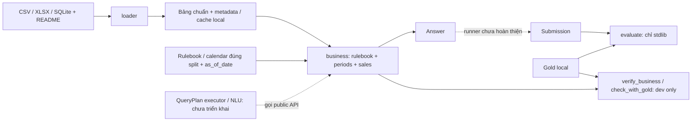

# Kiến trúc và ranh giới DataMate

Nguồn hiện hành: code trong loader/business/evaluate; tiến độ ở [PROGRESS](PROGRESS.md), API chi tiết ở [business](business.md).

Mũi tên trong sơ đồ là luồng dữ liệu/cách gọi, không phải quyền import ngược. Root scripts ghép các tầng; gold không được chảy vào loader/business.

| Tầng | Trách nhiệm / entrypoint | Dependency cục bộ cho phép |
|---|---|---|
| loader | `load_business`, đọc thô -> parse/type -> mapping -> bảng chuẩn | Nội bộ loader; pandas/numpy/openpyxl và stdlib |
| business | `Rulebook`, `Periods`, `SalesMetrics`, `Answer`; tính tất định trên bảng chuẩn | Nội bộ business; pandas/numpy và stdlib |
| evaluate | Chấm type/format/value; local evaluator chưa được chứng nhận tương đương BTC | Stdlib |
| Root tools | `load_all.py`, `verify_business.py`, `check_with_gold.py`, `generalize_check.py` | Ghép các API phục vụ phát triển/kiểm chứng |
| Harness | `scripts/harness.py`: ngữ cảnh, structural checks, test runner | Stdlib; gọi pytest/verifier qua subprocess |
| Tests | Fixture tổng hợp trong Python/tmp_path; một số ca local_data | Có thể gọi nhiều tầng để kiểm chứng contract |

`business/` không import `loader/`: caller đưa bảng hoặc cache vào API. Loader không biết gold hoặc cách trả lời câu hỏi. Evaluator không phụ thuộc implementation tính toán. Kiến trúc tương lai của executor cần được thêm vào sơ đồ và guard khi module đó thực sự tồn tại.

Các bảng chuẩn chính: `cua_hang`, `don_hang`, `dong_hang`, `mat_hang`, `quy_doi_don_vi`, `khach_hang`. Xem phần schema tương ứng trong [DESIGN](../surveys/DESIGN.md); không tự tạo schema mới từ bản tóm tắt này.

Các contract cần giữ:

- Rulebook/calendar đúng split, as_of_date theo câu hỏi; bản ghi tương lai chưa xảy ra.
- Thiếu dữ liệu có ngữ nghĩa khác với mapping sai, luật chưa hỗ trợ, hoặc agent chưa đủ tự tin. Giữ `unanswerable`, `DataError`, `UnsupportedRule`, abstain tách biệt.
- Dữ liệu đầu vào chỉ đọc; báo cáo từng câu/cache/môi trường không vào Git hoặc CI.
- Không điều kiện hóa theo ID doanh nghiệp/câu hỏi, không fit public test.
- Lệnh context chỉ suy import tĩnh và signatures, không chứng minh mọi data dependency/dynamic dispatch. Đọc source và test các hành vi chịu ảnh hưởng.

Guard trong harness kiểm tra được một phần contract bằng AST và tên file. Các quy tắc nghiệp vụ, tổng quát hóa và chính sách cuộc thi vẫn cần test/review có bằng chứng.
