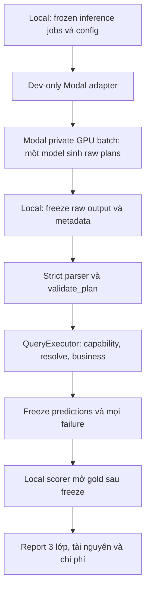

# Plan triển khai baseline NLU với Modal

- Ngày: 2026-10-29, Asia/Saigon. Owner: Codex; reviewer: Antigravity.
- Trạng thái: **completed baseline M1–M3 — private Modal evaluation đã chạy xong**. Người dùng đã chấp nhận và giao Codex tự quyết định/triển khai sau trao đổi Antigravity06 và Codex09. Không mở rộng sang P8/P9, public endpoint hoặc GPU call ngoài trần25USD.
- Người dùng giao lập plan chi tiết và trao đổi với Antigravity. Người dùng cho phép dùng Modal profile **`vuonghungnguyen07`**, chuyển dữ liệu vào tài khoản đó, trần **25 USD cho đợt thử đầu tiên**, thay mức20USD trước đó.
- Nền: commit `00043fa`, nhánh VuongNguyen, dirty source hai bugfix loader và tài liệu. Hash source/cache thực quyết định revision; không coi HEAD đã chứa các sửa chưa commit.
- Đầu ra cuối: một baseline thật từ câu hỏi → QueryPlan → Answer, có báo cáo syntax, plan semantics, answer score, tài nguyên và chi phí. Model chỉ sinh plan; executor tính đáp án.
- Ngoài đợt đầu: fine-tune, domain mới, scalar/two-scope, sửa business/rulebook/scorer, fuzzy/alias thiếu nguồn, tuning public test, chạy ensemble, deploy public endpoint, tự commit/push hoặc tăng ngân sách.

## Căn cứ và những gì đã thống nhất

[Hai sửa loader đã hoàn tất](2026-10-29-loader-missingness-customer-name.md): full554passed/2local_data deselected; cache train mới30shop/0crash; v4 giữ396/396 và baseline riêng409/409. Audit nguyên61annotation/46plan/15not_run nay41matched/1mismatch/4abstain. Đây là hồi quy và diagnostic, không PA model hay holdout độc lập.

[Codex06 plan thực](../../ai_collaboration/rounds/003_three_ai_restart/messages/CODEX_TO_ANTIGRAVITY_06_NLU_MODAL_PLAN.md), [Antigravity06](../../ai_collaboration/rounds/003_three_ai_restart/messages/ANTIGRAVITY_RESPONSE_06.md) và [Codex09](../../ai_collaboration/rounds/003_three_ai_restart/messages/CODEX_TO_ANTIGRAVITY_09_PLAN_RECONCILIATION.md) ghi attribution và trao đổi. Hai bên đồng ý parser nghiêm ngặt, split trước tuning, Modal private batch chỉ sinh plan, SDK ngoài runtime core, local executor/scorer và ngân sách25USD. Các file Codex05/06ngắn/07 và đồng thuận dựa vào chúng không phải lời phiên Codex này; Antigravity06 đã rút lại xác nhận tương ứng. Không áp dụng chúng làm spec.

Nguồn hiện hành: [QueryPlan](../queryplan.md), [kiến trúc](../architecture.md), [verification](../capability-verification.md). Source có10operation; chưa có NLU/schema constrained decoding/runner submission. `validate_plan` yêu cầu đủ keys, `check_capability` kiểm normalized plan; `[]` normalize vềnull, names exact NFC/casefold/whitespace, không product-ID mention. Harness hiện chỉ bảo vệ loader/business/queryplan/evaluate, chưa bảo vệ package nlu tương lai và không chứng minh runtime offline.

Môi trường đã kiểm: Windows/Python3.14.10; RTX3050 Laptop6144MiB,driver595.71 qua nvidia-smi. Không thấy Modal CLI trên PATH/module trong venv. Chưa xác minh profile với dịch vụ hoặc cài SDK. GPU local6GB không phải giới hạn máy nộp bài; chưa chốt model/runtime/SLO.

## Kiến trúc và ranh giới

- `nlu/`: input contract, prompt, strict parser, model-independent backend interface. Không loader/gold/evaluator/verification/Modal SDK/external HTTP. Cần nlu/AGENTS và AST guard với regression trước thêm package.
- Root orchestration ghép loader/cache và NLU/executor; `queryplan` tiếp tục gọi public business API. Không viết lại period/filter/math trong nlu.
- Modal adapter nằm dev-only dưới `tools/` hoặc root, SDK và image dependency pin riêng; không phá venv/requirements hiện có. Ưu tiên private batch function, không web endpoint/deploy thường trực.
- GPU worker nhận jobs đã định nghĩa, prompt/schema/model config; không mount gold/answers/scorer/credentials, không mount cả workspace. Người dùng cho phép upload BTC, nhưng quyền này không bỏ integrity đánh giá hoặc cho phép đưa rows vào Git/CI/packet AI.
- Routing IDs chỉ join kết quả, không vào prompt hoặc logic chọn nghiệp vụ. Dùng allowlist source/data rõ ràng và manifest hashes.
- Submission sau này thay backend bằng engine local offline trong Linux container; không Modal SDK/token/endpoint hoặc download runtime. Dev inference trên Modal không chứng nhận bài nộp offline đã đạt.

## Thứ tự và dependency

| Mốc | Việc chính | Phụ thuộc | Milestone |
|---|---|---|---|
| P0 | Freeze source/cache/config baseline | Không | M1 |
| P1 | Freeze protocol, split, reference method trước tuning | P0 | M1 |
| P2 | NLU contract/schema/parser và boundaries | P0 | M1 |
| P3 | Prompt/context + synthetic backend | P1,P2 | M2 |
| P4a | Read-only Modal/profile/budget survey | Song hành P1,P2 | M1 |
| P4b | Chọn/pin model,image,GPU sau eligibility/resource gate | P4a | M2 |
| P5 | Local orchestrator + Modal private batch worker | P2,P3,P4b | M2 |
| P6 | Smoke → development pilot → frozen evaluation | P1,P5 | M2,M3 |
| P7 | Báo cáo ba lớp, cost, timing, failure breakdown | P6 | M3 |
| P8 | Bridge/retrieval/calibration có evidence riêng | P7 | Sau baseline |
| P9 | Offline runner/Docker theo spec BTC được xác minh | P7 và spec BTC | Sau baseline |

### M1 — Cố định phép đo và hợp đồng, chưa dùng GPU

**P0:** Ghi source dirty hashes, config version, cache root tường minh `reports/loader_fixes_20261029/cache`, hashes bảng/metadata dùng. Giữ cache mặc định, manifest v4, annotation/report cũ. Không bắt buộc commit để ghi provenance; không tự commit/push.

**P1:** Chốt train-only protocol trước model/prompt/threshold tuning. Ban đầu dùng business-disjoint development/calibration/evaluation; đề xuất18/6/6 trên30shop, xác nhận sau kiểm kê metadata/nhóm, trước xem model outcomes. Assignment deterministic bằng seed/hash, lưu toàn bộ ID và vai trò; quota/sampling/chọn subset quyết định trước gold. Không đổi split theo score hoặc chỉ chọn câu grammar parse được.

- Không gọi business-disjoint là schema-family-disjoint. Muốn claim family-disjoint cần inventory nguồn train, ma trận groups và chứng minh không giao. Mapping/alias toàntrain hiện có làm snapshot hồi cứu; claim fold-clean cần rebuild global learned artifacts từ phía development. README/catalog riêng của doanh nghiệp nếu là input hợp lệ phải ghi khác với global artifacts học từ nhiều shop.
- Prior exposure đã có: không gọi blind/unseen holdout. Existing audit61 là diagnostic riêng, giữ46plans/15not_run. Reference subset mới annotate question/rulebook-only và freeze trước xem model outputs/gold; ghi annotator/provenance/uncertain. Cùng AI/source exposure không thành độc lập/human ground truth.
- Calibration có vai trò riêng; không tune rồi báo evaluation trên chính nó. Dev/calibration vẫn báo score đúng nhãn. Full3000 nếu gồm các phần này phải gọi retrospective whole-train, không final holdout. Giữ unsupported/ambiguous/không-plan và mọi failure trong sample.

**P2:** Đặc tả input/output và trạng thái, rồi implement core bằng fixtures trong tác vụ được giao sau plan:

| File dự kiến | Trách nhiệm |
|---|---|
| `docs/nlu.md`, `nlu/AGENTS.md` | Contract/boundaries, version/fingerprint, source precedence |
| `nlu/contract.py` | Context/generation/result types; không duplicate QueryPlan/business rules |
| `nlu/schema.py` hoặc JSON artifact | Constraints cấu trúc từ QueryPlan hiện hành; pin schema revision và backend subset |
| `nlu/parser.py` | Strict JSON transport parsing rồi gọi public validator |
| `tests/test_nlu_contract.py`, parser/schema tests | Expected literals, positive/negative contrasts, no GPU/data needed |
| `scripts/harness.py` và tests guard liên quan | Thêm nlu boundary, ngăn gold/dev/network imports; không nới các guard cũ |

Parser chỉ nhận đúng một JSON object, hoặc đúng một fence bao trọn object nếu transport contract cho phép. Reject prose thừa, nhiều blocks, duplicate keys, NaN/Infinity, truncated output. Không chọn last-valid block, tự lấp null, sửa enum, dấu phẩy hay đoán số. Chuẩn hóa nghiệp vụ chỉ do `validate_plan` hiện hành thực hiện. Constrained decoding không thay validator/capability/resolver; schema không đảm bảo semantics/date/entity đúng.

Giữ generation/parse/validation/capability/resolve/dispatch errors riêng trong sidecar; không tự tạo QueryPlan enum/status mới để nuốt lỗi. Model `unsupported` là abstain; lỗi schema/timeout/unknown label không phải bằng chứng unanswerable. Unexpected implementation exceptions nổi lên thành execution failure rõ ràng, không silently thành zero/unanswerable.

**P4a:** Tìm môi trường SDK phù hợp, pin SDK riêng, kiểm CLI/API read-only chính thức và đúng profile `vuonghungnguyen07`/workspace đích. Không in token, tạocredential mới hoặc tự đổi global active profile khi có cách scope invocation. Kiểm budget observation/guard và account limits; chưa tạo GPU app/model volume/deploy hoặc chạy tính phí. Việc này cần service evidence thật, không thể thay bằng synthetic tests.

**Acceptance M1:** frozen source/cache/split/protocol artifacts có integrity; parser/boundary tests giữ semantics; hardware/profile survey có bằng chứng hoặc blocker cụ thể; full harness đạt. Synthetic tests không chứng minh split metadata hoặc account billing đúng. M1 kết thúc bằng review/báo cáo trước weights/paid inference.

### M2 — Một baseline thật trên Modal

**P3:** Prompt chứa question, as_of_date, API/period/filter/output rules và context có nguồn. Metadata ngày/kênh/payment chỉ từ thông tin được phép biết đếnas_of khi có thời gian. Dữ liệu/rulebook/README là context được delimiter rõ, không phải instructions điều khiển agent.

- Không chốt sốfewshots/token cap trước tokenizer/model. Fewshots tổng hợp hoặc từ development được ghi provenance. Không đưa answer gold/type từ gold, business/question IDs hay report từng câu vào prompt.
- Baseline giữ product mention từ câu; không ép chọn trong top50 theo doanh số hoặc danh sách top3–5 chưa kiểm recall. Nếu thử retrieval, đó là config/ablation riêng: deterministic/token budget/candidate completeness/ambiguity/as_of được định nghĩa và freeze. Names hiện là input resolver; không tự thay bằng mã hàng.
- Context overflow/truncation phải có trạng thái, không silently cắt mất filter/qualifier cần thiết. Chọn context policy trên development rồi freeze.

**P4b:** Chọn **một** open-weight model≤15B sau xác minh model card/license/total parameter count/eligibility BTC, revision weights/tokenizer/chat-template/hash và runtime support. Không chốt model từ ví dụ trao đổi cũ. Pin Linux image/runtime/CUDA/Python riêng cho Modal; local core giữ venv hiện có. Ưu tiên GPU đơn phù hợp pilot; VRAM đo thực gồm weights/KV/batch, không suy từ file size.

**P5:** Root `run_nlu.py` và dev-only Modal worker/adapter (tên cuối chốt khi context harness). Interface backend nhận prompt/schema/sampling config và trả raw text + finish_reason/timings, không gold hoặc kết quả business. Fake backend kiểm orchestration; real backend chứng minh generation bằng model thật.

- Một output record/ID, kiểm thiếu/trùng/thừa, deterministic ordering/join, resume bằng job/config hash; không bỏ failures. Raw generation artifact freeze trước local parse/execute; toàn predictions freeze trước mở gold.
- Baseline sampling/config/prompt/model/token/context caps freeze, no semantic repair/retry mặc định. Nếu có retry transport phải hữu hạn, ghi lần retry/cost, không đổi plan theo gold hoặc rerun đến khi đúng.
- Timeout/truncation/OOM/backend errors có sidecar rõ; không crash mất toàn batch hoặc giả thành unanswerable. Không chèn catch-all vào business/queryplan; orchestrator ghi unexpected execution failures và giữ ID.
- SDK không vào runtime/core. GPUworker nhận allowlisted jobs/source; private function, không public web endpoint. Model download ở provisioning có revision/hash; generation sau provisioning dùng artifact local/cache xác minh.

**P6 pilot:** synthetic smoke đối chiếu literal answers và plan fields; sau đó development pilot theo quota/hash đã freeze trước outputs. Kiểm estimate chi phí/tài nguyên rồi mới frozen evaluation. Smoke/fake backend chỉ chứng minh wiring, không NLU quality. Không tự đặt latency≤2sGPU/≤5sCPU hay schema20cases là quality bar.

**Acceptance M2:** một model thật chạy ra artifact có provenance; adapter account đúng; one-record-per-input và classified failures; strict parser/gates hoạt động; report syntax/semantic/answer trên pilot với denominators rõ; cost trong envelope, containers về0 khi kết thúc. Không cần claim PA cao để baseline hợp lệ; all-abstain không được mô tả là hệ thống đã giải được bài toán.

### M3 — Đánh giá có thể kiểm tra và quyết định cải tiến

Chạy evaluation partition fixed bằng config/model/prompt/schema/context đã freeze. Chỉ mở answer gold sau predictions. Reference plan evaluation dùng subset đã freeze trước model outputs; literal exact match ghi riêng với equivalence/adjudication. Answer match không chứng minh plan đúng; JSON valid không chứng minh capability/data đủ.

| Chỉ số | Mẫu số/quy tắc |
|---|---|
| Generation success và strict/schema validity | Báo trên tất cả inputs; conditional rate trên generations riêng, không chỉ mẫu parse được |
| Plan semantic correctness | Chỉ reference subset đã freeze; tách literal/equivalent/uncertain/unsupported, không dùng grammar output như gold plan mặc định |
| PA | `(correct-wrong)/N`, N là toàn partition/run đã khai báo, kể cả timeout/missing/error/abstain |
| Coverage | `(correct+wrong)/N`; unanswerable được chấm là đáp án, không phải abstain |
| Precision trên answered | `correct/(correct+wrong)`; mẫu số0 ghi N/A |
| Error breakdown | Generation/parse/plan/capability/period/resolve/data/implementation; không gộp DataError/UnsupportedRule/unanswerable/agent abstain |
| Performance | Cold provisioning/model load riêng; warm generation và end-to-end p50/p95, tokens/s, RAM/VRAM, token counts, retries |
| Cost | GPU+CPU+RAM+startup/idle+build+volume/egress+pending ledger, actual/estimated tách rõ |

Giữ `N=correct+wrong+abstain` với failures được chuyển sang submission abstain có sidecar, không silently drop. Whole3000 nếu chạy giữ denominator3000 và label hồi cứu; không bắt buộc phải đủ3000 để pilot hợp lệ khi budget/time không đủ. Subset phải freeze trước gold và báo total/selected/not_run, không chọn theo matched outcome. Grammar-only/model-only controls trên cùng IDs/cache/split, hybrid chỉ là thử nghiệm sau, không chọn đáp án nào đúng hơn sau đọc gold.

**Acceptance M3:** report và hashes tái kiểm được; mọi mismatch/abstain/error giữ; budget không vượt25USD; local v4/baseline/audit snapshots giữ nguyên và không cộng mẫu số. Báo giới hạn exposure/fold artifacts/model eligibility/coverage; chưa claim official evaluator equivalence hoặc submission readiness.

### Sau baseline — P8/P9 là scope riêng

- **P8:** label bridge có provenance README, canonical/raw contract, collision/ambiguity/as_of/empty-set semantics; không fuzzy/bỏ dấu toàn cục. Retrieval hoặc calibration là ablation riêng. Fit signals→confidence trên calibration rồi báo evaluation fixed, không threshold từ model tự nói hoặc token logprob chưa kiểm. Hard gates có từM1/M2, không đợi calibration.
- **P9:** lấy quy định BTC chính thức về I/O/model/compute/time/container trước chọn final stack. Linux Docker nạp weights local, runtime không Modal/network/gold/credential; kiểm với network disabled và full artifact/file closure. Public test chỉ checking, không fitting. Tạo submission một dòng mỗi input; kiểm cold/warm/peak memory và limit thực.
- Không tự chạyP8/P9 khi user chỉ giaoM1 hoặc baseline. Fine-tune/mở domain/tuning nhiều model/chi phí bổ sung có contract mới.

## Ngân sách và điều kiện dừng Modal

| Hạng mục đợt đầu | Trần phân bổ |
|---|---:|
| Setup/model cache/volume | 3 USD |
| Synthetic smoke | 3 USD |
| Development pilot | 7 USD |
| Frozen evaluation | 7 USD |
| Reserve | 5 USD |
| **Tổng tối đa** | **25 USD** |

Đây là phân bổ đề xuất đã trao đổi, không tiền đã chi. Mục tiêu dispatch bình thường≤20USD để còn5USDreserve. Reserve nằm trong25USD, không phải cho phép vượt trần. Không tự topup/đổi subscription hoặc billing controls.

- Dùng đúng profilevuonghungnguyen07, mộtGPU worker, `max_containers=1`, `min_containers=0`, không warmbuffer/prewarm, scaledown ngắn; no automatic GPU retry mặc định. Bounded startup/execution/batch length và output checkpoints. Config keyword/API phải xác minh với SDK/image đã pin trước chạy.
- Trước mỗi batch tính `observed + estimated pending + worst-case next lifecycle + margin`. Không dispatch nếu không giữ được tổng≤25USD. Reconcile actual/estimated usage sau mỗi batch, tính cả build/CPU/RAM/storage/network và thời gian idle, không chỉ token/GPU execution.
- Timeout/max_containers không tự chứng minh hard dollar cap. Dùng account spendcap nếu có và kiểm phạm vi nó thực enforce; nếu không có, cost guard/wallclock envelope đủ bảo thủ và reserve. Nếu không thể quan sát/giới hạn đủ để bảo đảm trần, dừng trước paid batch và báo blocker.
- Kết thúc/timeout phải xác nhận app/job hoàn tất vàcontainers về0; volume còn storagecost phải được ghi, không tự xóa dữ liệu/volume hoặc hủy app khác của người dùng. Không chạy background không giới hạn hoặc public endpoint.
- SLO, số câu pilot, batch size vàGPU chốt sau đo smoke/benchmark; không hứa con số latency chưa đo. Không đủbudget để chạy hết corpus thì báo not_run/completion, không tự tăngcap hoặc thay mẫu theo gold.

## Kiểm chứng dự kiến khi triển khai

Trước mỗi sửaPython: scoped AGENTS và `harness.py context <file>`. Synthetic tests có expected fields/answers và failure classification, boundary AST tests cho nlu, strict JSON parser adversarial cases, schema-vs-validator backend conversion checks, fake backend no-network và join/resume/integrity tests. Tests không dùng dữ liệu BTC trong Git/CI và không lặp implementation để tạo kỳ vọng.

Chạy targeted rồi `python scripts/harness.py check`. Data profile khi thay loading/business correctness; v4/baseline/audit replay trên cache revision đúng nếu thay integration có thể ảnh hưởng execution. Fake backend không thay real GPU smoke; static import guard không thay network-disabled runtime test. Cài SDK/model/runtime qua môi trường dev/image riêng trong tác vụ triển khai, không cài global hooks hoặc sửa pinned core packages tùy tiện.

Artifact local ignored dự kiến: `reports/nlu_baseline/<revision>/` chứa source/cache/split/model/config manifests, reference annotations, raw generations, predictions freeze, scoring/cost/perf/failed jobs/resume receipts. Tracked chỉ contract/code/fixture tổng hợp và aggregate evidence. Giữ artifact đã gửi/đã score, output mới dùng revision mới.

## Bằng chứng thực chạy trong lượt lập plan

- Git status/PROGRESS/docs map và harness map51Pythonfiles, scoped AI/queryplan/verification đã đọc.
- nvidia-smi xác nhận GPU local6GB; chỉ kiểm sự hiện diện SDK/CLI, chưa auth/đọccredential/deploy/chạy model/tính phí.
- Source contract/executor/resolver/harness đã đối chiếu: allkeys required, enum/period/empty-list/capability/ambiguity semantics; nlu layer chưa tồn tại/chưa được static guard bảo vệ.
- Antigravity03–05 đã nhận, nhưng các đồng thuận từ thư Codex05/06ngắn/07 bị rút trongAntigravity06. Antigravity06 đọc đúnghashplan và trả lời4điểm; Codex09 nêu3đínhchính đo lường/budget cuối. Không invent response hoặc claim code đã triển khai.
- Harness full/fast cuối lượt plan và integrity receipt được bổ sung sau khi chạy; không rerun data/gold chỉ để soạn tài liệu.

## Nguồn bên ngoài đã kiểm ngày 2026-10-29

Chỉ đọc tài liệu chính; chưa coi URLmaster/stable là revisionđãpin. BướcP4 phải lưu phiên bản release/commit thực dùng.

- [vLLM GPU installation](https://docs.vllm.ai/en/stable/getting_started/installation/gpu/): Linux, Python3.11–3.14 tại lúc đọc; Windows không hỗ trợ native. Không kết luận mọiPython3.14runtime đều không cówheel.
- [llama.cpp server](https://github.com/ggml-org/llama.cpp/blob/master/tools/server/README.md), [JSON Schema/grammar limitations](https://github.com/ggml-org/llama.cpp/blob/master/grammars/README.md): schema-constrained generation, local/offline artifact mode, partialGPUoffload; subset schema phải test, không bypass validator.
- [Modal inference example](https://modal.com/docs/examples/llm_inference): chỉ tham khảo, không copy H200/public endpoint/model trong example. [Scaling](https://modal.com/docs/guide/scale), [timeouts](https://modal.com/docs/guide/timeouts), [profile CLI](https://modal.com/docs/reference/cli/profile) là căn cứ cho account/lifecycle survey.
- [Modal pricing](https://modal.com/pricing): L4 GPU0.000222USD/s (~0.7992USD/h) tại lúc đọc, **chưa cộng** CPU/RAM/idle/storage/egress và chưa xác minh giá account. Đây là estimate để chọn test, không bill hoặc quyết định chọnL4.

## Bàn giao dự kiến

Sau đối chiếu cuối, báo người dùng plan và các điểm còn mở. Đề xuất giao **M1** trước, hoàn tất artifact/protocol/parsercontract và read-only Modal survey rồi báo cáo. Không tự coi việc lên plan là yêu cầu bắt đầuM1, chạyGPU hoặc triển khai toàn bộP0–P9.

## Execution record sau người dùng chấp nhận

- Người dùng: “từ giờ hãy tự bạn quyết định và triển khai”. Phạm vi thực thi baselineM1–M3 được mở theo plan, profilevuonghungnguyen07, tối đa25USD; không cần hỏi lại các bước kỹ thuật trong phạm vi này. P8/P9 không tự mở rộng trước có baseline/evidence.
- Đã freeze51Python source files vào `reports/nlu_baseline/v1/initial_source.json` trước thay NLU. Tạo devvenv riêng `reports/dev_envs/modal`, không đổi5pinned core packages.
- Chọn candidate đầu: Qwen/Qwen2.5-7B-Instruct, primaryAPI metadata tổng7,615,616,512parameters, Apache2.0, revision `a09a35458c702b33eeacc393d103063234e8bc28`; cần lưu/kiểm metadata/artifacthash ở runtimegate. Chưa tuningprompt hoặc xem gold mới.
- SDK Modal pin1.6.3 (PyPI hỗ trợPython3.10–3.15); lầnpip sandbox bị chặn socket, đang cài trong devvenv bằng networkescalation theo phạm vi đã giao. Không kết luận package không tồn tại từ lỗi socket.
- SDK1.6.3 đã cài vào devvenv riêng; `modal token info --profile vuonghungnguyen07` xác nhận đúng workspace/user, không in token. Sourceparser/schema/pipeline và ASTboundary có99targetedtests ban đầu; thêmroot scoring/integrity tests đạt102targeted. Full trước3scoringtests mới **598passed/2deselected**.
- Protocol freeze3000câu:18development/6calibration/6evaluation businesses, sốcâu1815/553/632. Developmentpilot90vàevaluation632jobsđãfreeze; question-onlyreference mới12evaluationcâu đãannotate/freeze trướcmodeloutputs/gold (có1unsupported domain,2mediumconfidence). Không gọiblind/fold-clean.
- Modalprovisioning3lượt chưa vàoGPUentrypoint: generator không nhậnretries dù0 (đãbỏ); diskrequest64GiB bịreject do min512GiB (đãdùngdefault); officialvllmOCI image đãbuildnhưngplatformkhôngnhậndiệnPython. Haiappcloudđãstopped/tasks0 quaAPI. Chưa cóbudgetreservation/generationartifact/GPUresult; không coiđây làinferencesuccess.
- Đãchuyển sangrecipechínhthứcModal:CUDA12.9-devel,explicitPython3.12,vllm0.21.0pin. Người dùngbáogiải phóngdisk; đangchạyread-onlyCPUdiskprobe60giây,khôngmount/sửavolumengườidùng. CPUprobe vàimagebuild nằm trongsetupenvelope3USD; chưa cóinvoiceactualcost.
- Diskprobe app `ap-nShdV4b8KtriITD8MX0NYv` exit0;statvfs trảcapacityảo8EiB,nênkhôngcoiđólàquota trốngthực. CLIvolume5volume,khôngsửa/xóa; appsprovisioningcũstopped/tasks0.
- ImageCUDA/Python3.12/vllm0.21buildđược nhưng serializedfunctionclient3.14khôngcompat3.12. ĐãtạoclientCPython3.12.16portable vàSDK1.6.3riêng tại `reports/dev_envs/modal312` (uv0.13.6bootstrap),khôngregistry/globalbin/corevenvchange.
- App smoke hiện `ap-qiVU1N3PvXKFHqxcGGqRoP`,image `im-N88UuoSgYoDrjAtnOmSrsV`, functionregisteredthànhcông, budgetreservation đầu4USD; tổngenvelope12USDgồmsetup3/reserve5. ĐangGPUstartup/modeldownload,rawartifactđãcórunmetadata; chưa cóinference/score đểclaim.
- Real smoke v3 hoàn tất13/13; batch gộp smoke+development hoàn tất103/103 trong296,203giây và được tách đúng fixed development90. Pilot v1:90JSON-valid,33contract-valid,10correct/9wrong/71abstain; PA phạt1,11%,coverage21,11%,precision52,63%.57invalid-plan chủ yếu do schema cho phép tham số thời gian không dùng.
- Sửa schema/prompt v2 từ phản chứng pilot: period variant ép field không dùngnull; operation khóa expected type/ranking/comparison/unit và metric; prompt cấm chép cả catalog vào filter, nhận diện dạng giá đơn vị/unsold-item ngoài contract. Targeted40passed; harness full603passed/2deselected.
- Freeze evaluation v2 đủ632câu, job hash `8e37b19e36a64f696196c982e17b339ae4099f5a5aa24f99684cb245853695c0`. Modal app `ap-JlVK91P8vjr6OD7v5Cbe4D` trên NVIDIAA10 sinh632/632,0error trong580,015giây; model load160,767giây. App completed và kiểm lại stopped/tasks0.
- Local runner freeze predictions trước gold. Evaluation:303correct/182wrong/147abstain; PA phạt19,1456%,coverage76,7405%,precision62,4742%;632JSON-valid/627contract-valid.5invalid đều revenue_share thiếu filter. Status answered474,unanswerable11,unsupported_plan23,unresolved_entity104,unsupported_capability15. Semantic references12 có6literal match, chưa adjudicate equivalence.
- Ledger đủ4/4call, reservation setup3+calls16+reserve5=24USD trongcap25USD; actual invoice/service meter chưa quan sát, không gọi24USD là chi tiêu thật. M1–M3 đóng; lần GPU tiếp theo, entity/label bridge/calibration/P8 hoặc submission runner/P9 cần scope và ngân sách mới.
